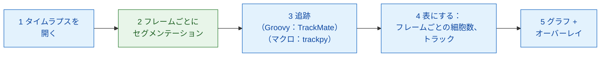
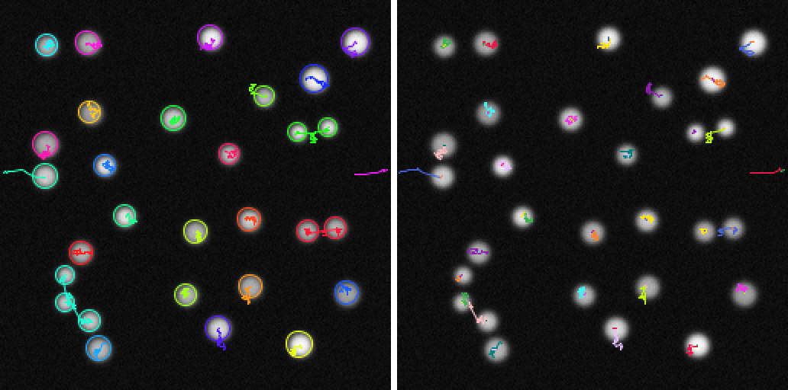

# Fiji でパイプライン

!!! question "このパイプラインが測るもの"
    分裂する核のタイムラプスで、**細胞数（y）と時間（x）** の関係を測ります。
    もう一つの見方として、**系譜** の数も数えます。系譜とは、最初の細胞 1 個と
    その娘細胞すべてのことです。下のどのステップも、この出力に必要だから
    あります（[解析の前に](index.md) を参照）。

## やさしく言うと

画像解析はいくつものコースからなるディナーです。各ステップ（開く、
セグメンテーション、トラッキング、数える、プロット）が一皿ずつのコースで、
すべてのコースが同じ厨房から出てくるとは限りません。ここでは、ウェイターである Fiji が食事のほとんどを
自分で出します。動画を開き、細胞を追跡し、数を数え、結果を描きます。Wavu の
厨房（`examples/segment_frames`、専用の環境で動きます）に注文するのは、
**すべてのフレームで核を見つける** という 1 品だけです。マクロ版では、もう
1 品の追跡（trackpy）もそこに注文します。TrackMate 自体は、Groovy や Jython
の [スクリプト用インターフェース](https://imagej.net/plugins/trackmate/scripting/scripting)
を通して、Fiji の中のスクリプトから問題なく動かせます。Groovy 版がそうして
います。ただ、ImageJ マクロ言語からはそのインターフェースに手が届かないのです。

手順は小さな **DAG**（directed acyclic graph、有向非巡回グラフ）になります。
箱が結果を次の箱へ渡し、後ろへ戻るループはありません。



青い箱は Fiji 自身のコマンド、緑の箱は Wavu スクリプトです。マクロ版では
ステップ 3 も緑になります（`examples/track_trackpy`）。

## 始める前に

1. **Fiji に Wavu が入っていること：** [Fiji に Wavu をインストールする](../fiji/install.md)
   を見てください。マクロでは **Plugins › Wavu › Run Script (Macro)** の
   `tables` 欄を使います。ダイアログに **Tables** 欄がなければ、wavu-fiji を
   更新してください。
2. **サンプルフォルダーを手に入れます。** Wavu リポジトリを VS Code で開くと、
   VS Code がクローンしてくれます。または zip でダウンロードして解凍します。

   [Wavu リポジトリを VS Code で開く](vscode://vscode.git/clone?url=https%3A%2F%2Fgithub.com%2FOxford-Zeiss-Centre-of-Excellence%2FWavu.git){ .md-button .md-button--primary }
   [ZIP をダウンロード](https://github.com/Oxford-Zeiss-Centre-of-Excellence/Wavu/archive/refs/heads/main.zip){ .md-button }

   `examples/segment_frames`（マクロでは
   `examples/track_trackpy` も）は **置かれている場所のまま** 使ってください。
   その `pixi.toml` が、2 つ上のフォルダーにある Wavu を見つけるからです。
3. **データ：** `examples/data/demo_timelapse.tif` は、このページのために
   作った合成の動画です。256 × 256 ピクセルのフレームが 30 枚、1 ピクセル
   0.65 µm、1 フレーム 5 分です。約 25 個の核があちこちへ漂い、そのうち 4 個が
   分裂し、1 個が右から出ていき、1 個が左から入ってきます。本当の数は最初が
   25、最後が 29 です。

   { width="256" }

4. Groovy 版には **TrackMate** が必要です。Fiji に付属しています。

最初の実行では、各フォルダーの調理器具をそろえます（1、2 分、一度だけ）。

## パイプライン

=== "Groovy"

    **File › New › Script…** を開き、**Language › Groovy** を選んで貼り付け、
    **Run** を押します。Fiji が動画、`segment_frames` フォルダー、出力
    フォルダーを尋ねます。

    ```groovy
    #@ File (label = "Time-lapse (T, Y, X)", style = "file") timelapse
    #@ File (label = "segment_frames folder", style = "directory") segmentDir
    #@ File (label = "Output folder", style = "directory") outDir
    // Fiji での最小限の動的な細胞計数：
    // 開く -> セグメンテーション (Wavu) -> 追跡 (TrackMate) -> 表にする -> グラフ + オーバーレイ。
    import fiji.plugin.trackmate.Logger
    import fiji.plugin.trackmate.Model
    import fiji.plugin.trackmate.Settings
    import fiji.plugin.trackmate.TrackMate
    import fiji.plugin.trackmate.detection.LabelImageDetectorFactory
    import fiji.plugin.trackmate.tracking.jaqaman.SparseLAPTrackerFactory
    import ij.IJ
    import ij.ImagePlus
    import ij.gui.Line
    import ij.gui.OvalRoi
    import ij.gui.Overlay
    import ij.gui.Plot
    import ij.measure.ResultsTable
    import java.awt.Color

    // Wavu のスクリプト用ライブラリ（wavu-fiji と一緒にインストールされます）。
    def wavu = new GroovyShell(this.class.classLoader).evaluate(
            new File(IJ.getDirectory("imagej"), "scripts/Plugins/Wavu/lib/wavu_lib.groovy.txt"))

    try {
        // 1. タイムラプスを開く（Fiji 標準）。
        def imp = IJ.openImage(timelapse.path)
        def cal = imp.getCalibration()
        double dt = cal.frameInterval > 0 ? cal.frameInterval : 1   // 1 フレームあたりの分
        int nFrames = imp.getNFrames()

        // 2. 全フレームをセグメンテーション（Wavu：examples/segment_frames を専用の環境で）。
        Map seg = wavu.run(segmentDir, "script", [sigma: 2, threshold: "otsu", min_area: 30], [image: imp])
        def labels = seg.images.labels                    // uint16 のラベルスタック、時点ごとに 1 フレーム
        labels.setCalibration(cal.copy())                 // 同じピクセルサイズとフレーム間隔

        // 3. ラベル付けした核を追跡（Fiji 標準：TrackMate）。
        def model = new Model()
        model.setLogger(Logger.VOID_LOGGER)
        def settings = new Settings(labels)
        settings.detectorFactory = new LabelImageDetectorFactory()
        settings.detectorSettings = settings.detectorFactory.getDefaultSettings()
        settings.detectorSettings["TARGET_CHANNEL"] = 1
        settings.detectorSettings["SIMPLIFY_CONTOURS"] = false
        settings.trackerFactory = new SparseLAPTrackerFactory()
        settings.trackerSettings = settings.trackerFactory.getDefaultSettings()
        settings.trackerSettings["LINKING_MAX_DISTANCE"] = 10d     // マイクロメートル
        settings.trackerSettings["ALLOW_GAP_CLOSING"] = true
        settings.trackerSettings["GAP_CLOSING_MAX_DISTANCE"] = 10d
        settings.trackerSettings["MAX_FRAME_GAP"] = 2              // フレーム
        settings.trackerSettings["ALLOW_TRACK_SPLITTING"] = true   // 分裂
        settings.trackerSettings["SPLITTING_MAX_DISTANCE"] = 10d
        def trackmate = new TrackMate(model, settings)
        if (!trackmate.checkInput() || !trackmate.process())
            throw new RuntimeException("TrackMate: " + trackmate.getErrorMessage())
        def tm = model.getTrackModel()
        def trackIds = tm.trackIDs(true)

        // 4. 表にする：フレームごとの細胞数と、トラックごとに 1 行。
        def counts = new ResultsTable()
        List<Integer> perFrame = []
        for (int t = 0; t < nFrames; t++) {
            int n = model.getSpots().getNSpots(t, true)
            perFrame << n
            counts.addRow()
            counts.addValue("frame", t)
            counts.addValue("time_min", t * dt)
            counts.addValue("cells", n)
        }
        def tracks = new ResultsTable()
        int divisions = 0
        trackIds.each { id ->
            def spots = tm.trackSpots(id)
            // 分裂：後のフレームの 2 つのスポットにつながっているスポット。
            int splits = spots.count { s -> tm.edgesOf(s).count { e -> tm.getEdgeSource(e) == s } > 1 }
            divisions += splits
            def frames = spots.collect { it.getFeature("FRAME") as int }
            tracks.addRow()
            tracks.addValue("track", id)
            tracks.addValue("spots", spots.size())
            tracks.addValue("first_frame", frames.min())
            tracks.addValue("last_frame", frames.max())
            tracks.addValue("divisions", splits)
        }
        counts.show("Cells per frame")
        tracks.show("Tracks")
        counts.save(new File(outDir, imp.getShortTitle() + "-counts.csv").path)
        tracks.save(new File(outDir, imp.getShortTitle() + "-tracks.csv").path)

        // 5a. フレームごとの細胞数を時間に対してプロット。
        def plot = new Plot("Cells per frame", "time (" + (cal.getTimeUnit() ?: "frame") + ")", "cells")
        plot.setColor(new Color(0x1565c0))
        plot.setLineWidth(2)
        double[] times = (0..<nFrames).collect { it * dt } as double[]
        plot.add("line", times, perFrame as double[])
        plot.add("circle", times, perFrame as double[])
        plot.setLimits(0, (nFrames - 1) * dt, 0, perFrame.max() + 5)
        plot.show()
        IJ.saveAs(plot.getImagePlus(), "PNG", new File(outDir, imp.getShortTitle() + "-counts.png").path)

        // 5b. 元の画像に各トラックの経路を描き（トラックごとに 1 色）、
        //     核がいるフレームでは、その核を円で囲む。
        double px = cal.pixelWidth
        def overlay = new Overlay()
        trackIds.each { id ->
            def colour = Color.getHSBColor((float) ((id * 0.618034) % 1), 0.9f, 1f)
            tm.trackEdges(id).each { e ->
                def a = tm.getEdgeSource(e), b = tm.getEdgeTarget(e)
                def line = new Line(a.getDoublePosition(0) / px, a.getDoublePosition(1) / px,
                                    b.getDoublePosition(0) / px, b.getDoublePosition(1) / px)
                line.setStrokeColor(colour)
                overlay.add(line)                                   // 全フレームに：経路全体
            }
            tm.trackSpots(id).each { s ->
                double r = s.getFeature("RADIUS") / px
                def ring = new OvalRoi(s.getDoublePosition(0) / px - r, s.getDoublePosition(1) / px - r, 2 * r, 2 * r)
                ring.setStrokeColor(colour)
                ring.setPosition(1, 1, (s.getFeature("FRAME") as int) + 1)   // そのスポットのフレームだけに
                overlay.add(ring)
            }
        }
        imp.setOverlay(overlay)
        IJ.run(imp, "Grays", "")
        // 最後のフレームを、描いたものごとスナップショットにする。
        imp.setT(nFrames)
        def last = new ImagePlus("last frame", imp.getProcessor().duplicate())
        last.setOverlay(new Overlay())
        overlay.each { roi -> if (roi.getTPosition() in [0, nFrames]) last.getOverlay().add(roi) }
        IJ.saveAs(last.flatten(), "PNG", new File(outDir, imp.getShortTitle() + "-tracks.png").path)
        imp.show()
        labels.close()

        IJ.log("Cells per frame: " + perFrame.join(" "))
        IJ.log(trackIds.size() + " tracks, " + divisions + " divisions")
    } finally {
        wavu.stopAll()                                               // ワーカーを止める
    }
    ```

    ステップ 3 は、TrackMate の
    [スクリプトのページ](https://imagej.net/plugins/trackmate/scripting/scripting)
    にあるように、TrackMate をコードから動かします。*label image detector*
    （ラベル画像検出器）が各ラベルを 1 つのスポットに変え、*LAP tracker* が
    スポットをつないでトラックにします。

=== "ImageJ macro"

    **File › New › Script…** を開き、**Language › IJ1 Macro** を選んで
    貼り付け、**Run** を押します。マクロが動画、`segment_frames` フォルダー、
    `track_trackpy` フォルダー、出力フォルダーを尋ねます。

    ```javascript
    // Fiji での最小限の動的な細胞計数（ImageJ マクロ版）：
    // 開く -> セグメンテーション (Wavu) -> 追跡 (Wavu: trackpy) -> 表にする -> グラフ + オーバーレイ。
    // スクリプトエディターから実行する（ファイルを尋ねます）か、コマンドラインから実行します：
    //   ImageJ-win64.exe --console -batch dag_counting.ijm "<time-lapse>|<segment_frames>|<track_trackpy>|<output folder>"
    arg = getArgument();
    if (arg == "") {
        timelapse = File.openDialog("Choose the time-lapse (T, Y, X)");
        segmentDir = getDirectory("Choose the segment_frames folder");
        trackDir = getDirectory("Choose the track_trackpy folder");
        outDir = getDirectory("Choose the output folder");
    } else {
        a = split(arg, "|");
        timelapse = a[0]; segmentDir = a[1]; trackDir = a[2]; outDir = a[3] + "/";
    }
    setBatchMode(true);

    // 1. タイムラプスを開く（Fiji 標準）。
    open(timelapse);
    movie = getImageID();
    name = File.nameWithoutExtension;
    dt = Stack.getFrameInterval();
    if (dt == 0) dt = 1;
    Stack.getUnits(xu, yu, zu, timeUnit, vu);
    Stack.getDimensions(w, h, channels, slices, frames);

    // 2. 全フレームをセグメンテーション（Wavu：segment_frames）。<name>-labels、
    //    <name>-detections、<name>-count_per_frame が開く。
    run("Run Script (Macro)", "folder=[" + segmentDir + "] script=script params=[sigma=2 threshold=otsu min_area=30]");

    // 3. detections の表を渡して追跡（Wavu：track_trackpy）。"tracks" が開く。
    //    search_range の単位は 1 フレームあたりのピクセル：ここでは 15 px ≈ 10 マイクロメートル。
    run("Run Script (Macro)", "folder=[" + trackDir + "] script=script params=[search_range=15 memory=2] tables=[detections=" + name + "-detections]");

    // 4. tracks の表から、フレームごとの細胞数とトラック数を表にする。
    n = Table.size("tracks");
    cells = newArray(frames);
    times = newArray(frames);
    nTracks = 0;
    for (i = 0; i < n; i++) {                          // 行は particle、次に frame の順に並んでいる
        t = Table.get("frame", i, "tracks");
        cells[t] = cells[t] + 1;
        if (i == 0 || Table.get("particle", i, "tracks") != Table.get("particle", i - 1, "tracks"))
            nTracks++;
    }
    Table.create("Cells per frame");
    for (t = 0; t < frames; t++) {
        times[t] = t * dt;
        Table.set("frame", t, t);
        Table.set("time_" + timeUnit, t, times[t]);
        Table.set("cells", t, cells[t]);
    }
    Table.update;
    Table.save(outDir + name + "-counts.csv");

    // 5a. フレームごとの細胞数を時間に対してプロット。
    Plot.create("Cells per frame", "time (" + timeUnit + ")", "cells");
    Plot.setColor("#1565c0");
    Plot.setLineWidth(2);
    Plot.add("line", times, cells);
    Plot.add("circle", times, cells);
    Array.getStatistics(cells, cmin, cmax);
    Plot.setLimits(0, (frames - 1) * dt, 0, cmax + 5);
    Plot.show();
    saveAs("PNG", outDir + name + "-counts.png");

    // 5b. 元の画像に各トラックの経路を描く（トラックごとに 1 色）。
    selectImage(movie);
    run("Grays");
    palette = newArray("#e6194b", "#3cb44b", "#ffe119", "#4363d8", "#f58231", "#911eb4",
                       "#46f0f0", "#f032e6", "#bcf60c", "#fabebe", "#008080", "#e6beff");
    Overlay.remove;
    for (i = 1; i < n; i++) {
        p = Table.get("particle", i, "tracks");
        if (Table.get("particle", i - 1, "tracks") != p) continue;
        setColor(palette[p % palette.length]);
        Overlay.drawLine(Table.get("x", i - 1, "tracks"), Table.get("y", i - 1, "tracks"),
                         Table.get("x", i, "tracks"), Table.get("y", i, "tracks"));
    }
    Overlay.show;
    Stack.setFrame(frames);                            // 最後のフレーム（トラックを描き込んだもの）
    run("Flatten", "slice");
    saveAs("PNG", outDir + name + "-tracks.png");
    close();
    setBatchMode("exit and display");

    counts = "" + cells[0];
    for (t = 1; t < frames; t++) counts = counts + " " + cells[t];
    print("Cells per frame: " + counts);
    print(nTracks + " tracks");
    run("Stop Worker");                                // 両方のワーカーを止める
    ```

    2 つ目の `run("Run Script (Macro)", …)` には送る画像がありません。代わりに
    **表** を送ります。`tables=[detections=demo_timelapse-detections]` は
    「スクリプトの入力 `detections` に、`demo_timelapse-detections` という
    題名の開いている表を渡す」という意味で、これは最初のステップが開いた表です。
    画像なしの呼び出しの結果は出力の名前だけで名付けられるので、トラックは
    `tracks` という表として届きます。

リポジトリにあるコピー `tests/fiji/dag_counting.groovy` と
`tests/fiji/dag_counting.ijm` は、同じコードの最後に、テストが探す `print` 行を
1 行加えたものです。

## 表示されるもの

- **グラフのウィンドウ** *Cells per frame*：分単位の時間に対する細胞数です。
  デモでは 25 から 29 まで階段状に増えます。分裂や流入のたびに 1 段上がり、
  核が 1 つ出ていくときに一度下がります。
- **トラックが描かれた動画。** 各トラックの経路が、それぞれの色の線として
  全フレームに描かれるので、各核がどこにいたか、どこへ向かうかが分かります。
  Groovy 版では、核がいるフレームでその核を円で囲みます。
- **表：** *Cells per frame*（frame、time、cells）と、Groovy では *Tracks*
  （トラックごとのスポット数、最初と最後のフレーム、分裂の数）。マクロでは
  Wavu の表 `demo_timelapse-detections`、`demo_timelapse-count_per_frame`、
  `tracks` も表示されます。
- 出力フォルダーの **ファイル：** `demo_timelapse-counts.csv`、
  `demo_timelapse-counts.png`（グラフ）、`demo_timelapse-tracks.png`
  （トラックを描いた最後のフレーム）、そして Groovy では
  `demo_timelapse-tracks.csv` も。

デモでは、どちらの版も次の結果を出します。

| | フレームごとの細胞数 | トラック |
|---|---|---|
| Groovy（TrackMate） | 25 → 29 | 26、分裂 4 回 |
| マクロ（trackpy） | 同じ | 30 |

数は、フレーム 9（26、正解は 25）とフレーム 17–18（28、正解は 27）を除いて
正解と一致します。そこでは核が半分画像の外にはみ出しています。正解のほうは
中心が内側に入ってから数えますが、しきい値処理は見えている部分を何でも
数えます。トラックの数が違うのは、2 つのトラッカーが分裂を別々に扱うから
です。TrackMate（分岐をオンにした場合）は 1 本のトラックを枝分かれさせるので、
25 個の核と新しく入ってきた 1 個で 26 本になります。trackpy は 2 つの娘細胞の
片方に新しいトラックを始めるので、4 回の分裂で 4 本増えます。

{ width="720" }

左は、各トラックの尾が付いた動画（trackpy）です。右は測定値、つまり
**細胞数と時間** のグラフです。灰色の破線：本当の数。青い点：測った細胞数で、
どの方法でも同じです。どれも同じセグメンテーションを数えるからです。
オレンジの線：各フレームで生きている **TrackMate の系譜** の数。点とオレンジの
線の差は分裂で生まれた細胞の数で、4 回の分裂のたびに 1 つずつ広がります。
系譜の線は、50 分で核が 1 個出ていくと下がり、85 分で 1 個入ってくると
戻ります。

{ width="720" }

すべてのトラックを描いた最後のフレームです。左の TrackMate では、分裂の
あとも 2 つの娘細胞が母細胞の色のままです。母細胞のトラックに属している
からです（枝分かれする系譜）。右の trackpy では、娘細胞ごとに自分の
トラックが付くので、トラックはあっても系譜はありません。

## ヒント

- **実データでは、パイプラインではなく厨房を替えます。** `segment_frames`
  を、同じくラベル画像を返す `examples/cellpose_nuclei` に替えてください。
  Groovy では `wavu.run` の行のフォルダーとパラメーター
  （`[diameter: 30, use_gpu: false]`）を変えます。TrackMate はどこから来た
  ラベルでも受け取ります。Cellpose は 1 回の呼び出しで 2-D 画像を 1 枚
  処理するので、フレームをループするか、内部でループする小さなスクリプトを
  書いてください。
- **TrackMate の設定** の単位はマイクロメートルです。`LINKING_MAX_DISTANCE` は
  フレーム間で核が動ける距離（ここでは 10 µm）、`MAX_FRAME_GAP` は核が
  消えていてよいフレーム数（2）で、`ALLOW_TRACK_SPLITTING` が分裂を
  とらえます。`ALLOW_TRACK_MERGING` は、物体が本当に融合する場合だけオンに
  してください。
- **trackpy の設定** の単位はピクセルです。ここでは `search_range=15` が
  約 10 µm です。
- **`tables` 欄** には、スペースで区切った `input=title` の組を書きます。
  開いている表なら何でも使えます。**Analyze › Measure** の表、`Table.create`
  で作った表、前の Wavu ステップの表などです。題名にスペースを含めることは
  できません。

## ひとことで言うと

開く、追跡する、数える、グラフにする、描くは Fiji 自身の道具で行い、
セグメンテーション（マクロでは追跡も）だけを Wavu の厨房に注文して、画像と表を
ステップからステップへ渡します。
