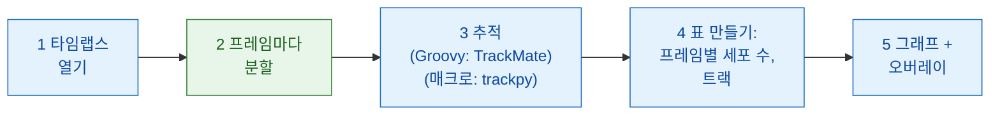

# Fiji에서 파이프라인

## 쉬운 말로 설명하면

이미지 분석은 여러 코스로 된 저녁 식사예요. 각 단계(열기, 분할, 추적,
세기, 그래프)가 코스 하나이고, 모든 코스가 같은 주방에서 나오는 건
아니에요. 여기서는 웨이터인 Fiji가 식사 대부분을 직접 내요. 동영상을 열고,
세포를 추적하고, 세고, 결과를 그려요. Wavu 주방(`examples/segment_frames`,
자기만의 환경에서 실행돼요)에 주문하는 건 **모든 프레임에서 핵 찾기**라는
요리 하나뿐이에요. 매크로 버전은 두 번째 요리인 추적(trackpy)도 그곳에
주문해요. TrackMate 자체는 Groovy나 Jython의
[스크립팅 인터페이스](https://imagej.net/plugins/trackmate/scripting/scripting)를
통해 Fiji 안의 스크립트에서 잘 돌아가요. Groovy 버전이 바로 그렇게 해요.
다만 ImageJ 매크로 언어로는 그 인터페이스에 닿을 수 없을 뿐이에요.

단계들은 작은 **DAG**(directed acyclic graph, 방향성 비순환 그래프)를
이뤄요. 상자가 결과를 다음 상자에 넘기고, 뒤로 돌아가는 고리는 없어요.



파란 상자는 Fiji 자체 명령이고, 초록 상자는 Wavu 스크립트예요. 매크로
버전에서는 3단계도 초록이에요(`examples/track_trackpy`).

## 시작하기 전에

1. **Fiji에 Wavu가 설치되어 있어야 해요.** [Fiji에 Wavu 설치하기](../fiji/install.md)를
   보세요. 매크로는 **Plugins › Wavu › Run Script (Macro)**의 `tables`
   입력란을 써요. 대화상자에 **Tables** 입력란이 없다면 wavu-fiji를
   업데이트하세요.
2. **예제 폴더를 받으세요.**
   [Wavu 저장소 zip](https://github.com/Oxford-Zeiss-Centre-of-Excellence/Wavu/archive/refs/heads/main.zip)을
   내려받아 압축을 푸세요. `examples/segment_frames`(매크로라면
   `examples/track_trackpy`도)는 **있는 자리에서 그대로** 쓰세요. 그
   `pixi.toml`이 두 단계 위 폴더에서 Wavu를 찾거든요.
3. **데이터:** `examples/data/demo_timelapse.tif`는 이 페이지를 위해 만든
   합성 동영상이에요. 256 × 256 픽셀 프레임 30장, 픽셀당 0.65 µm, 프레임당
   5분이에요. 핵 약 25개가 이리저리 떠다니고, 그중 4개가 분열하고, 1개는
   오른쪽으로 나가고 1개는 왼쪽에서 들어와요. 실제 개수는 처음에 25, 끝에
   29예요.
   `25 25 25 25 25 25 26 26 26 25 25 25 26 26 26 26 26 27 27 28 28 28 28 29 29 29 29 29 29 29`.
4. Groovy 버전에는 **TrackMate**가 필요해요. Fiji에 들어 있어요.

첫 실행에서는 폴더마다 주방 도구를 갖춰요(1–2분, 한 번만).

## 파이프라인

=== "Groovy"

    **File › New › Script…**를 열고 **Language › Groovy**를 고른 다음
    붙여 넣고 **Run**을 누르세요. Fiji가 동영상, `segment_frames` 폴더,
    출력 폴더를 물어봐요.

    ```groovy
    #@ File (label = "Time-lapse (T, Y, X)", style = "file") timelapse
    #@ File (label = "segment_frames folder", style = "directory") segmentDir
    #@ File (label = "Output folder", style = "directory") outDir
    // Fiji에서 하는 최소한의 동적 세포 세기:
    // 열기 -> 분할 (Wavu) -> 추적 (TrackMate) -> 표 만들기 -> 그래프 + 오버레이.
    import fiji.plugin.trackmate.Logger
    import fiji.plugin.trackmate.Model
    import fiji.plugin.trackmate.Settings
    import fiji.plugin.trackmate.TrackMate
    import fiji.plugin.trackmate.detection.LabelImageDetectorFactory
    import fiji.plugin.trackmate.tracking.jaqaman.SparseLAPTrackerFactory
    import ij.IJ
    import ij.ImagePlus
    import ij.gui.Line
    import ij.gui.OvalRoi
    import ij.gui.Overlay
    import ij.gui.Plot
    import ij.measure.ResultsTable
    import java.awt.Color

    // Wavu의 스크립트 라이브러리(wavu-fiji와 함께 설치돼요).
    def wavu = new GroovyShell(this.class.classLoader).evaluate(
            new File(IJ.getDirectory("imagej"), "scripts/Plugins/Wavu/lib/wavu_lib.groovy.txt"))

    try {
        // 1. 타임랩스 열기(Fiji 기본 기능).
        def imp = IJ.openImage(timelapse.path)
        def cal = imp.getCalibration()
        double dt = cal.frameInterval > 0 ? cal.frameInterval : 1   // 프레임당 분
        int nFrames = imp.getNFrames()

        // 2. 모든 프레임 분할(Wavu: examples/segment_frames, 자기 환경에서).
        Map seg = wavu.run(segmentDir, "script", [sigma: 2, threshold: "otsu", min_area: 30], [image: imp])
        def labels = seg.images.labels                    // uint16 라벨 스택, 시점마다 프레임 하나
        labels.setCalibration(cal.copy())                 // 같은 픽셀 크기와 프레임 간격

        // 3. 라벨이 붙은 핵 추적(Fiji 기본 기능: TrackMate).
        def model = new Model()
        model.setLogger(Logger.VOID_LOGGER)
        def settings = new Settings(labels)
        settings.detectorFactory = new LabelImageDetectorFactory()
        settings.detectorSettings = settings.detectorFactory.getDefaultSettings()
        settings.detectorSettings["TARGET_CHANNEL"] = 1
        settings.detectorSettings["SIMPLIFY_CONTOURS"] = false
        settings.trackerFactory = new SparseLAPTrackerFactory()
        settings.trackerSettings = settings.trackerFactory.getDefaultSettings()
        settings.trackerSettings["LINKING_MAX_DISTANCE"] = 10d     // 마이크로미터
        settings.trackerSettings["ALLOW_GAP_CLOSING"] = true
        settings.trackerSettings["GAP_CLOSING_MAX_DISTANCE"] = 10d
        settings.trackerSettings["MAX_FRAME_GAP"] = 2              // 프레임
        settings.trackerSettings["ALLOW_TRACK_SPLITTING"] = true   // 분열
        settings.trackerSettings["SPLITTING_MAX_DISTANCE"] = 10d
        def trackmate = new TrackMate(model, settings)
        if (!trackmate.checkInput() || !trackmate.process())
            throw new RuntimeException("TrackMate: " + trackmate.getErrorMessage())
        def tm = model.getTrackModel()
        def trackIds = tm.trackIDs(true)

        // 4. 표 만들기: 프레임별 세포 수, 그리고 트랙마다 한 행.
        def counts = new ResultsTable()
        List<Integer> perFrame = []
        for (int t = 0; t < nFrames; t++) {
            int n = model.getSpots().getNSpots(t, true)
            perFrame << n
            counts.addRow()
            counts.addValue("frame", t)
            counts.addValue("time_min", t * dt)
            counts.addValue("cells", n)
        }
        def tracks = new ResultsTable()
        int divisions = 0
        trackIds.each { id ->
            def spots = tm.trackSpots(id)
            // 분열: 다음 프레임의 스폿 두 개와 이어진 스폿.
            int splits = spots.count { s -> tm.edgesOf(s).count { e -> tm.getEdgeSource(e) == s } > 1 }
            divisions += splits
            def frames = spots.collect { it.getFeature("FRAME") as int }
            tracks.addRow()
            tracks.addValue("track", id)
            tracks.addValue("spots", spots.size())
            tracks.addValue("first_frame", frames.min())
            tracks.addValue("last_frame", frames.max())
            tracks.addValue("divisions", splits)
        }
        counts.show("Cells per frame")
        tracks.show("Tracks")
        counts.save(new File(outDir, imp.getShortTitle() + "-counts.csv").path)
        tracks.save(new File(outDir, imp.getShortTitle() + "-tracks.csv").path)

        // 5a. 프레임별 세포 수를 시간에 대해 그리기.
        def plot = new Plot("Cells per frame", "time (" + (cal.getTimeUnit() ?: "frame") + ")", "cells")
        plot.setColor(new Color(0x1565c0))
        plot.setLineWidth(2)
        double[] times = (0..<nFrames).collect { it * dt } as double[]
        plot.add("line", times, perFrame as double[])
        plot.add("circle", times, perFrame as double[])
        plot.setLimits(0, (nFrames - 1) * dt, 0, perFrame.max() + 5)
        plot.show()
        IJ.saveAs(plot.getImagePlus(), "PNG", new File(outDir, imp.getShortTitle() + "-counts.png").path)

        // 5b. 원본 위에 트랙마다 한 색으로 경로를 그리고,
        //     핵이 있는 프레임에서는 그 핵에 동그라미를 그리기.
        double px = cal.pixelWidth
        def overlay = new Overlay()
        trackIds.each { id ->
            def colour = Color.getHSBColor((float) ((id * 0.618034) % 1), 0.9f, 1f)
            tm.trackEdges(id).each { e ->
                def a = tm.getEdgeSource(e), b = tm.getEdgeTarget(e)
                def line = new Line(a.getDoublePosition(0) / px, a.getDoublePosition(1) / px,
                                    b.getDoublePosition(0) / px, b.getDoublePosition(1) / px)
                line.setStrokeColor(colour)
                overlay.add(line)                                   // 모든 프레임에: 경로 전체
            }
            tm.trackSpots(id).each { s ->
                double r = s.getFeature("RADIUS") / px
                def ring = new OvalRoi(s.getDoublePosition(0) / px - r, s.getDoublePosition(1) / px - r, 2 * r, 2 * r)
                ring.setStrokeColor(colour)
                ring.setPosition(1, 1, (s.getFeature("FRAME") as int) + 1)   // 자기 프레임에만
                overlay.add(ring)
            }
        }
        imp.setOverlay(overlay)
        IJ.run(imp, "Grays", "")
        // 마지막 프레임을 그려진 것과 함께 스냅숏으로.
        imp.setT(nFrames)
        def last = new ImagePlus("last frame", imp.getProcessor().duplicate())
        last.setOverlay(new Overlay())
        overlay.each { roi -> if (roi.getTPosition() in [0, nFrames]) last.getOverlay().add(roi) }
        IJ.saveAs(last.flatten(), "PNG", new File(outDir, imp.getShortTitle() + "-tracks.png").path)
        imp.show()
        labels.close()

        IJ.log("Cells per frame: " + perFrame.join(" "))
        IJ.log(trackIds.size() + " tracks, " + divisions + " divisions")
    } finally {
        wavu.stopAll()                                               // 워커 멈추기
    }
    ```

    3단계는 TrackMate의
    [스크립팅 페이지](https://imagej.net/plugins/trackmate/scripting/scripting)에
    나온 대로 코드에서 TrackMate를 실행해요. *label image detector*(라벨
    이미지 검출기)가 라벨 하나를 스폿 하나로 바꾸고, *LAP tracker*가
    스폿들을 이어 트랙을 만들어요.

=== "ImageJ macro"

    **File › New › Script…**를 열고 **Language › IJ1 Macro**를 고른 다음
    붙여 넣고 **Run**을 누르세요. 매크로가 동영상, `segment_frames` 폴더,
    `track_trackpy` 폴더, 출력 폴더를 물어봐요.

    ```javascript
    // Fiji에서 하는 최소한의 동적 세포 세기(ImageJ 매크로 버전):
    // 열기 -> 분할 (Wavu) -> 추적 (Wavu: trackpy) -> 표 만들기 -> 그래프 + 오버레이.
    // 스크립트 편집기에서 실행하거나(파일을 물어봐요), 명령줄에서 실행해요:
    //   ImageJ-win64.exe --console -batch dag_counting.ijm "<time-lapse>|<segment_frames>|<track_trackpy>|<output folder>"
    arg = getArgument();
    if (arg == "") {
        timelapse = File.openDialog("Choose the time-lapse (T, Y, X)");
        segmentDir = getDirectory("Choose the segment_frames folder");
        trackDir = getDirectory("Choose the track_trackpy folder");
        outDir = getDirectory("Choose the output folder");
    } else {
        a = split(arg, "|");
        timelapse = a[0]; segmentDir = a[1]; trackDir = a[2]; outDir = a[3] + "/";
    }
    setBatchMode(true);

    // 1. 타임랩스 열기(Fiji 기본 기능).
    open(timelapse);
    movie = getImageID();
    name = File.nameWithoutExtension;
    dt = Stack.getFrameInterval();
    if (dt == 0) dt = 1;
    Stack.getUnits(xu, yu, zu, timeUnit, vu);
    Stack.getDimensions(w, h, channels, slices, frames);

    // 2. 모든 프레임 분할(Wavu: segment_frames). <name>-labels,
    //    <name>-detections, <name>-count_per_frame가 열려요.
    run("Run Script (Macro)", "folder=[" + segmentDir + "] script=script params=[sigma=2 threshold=otsu min_area=30]");

    // 3. detections 표를 주고 추적(Wavu: track_trackpy). "tracks"가 열려요.
    //    search_range의 단위는 프레임당 픽셀: 여기서 15 px는 약 10 마이크로미터.
    run("Run Script (Macro)", "folder=[" + trackDir + "] script=script params=[search_range=15 memory=2] tables=[detections=" + name + "-detections]");

    // 4. tracks 표에서 프레임별 세포 수와 트랙 수로 표 만들기.
    n = Table.size("tracks");
    cells = newArray(frames);
    times = newArray(frames);
    nTracks = 0;
    for (i = 0; i < n; i++) {                          // 행은 particle, 그다음 frame 순으로 정렬돼 있어요
        t = Table.get("frame", i, "tracks");
        cells[t] = cells[t] + 1;
        if (i == 0 || Table.get("particle", i, "tracks") != Table.get("particle", i - 1, "tracks"))
            nTracks++;
    }
    Table.create("Cells per frame");
    for (t = 0; t < frames; t++) {
        times[t] = t * dt;
        Table.set("frame", t, t);
        Table.set("time_" + timeUnit, t, times[t]);
        Table.set("cells", t, cells[t]);
    }
    Table.update;
    Table.save(outDir + name + "-counts.csv");

    // 5a. 프레임별 세포 수를 시간에 대해 그리기.
    Plot.create("Cells per frame", "time (" + timeUnit + ")", "cells");
    Plot.setColor("#1565c0");
    Plot.setLineWidth(2);
    Plot.add("line", times, cells);
    Plot.add("circle", times, cells);
    Array.getStatistics(cells, cmin, cmax);
    Plot.setLimits(0, (frames - 1) * dt, 0, cmax + 5);
    Plot.show();
    saveAs("PNG", outDir + name + "-counts.png");

    // 5b. 원본 위에 트랙마다 한 색으로 경로 그리기.
    selectImage(movie);
    run("Grays");
    palette = newArray("#e6194b", "#3cb44b", "#ffe119", "#4363d8", "#f58231", "#911eb4",
                       "#46f0f0", "#f032e6", "#bcf60c", "#fabebe", "#008080", "#e6beff");
    Overlay.remove;
    for (i = 1; i < n; i++) {
        p = Table.get("particle", i, "tracks");
        if (Table.get("particle", i - 1, "tracks") != p) continue;
        setColor(palette[p % palette.length]);
        Overlay.drawLine(Table.get("x", i - 1, "tracks"), Table.get("y", i - 1, "tracks"),
                         Table.get("x", i, "tracks"), Table.get("y", i, "tracks"));
    }
    Overlay.show;
    Stack.setFrame(frames);                            // 트랙이 그려진 마지막 프레임
    run("Flatten");
    saveAs("PNG", outDir + name + "-tracks.png");
    close();
    setBatchMode("exit and display");

    counts = "" + cells[0];
    for (t = 1; t < frames; t++) counts = counts + " " + cells[t];
    print("Cells per frame: " + counts);
    print(nTracks + " tracks");
    run("Stop Worker");                                // 워커 둘 다 멈추기
    ```

    두 번째 `run("Run Script (Macro)", …)`에는 보낼 이미지가 없어요. 대신
    **표**를 보내요. `tables=[detections=demo_timelapse-detections]`는
    "스크립트의 입력 `detections`에 `demo_timelapse-detections`라는 제목의
    열린 표를 줘"라는 뜻이고, 이 표는 첫 단계가 연 표예요. 이미지 없이 부른
    결과는 출력 이름만으로 이름이 붙으니, 트랙은 `tracks`라는 표로 도착해요.

저장소에 있는 사본 `tests/fiji/dag_counting.groovy`와
`tests/fiji/dag_counting.ijm`은 같은 코드에, 테스트가 찾는 마지막 `print`
줄 하나를 더한 거예요.

## 보이는 것

- **그래프 창** *Cells per frame*: 분 단위 시간에 대한 세포 수예요. 데모에서는
  25에서 29까지 계단처럼 올라가요. 분열이나 들어온 핵마다 한 칸씩 오르고,
  핵 하나가 나갈 때 한 번 내려가요.
- **트랙이 그려진 동영상.** 트랙마다 경로가 자기 색의 선으로 모든 프레임에
  그려지니, 각 핵이 어디 있었고 어디로 가는지 볼 수 있어요. Groovy 버전은
  핵이 있는 프레임에서 그 핵에 동그라미도 그려요.
- **표:** *Cells per frame*(frame, time, cells), 그리고 Groovy에서는
  *Tracks*(트랙마다 스폿 수, 첫 프레임과 마지막 프레임, 분열 수). 매크로는
  Wavu 표 `demo_timelapse-detections`, `demo_timelapse-count_per_frame`,
  `tracks`도 보여 줘요.
- 출력 폴더의 **파일:** `demo_timelapse-counts.csv`,
  `demo_timelapse-counts.png`(그래프), `demo_timelapse-tracks.png`
  (트랙이 그려진 마지막 프레임), 그리고 Groovy에서는
  `demo_timelapse-tracks.csv`도요.

데모에서 두 버전은 이렇게 보고해요.

| | 프레임별 세포 수 | 트랙 |
|---|---|---|
| Groovy (TrackMate) | `25 25 25 25 25 25 26 26 26 26 25 25 26 26 26 26 26 28 28 28 28 28 28 29 29 29 29 29 29 29` | 26, 분열 4번 |
| 매크로 (trackpy) | 같음 | 30 |

개수는 프레임 9(26, 실제는 25)와 프레임 17–18(28, 실제는 27)을 빼면 실제와
맞아요. 거기서는 핵 하나가 반쯤 화면 밖에 있어요. 실제 개수는 중심이 안에
들어와야 세지만, 임계값은 보이는 부분이면 뭐든 세요. 트랙 수가 다른 건 두
트래커가 분열을 다르게 다루기 때문이에요. TrackMate(분기를 켠 경우)는 트랙
하나를 갈라지게 하니, 핵 25개에 새로 들어온 1개를 더해 트랙 26개가 돼요.
trackpy는 두 딸세포 중 하나에 새 트랙을 시작하니, 분열 4번이 트랙 4개를
더해요.

## 팁

- **실제 데이터: 파이프라인이 아니라 주방을 바꾸세요.** `segment_frames`를
  역시 라벨 이미지를 돌려주는 `examples/cellpose_nuclei`로 바꾸세요.
  Groovy에서는 `wavu.run` 줄의 폴더와 매개변수
  (`[diameter: 30, use_gpu: false]`)를 바꾸면 돼요. TrackMate는 어디서 온
  라벨이든 받아요. Cellpose는 한 번 부를 때 2-D 이미지 한 장을 처리하니,
  프레임을 돌거나 안에서 도는 작은 스크립트를 쓰세요.
- **TrackMate 설정**의 단위는 마이크로미터예요. `LINKING_MAX_DISTANCE`는
  프레임 사이에 핵이 움직일 수 있는 거리(여기서는 10 µm),
  `MAX_FRAME_GAP`은 핵이 사라져도 되는 프레임 수(2)이고,
  `ALLOW_TRACK_SPLITTING`이 분열을 잡아요. `ALLOW_TRACK_MERGING`은 물체가
  정말로 합쳐질 때만 켜세요.
- **trackpy 설정**의 단위는 픽셀이에요. 여기서 `search_range=15`는 약
  10 µm예요.
- **`tables` 입력란**은 공백으로 구분한 `input=title` 쌍을 받아요. 열린
  표라면 뭐든 돼요. **Analyze › Measure**에서 나온 표, `Table.create`로 만든
  표, 앞선 Wavu 단계의 표 등이요. 제목에 공백이 있으면 안 돼요.

## 한 문장으로

열기, 추적, 세기, 그래프, 그리기는 Fiji 자체 도구로 하고, 분할(매크로에서는
추적도)만 Wavu 주방에 주문하면서, 이미지와 표를 단계에서 단계로 넘겨요.
