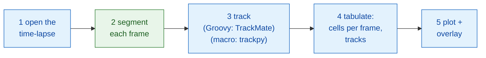
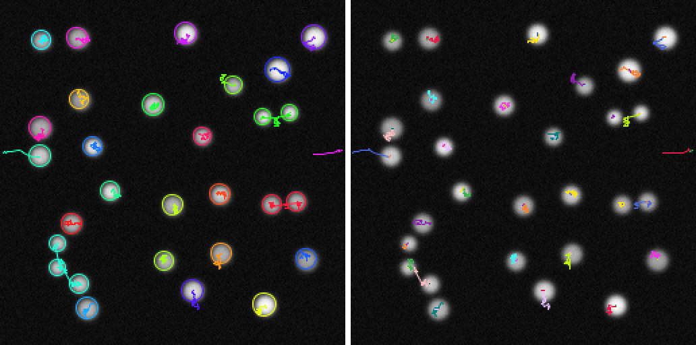

# Pipeline in Fiji

!!! question "What this pipeline measures"
    **Cells (y) against time (x)** in a time-lapse of dividing nuclei, and,
    as a second look, the number of **lineages**: one starting cell plus all
    its daughters. Every step below exists because this output needs it
    (see [Before any analysis](index.md)).

## The idea in plain words

An image analysis is a dinner of several courses: each step (open, segment,
track, count, plot) is one course, and not every course comes from the same
kitchen. Here Fiji, the waiter, serves most of the meal itself: it opens the
movie, follows the cells, counts them and draws the result. Only one course,
**finding the nuclei in every frame**, is ordered from a Wavu kitchen
(`examples/segment_frames`, in its own environment). The macro version
orders a second course there too, the tracking (trackpy). TrackMate itself
runs fine from a script inside Fiji, through its
[scripting interface](https://imagej.net/plugins/trackmate/scripting/scripting)
in Groovy or Jython, as the Groovy version does; the ImageJ macro language
just cannot reach that interface.

The steps form a small **DAG** (directed acyclic graph): boxes that hand
their result to the next box, with no loops back.



Blue boxes are Fiji's own commands; the green box is a Wavu script. In the
macro version, step 3 is green as well (`examples/track_trackpy`).

## Before you start

1. **Wavu is installed in Fiji**: see [Install wavu-fiji](../fiji/install.md).
   The macro needs the `tables` field of
   **Plugins › Wavu › Run Script (Macro)**: if its dialog has no **Tables**
   field, update wavu-fiji.
2. **Get the example folders**: open the Wavu repository in VS Code, which
   clones it for you, or download it as a zip and unzip it.

   [Open the Wavu repository in VS Code](vscode://vscode.git/clone?url=https%3A%2F%2Fgithub.com%2FOxford-Zeiss-Centre-of-Excellence%2FWavu.git){ .md-button .md-button--primary }
   [Download ZIP](https://github.com/Oxford-Zeiss-Centre-of-Excellence/Wavu/archive/refs/heads/main.zip){ .md-button }

   Use `examples/segment_frames` (and, for the macro,
   `examples/track_trackpy`) **where they are**: their `pixi.toml` finds
   Wavu two folders up.
3. **The data**: `examples/data/demo_timelapse.tif`, a synthetic movie made
   for this page: 30 frames of 256 × 256 pixels, 0.65 µm per pixel, 5 min
   per frame. About 25 nuclei drift around, four of them divide, one leaves
   on the right and one comes in from the left. The true counts are 25 at
   the start and 29 at the end.

   { width="256" }

4. **TrackMate** for the Groovy version. It ships with Fiji.

The first run installs each folder's kitchenware (a minute or two, once).

## The pipeline

=== "Groovy"

    Open **File › New › Script…**, choose **Language › Groovy**, paste, and
    press **Run**. Fiji asks for the movie, the `segment_frames` folder and
    an output folder.

    ```groovy
    #@ File (label = "Time-lapse (T, Y, X)", style = "file") timelapse
    #@ File (label = "segment_frames folder", style = "directory") segmentDir
    #@ File (label = "Output folder", style = "directory") outDir
    // Minimal dynamic cell counting in Fiji:
    // open -> segment (Wavu) -> track (TrackMate) -> tabulate -> plot + overlay.
    import fiji.plugin.trackmate.Logger
    import fiji.plugin.trackmate.Model
    import fiji.plugin.trackmate.Settings
    import fiji.plugin.trackmate.TrackMate
    import fiji.plugin.trackmate.detection.LabelImageDetectorFactory
    import fiji.plugin.trackmate.tracking.jaqaman.SparseLAPTrackerFactory
    import ij.IJ
    import ij.ImagePlus
    import ij.gui.Line
    import ij.gui.OvalRoi
    import ij.gui.Overlay
    import ij.gui.Plot
    import ij.measure.ResultsTable
    import java.awt.Color

    // Wavu's scripting library (installed with wavu-fiji).
    def wavu = new GroovyShell(this.class.classLoader).evaluate(
            new File(IJ.getDirectory("imagej"), "scripts/Plugins/Wavu/lib/wavu_lib.groovy.txt"))

    try {
        // 1. Open the time-lapse (native Fiji).
        def imp = IJ.openImage(timelapse.path)
        def cal = imp.getCalibration()
        double dt = cal.frameInterval > 0 ? cal.frameInterval : 1   // minutes per frame
        int nFrames = imp.getNFrames()

        // 2. Segment every frame (Wavu: examples/segment_frames in its own environment).
        Map seg = wavu.run(segmentDir, "script", [sigma: 2, threshold: "otsu", min_area: 30], [image: imp])
        def labels = seg.images.labels                    // uint16 label stack, one frame per time point
        labels.setCalibration(cal.copy())                 // same pixel size and frame interval

        // 3. Track the labelled nuclei (native Fiji: TrackMate).
        def model = new Model()
        model.setLogger(Logger.VOID_LOGGER)
        def settings = new Settings(labels)
        settings.detectorFactory = new LabelImageDetectorFactory()
        settings.detectorSettings = settings.detectorFactory.getDefaultSettings()
        settings.detectorSettings["TARGET_CHANNEL"] = 1
        settings.detectorSettings["SIMPLIFY_CONTOURS"] = false
        settings.trackerFactory = new SparseLAPTrackerFactory()
        settings.trackerSettings = settings.trackerFactory.getDefaultSettings()
        settings.trackerSettings["LINKING_MAX_DISTANCE"] = 10d     // microns
        settings.trackerSettings["ALLOW_GAP_CLOSING"] = true
        settings.trackerSettings["GAP_CLOSING_MAX_DISTANCE"] = 10d
        settings.trackerSettings["MAX_FRAME_GAP"] = 2              // frames
        settings.trackerSettings["ALLOW_TRACK_SPLITTING"] = true   // divisions
        settings.trackerSettings["SPLITTING_MAX_DISTANCE"] = 10d
        def trackmate = new TrackMate(model, settings)
        if (!trackmate.checkInput() || !trackmate.process())
            throw new RuntimeException("TrackMate: " + trackmate.getErrorMessage())
        def tm = model.getTrackModel()
        def trackIds = tm.trackIDs(true)

        // 4. Tabulate: cells per frame, and one row per track.
        def counts = new ResultsTable()
        List<Integer> perFrame = []
        for (int t = 0; t < nFrames; t++) {
            int n = model.getSpots().getNSpots(t, true)
            perFrame << n
            counts.addRow()
            counts.addValue("frame", t)
            counts.addValue("time_min", t * dt)
            counts.addValue("cells", n)
        }
        def tracks = new ResultsTable()
        int divisions = 0
        trackIds.each { id ->
            def spots = tm.trackSpots(id)
            // A division: a spot linked to two spots in a later frame.
            int splits = spots.count { s -> tm.edgesOf(s).count { e -> tm.getEdgeSource(e) == s } > 1 }
            divisions += splits
            def frames = spots.collect { it.getFeature("FRAME") as int }
            tracks.addRow()
            tracks.addValue("track", id)
            tracks.addValue("spots", spots.size())
            tracks.addValue("first_frame", frames.min())
            tracks.addValue("last_frame", frames.max())
            tracks.addValue("divisions", splits)
        }
        counts.show("Cells per frame")
        tracks.show("Tracks")
        counts.save(new File(outDir, imp.getShortTitle() + "-counts.csv").path)
        tracks.save(new File(outDir, imp.getShortTitle() + "-tracks.csv").path)

        // 5a. Plot cells per frame against time.
        def plot = new Plot("Cells per frame", "time (" + (cal.getTimeUnit() ?: "frame") + ")", "cells")
        plot.setColor(new Color(0x1565c0))
        plot.setLineWidth(2)
        double[] times = (0..<nFrames).collect { it * dt } as double[]
        plot.add("line", times, perFrame as double[])
        plot.add("circle", times, perFrame as double[])
        plot.setLimits(0, (nFrames - 1) * dt, 0, perFrame.max() + 5)
        plot.show()
        IJ.saveAs(plot.getImagePlus(), "PNG", new File(outDir, imp.getShortTitle() + "-counts.png").path)

        // 5b. Draw each track's path on the original, one colour per track,
        //     and a circle around each nucleus in the frame where it is.
        double px = cal.pixelWidth
        def overlay = new Overlay()
        trackIds.each { id ->
            def colour = Color.getHSBColor((float) ((id * 0.618034) % 1), 0.9f, 1f)
            tm.trackEdges(id).each { e ->
                def a = tm.getEdgeSource(e), b = tm.getEdgeTarget(e)
                def line = new Line(a.getDoublePosition(0) / px, a.getDoublePosition(1) / px,
                                    b.getDoublePosition(0) / px, b.getDoublePosition(1) / px)
                line.setStrokeColor(colour)
                overlay.add(line)                                   // on every frame: the whole path
            }
            tm.trackSpots(id).each { s ->
                double r = s.getFeature("RADIUS") / px
                def ring = new OvalRoi(s.getDoublePosition(0) / px - r, s.getDoublePosition(1) / px - r, 2 * r, 2 * r)
                ring.setStrokeColor(colour)
                ring.setPosition(1, 1, (s.getFeature("FRAME") as int) + 1)   // only in its own frame
                overlay.add(ring)
            }
        }
        imp.setOverlay(overlay)
        IJ.run(imp, "Grays", "")
        // A snapshot of the last frame with what is drawn on it.
        imp.setT(nFrames)
        def last = new ImagePlus("last frame", imp.getProcessor().duplicate())
        last.setOverlay(new Overlay())
        overlay.each { roi -> if (roi.getTPosition() in [0, nFrames]) last.getOverlay().add(roi) }
        IJ.saveAs(last.flatten(), "PNG", new File(outDir, imp.getShortTitle() + "-tracks.png").path)
        imp.show()
        labels.close()

        IJ.log("Cells per frame: " + perFrame.join(" "))
        IJ.log(trackIds.size() + " tracks, " + divisions + " divisions")
    } finally {
        wavu.stopAll()                                               // stop the worker
    }
    ```

    Step 3 runs TrackMate from code, as on its
    [scripting page](https://imagej.net/plugins/trackmate/scripting/scripting):
    the *label image detector* turns each label into one spot, and the
    *LAP tracker* links spots into tracks.

=== "ImageJ macro"

    Open **File › New › Script…**, choose **Language › IJ1 Macro**, paste,
    and press **Run**. The macro asks for the movie, the `segment_frames`
    folder, the `track_trackpy` folder and an output folder.

    ```javascript
    // Minimal dynamic cell counting in Fiji, as an ImageJ macro:
    // open -> segment (Wavu) -> track (Wavu: trackpy) -> tabulate -> plot + overlay.
    // Run it from the script editor (it asks for the files), or from the command line:
    //   ImageJ-win64.exe --console -batch dag_counting.ijm "<time-lapse>|<segment_frames>|<track_trackpy>|<output folder>"
    arg = getArgument();
    if (arg == "") {
        timelapse = File.openDialog("Choose the time-lapse (T, Y, X)");
        segmentDir = getDirectory("Choose the segment_frames folder");
        trackDir = getDirectory("Choose the track_trackpy folder");
        outDir = getDirectory("Choose the output folder");
    } else {
        a = split(arg, "|");
        timelapse = a[0]; segmentDir = a[1]; trackDir = a[2]; outDir = a[3] + "/";
    }
    setBatchMode(true);

    // 1. Open the time-lapse (native Fiji).
    open(timelapse);
    movie = getImageID();
    name = File.nameWithoutExtension;
    dt = Stack.getFrameInterval();
    if (dt == 0) dt = 1;
    Stack.getUnits(xu, yu, zu, timeUnit, vu);
    Stack.getDimensions(w, h, channels, slices, frames);

    // 2. Segment every frame (Wavu: segment_frames). Opens <name>-labels,
    //    <name>-detections and <name>-count_per_frame.
    run("Run Script (Macro)", "folder=[" + segmentDir + "] script=script params=[sigma=2 threshold=otsu min_area=30]");

    // 3. Track (Wavu: track_trackpy), given the detections table. Opens "tracks".
    //    search_range is in pixels per frame: 15 px = about 10 microns here.
    run("Run Script (Macro)", "folder=[" + trackDir + "] script=script params=[search_range=15 memory=2] tables=[detections=" + name + "-detections]");

    // 4. Tabulate: cells per frame and number of tracks, from the tracks table.
    n = Table.size("tracks");
    cells = newArray(frames);
    times = newArray(frames);
    nTracks = 0;
    for (i = 0; i < n; i++) {                          // rows are sorted by particle, then frame
        t = Table.get("frame", i, "tracks");
        cells[t] = cells[t] + 1;
        if (i == 0 || Table.get("particle", i, "tracks") != Table.get("particle", i - 1, "tracks"))
            nTracks++;
    }
    Table.create("Cells per frame");
    for (t = 0; t < frames; t++) {
        times[t] = t * dt;
        Table.set("frame", t, t);
        Table.set("time_" + timeUnit, t, times[t]);
        Table.set("cells", t, cells[t]);
    }
    Table.update;
    Table.save(outDir + name + "-counts.csv");

    // 5a. Plot cells per frame against time.
    Plot.create("Cells per frame", "time (" + timeUnit + ")", "cells");
    Plot.setColor("#1565c0");
    Plot.setLineWidth(2);
    Plot.add("line", times, cells);
    Plot.add("circle", times, cells);
    Array.getStatistics(cells, cmin, cmax);
    Plot.setLimits(0, (frames - 1) * dt, 0, cmax + 5);
    Plot.show();
    saveAs("PNG", outDir + name + "-counts.png");

    // 5b. Draw each track's path on the original, one colour per track.
    selectImage(movie);
    run("Grays");
    palette = newArray("#e6194b", "#3cb44b", "#ffe119", "#4363d8", "#f58231", "#911eb4",
                       "#46f0f0", "#f032e6", "#bcf60c", "#fabebe", "#008080", "#e6beff");
    Overlay.remove;
    for (i = 1; i < n; i++) {
        p = Table.get("particle", i, "tracks");
        if (Table.get("particle", i - 1, "tracks") != p) continue;
        setColor(palette[p % palette.length]);
        Overlay.drawLine(Table.get("x", i - 1, "tracks"), Table.get("y", i - 1, "tracks"),
                         Table.get("x", i, "tracks"), Table.get("y", i, "tracks"));
    }
    Overlay.show;
    Stack.setFrame(frames);                            // last frame, with the tracks drawn in
    run("Flatten", "slice");
    saveAs("PNG", outDir + name + "-tracks.png");
    close();
    setBatchMode("exit and display");

    counts = "" + cells[0];
    for (t = 1; t < frames; t++) counts = counts + " " + cells[t];
    print("Cells per frame: " + counts);
    print(nTracks + " tracks");
    run("Stop Worker");                                // stop both workers
    ```

    The second `run("Run Script (Macro)", …)` has no image to send. Instead
    it sends a **table**: `tables=[detections=demo_timelapse-detections]`
    means "give the script's input `detections` the open table titled
    `demo_timelapse-detections`", which is the table the first step opened.
    Results of a call without an image are named after the output only,
    so the tracks arrive as the table `tracks`.

The copies in the repository, `tests/fiji/dag_counting.groovy` and
`tests/fiji/dag_counting.ijm`, are the same code plus one last `print` line
that the tests look for.

## What you see

- **A plot window**, *Cells per frame*: cells against time in minutes.
  On the demo it climbs from 25 to 29 in steps, one step per division
  or arrival, and dips once when a nucleus leaves.
- **The movie, with tracks drawn on it.** Each track's path is a line in
  its own colour, on every frame, so you see where each nucleus has been
  and is going. The Groovy version also rings each nucleus in the frame
  where it is.
- **Tables**: *Cells per frame* (frame, time, cells) and, in Groovy,
  *Tracks* (spots, first and last frame, divisions per track). The macro
  also shows the Wavu tables `demo_timelapse-detections`,
  `demo_timelapse-count_per_frame` and `tracks`.
- **Files** in the output folder: `demo_timelapse-counts.csv`,
  `demo_timelapse-counts.png` (the plot) and `demo_timelapse-tracks.png`
  (the last frame with the tracks), plus `demo_timelapse-tracks.csv` from
  Groovy.

On the demo, both versions report:

| | cells per frame | tracks |
|---|---|---|
| Groovy (TrackMate) | 25 → 29 | 26, with 4 divisions |
| Macro (trackpy) | the same | 30 |

The counts match the truth except at frame 9 (26, truth 25) and frames
17–18 (28, truth 27). There a nucleus sits half outside the picture: the
truth counts it only once its centre is inside, the threshold counts
whatever part it sees. The track numbers differ because the two trackers
treat a division differently: TrackMate (with splitting on) lets one track
branch, so 25 nuclei plus 1 newcomer give 26 tracks; trackpy starts a new
track for one of the two daughters, so the 4 divisions add 4 tracks.

{ width="720" }

Left, the movie with each track's tail (trackpy). Right, the measurement,
**cells against time**. Dashed grey: the true count. Blue dots: the measured
cells, the same for every method, because all of them count the same
segmentation. Orange line: the **TrackMate lineages** alive in each frame.
The gap between the dots and the orange line is the cells born by division:
it widens by one at each of the four divisions. The lineage line dips at
50 min, when a nucleus leaves, and comes back at 85 min, when one enters.

{ width="720" }

The last frame with every track. Left, TrackMate: after a division both
daughters keep their mother's colour, because they belong to her track (a
branching lineage). Right, trackpy: each daughter gets a track of its own,
so there are tracks but no lineages.

## Tips

- **Real data: change the kitchen, not the pipeline.** Swap
  `segment_frames` for `examples/cellpose_nuclei`, which also returns a
  label image. In Groovy, change the folder and the parameters
  (`[diameter: 30, use_gpu: false]`) on the `wavu.run` line; TrackMate
  takes labels from any source. Cellpose handles one 2-D image per call,
  so loop over the frames, or write a small script that loops inside.
- **TrackMate settings** are in microns. `LINKING_MAX_DISTANCE` is how far a
  nucleus may move between frames (10 µm here),
  `MAX_FRAME_GAP` how many frames it may vanish (2), and
  `ALLOW_TRACK_SPLITTING` catches divisions. Turn on
  `ALLOW_TRACK_MERGING` only if objects really fuse.
- **trackpy settings** are in pixels: `search_range=15` is about 10 µm here.
- **The `tables` field** takes `input=title` pairs separated by spaces,
  for any open table: one from **Analyze › Measure**, from `Table.create`,
  or from an earlier Wavu step. Titles must not contain spaces.

## In one sentence

Open, track, count, plot and draw with Fiji's own tools, and order only the
segmentation (and, in a macro, the tracking) from a Wavu kitchen, passing
images and tables from step to step.
