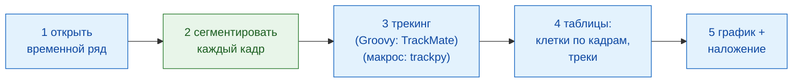

# Конвейер в Fiji

## Идея простыми словами

Анализ изображений — это ужин из нескольких блюд: каждый шаг (открыть,
сегментировать, отследить, посчитать, построить график) — одно блюдо, и не
все блюда готовятся на одной кухне. Здесь Fiji, официант, подаёт бо́льшую часть ужина сам: открывает
фильм, следит за клетками, считает их и рисует результат. Только одно блюдо,
**поиск ядер в каждом кадре**, заказывается на кухне Wavu
(`examples/segment_frames`, в своём собственном окружении). Версия на
макросе заказывает там и второе блюдо, трекинг (отслеживание, через trackpy).
Сам TrackMate прекрасно запускается из скрипта внутри Fiji через свой
[интерфейс для скриптов](https://imagej.net/plugins/trackmate/scripting/scripting) на Groovy или Jython, как это делает версия на
Groovy; просто язык макросов ImageJ не может добраться до этого интерфейса.

Шаги образуют маленький **DAG** (directed acyclic graph, ориентированный
ациклический граф): блоки, которые передают свой результат следующему
блоку, без петель назад.



Синие блоки — собственные команды Fiji; зелёный блок — скрипт Wavu. В
версии на макросе шаг 3 тоже зелёный (`examples/track_trackpy`).

## Перед началом

1. **Wavu установлен в Fiji**: см. [Установка wavu-fiji](../fiji/install.md).
   Макросу нужно поле `tables` команды
   **Plugins › Wavu › Run Script (Macro)** (запустить скрипт из макроса):
   если в её диалоге нет поля **Tables**, обновите wavu-fiji.
2. **Скачайте папки с примерами.** Загрузите
   [репозиторий Wavu в виде zip](https://github.com/Oxford-Zeiss-Centre-of-Excellence/Wavu/archive/refs/heads/main.zip)
   и распакуйте его. Используйте `examples/segment_frames` (а для макроса
   ещё и `examples/track_trackpy`) **там, где они лежат**: их `pixi.toml`
   находит Wavu на две папки выше.
3. **Данные**: `examples/data/demo_timelapse.tif`, синтетический фильм,
   сделанный для этой страницы: 30 кадров по 256 × 256 пикселей, 0,65 мкм на
   пиксель, 5 мин на кадр. Около 25 ядер дрейфуют по полю, четыре из них
   делятся, одно уходит вправо и одно приходит слева. Истинные числа — 25 в
   начале и 29 в конце:
   `25 25 25 25 25 25 26 26 26 25 25 25 26 26 26 26 26 27 27 28 28 28 28 29 29 29 29 29 29 29`.
4. **TrackMate** для версии на Groovy. Он входит в состав Fiji.

Первый запуск устанавливает кухонную утварь каждой папки (минуту-другую,
один раз).

## Конвейер

=== "Groovy"

    Откройте **File › New › Script…** (новый скрипт), выберите
    **Language › Groovy**, вставьте код и нажмите **Run**. Fiji спросит
    фильм, папку `segment_frames` и папку для результатов.

    ```groovy
    #@ File (label = "Time-lapse (T, Y, X)", style = "file") timelapse
    #@ File (label = "segment_frames folder", style = "directory") segmentDir
    #@ File (label = "Output folder", style = "directory") outDir
    // Минимальный динамический подсчёт клеток в Fiji:
    // открыть -> сегментировать (Wavu) -> трекинг (TrackMate) -> таблицы -> график + наложение.
    import fiji.plugin.trackmate.Logger
    import fiji.plugin.trackmate.Model
    import fiji.plugin.trackmate.Settings
    import fiji.plugin.trackmate.TrackMate
    import fiji.plugin.trackmate.detection.LabelImageDetectorFactory
    import fiji.plugin.trackmate.tracking.jaqaman.SparseLAPTrackerFactory
    import ij.IJ
    import ij.ImagePlus
    import ij.gui.Line
    import ij.gui.OvalRoi
    import ij.gui.Overlay
    import ij.gui.Plot
    import ij.measure.ResultsTable
    import java.awt.Color

    // Библиотека скриптов Wavu (устанавливается вместе с wavu-fiji).
    def wavu = new GroovyShell(this.class.classLoader).evaluate(
            new File(IJ.getDirectory("imagej"), "scripts/Plugins/Wavu/lib/wavu_lib.groovy.txt"))

    try {
        // 1. Открыть временной ряд (сам Fiji).
        def imp = IJ.openImage(timelapse.path)
        def cal = imp.getCalibration()
        double dt = cal.frameInterval > 0 ? cal.frameInterval : 1   // минут на кадр
        int nFrames = imp.getNFrames()

        // 2. Сегментировать каждый кадр (Wavu: examples/segment_frames в своём окружении).
        Map seg = wavu.run(segmentDir, "script", [sigma: 2, threshold: "otsu", min_area: 30], [image: imp])
        def labels = seg.images.labels                    // стек меток uint16, один кадр на момент времени
        labels.setCalibration(cal.copy())                 // тот же размер пикселя и интервал между кадрами

        // 3. Трекинг размеченных ядер (сам Fiji: TrackMate).
        def model = new Model()
        model.setLogger(Logger.VOID_LOGGER)
        def settings = new Settings(labels)
        settings.detectorFactory = new LabelImageDetectorFactory()
        settings.detectorSettings = settings.detectorFactory.getDefaultSettings()
        settings.detectorSettings["TARGET_CHANNEL"] = 1
        settings.detectorSettings["SIMPLIFY_CONTOURS"] = false
        settings.trackerFactory = new SparseLAPTrackerFactory()
        settings.trackerSettings = settings.trackerFactory.getDefaultSettings()
        settings.trackerSettings["LINKING_MAX_DISTANCE"] = 10d     // микроны
        settings.trackerSettings["ALLOW_GAP_CLOSING"] = true
        settings.trackerSettings["GAP_CLOSING_MAX_DISTANCE"] = 10d
        settings.trackerSettings["MAX_FRAME_GAP"] = 2              // кадры
        settings.trackerSettings["ALLOW_TRACK_SPLITTING"] = true   // деления
        settings.trackerSettings["SPLITTING_MAX_DISTANCE"] = 10d
        def trackmate = new TrackMate(model, settings)
        if (!trackmate.checkInput() || !trackmate.process())
            throw new RuntimeException("TrackMate: " + trackmate.getErrorMessage())
        def tm = model.getTrackModel()
        def trackIds = tm.trackIDs(true)

        // 4. Таблицы: клетки по кадрам и по строке на трек.
        def counts = new ResultsTable()
        List<Integer> perFrame = []
        for (int t = 0; t < nFrames; t++) {
            int n = model.getSpots().getNSpots(t, true)
            perFrame << n
            counts.addRow()
            counts.addValue("frame", t)
            counts.addValue("time_min", t * dt)
            counts.addValue("cells", n)
        }
        def tracks = new ResultsTable()
        int divisions = 0
        trackIds.each { id ->
            def spots = tm.trackSpots(id)
            // Деление: точка, связанная с двумя точками в более позднем кадре.
            int splits = spots.count { s -> tm.edgesOf(s).count { e -> tm.getEdgeSource(e) == s } > 1 }
            divisions += splits
            def frames = spots.collect { it.getFeature("FRAME") as int }
            tracks.addRow()
            tracks.addValue("track", id)
            tracks.addValue("spots", spots.size())
            tracks.addValue("first_frame", frames.min())
            tracks.addValue("last_frame", frames.max())
            tracks.addValue("divisions", splits)
        }
        counts.show("Cells per frame")
        tracks.show("Tracks")
        counts.save(new File(outDir, imp.getShortTitle() + "-counts.csv").path)
        tracks.save(new File(outDir, imp.getShortTitle() + "-tracks.csv").path)

        // 5a. График числа клеток на кадр в зависимости от времени.
        def plot = new Plot("Cells per frame", "time (" + (cal.getTimeUnit() ?: "frame") + ")", "cells")
        plot.setColor(new Color(0x1565c0))
        plot.setLineWidth(2)
        double[] times = (0..<nFrames).collect { it * dt } as double[]
        plot.add("line", times, perFrame as double[])
        plot.add("circle", times, perFrame as double[])
        plot.setLimits(0, (nFrames - 1) * dt, 0, perFrame.max() + 5)
        plot.show()
        IJ.saveAs(plot.getImagePlus(), "PNG", new File(outDir, imp.getShortTitle() + "-counts.png").path)

        // 5b. Нарисовать путь каждого трека на оригинале, свой цвет для каждого трека,
        //     и кружок вокруг каждого ядра в том кадре, где оно находится.
        double px = cal.pixelWidth
        def overlay = new Overlay()
        trackIds.each { id ->
            def colour = Color.getHSBColor((float) ((id * 0.618034) % 1), 0.9f, 1f)
            tm.trackEdges(id).each { e ->
                def a = tm.getEdgeSource(e), b = tm.getEdgeTarget(e)
                def line = new Line(a.getDoublePosition(0) / px, a.getDoublePosition(1) / px,
                                    b.getDoublePosition(0) / px, b.getDoublePosition(1) / px)
                line.setStrokeColor(colour)
                overlay.add(line)                                   // на каждом кадре: весь путь
            }
            tm.trackSpots(id).each { s ->
                double r = s.getFeature("RADIUS") / px
                def ring = new OvalRoi(s.getDoublePosition(0) / px - r, s.getDoublePosition(1) / px - r, 2 * r, 2 * r)
                ring.setStrokeColor(colour)
                ring.setPosition(1, 1, (s.getFeature("FRAME") as int) + 1)   // только в своём кадре
                overlay.add(ring)
            }
        }
        imp.setOverlay(overlay)
        IJ.run(imp, "Grays", "")
        // Снимок последнего кадра со всем, что на нём нарисовано.
        imp.setT(nFrames)
        def last = new ImagePlus("last frame", imp.getProcessor().duplicate())
        last.setOverlay(new Overlay())
        overlay.each { roi -> if (roi.getTPosition() in [0, nFrames]) last.getOverlay().add(roi) }
        IJ.saveAs(last.flatten(), "PNG", new File(outDir, imp.getShortTitle() + "-tracks.png").path)
        imp.show()
        labels.close()

        IJ.log("Cells per frame: " + perFrame.join(" "))
        IJ.log(trackIds.size() + " tracks, " + divisions + " divisions")
    } finally {
        wavu.stopAll()                                               // остановить воркер
    }
    ```

    Шаг 3 запускает TrackMate из кода, как на его
    [странице о скриптах](https://imagej.net/plugins/trackmate/scripting/scripting): *label image detector* (детектор
    изображения меток) превращает каждую метку в одну точку, а *LAP tracker*
    связывает точки в треки.

=== "ImageJ macro"

    Откройте **File › New › Script…** (новый скрипт), выберите
    **Language › IJ1 Macro**, вставьте код и нажмите **Run**. Макрос
    спросит фильм, папку `segment_frames`, папку `track_trackpy` и папку
    для результатов.

    ```javascript
    // Минимальный динамический подсчёт клеток в Fiji, в виде макроса ImageJ:
    // открыть -> сегментировать (Wavu) -> трекинг (Wavu: trackpy) -> таблицы -> график + наложение.
    // Запускайте из редактора скриптов (он спросит файлы) или из командной строки:
    //   ImageJ-win64.exe --console -batch dag_counting.ijm "<time-lapse>|<segment_frames>|<track_trackpy>|<output folder>"
    arg = getArgument();
    if (arg == "") {
        timelapse = File.openDialog("Choose the time-lapse (T, Y, X)");
        segmentDir = getDirectory("Choose the segment_frames folder");
        trackDir = getDirectory("Choose the track_trackpy folder");
        outDir = getDirectory("Choose the output folder");
    } else {
        a = split(arg, "|");
        timelapse = a[0]; segmentDir = a[1]; trackDir = a[2]; outDir = a[3] + "/";
    }
    setBatchMode(true);

    // 1. Открыть временной ряд (сам Fiji).
    open(timelapse);
    movie = getImageID();
    name = File.nameWithoutExtension;
    dt = Stack.getFrameInterval();
    if (dt == 0) dt = 1;
    Stack.getUnits(xu, yu, zu, timeUnit, vu);
    Stack.getDimensions(w, h, channels, slices, frames);

    // 2. Сегментировать каждый кадр (Wavu: segment_frames). Открывает <name>-labels,
    //    <name>-detections и <name>-count_per_frame.
    run("Run Script (Macro)", "folder=[" + segmentDir + "] script=script params=[sigma=2 threshold=otsu min_area=30]");

    // 3. Трекинг (Wavu: track_trackpy) по таблице детекций. Открывает "tracks".
    //    search_range задаётся в пикселях на кадр: 15 px = здесь около 10 микрон.
    run("Run Script (Macro)", "folder=[" + trackDir + "] script=script params=[search_range=15 memory=2] tables=[detections=" + name + "-detections]");

    // 4. Таблицы: клетки по кадрам и число треков, по таблице tracks.
    n = Table.size("tracks");
    cells = newArray(frames);
    times = newArray(frames);
    nTracks = 0;
    for (i = 0; i < n; i++) {                          // строки отсортированы по частице, затем по кадру
        t = Table.get("frame", i, "tracks");
        cells[t] = cells[t] + 1;
        if (i == 0 || Table.get("particle", i, "tracks") != Table.get("particle", i - 1, "tracks"))
            nTracks++;
    }
    Table.create("Cells per frame");
    for (t = 0; t < frames; t++) {
        times[t] = t * dt;
        Table.set("frame", t, t);
        Table.set("time_" + timeUnit, t, times[t]);
        Table.set("cells", t, cells[t]);
    }
    Table.update;
    Table.save(outDir + name + "-counts.csv");

    // 5a. График числа клеток на кадр в зависимости от времени.
    Plot.create("Cells per frame", "time (" + timeUnit + ")", "cells");
    Plot.setColor("#1565c0");
    Plot.setLineWidth(2);
    Plot.add("line", times, cells);
    Plot.add("circle", times, cells);
    Array.getStatistics(cells, cmin, cmax);
    Plot.setLimits(0, (frames - 1) * dt, 0, cmax + 5);
    Plot.show();
    saveAs("PNG", outDir + name + "-counts.png");

    // 5b. Нарисовать путь каждого трека на оригинале, свой цвет для каждого трека.
    selectImage(movie);
    run("Grays");
    palette = newArray("#e6194b", "#3cb44b", "#ffe119", "#4363d8", "#f58231", "#911eb4",
                       "#46f0f0", "#f032e6", "#bcf60c", "#fabebe", "#008080", "#e6beff");
    Overlay.remove;
    for (i = 1; i < n; i++) {
        p = Table.get("particle", i, "tracks");
        if (Table.get("particle", i - 1, "tracks") != p) continue;
        setColor(palette[p % palette.length]);
        Overlay.drawLine(Table.get("x", i - 1, "tracks"), Table.get("y", i - 1, "tracks"),
                         Table.get("x", i, "tracks"), Table.get("y", i, "tracks"));
    }
    Overlay.show;
    Stack.setFrame(frames);                            // последний кадр, с нарисованными треками
    run("Flatten");
    saveAs("PNG", outDir + name + "-tracks.png");
    close();
    setBatchMode("exit and display");

    counts = "" + cells[0];
    for (t = 1; t < frames; t++) counts = counts + " " + cells[t];
    print("Cells per frame: " + counts);
    print(nTracks + " tracks");
    run("Stop Worker");                                // остановить оба воркера
    ```

    Второму `run("Run Script (Macro)", …)` нечего отправить в виде
    изображения. Вместо этого он отправляет **таблицу**:
    `tables=[detections=demo_timelapse-detections]` означает «передай на
    вход скрипта `detections` открытую таблицу с заголовком
    `demo_timelapse-detections`», то есть таблицу, которую открыл первый
    шаг. Результаты вызова без изображения называются только по имени
    выхода, поэтому треки приходят как таблица `tracks`.

Копии в репозитории, `tests/fiji/dag_counting.groovy` и
`tests/fiji/dag_counting.ijm`, — это тот же код плюс одна последняя строка
`print`, которую ищут тесты.

## Что вы увидите

- **Окно графика** *Cells per frame* (клетки на кадр): число клеток в
  зависимости от времени в минутах. На демо оно растёт с 25 до 29
  ступеньками, по ступеньке на каждое деление или появление, и один раз
  проседает, когда ядро уходит.
- **Фильм с нарисованными треками.** Путь каждого трека — линия своего
  цвета на каждом кадре, так что видно, где каждое ядро было и куда
  движется. Версия на Groovy ещё и обводит каждое ядро кружком в том
  кадре, где оно находится.
- **Таблицы**: *Cells per frame* (кадр, время, клетки) и, в Groovy,
  *Tracks* (точки, первый и последний кадр, деления на трек). Макрос ещё
  показывает таблицы Wavu `demo_timelapse-detections`,
  `demo_timelapse-count_per_frame` и `tracks`.
- **Файлы** в папке результатов: `demo_timelapse-counts.csv`,
  `demo_timelapse-counts.png` (график) и `demo_timelapse-tracks.png`
  (последний кадр с треками), плюс `demo_timelapse-tracks.csv` из Groovy.

На демо обе версии выдают:

| | клетки на кадр | треки |
|---|---|---|
| Groovy (TrackMate) | `25 25 25 25 25 25 26 26 26 26 25 25 26 26 26 26 26 28 28 28 28 28 28 29 29 29 29 29 29 29` | 26, из них 4 деления |
| Макрос (trackpy) | то же самое | 30 |

Подсчёт совпадает с истиной, кроме кадра 9 (26, истина 25) и кадров 17–18
(28, истина 27). Там одно ядро наполовину выходит за край снимка: истина
считает его, только когда его центр внутри, а порог считает любую видимую
часть. Число треков различается, потому что два трекера по-разному
обрабатывают деление: TrackMate (с включённым разветвлением) позволяет
одному треку ветвиться, поэтому 25 ядер плюс 1 новичок дают 26 треков;
trackpy начинает новый трек для одной из двух дочерних клеток, поэтому 4
деления добавляют 4 трека.

## Советы

- **Реальные данные: меняйте кухню, а не конвейер.** Замените
  `segment_frames` на `examples/cellpose_nuclei`, который тоже возвращает
  изображение меток. В Groovy поменяйте папку и параметры
  (`[diameter: 30, use_gpu: false]`) в строке `wavu.run`; TrackMate
  принимает метки из любого источника. Cellpose обрабатывает одно 2-D
  изображение за вызов, поэтому пройдитесь по кадрам в цикле или напишите
  небольшой скрипт, который делает цикл внутри.
- **Настройки TrackMate** задаются в микронах. `LINKING_MAX_DISTANCE` — как
  далеко ядро может сместиться между кадрами (здесь 10 мкм),
  `MAX_FRAME_GAP` — на сколько кадров оно может пропасть (2), а
  `ALLOW_TRACK_SPLITTING` ловит деления. Включайте `ALLOW_TRACK_MERGING`,
  только если объекты действительно сливаются.
- **Настройки trackpy** задаются в пикселях: `search_range=15` — здесь
  около 10 мкм.
- **Поле `tables`** принимает пары `input=title` через пробел, для любой
  открытой таблицы: из **Analyze › Measure**, из `Table.create` или с
  предыдущего шага Wavu. В заголовках не должно быть пробелов.

## Одним предложением

Открывайте, отслеживайте, считайте, стройте график и рисуйте собственными
инструментами Fiji, а на кухне Wavu заказывайте только сегментацию (и, в
макросе, трекинг), передавая изображения и таблицы от шага к шагу.
