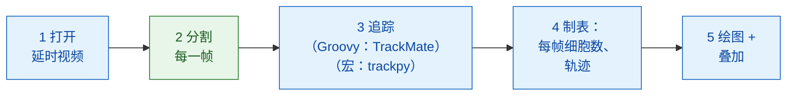

# Fiji 中的分析流程

## 用白话说

一次图像分析就像一顿有好几道菜的晚餐：每个步骤（打开、分割、追踪、
计数、绘图）就是一道菜，而且不是每道菜都出自同一个厨房。在这里，服务员
Fiji 自己端出大部分的菜：它打开视频、追踪细胞、计数，再把结果画出来。
只有一道菜，**找出每一帧里的细胞核**，是向 Wavu 厨房点的
（`examples/segment_frames`，在它自己的环境里）。宏版本还会再向那里点
第二道菜，也就是追踪（trackpy）。TrackMate 本身在 Fiji 里从脚本运行完全
没问题，可以像 Groovy 版本那样，通过它的
[脚本接口](https://imagej.net/plugins/trackmate/scripting/scripting)用 Groovy
或 Jython 调用；只是 ImageJ 宏语言访问不到这个接口。

这些步骤组成一个小小的 **DAG**（directed acyclic graph，有向无环图）：
每个方框把结果交给下一个方框，不会绕回去形成循环。



蓝色方框是 Fiji 自己的命令；绿色方框是 Wavu 脚本。在宏版本里，步骤 3
也是绿色的（`examples/track_trackpy`）。

## 开始之前

1. **Fiji 里已安装 Wavu**：请看[安装 wavu-fiji](../fiji/install.md)。
   宏需要 **Plugins › Wavu › Run Script (Macro)** 的 `tables` 字段：
   如果它的对话框里没有 **Tables** 字段，请更新 wavu-fiji。
2. **获取示例文件夹**。下载
   [Wavu 仓库的 zip 文件](https://github.com/Oxford-Zeiss-Centre-of-Excellence/Wavu/archive/refs/heads/main.zip)
   并解压。直接在**原来的位置**使用 `examples/segment_frames`（宏还要用
   `examples/track_trackpy`）：它们的 `pixi.toml` 会往上两层文件夹找到 Wavu。
3. **数据**：`examples/data/demo_timelapse.tif`，一段专为本页制作的合成
   视频：30 帧，每帧 256 × 256 像素，每像素 0.65 µm，每帧间隔 5 分钟。
   大约 25 个细胞核四处漂移，其中四个会分裂，一个从右边离开，一个从左边
   进来。真实的数量开始时是 25，最后是 29：
   `25 25 25 25 25 25 26 26 26 25 25 25 26 26 26 26 26 27 27 28 28 28 28 29 29 29 29 29 29 29`。
4. Groovy 版本需要 **TrackMate**。它随 Fiji 一起提供。

第一次运行时会安装每个文件夹的厨具（一两分钟，只有一次）。

## 分析流程

=== "Groovy"

    打开 **File › New › Script…**，选择 **Language › Groovy**，粘贴代码，
    再按 **Run**。Fiji 会让你选择视频、`segment_frames` 文件夹和一个输出
    文件夹。

    ```groovy
    #@ File (label = "Time-lapse (T, Y, X)", style = "file") timelapse
    #@ File (label = "segment_frames folder", style = "directory") segmentDir
    #@ File (label = "Output folder", style = "directory") outDir
    // 在 Fiji 里做最简单的动态细胞计数：
    // 打开 -> 分割（Wavu）-> 追踪（TrackMate）-> 制表 -> 绘图 + 叠加。
    import fiji.plugin.trackmate.Logger
    import fiji.plugin.trackmate.Model
    import fiji.plugin.trackmate.Settings
    import fiji.plugin.trackmate.TrackMate
    import fiji.plugin.trackmate.detection.LabelImageDetectorFactory
    import fiji.plugin.trackmate.tracking.jaqaman.SparseLAPTrackerFactory
    import ij.IJ
    import ij.ImagePlus
    import ij.gui.Line
    import ij.gui.OvalRoi
    import ij.gui.Overlay
    import ij.gui.Plot
    import ij.measure.ResultsTable
    import java.awt.Color

    // Wavu 的脚本库（随 wavu-fiji 安装）。
    def wavu = new GroovyShell(this.class.classLoader).evaluate(
            new File(IJ.getDirectory("imagej"), "scripts/Plugins/Wavu/lib/wavu_lib.groovy.txt"))

    try {
        // 1. 打开延时视频（Fiji 原生）。
        def imp = IJ.openImage(timelapse.path)
        def cal = imp.getCalibration()
        double dt = cal.frameInterval > 0 ? cal.frameInterval : 1   // 每帧的分钟数
        int nFrames = imp.getNFrames()

        // 2. 分割每一帧（Wavu：examples/segment_frames，在它自己的环境里）。
        Map seg = wavu.run(segmentDir, "script", [sigma: 2, threshold: "otsu", min_area: 30], [image: imp])
        def labels = seg.images.labels                    // uint16 标签堆栈，每个时间点一帧
        labels.setCalibration(cal.copy())                 // 相同的像素大小和帧间隔

        // 3. 追踪已标记的细胞核（Fiji 原生：TrackMate）。
        def model = new Model()
        model.setLogger(Logger.VOID_LOGGER)
        def settings = new Settings(labels)
        settings.detectorFactory = new LabelImageDetectorFactory()
        settings.detectorSettings = settings.detectorFactory.getDefaultSettings()
        settings.detectorSettings["TARGET_CHANNEL"] = 1
        settings.detectorSettings["SIMPLIFY_CONTOURS"] = false
        settings.trackerFactory = new SparseLAPTrackerFactory()
        settings.trackerSettings = settings.trackerFactory.getDefaultSettings()
        settings.trackerSettings["LINKING_MAX_DISTANCE"] = 10d     // 微米
        settings.trackerSettings["ALLOW_GAP_CLOSING"] = true
        settings.trackerSettings["GAP_CLOSING_MAX_DISTANCE"] = 10d
        settings.trackerSettings["MAX_FRAME_GAP"] = 2              // 帧
        settings.trackerSettings["ALLOW_TRACK_SPLITTING"] = true   // 分裂
        settings.trackerSettings["SPLITTING_MAX_DISTANCE"] = 10d
        def trackmate = new TrackMate(model, settings)
        if (!trackmate.checkInput() || !trackmate.process())
            throw new RuntimeException("TrackMate: " + trackmate.getErrorMessage())
        def tm = model.getTrackModel()
        def trackIds = tm.trackIDs(true)

        // 4. 制表：每帧的细胞数，以及每条轨迹一行。
        def counts = new ResultsTable()
        List<Integer> perFrame = []
        for (int t = 0; t < nFrames; t++) {
            int n = model.getSpots().getNSpots(t, true)
            perFrame << n
            counts.addRow()
            counts.addValue("frame", t)
            counts.addValue("time_min", t * dt)
            counts.addValue("cells", n)
        }
        def tracks = new ResultsTable()
        int divisions = 0
        trackIds.each { id ->
            def spots = tm.trackSpots(id)
            // 分裂：一个点连到后面某一帧中的两个点。
            int splits = spots.count { s -> tm.edgesOf(s).count { e -> tm.getEdgeSource(e) == s } > 1 }
            divisions += splits
            def frames = spots.collect { it.getFeature("FRAME") as int }
            tracks.addRow()
            tracks.addValue("track", id)
            tracks.addValue("spots", spots.size())
            tracks.addValue("first_frame", frames.min())
            tracks.addValue("last_frame", frames.max())
            tracks.addValue("divisions", splits)
        }
        counts.show("Cells per frame")
        tracks.show("Tracks")
        counts.save(new File(outDir, imp.getShortTitle() + "-counts.csv").path)
        tracks.save(new File(outDir, imp.getShortTitle() + "-tracks.csv").path)

        // 5a. 画出每帧细胞数随时间变化的图。
        def plot = new Plot("Cells per frame", "time (" + (cal.getTimeUnit() ?: "frame") + ")", "cells")
        plot.setColor(new Color(0x1565c0))
        plot.setLineWidth(2)
        double[] times = (0..<nFrames).collect { it * dt } as double[]
        plot.add("line", times, perFrame as double[])
        plot.add("circle", times, perFrame as double[])
        plot.setLimits(0, (nFrames - 1) * dt, 0, perFrame.max() + 5)
        plot.show()
        IJ.saveAs(plot.getImagePlus(), "PNG", new File(outDir, imp.getShortTitle() + "-counts.png").path)

        // 5b. 在原始图像上画出每条轨迹的路径，每条轨迹一种颜色，
        //     并在每个细胞核所在的帧中圈出它。
        double px = cal.pixelWidth
        def overlay = new Overlay()
        trackIds.each { id ->
            def colour = Color.getHSBColor((float) ((id * 0.618034) % 1), 0.9f, 1f)
            tm.trackEdges(id).each { e ->
                def a = tm.getEdgeSource(e), b = tm.getEdgeTarget(e)
                def line = new Line(a.getDoublePosition(0) / px, a.getDoublePosition(1) / px,
                                    b.getDoublePosition(0) / px, b.getDoublePosition(1) / px)
                line.setStrokeColor(colour)
                overlay.add(line)                                   // 在每一帧上：整条路径
            }
            tm.trackSpots(id).each { s ->
                double r = s.getFeature("RADIUS") / px
                def ring = new OvalRoi(s.getDoublePosition(0) / px - r, s.getDoublePosition(1) / px - r, 2 * r, 2 * r)
                ring.setStrokeColor(colour)
                ring.setPosition(1, 1, (s.getFeature("FRAME") as int) + 1)   // 只在它自己的那一帧
                overlay.add(ring)
            }
        }
        imp.setOverlay(overlay)
        IJ.run(imp, "Grays", "")
        // 最后一帧连同画在上面的内容的快照。
        imp.setT(nFrames)
        def last = new ImagePlus("last frame", imp.getProcessor().duplicate())
        last.setOverlay(new Overlay())
        overlay.each { roi -> if (roi.getTPosition() in [0, nFrames]) last.getOverlay().add(roi) }
        IJ.saveAs(last.flatten(), "PNG", new File(outDir, imp.getShortTitle() + "-tracks.png").path)
        imp.show()
        labels.close()

        IJ.log("Cells per frame: " + perFrame.join(" "))
        IJ.log(trackIds.size() + " tracks, " + divisions + " divisions")
    } finally {
        wavu.stopAll()                                               // 停止 worker
    }
    ```

    步骤 3 用代码运行 TrackMate，做法和它的
    [脚本说明页](https://imagej.net/plugins/trackmate/scripting/scripting)一样：*label image detector*（标签图像检测器）
    把每个标签变成一个点（spot），*LAP tracker*（LAP 追踪器）再把这些点连成
    轨迹。

=== "ImageJ macro"

    打开 **File › New › Script…**，选择 **Language › IJ1 Macro**，粘贴代码，
    再按 **Run**。宏会让你选择视频、`segment_frames` 文件夹、
    `track_trackpy` 文件夹和一个输出文件夹。

    ```javascript
    // 在 Fiji 里做最简单的动态细胞计数，写成 ImageJ 宏：
    // 打开 -> 分割（Wavu）-> 追踪（Wavu：trackpy）-> 制表 -> 绘图 + 叠加。
    // 从脚本编辑器运行（它会询问文件），或从命令行运行：
    //   ImageJ-win64.exe --console -batch dag_counting.ijm "<time-lapse>|<segment_frames>|<track_trackpy>|<output folder>"
    arg = getArgument();
    if (arg == "") {
        timelapse = File.openDialog("Choose the time-lapse (T, Y, X)");
        segmentDir = getDirectory("Choose the segment_frames folder");
        trackDir = getDirectory("Choose the track_trackpy folder");
        outDir = getDirectory("Choose the output folder");
    } else {
        a = split(arg, "|");
        timelapse = a[0]; segmentDir = a[1]; trackDir = a[2]; outDir = a[3] + "/";
    }
    setBatchMode(true);

    // 1. 打开延时视频（Fiji 原生）。
    open(timelapse);
    movie = getImageID();
    name = File.nameWithoutExtension;
    dt = Stack.getFrameInterval();
    if (dt == 0) dt = 1;
    Stack.getUnits(xu, yu, zu, timeUnit, vu);
    Stack.getDimensions(w, h, channels, slices, frames);

    // 2. 分割每一帧（Wavu：segment_frames）。会打开 <name>-labels、
    //    <name>-detections 和 <name>-count_per_frame。
    run("Run Script (Macro)", "folder=[" + segmentDir + "] script=script params=[sigma=2 threshold=otsu min_area=30]");

    // 3. 追踪（Wavu：track_trackpy），输入检测结果表格。会打开 "tracks"。
    //    search_range 的单位是每帧的像素数：这里 15 px 约等于 10 微米。
    run("Run Script (Macro)", "folder=[" + trackDir + "] script=script params=[search_range=15 memory=2] tables=[detections=" + name + "-detections]");

    // 4. 制表：从轨迹表格算出每帧的细胞数和轨迹数。
    n = Table.size("tracks");
    cells = newArray(frames);
    times = newArray(frames);
    nTracks = 0;
    for (i = 0; i < n; i++) {                          // 各行先按 particle、再按 frame 排序
        t = Table.get("frame", i, "tracks");
        cells[t] = cells[t] + 1;
        if (i == 0 || Table.get("particle", i, "tracks") != Table.get("particle", i - 1, "tracks"))
            nTracks++;
    }
    Table.create("Cells per frame");
    for (t = 0; t < frames; t++) {
        times[t] = t * dt;
        Table.set("frame", t, t);
        Table.set("time_" + timeUnit, t, times[t]);
        Table.set("cells", t, cells[t]);
    }
    Table.update;
    Table.save(outDir + name + "-counts.csv");

    // 5a. 画出每帧细胞数随时间变化的图。
    Plot.create("Cells per frame", "time (" + timeUnit + ")", "cells");
    Plot.setColor("#1565c0");
    Plot.setLineWidth(2);
    Plot.add("line", times, cells);
    Plot.add("circle", times, cells);
    Array.getStatistics(cells, cmin, cmax);
    Plot.setLimits(0, (frames - 1) * dt, 0, cmax + 5);
    Plot.show();
    saveAs("PNG", outDir + name + "-counts.png");

    // 5b. 在原始图像上画出每条轨迹的路径，每条轨迹一种颜色。
    selectImage(movie);
    run("Grays");
    palette = newArray("#e6194b", "#3cb44b", "#ffe119", "#4363d8", "#f58231", "#911eb4",
                       "#46f0f0", "#f032e6", "#bcf60c", "#fabebe", "#008080", "#e6beff");
    Overlay.remove;
    for (i = 1; i < n; i++) {
        p = Table.get("particle", i, "tracks");
        if (Table.get("particle", i - 1, "tracks") != p) continue;
        setColor(palette[p % palette.length]);
        Overlay.drawLine(Table.get("x", i - 1, "tracks"), Table.get("y", i - 1, "tracks"),
                         Table.get("x", i, "tracks"), Table.get("y", i, "tracks"));
    }
    Overlay.show;
    Stack.setFrame(frames);                            // 最后一帧，画上轨迹
    run("Flatten");
    saveAs("PNG", outDir + name + "-tracks.png");
    close();
    setBatchMode("exit and display");

    counts = "" + cells[0];
    for (t = 1; t < frames; t++) counts = counts + " " + cells[t];
    print("Cells per frame: " + counts);
    print(nTracks + " tracks");
    run("Stop Worker");                                // 停止两个 worker
    ```

    第二个 `run("Run Script (Macro)", …)` 没有图像可以发送。它改为发送一个
    **表格**：`tables=[detections=demo_timelapse-detections]` 的意思是
    “把标题为 `demo_timelapse-detections` 的已打开表格交给脚本的输入
    `detections`”，也就是第一步打开的那个表格。没有图像的调用，结果只会以
    输出的名称命名，所以轨迹会以表格 `tracks` 的形式返回。

仓库里的副本 `tests/fiji/dag_counting.groovy` 和
`tests/fiji/dag_counting.ijm` 是同样的代码，只是最后多了一行测试会检查的
`print`。

## 你会看到什么

- **一个图表窗口** *Cells per frame*：细胞数随时间（分钟）变化的图。在示例
  数据上，它从 25 一级一级升到 29，每次分裂或有细胞进来就升一级，有一个
  细胞核离开时则下降一次。
- **画上轨迹的视频**。每条轨迹的路径是一条自己颜色的线，画在每一帧上，
  所以你能看出每个细胞核去过哪里、正要往哪里去。Groovy 版本还会在每个
  细胞核所在的帧中把它圈起来。
- **表格**：*Cells per frame*（帧、时间、细胞数），以及 Groovy 版本的
  *Tracks*（每条轨迹的点数、第一帧和最后一帧、分裂次数）。宏还会显示
  Wavu 的表格 `demo_timelapse-detections`、
  `demo_timelapse-count_per_frame` 和 `tracks`。
- **文件**，在输出文件夹里：`demo_timelapse-counts.csv`、
  `demo_timelapse-counts.png`（图表）和 `demo_timelapse-tracks.png`
  （画上轨迹的最后一帧），Groovy 另外还有 `demo_timelapse-tracks.csv`。

在示例数据上，两个版本的结果是：

| | 每帧细胞数 | 轨迹 |
|---|---|---|
| Groovy（TrackMate） | `25 25 25 25 25 25 26 26 26 26 25 25 26 26 26 26 26 28 28 28 28 28 28 29 29 29 29 29 29 29` | 26 条，含 4 次分裂 |
| 宏（trackpy） | 相同 | 30 |

除了第 9 帧（26，实际是 25）和第 17–18 帧（28，实际是 27）之外，数量都和
真实值一致。在这几帧里，有一个细胞核有一半在画面外：真实值要等它的中心
进入画面才算，阈值则是看到哪一部分就算哪一部分。两者的轨迹数不同，是
因为两种追踪器处理分裂的方式不一样：TrackMate（开启 splitting 时）让一条
轨迹分叉，所以 25 个细胞核加上 1 个新来的，得到 26 条轨迹；trackpy 则为
两个子细胞中的一个开一条新轨迹，所以 4 次分裂多出 4 条轨迹。

## 小技巧

- **真实数据：换厨房，不换流程**。把 `segment_frames` 换成
  `examples/cellpose_nuclei`，它同样会返回标签图像。在 Groovy 里，改掉
  `wavu.run` 那一行的文件夹和参数（`[diameter: 30, use_gpu: false]`）；
  TrackMate 接受任何来源的标签。Cellpose 每次调用只处理一张 2-D 图像，
  所以要逐帧循环，或写一个在内部循环的小脚本。
- **TrackMate 设置**以微米为单位。`LINKING_MAX_DISTANCE` 是细胞核在两帧
  之间最多能移动多远（这里是 10 µm），`MAX_FRAME_GAP` 是它最多能消失几帧
  （2），`ALLOW_TRACK_SPLITTING` 用来捕捉分裂。只有物体真的会融合时，
  才开启 `ALLOW_TRACK_MERGING`。
- **trackpy 设置**以像素为单位：`search_range=15` 在这里大约是 10 µm。
- **`tables` 字段**接受以空格分隔的 `input=title` 配对，适用于任何已打开
  的表格：来自 **Analyze › Measure**、来自 `Table.create`，或来自前一个
  Wavu 步骤的表格都可以。标题不能包含空格。

## 一句话总结

用 Fiji 自己的工具打开、追踪、计数、绘图和描绘，只向 Wavu 厨房点分割这道菜
（在宏里还有追踪），并在步骤之间传递图像和表格。
