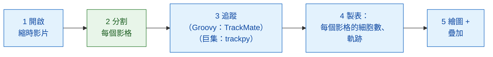
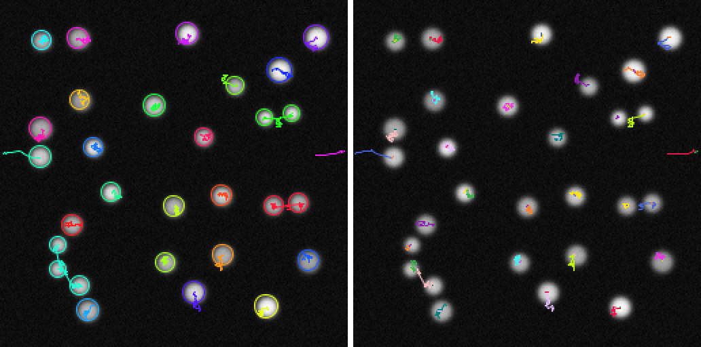

# Fiji 中的分析流程

!!! question "這個分析流程量什麼"
    在一段細胞核會分裂的縮時影片裡，量**細胞數（y）對時間（x）**；再換個
    角度看，量**譜系**的數目：一個起始細胞加上它所有的子細胞。下面的每個
    步驟之所以存在，都是因為這個輸出需要它（請看[分析之前](index.md)）。

## 用白話說

一次影像分析就像一頓有好幾道菜的晚餐：每個步驟（開啟、分割、追蹤、
計數、繪圖）就是一道菜，而且不是每道菜都出自同一個廚房。在這裡，服務生
Fiji 自己端出大部分的菜：它開啟影片、追蹤細胞、計數，再把結果畫出來。
只有一道菜，**找出每個影格裡的細胞核**，是向 Wavu 廚房點的
（`examples/segment_frames`，在它自己的環境裡）。巨集版本還會再向那裡點
第二道菜，也就是追蹤（trackpy）。TrackMate 本身在 Fiji 裡從腳本執行完全
沒問題，可以像 Groovy 版本那樣，透過它的
[腳本介面](https://imagej.net/plugins/trackmate/scripting/scripting)用 Groovy
或 Jython 呼叫；只是 ImageJ 巨集語言碰不到這個介面。

這些步驟組成一個小小的 **DAG**（directed acyclic graph，有向無環圖）：
每個方框把結果交給下一個方框，不會繞回去形成迴圈。



藍色方框是 Fiji 自己的指令；綠色方框是 Wavu 腳本。在巨集版本裡，步驟 3
也是綠色的（`examples/track_trackpy`）。

## 開始之前

1. **Fiji 裡已安裝 Wavu**：請看[安裝 wavu-fiji](../fiji/install.md)。
   巨集需要 **Plugins › Wavu › Run Script (Macro)** 的 `tables` 欄位：
   如果它的對話框沒有 **Tables** 欄位，請更新 wavu-fiji。
2. **取得範例資料夾**：在 VS Code 中開啟 Wavu 儲存庫，它會幫你複製
   （clone）下來；或者把它下載成 zip 檔再解壓縮。

   [在 VS Code 中開啟 Wavu 儲存庫](vscode://vscode.git/clone?url=https%3A%2F%2Fgithub.com%2FOxford-Zeiss-Centre-of-Excellence%2FWavu.git){ .md-button .md-button--primary }
   [下載 ZIP](https://github.com/Oxford-Zeiss-Centre-of-Excellence/Wavu/archive/refs/heads/main.zip){ .md-button }

   直接在**原來的位置**使用 `examples/segment_frames`（巨集還要用
   `examples/track_trackpy`）：它們的 `pixi.toml` 會往上兩層資料夾找到 Wavu。
3. **資料**：`examples/data/demo_timelapse.tif`，一段專為本頁製作的合成
   影片：30 個影格，每格 256 × 256 像素，每像素 0.65 µm，每格間隔 5 分鐘。
   大約 25 個細胞核四處漂移，其中四個會分裂，一個從右邊離開，一個從左邊
   進來。真實的數量一開始是 25，最後是 29。

   { width="256" }

4. Groovy 版本需要 **TrackMate**。它隨 Fiji 一起提供。

第一次執行時會安裝每個資料夾的廚具（一兩分鐘，只有一次）。

## 分析流程

=== "Groovy"

    開啟 **File › New › Script…**，選擇 **Language › Groovy**，貼上程式碼，
    再按 **Run**。Fiji 會要你選擇影片、`segment_frames` 資料夾和一個輸出
    資料夾。

    ```groovy
    #@ File (label = "Time-lapse (T, Y, X)", style = "file") timelapse
    #@ File (label = "segment_frames folder", style = "directory") segmentDir
    #@ File (label = "Output folder", style = "directory") outDir
    // 在 Fiji 裡做最簡單的動態細胞計數：
    // 開啟 -> 分割（Wavu）-> 追蹤（TrackMate）-> 製表 -> 繪圖 + 疊加。
    import fiji.plugin.trackmate.Logger
    import fiji.plugin.trackmate.Model
    import fiji.plugin.trackmate.Settings
    import fiji.plugin.trackmate.TrackMate
    import fiji.plugin.trackmate.detection.LabelImageDetectorFactory
    import fiji.plugin.trackmate.tracking.jaqaman.SparseLAPTrackerFactory
    import ij.IJ
    import ij.ImagePlus
    import ij.gui.Line
    import ij.gui.OvalRoi
    import ij.gui.Overlay
    import ij.gui.Plot
    import ij.measure.ResultsTable
    import java.awt.Color

    // Wavu 的腳本函式庫（隨 wavu-fiji 安裝）。
    def wavu = new GroovyShell(this.class.classLoader).evaluate(
            new File(IJ.getDirectory("imagej"), "scripts/Plugins/Wavu/lib/wavu_lib.groovy.txt"))

    try {
        // 1. 開啟縮時影片（Fiji 原生）。
        def imp = IJ.openImage(timelapse.path)
        def cal = imp.getCalibration()
        double dt = cal.frameInterval > 0 ? cal.frameInterval : 1   // 每個影格的分鐘數
        int nFrames = imp.getNFrames()

        // 2. 分割每個影格（Wavu：examples/segment_frames，在它自己的環境裡）。
        Map seg = wavu.run(segmentDir, "script", [sigma: 2, threshold: "otsu", min_area: 30], [image: imp])
        def labels = seg.images.labels                    // uint16 標籤堆疊，每個時間點一個影格
        labels.setCalibration(cal.copy())                 // 相同的像素大小和影格間隔

        // 3. 追蹤已標記的細胞核（Fiji 原生：TrackMate）。
        def model = new Model()
        model.setLogger(Logger.VOID_LOGGER)
        def settings = new Settings(labels)
        settings.detectorFactory = new LabelImageDetectorFactory()
        settings.detectorSettings = settings.detectorFactory.getDefaultSettings()
        settings.detectorSettings["TARGET_CHANNEL"] = 1
        settings.detectorSettings["SIMPLIFY_CONTOURS"] = false
        settings.trackerFactory = new SparseLAPTrackerFactory()
        settings.trackerSettings = settings.trackerFactory.getDefaultSettings()
        settings.trackerSettings["LINKING_MAX_DISTANCE"] = 10d     // 微米
        settings.trackerSettings["ALLOW_GAP_CLOSING"] = true
        settings.trackerSettings["GAP_CLOSING_MAX_DISTANCE"] = 10d
        settings.trackerSettings["MAX_FRAME_GAP"] = 2              // 影格
        settings.trackerSettings["ALLOW_TRACK_SPLITTING"] = true   // 分裂
        settings.trackerSettings["SPLITTING_MAX_DISTANCE"] = 10d
        def trackmate = new TrackMate(model, settings)
        if (!trackmate.checkInput() || !trackmate.process())
            throw new RuntimeException("TrackMate: " + trackmate.getErrorMessage())
        def tm = model.getTrackModel()
        def trackIds = tm.trackIDs(true)

        // 4. 製表：每個影格的細胞數，以及每條軌跡一列。
        def counts = new ResultsTable()
        List<Integer> perFrame = []
        for (int t = 0; t < nFrames; t++) {
            int n = model.getSpots().getNSpots(t, true)
            perFrame << n
            counts.addRow()
            counts.addValue("frame", t)
            counts.addValue("time_min", t * dt)
            counts.addValue("cells", n)
        }
        def tracks = new ResultsTable()
        int divisions = 0
        trackIds.each { id ->
            def spots = tm.trackSpots(id)
            // 分裂：一個點連到後面影格中的兩個點。
            int splits = spots.count { s -> tm.edgesOf(s).count { e -> tm.getEdgeSource(e) == s } > 1 }
            divisions += splits
            def frames = spots.collect { it.getFeature("FRAME") as int }
            tracks.addRow()
            tracks.addValue("track", id)
            tracks.addValue("spots", spots.size())
            tracks.addValue("first_frame", frames.min())
            tracks.addValue("last_frame", frames.max())
            tracks.addValue("divisions", splits)
        }
        counts.show("Cells per frame")
        tracks.show("Tracks")
        counts.save(new File(outDir, imp.getShortTitle() + "-counts.csv").path)
        tracks.save(new File(outDir, imp.getShortTitle() + "-tracks.csv").path)

        // 5a. 畫出每個影格的細胞數對時間的圖。
        def plot = new Plot("Cells per frame", "time (" + (cal.getTimeUnit() ?: "frame") + ")", "cells")
        plot.setColor(new Color(0x1565c0))
        plot.setLineWidth(2)
        double[] times = (0..<nFrames).collect { it * dt } as double[]
        plot.add("line", times, perFrame as double[])
        plot.add("circle", times, perFrame as double[])
        plot.setLimits(0, (nFrames - 1) * dt, 0, perFrame.max() + 5)
        plot.show()
        IJ.saveAs(plot.getImagePlus(), "PNG", new File(outDir, imp.getShortTitle() + "-counts.png").path)

        // 5b. 在原始影像上畫出每條軌跡的路徑，每條軌跡一種顏色，
        //     並在每個細胞核所在的影格中圈出它。
        double px = cal.pixelWidth
        def overlay = new Overlay()
        trackIds.each { id ->
            def colour = Color.getHSBColor((float) ((id * 0.618034) % 1), 0.9f, 1f)
            tm.trackEdges(id).each { e ->
                def a = tm.getEdgeSource(e), b = tm.getEdgeTarget(e)
                def line = new Line(a.getDoublePosition(0) / px, a.getDoublePosition(1) / px,
                                    b.getDoublePosition(0) / px, b.getDoublePosition(1) / px)
                line.setStrokeColor(colour)
                overlay.add(line)                                   // 在每個影格上：整條路徑
            }
            tm.trackSpots(id).each { s ->
                double r = s.getFeature("RADIUS") / px
                def ring = new OvalRoi(s.getDoublePosition(0) / px - r, s.getDoublePosition(1) / px - r, 2 * r, 2 * r)
                ring.setStrokeColor(colour)
                ring.setPosition(1, 1, (s.getFeature("FRAME") as int) + 1)   // 只在它自己的影格
                overlay.add(ring)
            }
        }
        imp.setOverlay(overlay)
        IJ.run(imp, "Grays", "")
        // 最後一個影格連同畫在上面的東西的快照。
        imp.setT(nFrames)
        def last = new ImagePlus("last frame", imp.getProcessor().duplicate())
        last.setOverlay(new Overlay())
        overlay.each { roi -> if (roi.getTPosition() in [0, nFrames]) last.getOverlay().add(roi) }
        IJ.saveAs(last.flatten(), "PNG", new File(outDir, imp.getShortTitle() + "-tracks.png").path)
        imp.show()
        labels.close()

        IJ.log("Cells per frame: " + perFrame.join(" "))
        IJ.log(trackIds.size() + " tracks, " + divisions + " divisions")
    } finally {
        wavu.stopAll()                                               // 停止 worker
    }
    ```

    步驟 3 用程式碼執行 TrackMate，做法和它的
    [腳本說明頁](https://imagej.net/plugins/trackmate/scripting/scripting)一樣：*label image detector*（標籤影像偵測器）
    把每個標籤變成一個點（spot），*LAP tracker*（LAP 追蹤器）再把這些點連成
    軌跡。

=== "ImageJ macro"

    開啟 **File › New › Script…**，選擇 **Language › IJ1 Macro**，貼上程式碼，
    再按 **Run**。巨集會要你選擇影片、`segment_frames` 資料夾、
    `track_trackpy` 資料夾和一個輸出資料夾。

    ```javascript
    // 在 Fiji 裡做最簡單的動態細胞計數，寫成 ImageJ 巨集：
    // 開啟 -> 分割（Wavu）-> 追蹤（Wavu：trackpy）-> 製表 -> 繪圖 + 疊加。
    // 從腳本編輯器執行（它會詢問檔案），或從命令列執行：
    //   ImageJ-win64.exe --console -batch dag_counting.ijm "<time-lapse>|<segment_frames>|<track_trackpy>|<output folder>"
    arg = getArgument();
    if (arg == "") {
        timelapse = File.openDialog("Choose the time-lapse (T, Y, X)");
        segmentDir = getDirectory("Choose the segment_frames folder");
        trackDir = getDirectory("Choose the track_trackpy folder");
        outDir = getDirectory("Choose the output folder");
    } else {
        a = split(arg, "|");
        timelapse = a[0]; segmentDir = a[1]; trackDir = a[2]; outDir = a[3] + "/";
    }
    setBatchMode(true);

    // 1. 開啟縮時影片（Fiji 原生）。
    open(timelapse);
    movie = getImageID();
    name = File.nameWithoutExtension;
    dt = Stack.getFrameInterval();
    if (dt == 0) dt = 1;
    Stack.getUnits(xu, yu, zu, timeUnit, vu);
    Stack.getDimensions(w, h, channels, slices, frames);

    // 2. 分割每個影格（Wavu：segment_frames）。會開啟 <name>-labels、
    //    <name>-detections 和 <name>-count_per_frame。
    run("Run Script (Macro)", "folder=[" + segmentDir + "] script=script params=[sigma=2 threshold=otsu min_area=30]");

    // 3. 追蹤（Wavu：track_trackpy），輸入偵測結果表格。會開啟 "tracks"。
    //    search_range 的單位是每個影格的像素數：這裡 15 px 約等於 10 微米。
    run("Run Script (Macro)", "folder=[" + trackDir + "] script=script params=[search_range=15 memory=2] tables=[detections=" + name + "-detections]");

    // 4. 製表：從軌跡表格算出每個影格的細胞數和軌跡數。
    n = Table.size("tracks");
    cells = newArray(frames);
    times = newArray(frames);
    nTracks = 0;
    for (i = 0; i < n; i++) {                          // 各列先依 particle、再依 frame 排序
        t = Table.get("frame", i, "tracks");
        cells[t] = cells[t] + 1;
        if (i == 0 || Table.get("particle", i, "tracks") != Table.get("particle", i - 1, "tracks"))
            nTracks++;
    }
    Table.create("Cells per frame");
    for (t = 0; t < frames; t++) {
        times[t] = t * dt;
        Table.set("frame", t, t);
        Table.set("time_" + timeUnit, t, times[t]);
        Table.set("cells", t, cells[t]);
    }
    Table.update;
    Table.save(outDir + name + "-counts.csv");

    // 5a. 畫出每個影格的細胞數對時間的圖。
    Plot.create("Cells per frame", "time (" + timeUnit + ")", "cells");
    Plot.setColor("#1565c0");
    Plot.setLineWidth(2);
    Plot.add("line", times, cells);
    Plot.add("circle", times, cells);
    Array.getStatistics(cells, cmin, cmax);
    Plot.setLimits(0, (frames - 1) * dt, 0, cmax + 5);
    Plot.show();
    saveAs("PNG", outDir + name + "-counts.png");

    // 5b. 在原始影像上畫出每條軌跡的路徑，每條軌跡一種顏色。
    selectImage(movie);
    run("Grays");
    palette = newArray("#e6194b", "#3cb44b", "#ffe119", "#4363d8", "#f58231", "#911eb4",
                       "#46f0f0", "#f032e6", "#bcf60c", "#fabebe", "#008080", "#e6beff");
    Overlay.remove;
    for (i = 1; i < n; i++) {
        p = Table.get("particle", i, "tracks");
        if (Table.get("particle", i - 1, "tracks") != p) continue;
        setColor(palette[p % palette.length]);
        Overlay.drawLine(Table.get("x", i - 1, "tracks"), Table.get("y", i - 1, "tracks"),
                         Table.get("x", i, "tracks"), Table.get("y", i, "tracks"));
    }
    Overlay.show;
    Stack.setFrame(frames);                            // 最後一個影格，畫上軌跡
    run("Flatten", "slice");
    saveAs("PNG", outDir + name + "-tracks.png");
    close();
    setBatchMode("exit and display");

    counts = "" + cells[0];
    for (t = 1; t < frames; t++) counts = counts + " " + cells[t];
    print("Cells per frame: " + counts);
    print(nTracks + " tracks");
    run("Stop Worker");                                // 停止兩個 worker
    ```

    第二個 `run("Run Script (Macro)", …)` 沒有影像可以送。它改送一個
    **表格**：`tables=[detections=demo_timelapse-detections]` 的意思是
    「把標題為 `demo_timelapse-detections` 的已開啟表格交給腳本的輸入
    `detections`」，也就是第一步開啟的那個表格。沒有影像的呼叫，結果只會以
    輸出的名稱命名，所以軌跡會以表格 `tracks` 的形式送回來。

儲存庫裡的副本 `tests/fiji/dag_counting.groovy` 和
`tests/fiji/dag_counting.ijm` 是同樣的程式碼，只是最後多了一行測試會檢查的
`print`。

## 你會看到什麼

- **一個圖表視窗** *Cells per frame*：細胞數對時間（分鐘）的圖。在示範
  資料上，它從 25 一階一階爬到 29，每次分裂或有細胞進來就升一階，有一個
  細胞核離開時則下降一次。
- **畫上軌跡的影片**。每條軌跡的路徑是一條自己顏色的線，畫在每個影格上，
  所以你看得出每個細胞核去過哪裡、正要往哪裡去。Groovy 版本還會在每個
  細胞核所在的影格中把它圈起來。
- **表格**：*Cells per frame*（影格、時間、細胞數），以及 Groovy 版本的
  *Tracks*（每條軌跡的點數、第一個和最後一個影格、分裂次數）。巨集還會
  顯示 Wavu 的表格 `demo_timelapse-detections`、
  `demo_timelapse-count_per_frame` 和 `tracks`。
- **檔案**，在輸出資料夾裡：`demo_timelapse-counts.csv`、
  `demo_timelapse-counts.png`（圖表）和 `demo_timelapse-tracks.png`
  （畫上軌跡的最後一個影格），Groovy 另外還有 `demo_timelapse-tracks.csv`。

在示範資料上，兩個版本的結果是：

| | 每個影格的細胞數 | 軌跡 |
|---|---|---|
| Groovy（TrackMate） | 25 → 29 | 26 條，含 4 次分裂 |
| 巨集（trackpy） | 相同 | 30 |

除了影格 9（26，實際是 25）和影格 17–18（28，實際是 27）之外，數量都和
真實值相符。在那幾個影格，有一個細胞核有一半在畫面外：真實值要等它的
中心進入畫面才算，閾值則是看到哪一部分就算哪一部分。兩者的軌跡數不同，
是因為兩種追蹤器處理分裂的方式不一樣：TrackMate（開啟 splitting 時）讓
一條軌跡分岔，所以 25 個細胞核加上 1 個新來的，得到 26 條軌跡；trackpy
則為兩個子細胞的其中一個開一條新軌跡，所以 4 次分裂多出 4 條軌跡。

{ width="720" }

左邊是影片，每條軌跡都拖著尾巴（trackpy）。右邊是量測結果，**細胞數對
時間**。灰色虛線：真實數量。藍點：量到的細胞數，每種方法都一樣，因為它們
數的都是同一份分割結果。橘線：每個影格中存在的 **TrackMate 譜系**。藍點和
橘線之間的差距，就是分裂產生的細胞：四次分裂，每次差距加一。譜系線在
50 分鐘時下降，因為有一個細胞核離開；到 85 分鐘又回升，因為有一個進來。

{ width="720" }

畫上每條軌跡的最後一個影格。左邊是 TrackMate：分裂之後，兩個子細胞都保留
母細胞的顏色，因為它們屬於母細胞那條軌跡（一個會分岔的譜系）。右邊是 trackpy：
每個子細胞各有一條自己的軌跡，所以有軌跡，卻沒有譜系。

## 小技巧

- **真實資料：換廚房，不換流程**。把 `segment_frames` 換成
  `examples/cellpose_nuclei`，它同樣會回傳標籤影像。在 Groovy 裡，改掉
  `wavu.run` 那一行的資料夾和參數（`[diameter: 30, use_gpu: false]`）；
  TrackMate 接受任何來源的標籤。Cellpose 每次呼叫只處理一張 2-D 影像，
  所以要逐格跑迴圈，或寫一個在內部跑迴圈的小腳本。
- **TrackMate 設定**以微米為單位。`LINKING_MAX_DISTANCE` 是細胞核在兩個
  影格之間最多能移動多遠（這裡是 10 µm），`MAX_FRAME_GAP` 是它最多能消失
  幾個影格（2），`ALLOW_TRACK_SPLITTING` 用來抓到分裂。只有物體真的會
  融合時，才開啟 `ALLOW_TRACK_MERGING`。
- **trackpy 設定**以像素為單位：`search_range=15` 在這裡大約是 10 µm。
- **`tables` 欄位**接受以空格分隔的 `input=title` 配對，適用於任何已開啟
  的表格：來自 **Analyze › Measure**、來自 `Table.create`，或來自前一個
  Wavu 步驟的表格都可以。標題不能有空格。

## 一句話總結

用 Fiji 自己的工具開啟、追蹤、計數、繪圖和描繪，只向 Wavu 廚房點分割這道菜
（在巨集裡還有追蹤），並在步驟之間傳遞影像和表格。
