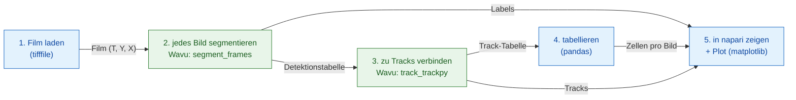

# Pipeline in Python und napari

## Die Idee in einfachen Worten { #the-idea-in-plain-words }

Eine Bildanalyse ist ein Abendessen mit mehreren Gängen: Jeder Schritt
(öffnen, segmentieren, verfolgen, zählen, plotten) ist ein Gang. Ihr Python-Skript
ist der Kellner: Es bringt die Zutaten (den Film) an den Tisch, schreibt
die Rechnung (eine Tabelle mit Zählungen) und serviert die Teller in
napari. Zwei Gerichte brauchen besondere Küchengeräte, also gehen sie an
zwei verschiedene Küchen: Eine Küche **zerlegt** jedes Einzelbild in
Zellkerne (Segmentierung, mit scikit-image), die nächste **verfolgt** jeden
Zellkern von Bild zu Bild (Tracking, mit trackpy). Jede Küche hat ihre
eigenen Küchengeräte, ihre eigene pixi-Umgebung, und keine weiß, dass es
die andere gibt.

Die Pipeline ist ein kleiner **DAG** (ein *gerichteter azyklischer Graph*:
Kästen, verbunden durch Pfeile, die nur vorwärts zeigen, nie in einer
Schleife zurück). Jeder Kasten braucht das Ergebnis des Kastens davor:



Blaue Kästen laufen in Ihrem eigenen Skript (*native* Schritte); grüne
Kästen sind Wavu-Schritte, jeder in seiner eigenen Umgebung.

## Die Daten { #the-data }

Das Wavu-Repository enthält einen kleinen synthetischen Film,
`examples/data/demo_timelapse.tif`: 30 Einzelbilder mit 256 × 256 Pixeln,
0,65 µm pro Pixel, 5 Minuten zwischen den Bildern. Etwa 25 Zellkerne
wandern umher; vier teilen sich, einer verlässt das Sichtfeld und einer
kommt herein, die wahre Zahl steigt also von 25 auf 29. Da wir den Film
selbst gemacht haben, kennen wir die richtige Antwort und können die
Pipeline daran prüfen.

## Der Code { #the-code }

Das ist `examples/pipelines/dag_counting.py` aus dem Repository, der Teil,
der die Arbeit macht (die Datei legt noch eine kleine Kommandozeile darum):

```python
from pathlib import Path

import pandas as pd
import tifffile

from wavu.client import Worker

REPO = Path(__file__).resolve().parents[2]
MOVIE = REPO / "examples" / "data" / "demo_timelapse.tif"
SEGMENT = REPO / "examples" / "segment_frames"
TRACK = REPO / "examples" / "track_trackpy"
PIXEL_UM = 0.65        # Mikrometer pro Pixel
FRAME_MIN = 5.0        # Minuten zwischen den Bildern


def analyse(movie_path: Path = MOVIE, log=print):
    # 1. Laden (nativ)
    movie = tifffile.imread(movie_path)                                   # (T, Y, X)
    log(f"loaded {movie_path.name}: {movie.shape}")

    # 2 + 3. Segmentieren, dann tracken: zwei Küchen, zwei Umgebungen
    with Worker.start(SEGMENT, on_log=log) as seg, Worker.start(TRACK, on_log=log) as trk:
        res = seg.run("script", {"sigma": 2.0, "threshold": "otsu", "min_area": 30},
                      {"image": movie}, meta={"image": {"pixel_um": PIXEL_UM}})
        labels = res.outputs["labels"].value                              # uint16 (T, Y, X)
        detections = res.outputs["detections"].value                      # frame, label, y, x, area, ...
        res = trk.run("script", {"search_range": 10.0, "memory": 2},
                      {"detections": detections})
        tracks = res.outputs["tracks"].value                              # ... plus 'particle'

    # 4. Tabellieren (nativ)
    counts = (detections.groupby("frame").size()
              .reindex(range(len(movie)), fill_value=0).rename("cells").reset_index())
    counts["minutes"] = counts["frame"] * FRAME_MIN
    per_track = tracks.groupby("particle")["frame"].agg(start="min", end="max", length="size")
    # Ein Track, der nach Bild 0 beginnt, ist eine Zelle, die vorher nicht da war:
    # eine Tochterzelle nach einer Teilung oder eine Zelle, die vom Rand hereinwandert
    # (oder ein Abriss im Tracking). Wir zählen sie; wir behaupten nicht, was was ist.
    new_tracks = per_track[per_track["start"] > 0]
    summary = {
        "frames": len(movie),
        "tracks": int(tracks["particle"].nunique()),
        "new_tracks": len(new_tracks),
        "median_track_length": float(per_track["length"].median()),
    }
    return movie, labels, tracks, counts, summary


def plot_counts(counts: pd.DataFrame):
    from matplotlib.figure import Figure

    fig = Figure(figsize=(5, 3), layout="constrained")
    ax = fig.add_subplot()
    ax.plot(counts["minutes"], counts["cells"], marker="o", markersize=3, color="#2e7d32")
    ax.set_xlabel("time (min)")
    ax.set_ylabel("cells")
    ax.set_title("Cells per frame")
    ax.grid(alpha=0.3)
    return fig


def show_in_napari(viewer, movie, labels, tracks, counts):
    """Step 5: the script decides names, colours and tail length."""
    from matplotlib.backends.backend_qtagg import FigureCanvasQTAgg

    scale = (1, PIXEL_UM, PIXEL_UM)                                        # t, y, x
    viewer.add_image(movie, name="nuclei", scale=scale, colormap="gray")
    viewer.add_labels(labels, name="segmentation", scale=scale, opacity=0.4)
    data = tracks[["particle", "frame", "y", "x"]].to_numpy(float)         # napari: [id, t, y, x]
    viewer.add_tracks(data, name="tracks", scale=scale, tail_length=10,
                      tail_width=2, colormap="turbo")
    canvas = FigureCanvasQTAgg(plot_counts(counts))
    canvas.setMinimumSize(320, 220)
    viewer.window.add_dock_widget(canvas, name="Cells per frame", area="right")
    return canvas


# Ausführen und anschauen
import napari

movie, labels, tracks, counts, summary = analyse()
print(summary)
viewer = napari.Viewer()
show_in_napari(viewer, movie, labels, tracks, counts)
napari.run()
```

Was jedes Stück tut:

- **Beide Worker starten in einem `with`.** `Worker.start(folder)` startet
  den Worker dieses Ordners in **seiner eigenen** Umgebung. Der zweite
  Worker startet, sobald der erste bereit ist; beide stoppen am Ende des
  Blocks.
- **Schritt 2** schickt den ganzen Film und bekommt drei Teller zurück:
  `labels` (ein 16-Bit-Label-Film, die Nummern beginnen in jedem Bild wieder
  bei 1), `detections` (eine Zeile pro Zellkern und Bild: `frame`, `label`,
  `y`, `x`, `area`, `mean_intensity`) und `count_per_frame`.
- **Schritt 3** schickt die Tabelle `detections`, kein Bild. Ein
  pandas-`DataFrame` reist als temporäre CSV-Datei und kommt im Skript als
  Tabelle an. trackpy fügt eine Spalte `particle` hinzu: die Track-Nummer.
- **Schritt 4** ist einfaches pandas in Ihrem Skript: Zellen pro Bild,
  Track-Längen und die Tracks, die **nach Bild 0 beginnen**. Das sind neue
  Zellen: eine Tochterzelle nach einer Teilung, eine Zelle, die vom Rand
  hereinwandert, oder eine Stelle, an der der Tracker einen Zellkern zu
  lange verloren hat. Das Skript zählt sie und tut nicht so, als wüsste es,
  was was ist.
- **Schritt 5**: Ihr Skript entscheidet, wie alles aussieht: Layer-Namen,
  die Farbtabelle (Colormap) der Tracks, wie lang ihre Schweife sind, und
  die Pixelgröße (`scale`), damit das Lineal von napari in Mikrometern misst.

## Was Sie in napari sehen { #what-you-see-in-napari }

- **nuclei**: der Film, in Grau, mit einem Zeitschieberegler unten.
- **segmentation**: der Label-Film darüber, jeder Zellkern in seiner
  eigenen Farbe.
- **tracks**: eine Linie hinter jedem Zellkern, die zeigt, wo er in den
  letzten zehn Bildern war. napari will Tracks als Zeilen
  `[track_id, t, y, x]`, und das ist genau
  `tracks[["particle", "frame", "y", "x"]]`.
- **Cells per frame**: ein matplotlib-Plot der Zahl gegen die Zeit in
  Minuten, rechts im Fenster angedockt
  (`viewer.window.add_dock_widget`).

Ziehen Sie den Zeitschieberegler und sehen Sie zu, wie sich ein Zellkern
teilt: Sein Track endet, zwei neue beginnen, und die Kurve rechts steigt
um eins.

## Warum das wichtig ist { #why-it-matters }

- **Ihre Umgebung bleibt schlank.** Das Skript, das die Pipeline steuert
  (hier die Umgebung von napari), braucht napari, pandas, matplotlib und
  `wavu`. Es braucht kein trackpy und führt keinen Segmentierungscode aus.
- **Jeder Schritt hat seine eigenen Küchengeräte.** Segmentierung und
  Tracking liegen jeweils in einem Ordner mit eigener `pixi.toml`.
  Aktualisieren Sie trackpy, und die Segmentierung kann nicht kaputtgehen.
  Zwei Schritte, deren Pakete sich nicht vertragen, können trotzdem
  aufeinander folgen.
- **Einen Schritt tauschen, den Rest behalten.** Bei echten Bildern reicht
  ein Schwellenwert vielleicht nicht. Ersetzen Sie `SEGMENT` durch
  `examples/cellpose_nuclei` (und dessen Parameter, z. B.
  `{"diameter": 30}`), lassen Sie es Bild für Bild laufen und bauen Sie die
  Detektionstabelle aus seinen Labels mit `regionprops_table`. Tracking,
  Tabellieren und die napari-Ansicht bleiben, wie sie sind.

## So führen Sie es aus { #how-to-run-it }

Aus einem Klon des Wavu-Repositorys (seine Umgebung `napari` enthält
`wavu`, napari und matplotlib):

```sh
pixi run -e napari python examples/pipelines/dag_counting.py
```

napari öffnet sich mit den drei Layern und dem Plot. Ohne Bildschirm, oder
um stattdessen Dateien zu bekommen:

```sh
pixi run -e napari python examples/pipelines/dag_counting.py --no-viewer
```

Das schreibt `counts.csv` (Bild, Zellen, Minuten) und `plot.png` nach
`dag_counting_out/` und gibt eine Zusammenfassungszeile aus. Der erste
Durchlauf installiert die Umgebungen der beiden Skriptordner; das dauert
einige Minuten, einmalig.

Beim Demofilm stimmt die Zahl in 27 der 30 Bilder und ist in den anderen
drei um eins zu hoch (am wahrscheinlichsten wegen der Zellkerne, die am
Rand hinaus- und hereinwandern: Die Wahrheit zählt einen Zellkern erst,
wenn sein Mittelpunkt im Bild liegt, die Segmentierung, sobald ein Teil
davon zu sehen ist); trackpy findet 32 Tracks, von denen 7 nach Bild 0
beginnen.

## In einem Satz { #in-one-sentence }

Ihr Skript lädt, zählt und zeigt an; zwei Wavu-Worker, jeder in seiner
eigenen Umgebung, segmentieren und tracken; die Ergebnisse kommen als
Arrays und Tabellen zurück, und Ihr Skript entscheidet, wie napari sie
serviert.
