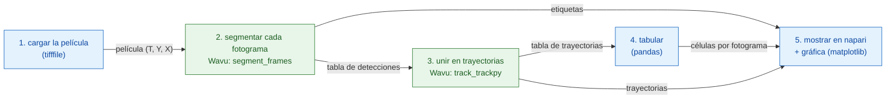

# Pipeline en Python y napari

## La idea en palabras sencillas

Un análisis de imágenes es una cena de varios platos: cada paso (abrir,
segmentar, seguir, contar, graficar) es un plato. Tu script de Python es el
camarero: lleva los ingredientes (la película) a la mesa, prepara la cuenta
(una tabla de recuentos) y sirve los platos en napari. Dos platos necesitan
utensilios de cocina especiales, así que van a dos cocinas distintas: una
cocina **corta** cada fotograma en núcleos (segmentación, con scikit-image),
la siguiente **sigue** cada núcleo de un fotograma a otro (seguimiento o
tracking, con trackpy). Cada cocina tiene sus propios utensilios, su propio
entorno de pixi, y ninguna sabe que la otra existe.

El pipeline es un pequeño **DAG** (un *grafo acíclico dirigido*, *directed
acyclic graph*: cajas unidas por flechas que solo van hacia delante, nunca
hacia atrás en un bucle). Cada caja necesita el resultado de la caja
anterior:



Las cajas azules se ejecutan en tu propio script (pasos *nativos*); las
cajas verdes son pasos de Wavu, cada uno en su propio entorno.

## Los datos

El repositorio de Wavu trae una pequeña película sintética,
`examples/data/demo_timelapse.tif`: 30 fotogramas de 256 × 256 píxeles,
0,65 µm por píxel, 5 minutos entre fotogramas. Unos 25 núcleos se
desplazan; cuatro se dividen, uno sale del campo de visión y otro entra, así
que el recuento real va de 25 a 29. Como hicimos nosotros la película,
conocemos la respuesta correcta y podemos comprobar el pipeline con ella.

## El código

Este es `examples/pipelines/dag_counting.py` del repositorio, la parte que
hace el trabajo (el archivo añade una pequeña línea de comandos alrededor):

```python
from pathlib import Path

import pandas as pd
import tifffile

from wavu.client import Worker

REPO = Path(__file__).resolve().parents[2]
MOVIE = REPO / "examples" / "data" / "demo_timelapse.tif"
SEGMENT = REPO / "examples" / "segment_frames"
TRACK = REPO / "examples" / "track_trackpy"
PIXEL_UM = 0.65        # micrómetros por píxel
FRAME_MIN = 5.0        # minutos entre fotogramas


def analyse(movie_path: Path = MOVIE, log=print):
    # 1. Cargar (nativo)
    movie = tifffile.imread(movie_path)                                   # (T, Y, X)
    log(f"loaded {movie_path.name}: {movie.shape}")

    # 2 + 3. Segmentar y luego seguir: dos cocinas, dos entornos
    with Worker.start(SEGMENT, on_log=log) as seg, Worker.start(TRACK, on_log=log) as trk:
        res = seg.run("script", {"sigma": 2.0, "threshold": "otsu", "min_area": 30},
                      {"image": movie}, meta={"image": {"pixel_um": PIXEL_UM}})
        labels = res.outputs["labels"].value                              # uint16 (T, Y, X)
        detections = res.outputs["detections"].value                      # frame, label, y, x, area, ...
        res = trk.run("script", {"search_range": 10.0, "memory": 2},
                      {"detections": detections})
        tracks = res.outputs["tracks"].value                              # ... más 'particle'

    # 4. Tabular (nativo)
    counts = (detections.groupby("frame").size()
              .reindex(range(len(movie)), fill_value=0).rename("cells").reset_index())
    counts["minutes"] = counts["frame"] * FRAME_MIN
    per_track = tracks.groupby("particle")["frame"].agg(start="min", end="max", length="size")
    # Una trayectoria que empieza después del fotograma 0 es una célula que antes no estaba:
    # una hija tras una división, o una célula que entra por el borde (o un corte
    # del seguimiento). Las contamos; no decimos cuál es cuál.
    new_tracks = per_track[per_track["start"] > 0]
    summary = {
        "frames": len(movie),
        "tracks": int(tracks["particle"].nunique()),
        "new_tracks": len(new_tracks),
        "median_track_length": float(per_track["length"].median()),
    }
    return movie, labels, tracks, counts, summary


def plot_counts(counts: pd.DataFrame):
    from matplotlib.figure import Figure

    fig = Figure(figsize=(5, 3), layout="constrained")
    ax = fig.add_subplot()
    ax.plot(counts["minutes"], counts["cells"], marker="o", markersize=3, color="#2e7d32")
    ax.set_xlabel("time (min)")
    ax.set_ylabel("cells")
    ax.set_title("Cells per frame")
    ax.grid(alpha=0.3)
    return fig


def show_in_napari(viewer, movie, labels, tracks, counts):
    """Step 5: the script decides names, colours and tail length."""
    from matplotlib.backends.backend_qtagg import FigureCanvasQTAgg

    scale = (1, PIXEL_UM, PIXEL_UM)                                        # t, y, x
    viewer.add_image(movie, name="nuclei", scale=scale, colormap="gray")
    viewer.add_labels(labels, name="segmentation", scale=scale, opacity=0.4)
    data = tracks[["particle", "frame", "y", "x"]].to_numpy(float)         # napari: [id, t, y, x]
    viewer.add_tracks(data, name="tracks", scale=scale, tail_length=10,
                      tail_width=2, colormap="turbo")
    canvas = FigureCanvasQTAgg(plot_counts(counts))
    canvas.setMinimumSize(320, 220)
    viewer.window.add_dock_widget(canvas, name="Cells per frame", area="right")
    return canvas


# Ejecutarlo y mirar
import napari

movie, labels, tracks, counts, summary = analyse()
print(summary)
viewer = napari.Viewer()
show_in_napari(viewer, movie, labels, tracks, counts)
napari.run()
```

Qué hace cada parte:

- **Los dos workers arrancan en un solo `with`.** `Worker.start(folder)`
  arranca el worker de esa carpeta en **su propio** entorno. El segundo
  worker arranca en cuanto el primero está listo; los dos se detienen al
  final del bloque.
- **El paso 2** envía la película entera y recibe tres platos: `labels`
  (una película de etiquetas de 16 bits, los números vuelven a empezar en 1
  en cada fotograma), `detections` (una fila por núcleo y fotograma:
  `frame`, `label`, `y`, `x`, `area`, `mean_intensity`) y `count_per_frame`.
- **El paso 3** envía la tabla `detections`, no una imagen. Un `DataFrame`
  de pandas viaja como un archivo CSV temporal y llega al script como una
  tabla. trackpy añade una columna `particle`: el número de trayectoria.
- **El paso 4** es pandas puro en tu script: células por fotograma,
  longitud de las trayectorias, y las trayectorias que **empiezan después
  del fotograma 0**. Esas son células nuevas: una hija tras una división,
  una célula que entra por el borde, o un sitio donde el tracker perdió un
  núcleo durante demasiado tiempo. El script las cuenta y no finge saber
  cuál es cuál.
- **El paso 5**: tu script decide el aspecto: los nombres de las capas, el
  mapa de colores de las trayectorias, lo larga que es su cola y el tamaño
  de píxel (`scale`), para que la regla de napari esté en micrómetros.

## Lo que ves en napari

- **nuclei**: la película, en gris, con un deslizador de tiempo abajo.
- **segmentation**: la película de etiquetas encima, cada núcleo de su
  propio color.
- **tracks**: una línea detrás de cada núcleo que muestra dónde estuvo en
  los últimos diez fotogramas. napari quiere las trayectorias como filas de
  `[track_id, t, y, x]`, que es justo `tracks[["particle", "frame", "y", "x"]]`.
- **Cells per frame** (células por fotograma): una gráfica de matplotlib del
  recuento frente al tiempo en minutos, acoplada a la derecha de la ventana
  (`viewer.window.add_dock_widget`).

Arrastra el deslizador de tiempo y mira cómo se divide un núcleo: su
trayectoria termina, empiezan dos nuevas, y la curva de la derecha sube un
escalón.

## Por qué importa

- **Tu entorno sigue siendo ligero.** El script que dirige el pipeline
  (aquí, el entorno de napari) necesita napari, pandas, matplotlib y
  `wavu`. No necesita trackpy, y no ejecuta ningún código de segmentación.
- **Cada paso tiene sus propios utensilios de cocina.** La segmentación y
  el seguimiento viven cada uno en una carpeta con su propio `pixi.toml`.
  Actualiza trackpy y la segmentación no se puede romper. Dos pasos cuyos
  paquetes chocan pueden seguir yendo uno detrás del otro.
- **Cambia un paso y conserva el resto.** Con imágenes reales, un umbral
  puede no bastar. Sustituye `SEGMENT` por `examples/cellpose_nuclei` (y sus
  parámetros, p. ej. `{"diameter": 30}`), ejecútalo fotograma a fotograma, y
  construye la tabla de detecciones a partir de sus etiquetas con
  `regionprops_table`. El seguimiento, la tabulación y la vista de napari se
  quedan como están.

## Cómo ejecutarlo

Desde un clon del repositorio de Wavu (su entorno `napari` tiene `wavu`,
napari y matplotlib):

```sh
pixi run -e napari python examples/pipelines/dag_counting.py
```

napari se abre con las tres capas y la gráfica. Sin pantalla, o para
obtener archivos en su lugar:

```sh
pixi run -e napari python examples/pipelines/dag_counting.py --no-viewer
```

Esto escribe `counts.csv` (frame, cells, minutes) y `plot.png` en
`dag_counting_out/` e imprime una línea de resumen. La primera ejecución
instala los entornos de las dos carpetas de script, lo que tarda unos
minutos, una sola vez.

En la película de demostración, el recuento es correcto en 27 de los 30
fotogramas y uno de más en los otros tres (lo más probable, por los núcleos
que salen y entran por el borde: la realidad cuenta un núcleo solo cuando
su centro está dentro de la imagen; la segmentación, en cuanto se ve una
parte); trackpy encuentra 32 trayectorias, 7 de las cuales empiezan después
del fotograma 0.

## En una frase

Tu script carga, cuenta y muestra; dos workers de Wavu, cada uno en su
propio entorno, segmentan y siguen; los resultados vuelven como arrays y
tablas, y tu script decide cómo los sirve napari.
