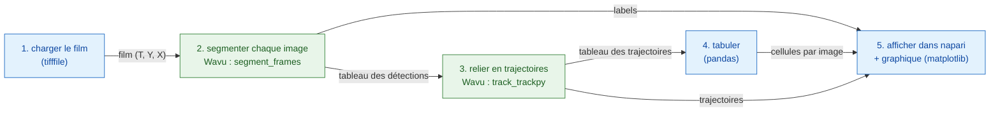

# Pipeline en Python et napari

## L'idée en mots simples { #the-idea-in-plain-words }

Une analyse d'images, c'est un dîner en plusieurs plats : chaque étape
(ouvrir, segmenter, suivre, compter, tracer) est un plat. Votre script Python est
le serveur : il apporte les ingrédients (le film) à table, rédige
l'addition (un tableau de comptes) et sert les assiettes dans napari. Deux
plats demandent une batterie de cuisine spéciale, ils partent donc vers
deux cuisines différentes : une cuisine **découpe** chaque image du film en
noyaux (segmentation, avec scikit-image), la suivante **suit** chaque noyau
d'une image à l'autre (suivi, ou *tracking*, avec trackpy). Chaque cuisine
a sa propre batterie de cuisine, son propre environnement pixi, et aucune
ne sait que l'autre existe.

Le pipeline est un petit **DAG** (un *graphe orienté acyclique* : des
boîtes reliées par des flèches qui vont seulement vers l'avant, jamais en
boucle vers l'arrière). Chaque boîte a besoin du résultat de la boîte
précédente :



Les boîtes bleues tournent dans votre propre script (étapes *natives*) ;
les boîtes vertes sont des étapes Wavu, chacune dans son propre
environnement.

## Les données { #the-data }

Le dépôt Wavu contient un petit film synthétique,
`examples/data/demo_timelapse.tif` : 30 images de 256 × 256 pixels,
0,65 µm par pixel, 5 minutes entre deux images. Environ 25 noyaux se
déplacent ; quatre se divisent, un quitte le champ de vision et un y entre,
donc le vrai compte passe de 25 à 29. Comme nous avons fabriqué ce film,
nous connaissons la bonne réponse et pouvons vérifier le pipeline avec.

## Le code { #the-code }

Voici `examples/pipelines/dag_counting.py`, tiré du dépôt : la partie qui
fait le travail (le fichier y ajoute une petite ligne de commande) :

```python
from pathlib import Path

import pandas as pd
import tifffile

from wavu.client import Worker

REPO = Path(__file__).resolve().parents[2]
MOVIE = REPO / "examples" / "data" / "demo_timelapse.tif"
SEGMENT = REPO / "examples" / "segment_frames"
TRACK = REPO / "examples" / "track_trackpy"
PIXEL_UM = 0.65        # micromètres par pixel
FRAME_MIN = 5.0        # minutes entre deux images


def analyse(movie_path: Path = MOVIE, log=print):
    # 1. Charger (natif)
    movie = tifffile.imread(movie_path)                                   # (T, Y, X)
    log(f"loaded {movie_path.name}: {movie.shape}")

    # 2 + 3. Segmenter, puis suivre : deux cuisines, deux environnements
    with Worker.start(SEGMENT, on_log=log) as seg, Worker.start(TRACK, on_log=log) as trk:
        res = seg.run("script", {"sigma": 2.0, "threshold": "otsu", "min_area": 30},
                      {"image": movie}, meta={"image": {"pixel_um": PIXEL_UM}})
        labels = res.outputs["labels"].value                              # uint16 (T, Y, X)
        detections = res.outputs["detections"].value                      # frame, label, y, x, area, ...
        res = trk.run("script", {"search_range": 10.0, "memory": 2},
                      {"detections": detections})
        tracks = res.outputs["tracks"].value                              # ... plus 'particle'

    # 4. Tabuler (natif)
    counts = (detections.groupby("frame").size()
              .reindex(range(len(movie)), fill_value=0).rename("cells").reset_index())
    counts["minutes"] = counts["frame"] * FRAME_MIN
    per_track = tracks.groupby("particle")["frame"].agg(start="min", end="max", length="size")
    # Une trajectoire qui commence après l'image 0 est une cellule absente avant :
    # une fille après une division, ou une cellule qui entre par le bord (ou une
    # coupure du suivi). Nous les comptons ; nous ne prétendons pas savoir laquelle est laquelle.
    new_tracks = per_track[per_track["start"] > 0]
    summary = {
        "frames": len(movie),
        "tracks": int(tracks["particle"].nunique()),
        "new_tracks": len(new_tracks),
        "median_track_length": float(per_track["length"].median()),
    }
    return movie, labels, tracks, counts, summary


def plot_counts(counts: pd.DataFrame):
    from matplotlib.figure import Figure

    fig = Figure(figsize=(5, 3), layout="constrained")
    ax = fig.add_subplot()
    ax.plot(counts["minutes"], counts["cells"], marker="o", markersize=3, color="#2e7d32")
    ax.set_xlabel("time (min)")
    ax.set_ylabel("cells")
    ax.set_title("Cells per frame")
    ax.grid(alpha=0.3)
    return fig


def show_in_napari(viewer, movie, labels, tracks, counts):
    """Step 5: the script decides names, colours and tail length."""
    from matplotlib.backends.backend_qtagg import FigureCanvasQTAgg

    scale = (1, PIXEL_UM, PIXEL_UM)                                        # t, y, x
    viewer.add_image(movie, name="nuclei", scale=scale, colormap="gray")
    viewer.add_labels(labels, name="segmentation", scale=scale, opacity=0.4)
    data = tracks[["particle", "frame", "y", "x"]].to_numpy(float)         # napari : [id, t, y, x]
    viewer.add_tracks(data, name="tracks", scale=scale, tail_length=10,
                      tail_width=2, colormap="turbo")
    canvas = FigureCanvasQTAgg(plot_counts(counts))
    canvas.setMinimumSize(320, 220)
    viewer.window.add_dock_widget(canvas, name="Cells per frame", area="right")
    return canvas


# Le lancer et regarder
import napari

movie, labels, tracks, counts, summary = analyse()
print(summary)
viewer = napari.Viewer()
show_in_napari(viewer, movie, labels, tracks, counts)
napari.run()
```

Ce que fait chaque morceau :

- **Les deux workers démarrent dans un seul `with`.** `Worker.start(folder)`
  démarre le worker de ce dossier dans **son propre** environnement. Le
  second worker démarre dès que le premier est prêt ; les deux s'arrêtent à
  la fin du bloc.
- **L'étape 2** envoie tout le film et reçoit trois assiettes : `labels`
  (un film de labels 16 bits, les numéros recommencent à 1 dans chaque
  image), `detections` (une ligne par noyau et par image : `frame`, `label`,
  `y`, `x`, `area`, `mean_intensity`) et `count_per_frame`.
- **L'étape 3** envoie le tableau `detections`, pas une image. Un
  `DataFrame` pandas voyage sous forme de fichier CSV temporaire et arrive
  dans le script comme un tableau. trackpy ajoute une colonne `particle` :
  le numéro de trajectoire.
- **L'étape 4** est du pandas tout simple dans votre script : cellules par
  image, longueurs des trajectoires, et les trajectoires qui **commencent
  après l'image 0**. Ce sont de nouvelles cellules : une fille après une
  division, une cellule qui entre par le bord, ou un endroit où le tracker a
  perdu un noyau trop longtemps. Le script les compte et ne prétend pas
  savoir laquelle est laquelle.
- **L'étape 5** : votre script décide de l'apparence : noms des calques,
  palette de couleurs (colormap) des trajectoires, longueur de leurs
  traînées, et taille de pixel (`scale`), pour que la règle de napari soit
  en micromètres.

## Ce que vous voyez dans napari { #what-you-see-in-napari }

- **nuclei** : le film, en gris, avec un curseur de temps en bas.
- **segmentation** : le film de labels par-dessus, chaque noyau dans sa
  propre couleur.
- **tracks** : une ligne derrière chaque noyau, qui montre où il était
  pendant les dix dernières images. napari veut les trajectoires sous forme
  de lignes `[track_id, t, y, x]`, ce qui est exactement
  `tracks[["particle", "frame", "y", "x"]]`.
- **Cells per frame** : un graphique matplotlib du compte en fonction du
  temps en minutes, ancré à droite de la fenêtre
  (`viewer.window.add_dock_widget`).

Faites glisser le curseur de temps et regardez un noyau se diviser : sa
trajectoire s'arrête, deux nouvelles commencent, et la courbe à droite
monte d'une marche.

## Pourquoi c'est important { #why-it-matters }

- **Votre environnement reste léger.** Le script qui pilote le pipeline
  (ici l'environnement de napari) a besoin de napari, pandas, matplotlib et
  `wavu`. Il n'a pas besoin de trackpy, et il n'exécute aucun code de
  segmentation.
- **Chaque étape a sa propre batterie de cuisine.** La segmentation et le
  suivi vivent chacun dans un dossier avec son propre `pixi.toml`. Mettez
  trackpy à jour, et la segmentation ne peut pas casser. Deux étapes dont
  les paquets sont incompatibles peuvent quand même se suivre.
- **Remplacez une étape, gardez le reste.** Sur de vraies images, un seuil
  peut ne pas suffire. Remplacez `SEGMENT` par `examples/cellpose_nuclei`
  (et ses paramètres, par exemple `{"diameter": 30}`), lancez-le image par
  image, et construisez le tableau des détections à partir de ses labels
  avec `regionprops_table`. Le suivi, la tabulation et la vue napari
  restent tels quels.

## Comment le lancer { #how-to-run-it }

Depuis un clone du dépôt Wavu (son environnement `napari` contient `wavu`,
napari et matplotlib) :

```sh
pixi run -e napari python examples/pipelines/dag_counting.py
```

napari s'ouvre avec les trois calques et le graphique. Sans écran, ou pour
obtenir des fichiers à la place :

```sh
pixi run -e napari python examples/pipelines/dag_counting.py --no-viewer
```

Cela écrit `counts.csv` (image, cellules, minutes) et `plot.png` dans
`dag_counting_out/` et affiche une ligne de résumé. La première exécution
installe les environnements des deux dossiers de script, ce qui prend
quelques minutes, une seule fois.

Sur le film de démo, le compte est juste dans 27 des 30 images et trop
élevé d'une unité dans les trois autres (très probablement les noyaux qui
sortent et entrent par le bord : la vérité ne compte un noyau que lorsque
son centre est dans l'image, la segmentation dès qu'une partie apparaît) ;
trackpy trouve 32 trajectoires, dont 7 commencent après l'image 0.

## En une phrase { #in-one-sentence }

Votre script charge, compte et affiche ; deux workers Wavu, chacun dans son
propre environnement, segmentent et suivent ; les résultats reviennent sous
forme de tableaux NumPy et de tableaux de données, et votre script décide
comment napari les sert.
