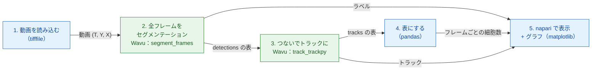

# Python と napari でパイプライン

## やさしく言うと

画像解析は、いくつものコースからなるディナーです。各ステップ（開く、
セグメンテーション、トラッキング、数える、プロット）が一皿ずつのコースです。あなたの Python
スクリプトはウェイターです。食材（動画）をテーブルに運び、伝票（数の表）を
書き、napari でお皿を出します。2 つの料理には特別な調理器具が必要なので、
別々の 2 つの厨房へ行きます。1 つ目の厨房は各フレームを核ごとに **切り分け**
（セグメンテーション、scikit-image を使用）、次の厨房は各核をフレームから
フレームへ **追いかけます**（追跡、trackpy を使用）。それぞれの厨房には専用の
調理器具、つまり専用の pixi 環境があり、どちらももう一方の存在を知りません。

パイプラインは小さな **DAG**（*directed acyclic graph*、有向非巡回グラフ：
前にしか進まず、ループで後ろに戻ることのない矢印で箱をつないだもの）です。
各箱は、1 つ前の箱の結果を必要とします。



青い箱はあなた自身のスクリプトの中で動きます（*ネイティブ* な手順）。緑の箱は
Wavu の手順で、それぞれ専用の環境で動きます。

## データ

Wavu リポジトリには小さな合成の動画 `examples/data/demo_timelapse.tif` が
あります。256 × 256 ピクセルのフレームが 30 枚、1 ピクセル 0.65 µm、フレーム
間隔 5 分です。約 25 個の核があちこちへ漂い、4 個が分裂し、1 個が視野から
出ていき、1 個が入ってくるので、本当の数は 25 から 29 になります。動画は
自分たちで作ったので正解が分かっており、それと照らしてパイプラインを確かめ
られます。

## コード

これはリポジトリの `examples/pipelines/dag_counting.py` のうち、実際の処理を
する部分です（ファイルでは、まわりに小さなコマンドラインが付いています）。

```python
from pathlib import Path

import pandas as pd
import tifffile

from wavu.client import Worker

REPO = Path(__file__).resolve().parents[2]
MOVIE = REPO / "examples" / "data" / "demo_timelapse.tif"
SEGMENT = REPO / "examples" / "segment_frames"
TRACK = REPO / "examples" / "track_trackpy"
PIXEL_UM = 0.65        # 1 ピクセルあたりのマイクロメートル
FRAME_MIN = 5.0        # フレーム間の分


def analyse(movie_path: Path = MOVIE, log=print):
    # 1. 読み込む（ネイティブ）
    movie = tifffile.imread(movie_path)                                   # (T, Y, X)
    log(f"loaded {movie_path.name}: {movie.shape}")

    # 2 + 3. セグメンテーションしてから追跡：厨房 2 つ、環境 2 つ
    with Worker.start(SEGMENT, on_log=log) as seg, Worker.start(TRACK, on_log=log) as trk:
        res = seg.run("script", {"sigma": 2.0, "threshold": "otsu", "min_area": 30},
                      {"image": movie}, meta={"image": {"pixel_um": PIXEL_UM}})
        labels = res.outputs["labels"].value                              # uint16 (T, Y, X)
        detections = res.outputs["detections"].value                      # frame, label, y, x, area, ...
        res = trk.run("script", {"search_range": 10.0, "memory": 2},
                      {"detections": detections})
        tracks = res.outputs["tracks"].value                              # ... に 'particle' を追加

    # 4. 表にする（ネイティブ）
    counts = (detections.groupby("frame").size()
              .reindex(range(len(movie)), fill_value=0).rename("cells").reset_index())
    counts["minutes"] = counts["frame"] * FRAME_MIN
    per_track = tracks.groupby("particle")["frame"].agg(start="min", end="max", length="size")
    # フレーム 0 より後に始まるトラックは、それまでいなかった細胞：
    # 分裂後の娘細胞か、端から漂ってきた細胞（または追跡の途切れ）。
    # 数は数えるが、どれがどれかは決めつけない。
    new_tracks = per_track[per_track["start"] > 0]
    summary = {
        "frames": len(movie),
        "tracks": int(tracks["particle"].nunique()),
        "new_tracks": len(new_tracks),
        "median_track_length": float(per_track["length"].median()),
    }
    return movie, labels, tracks, counts, summary


def plot_counts(counts: pd.DataFrame):
    from matplotlib.figure import Figure

    fig = Figure(figsize=(5, 3), layout="constrained")
    ax = fig.add_subplot()
    ax.plot(counts["minutes"], counts["cells"], marker="o", markersize=3, color="#2e7d32")
    ax.set_xlabel("time (min)")
    ax.set_ylabel("cells")
    ax.set_title("Cells per frame")
    ax.grid(alpha=0.3)
    return fig


def show_in_napari(viewer, movie, labels, tracks, counts):
    """Step 5: the script decides names, colours and tail length."""
    from matplotlib.backends.backend_qtagg import FigureCanvasQTAgg

    scale = (1, PIXEL_UM, PIXEL_UM)                                        # t, y, x
    viewer.add_image(movie, name="nuclei", scale=scale, colormap="gray")
    viewer.add_labels(labels, name="segmentation", scale=scale, opacity=0.4)
    data = tracks[["particle", "frame", "y", "x"]].to_numpy(float)         # napari: [id, t, y, x]
    viewer.add_tracks(data, name="tracks", scale=scale, tail_length=10,
                      tail_width=2, colormap="turbo")
    canvas = FigureCanvasQTAgg(plot_counts(counts))
    canvas.setMinimumSize(320, 220)
    viewer.window.add_dock_widget(canvas, name="Cells per frame", area="right")
    return canvas


# 実行して見る
import napari

movie, labels, tracks, counts, summary = analyse()
print(summary)
viewer = napari.Viewer()
show_in_napari(viewer, movie, labels, tracks, counts)
napari.run()
```

それぞれの部分がすること：

- **2 つのワーカーは 1 つの `with` で起動します。** `Worker.start(folder)` は、
  そのフォルダーのワーカーを **そのフォルダー専用の** 環境で起動します。
  2 つ目のワーカーは 1 つ目の準備ができるとすぐに起動し、ブロックの終わりで
  両方とも止まります。
- **ステップ 2** は動画全体を送り、3 枚のお皿を受け取ります。`labels`
  （16 ビットのラベル動画。番号はフレームごとに 1 から振り直されます）、
  `detections`（フレームごと・核ごとに 1 行：`frame`、`label`、`y`、`x`、
  `area`、`mean_intensity`）、そして `count_per_frame` です。
- **ステップ 3** は画像ではなく `detections` の表を送ります。pandas の
  `DataFrame` は一時的な CSV ファイルとして運ばれ、スクリプトには表として
  届きます。trackpy は `particle` 列、つまりトラック番号を追加します。
- **ステップ 4** は、あなたのスクリプトの中のふつうの pandas です。
  フレームごとの細胞数、トラックの長さ、そして **フレーム 0 より後に始まる**
  トラックを求めます。これらは新しい細胞です。分裂後の娘細胞か、端から
  漂ってきた細胞か、トラッカーが核を長く見失いすぎた場所です。スクリプトは
  それを数えますが、どれがどれかを知っているふりはしません。
- **ステップ 5：** 見た目はあなたのスクリプトが決めます。レイヤーの名前、
  トラックのカラーマップ、尾の長さ、そしてピクセルサイズ（`scale`）です。
  これで napari の定規はマイクロメートル単位になります。

## napari に表示されるもの

- **nuclei**：グレーの動画。下に時間のスライダーがあります。
- **segmentation**：その上に重なるラベル動画。核ごとに色が違います。
- **tracks**：各核の後ろに引かれた線で、直近 10 フレームでどこにいたかを
  示します。napari はトラックを `[track_id, t, y, x]` の行として受け取ります。
  これはちょうど `tracks[["particle", "frame", "y", "x"]]` です。
- **Cells per frame**：分単位の時間に対する細胞数の matplotlib グラフで、
  ウィンドウの右側にドッキングされます（`viewer.window.add_dock_widget`）。

時間のスライダーを動かして、核が分裂するところを見てください。そのトラックが
終わり、新しいトラックが 2 本始まり、右側の曲線が 1 段上がります。

## なぜ大事なのか

- **あなたの環境は軽いままです。** パイプラインを動かすスクリプト（ここでは
  napari の環境）に必要なのは、napari、pandas、matplotlib、`wavu` です。
  trackpy は不要で、セグメンテーションのコードも動かしません。
- **手順ごとに専用の調理器具があります。** セグメンテーションと追跡は、
  それぞれ専用の `pixi.toml` を持つフォルダーにあります。trackpy を
  アップグレードしても、セグメンテーションが壊れることはありません。
  パッケージがぶつかる 2 つの手順でも、続けて実行できます。
- **手順を 1 つ替えて、残りはそのまま。** 実際の画像では、しきい値だけでは
  足りないことがあります。`SEGMENT` を `examples/cellpose_nuclei`（とその
  パラメーター、たとえば `{"diameter": 30}`）に替え、フレームごとに実行し、
  そのラベルから `regionprops_table` で detections の表を作ります。追跡、
  表作り、napari での表示はそのままです。

## 実行のしかた

Wavu リポジトリのクローンから実行します（その `napari` 環境には `wavu`、
napari、matplotlib が入っています）。

```sh
pixi run -e napari python examples/pipelines/dag_counting.py
```

napari が 3 つのレイヤーとグラフ付きで開きます。画面がない場合や、代わりに
ファイルがほしい場合は次のようにします。

```sh
pixi run -e napari python examples/pipelines/dag_counting.py --no-viewer
```

これは `counts.csv`（frame、cells、minutes）と `plot.png` を
`dag_counting_out/` に書き出し、要約を 1 行表示します。最初の実行では
2 つのスクリプトフォルダーの環境をインストールするので、一度だけ数分
かかります。

デモ動画では、30 フレームのうち 27 フレームで数が正しく、残りの 3 フレームでは
1 つ多くなります（おそらく端で出入りする核のためです。正解は中心が画像の内側に
あるときだけ核を数えますが、セグメンテーションは一部が見えた時点で数えます）。
trackpy は 32 本のトラックを見つけ、そのうち 7 本がフレーム 0 より後に
始まります。

## ひとことで言うと

あなたのスクリプトが読み込み、数え、表示します。それぞれ専用の環境を持つ
2 つの Wavu ワーカーがセグメンテーションと追跡を行い、結果は配列と表として
戻ってきます。そして napari でどう出すかは、あなたのスクリプトが決めます。
