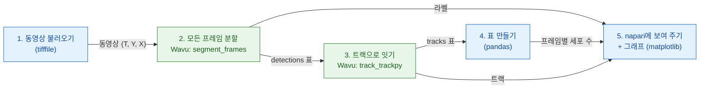

# Python과 napari에서 파이프라인

!!! question "이 파이프라인이 재는 것"
    분열하는 핵의 타임랩스에서 **시간에 따른 세포 수**(y는 세포 수, x는 시간)를
    재고, 두 번째로 **계보**의 수도 봐요. 계보란 처음 세포 하나와 그 딸세포
    전부예요. 아래의 모든 단계는 이 출력에 필요하기 때문에 있어요
    ([분석 전에](index.md) 참고).

## 쉬운 말로 설명하면

이미지 분석은 여러 코스로 된 저녁 식사예요. 각 단계(열기, 분할, 추적,
세기, 그래프)가 코스 하나예요. 여러분의 Python 스크립트가
웨이터예요. 재료(동영상)를 테이블로 가져오고, 계산서(개수 표)를 쓰고,
napari에 접시를 내요. 요리 두 개에는 특별한 주방 도구가 필요해서, 서로 다른
두 주방으로 가요. 한 주방은 모든 프레임을 핵 단위로 **잘라 내고**(분할,
scikit-image 사용), 다음 주방은 핵 하나하나를 프레임에서 프레임으로
**따라가요**(추적, trackpy 사용). 주방마다 자기만의 주방 도구, 곧 자기만의
pixi 환경이 있고, 둘 다 서로가 있는 줄도 몰라요.

파이프라인은 작은 **DAG**(*directed acyclic graph*, 방향성 비순환 그래프:
앞으로만 가고 고리처럼 뒤로 돌아가지 않는 화살표로 상자들을 이은 것)예요.
상자마다 바로 앞 상자의 결과가 필요해요.



파란 상자는 여러분 스크립트 안에서 실행돼요(*네이티브* 단계). 초록 상자는
Wavu 단계이고, 각각 자기 환경에서 실행돼요.

## 시작하기 전에

1. **Wavu 저장소 받기:** VS Code에서 열면 VS Code가 클론해 줘요. 아니면
   `git clone`으로 클론하세요. 이 페이지의 모든 것은 그 폴더에서
   [pixi](../napari/install.md)로 실행해요.

   [Wavu 저장소를 VS Code에서 열기](vscode://vscode.git/clone?url=https%3A%2F%2Fgithub.com%2FOxford-Zeiss-Centre-of-Excellence%2FWavu.git){ .md-button .md-button--primary }

2. **데이터:** `examples/data/demo_timelapse.tif`는 작은 합성 동영상이에요.
   256 × 256 픽셀 프레임 30장, 픽셀당 0.65 µm, 프레임 사이 5분이에요. 핵 약
   25개가 이리저리 떠다니고, 4개가 분열하고, 1개는 시야 밖으로 나가고 1개는
   들어오니, 실제 개수는 25에서 29가 돼요. 동영상을 우리가 만들었으니 정답을
   알고 있고, 그것과 비교해 파이프라인을 확인할 수 있어요.

   { width="256" }

## 코드

저장소의 `examples/pipelines/dag_counting.py` 중 실제로 일하는 부분이에요
(파일에는 이 둘레에 작은 명령줄 처리가 더 있어요).

```python
from pathlib import Path

import pandas as pd
import tifffile

from wavu.client import Worker

REPO = Path(__file__).resolve().parents[2]
MOVIE = REPO / "examples" / "data" / "demo_timelapse.tif"
SEGMENT = REPO / "examples" / "segment_frames"
TRACK = REPO / "examples" / "track_trackpy"
PIXEL_UM = 0.65        # 픽셀당 마이크로미터
FRAME_MIN = 5.0        # 프레임 사이의 분


def analyse(movie_path: Path = MOVIE, log=print):
    # 1. 불러오기(네이티브)
    movie = tifffile.imread(movie_path)                                   # (T, Y, X)
    log(f"loaded {movie_path.name}: {movie.shape}")

    # 2 + 3. 분할한 다음 추적: 주방 둘, 환경 둘
    with Worker.start(SEGMENT, on_log=log) as seg, Worker.start(TRACK, on_log=log) as trk:
        res = seg.run("script", {"sigma": 2.0, "threshold": "otsu", "min_area": 30},
                      {"image": movie}, meta={"image": {"pixel_um": PIXEL_UM}})
        labels = res.outputs["labels"].value                              # uint16 (T, Y, X)
        detections = res.outputs["detections"].value                      # frame, label, y, x, area, ...
        res = trk.run("script", {"search_range": 10.0, "memory": 2},
                      {"detections": detections})
        tracks = res.outputs["tracks"].value                              # ... 에 'particle' 추가

    # 4. 표 만들기(네이티브)
    counts = (detections.groupby("frame").size()
              .reindex(range(len(movie)), fill_value=0).rename("cells").reset_index())
    counts["minutes"] = counts["frame"] * FRAME_MIN
    per_track = tracks.groupby("particle")["frame"].agg(start="min", end="max", length="size")
    # 프레임 0 이후에 시작하는 트랙은 전에 없던 세포예요:
    # 분열 뒤의 딸세포, 가장자리에서 떠 들어온 세포(또는 추적이 끊긴 곳).
    # 개수는 세지만, 어느 쪽인지는 단정하지 않아요.
    new_tracks = per_track[per_track["start"] > 0]
    summary = {
        "frames": len(movie),
        "tracks": int(tracks["particle"].nunique()),
        "new_tracks": len(new_tracks),
        "median_track_length": float(per_track["length"].median()),
    }
    return movie, labels, tracks, counts, summary


def plot_counts(counts: pd.DataFrame):
    from matplotlib.figure import Figure

    fig = Figure(figsize=(5, 3), layout="constrained")
    ax = fig.add_subplot()
    ax.plot(counts["minutes"], counts["cells"], marker="o", markersize=3, color="#2e7d32")
    ax.set_xlabel("time (min)")
    ax.set_ylabel("cells")
    ax.set_title("Cells per frame")
    ax.grid(alpha=0.3)
    return fig


def show_in_napari(viewer, movie, labels, tracks, counts):
    """Step 5: the script decides names, colours and tail length."""
    from matplotlib.backends.backend_qtagg import FigureCanvasQTAgg

    scale = (1, PIXEL_UM, PIXEL_UM)                                        # t, y, x
    viewer.add_image(movie, name="nuclei", scale=scale, colormap="gray")
    viewer.add_labels(labels, name="segmentation", scale=scale, opacity=0.4)
    data = tracks[["particle", "frame", "y", "x"]].to_numpy(float)         # napari: [id, t, y, x]
    viewer.add_tracks(data, name="tracks", scale=scale, tail_length=10,
                      tail_width=2, colormap="turbo")
    canvas = FigureCanvasQTAgg(plot_counts(counts))
    canvas.setMinimumSize(320, 220)
    viewer.window.add_dock_widget(canvas, name="Cells per frame", area="right")
    return canvas


# 실행하고 보기
import napari

movie, labels, tracks, counts, summary = analyse()
print(summary)
viewer = napari.Viewer()
show_in_napari(viewer, movie, labels, tracks, counts)
napari.run()
```

각 부분이 하는 일:

- **두 워커가 `with` 하나에서 시작해요.** `Worker.start(folder)`는 그 폴더의
  워커를 **그 폴더만의** 환경에서 시작해요. 두 번째 워커는 첫 번째가 준비되는
  대로 시작하고, 블록이 끝나면 둘 다 멈춰요.
- **2단계**는 동영상 전체를 보내고 접시 세 개를 돌려받아요. `labels`(16비트
  라벨 동영상, 번호는 프레임마다 1부터 다시 시작해요), `detections`(프레임별
  핵마다 한 행: `frame`, `label`, `y`, `x`, `area`, `mean_intensity`),
  그리고 `count_per_frame`이에요.
- **3단계**는 이미지가 아니라 `detections` 표를 보내요. pandas
  `DataFrame`은 임시 CSV 파일로 옮겨져 스크립트에 표로 도착해요. trackpy는
  `particle` 열, 곧 트랙 번호를 더해요.
- **4단계**는 여러분 스크립트 안의 평범한 pandas예요. 프레임별 세포 수, 트랙
  길이, 그리고 **프레임 0 이후에 시작하는** 트랙을 구해요. 이것들은 새
  세포예요. 분열 뒤의 딸세포, 가장자리에서 떠 들어온 세포, 또는 트래커가
  핵을 너무 오래 놓친 곳이에요. 스크립트는 이것들을 세지만, 어느 쪽인지
  아는 척하지 않아요.
- **5단계:** 보이는 모습은 여러분 스크립트가 정해요. 레이어 이름, 트랙의
  컬러맵, 꼬리 길이, 그리고 픽셀 크기(`scale`)요. 그래서 napari의 자가
  마이크로미터 단위가 돼요.

## napari에서 보이는 것

- **nuclei**: 회색 동영상, 아래쪽에 시간 슬라이더가 있어요.
- **segmentation**: 그 위에 겹친 라벨 동영상, 핵마다 색이 달라요.
- **tracks**: 핵마다 뒤에 남는 선으로, 지난 10프레임 동안 어디 있었는지
  보여 줘요. napari는 트랙을 `[track_id, t, y, x]` 행으로 받는데, 이게 바로
  `tracks[["particle", "frame", "y", "x"]]`예요.
- **Cells per frame**: 분 단위 시간에 대한 개수를 그린 matplotlib 그래프로,
  창 오른쪽에 도킹돼요(`viewer.window.add_dock_widget`).

시간 슬라이더를 끌면서 핵이 갈라지는 걸 보세요. 그 트랙이 끝나고, 새 트랙
두 개가 시작되고, 오른쪽 곡선이 한 칸 올라가요.

## 왜 중요한가요

- **여러분의 환경이 가볍게 유지돼요.** 파이프라인을 조종하는 스크립트(여기서는
  napari 환경)에는 napari, pandas, matplotlib, `wavu`만 있으면 돼요.
  trackpy는 필요 없고, 분할 코드도 실행하지 않아요.
- **단계마다 자기 주방 도구가 있어요.** 분할과 추적은 각각 자기 `pixi.toml`이
  있는 폴더에 살아요. trackpy를 업그레이드해도 분할은 망가질 수 없어요.
  패키지가 충돌하는 두 단계도 차례로 이어질 수 있어요.
- **한 단계만 바꾸고 나머지는 그대로.** 실제 이미지에서는 임계값만으로
  모자랄 수 있어요. `SEGMENT`를 `examples/cellpose_nuclei`(와 그 매개변수,
  예: `{"diameter": 30}`)로 바꾸고, 프레임마다 실행하고, 그 라벨에서
  `regionprops_table`로 detections 표를 만드세요. 추적, 표 만들기, napari
  화면은 그대로예요.

## 실행 방법

VS Code에서 Wavu 폴더의 터미널(**Terminal › New Terminal**)을 열고
실행하세요(그 `napari` 환경에 `wavu`, napari, matplotlib가 있어요).

```sh
pixi run -e napari python examples/pipelines/dag_counting.py
```

napari가 레이어 세 개와 그래프와 함께 열려요. 화면이 없거나 대신 파일을
받고 싶다면:

```sh
pixi run -e napari python examples/pipelines/dag_counting.py --no-viewer
```

이렇게 하면 `counts.csv`(frame, cells, minutes)와 `plot.png`를
`dag_counting_out/`에 쓰고 요약을 한 줄 출력해요. 첫 실행에서는 두 스크립트
폴더의 환경을 설치하느라 몇 분 걸려요. 한 번만요.

## 결과

데모 동영상에서 개수는 30프레임 중 27프레임에서 맞고, 나머지 3프레임에서는
하나 많아요(가장자리에서 나가고 들어오는 핵 때문이에요. 정답은 중심이
이미지 안에 있을 때만 핵을 세지만, 분할은 일부만 보여도 바로 세요). trackpy는
트랙 32개를 찾고, 그중 7개가 프레임 0 이후에 시작해요. 딸세포 넷과 새로
들어온 핵, 그리고 끊긴 트랙 몇 개예요.

{ width="720" }

왼쪽은 각 트랙의 꼬리를 그린 동영상(trackpy)이에요. 오른쪽은 측정값, 곧
**시간에 따른 세포 수**예요. 회색 점선: 실제 개수. 파란 점: 측정한 세포
수로, 어느 방법이든 같아요. 모두 같은 분할 결과를 세니까요. 비교용 주황색
선: [Fiji 버전](pipeline-fiji.md)에서 각 프레임에 살아 있는 **TrackMate
계보** 수. trackpy에는 트랙은 있지만 계보는 없어요. 점과 주황색 선 사이의
틈은 분열로 태어난 세포 수이고, 분열 네 번마다 하나씩 벌어져요. 계보 선은
50분에 핵 하나가 나갈 때 내려가고, 85분에 하나가 들어올 때 다시 올라와요.

## 한 문장으로

여러분의 스크립트가 불러오고, 세고, 보여 줘요. 각자 자기 환경을 가진 Wavu
워커 둘이 분할과 추적을 하고, 결과는 배열과 표로 돌아오며, napari에 어떻게
낼지는 여러분의 스크립트가 정해요.
