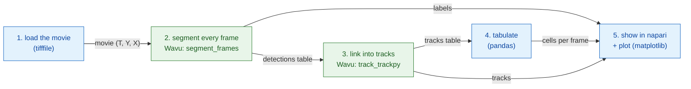

# Pipeline in Python and napari

## The idea in plain words

A time-lapse is a dinner of several courses. Your Python script is the
waiter: it brings the ingredients (the movie) to the table, writes up the
bill (a table of counts) and serves the plates in napari. Two dishes need
special kitchenware, so they go to two different kitchens: one kitchen
**cuts** every frame into nuclei (segmentation, with scikit-image), the
next **follows** each nucleus from frame to frame (tracking, with
trackpy). Each kitchen has its own kitchenware, its own pixi environment,
and neither knows the other exists.

The pipeline is a small **DAG** (a *directed acyclic graph*: boxes joined
by arrows that only go forward, never back in a loop). Each box needs the
result of the box before it:



Blue boxes run in your own script (*native* steps); green boxes are Wavu
steps, each in its own environment.

## The data

The Wavu repository has a small synthetic movie,
`examples/data/demo_timelapse.tif`: 30 frames of 256 × 256 pixels,
0.65 µm per pixel, 5 minutes between frames. About 25 nuclei drift
around; four divide, one leaves the field of view and one enters, so the
true count goes from 25 to 29. Since we made the movie, we know the right
answer and can check the pipeline against it.

## The code

This is `examples/pipelines/dag_counting.py` from the repository, the part
that does the work (the file adds a small command line around it):

```python
from pathlib import Path

import pandas as pd
import tifffile

from wavu.client import Worker

REPO = Path(__file__).resolve().parents[2]
MOVIE = REPO / "examples" / "data" / "demo_timelapse.tif"
SEGMENT = REPO / "examples" / "segment_frames"
TRACK = REPO / "examples" / "track_trackpy"
PIXEL_UM = 0.65        # micrometres per pixel
FRAME_MIN = 5.0        # minutes between frames


def analyse(movie_path: Path = MOVIE, log=print):
    # 1. Load (native)
    movie = tifffile.imread(movie_path)                                   # (T, Y, X)
    log(f"loaded {movie_path.name}: {movie.shape}")

    # 2 + 3. Segment, then track: two kitchens, two environments
    with Worker.start(SEGMENT, on_log=log) as seg, Worker.start(TRACK, on_log=log) as trk:
        res = seg.run("script", {"sigma": 2.0, "threshold": "otsu", "min_area": 30},
                      {"image": movie}, meta={"image": {"pixel_um": PIXEL_UM}})
        labels = res.outputs["labels"].value                              # uint16 (T, Y, X)
        detections = res.outputs["detections"].value                      # frame, label, y, x, area, ...
        res = trk.run("script", {"search_range": 10.0, "memory": 2},
                      {"detections": detections})
        tracks = res.outputs["tracks"].value                              # ... plus 'particle'

    # 4. Tabulate (native)
    counts = (detections.groupby("frame").size()
              .reindex(range(len(movie)), fill_value=0).rename("cells").reset_index())
    counts["minutes"] = counts["frame"] * FRAME_MIN
    per_track = tracks.groupby("particle")["frame"].agg(start="min", end="max", length="size")
    # A track that starts after frame 0 is a cell that was not there before:
    # a daughter after a division, or a cell drifting in from the edge (or a
    # tracking break). We count them; we do not claim which is which.
    new_tracks = per_track[per_track["start"] > 0]
    summary = {
        "frames": len(movie),
        "tracks": int(tracks["particle"].nunique()),
        "new_tracks": len(new_tracks),
        "median_track_length": float(per_track["length"].median()),
    }
    return movie, labels, tracks, counts, summary


def plot_counts(counts: pd.DataFrame):
    from matplotlib.figure import Figure

    fig = Figure(figsize=(5, 3), layout="constrained")
    ax = fig.add_subplot()
    ax.plot(counts["minutes"], counts["cells"], marker="o", markersize=3, color="#2e7d32")
    ax.set_xlabel("time (min)")
    ax.set_ylabel("cells")
    ax.set_title("Cells per frame")
    ax.grid(alpha=0.3)
    return fig


def show_in_napari(viewer, movie, labels, tracks, counts):
    """Step 5: the script decides names, colours and tail length."""
    from matplotlib.backends.backend_qtagg import FigureCanvasQTAgg

    scale = (1, PIXEL_UM, PIXEL_UM)                                        # t, y, x
    viewer.add_image(movie, name="nuclei", scale=scale, colormap="gray")
    viewer.add_labels(labels, name="segmentation", scale=scale, opacity=0.4)
    data = tracks[["particle", "frame", "y", "x"]].to_numpy(float)         # napari: [id, t, y, x]
    viewer.add_tracks(data, name="tracks", scale=scale, tail_length=10,
                      tail_width=2, colormap="turbo")
    canvas = FigureCanvasQTAgg(plot_counts(counts))
    canvas.setMinimumSize(320, 220)
    viewer.window.add_dock_widget(canvas, name="Cells per frame", area="right")
    return canvas


# Run it and look
import napari

movie, labels, tracks, counts, summary = analyse()
print(summary)
viewer = napari.Viewer()
show_in_napari(viewer, movie, labels, tracks, counts)
napari.run()
```

What each piece does:

- **Both workers start in one `with`.** `Worker.start(folder)` starts that
  folder's worker in **its own** environment. The second worker starts
  as soon as the first is ready; both stop at the end of the block.
- **Step 2** sends the whole movie and gets back three plates: `labels`
  (a 16-bit label movie, numbers restart at 1 in each frame),
  `detections` (one row per nucleus per frame: `frame`, `label`, `y`, `x`,
  `area`, `mean_intensity`) and `count_per_frame`.
- **Step 3** sends the `detections` table, not an image. A pandas
  `DataFrame` travels as a temporary CSV file and arrives in the script as
  a table. trackpy adds a `particle` column: the track number.
- **Step 4** is plain pandas in your script: cells per frame, track lengths,
  and the tracks that **start after frame 0**. Those are new cells: a
  daughter after a division, a cell drifting in from the edge, or a place
  where the tracker lost a nucleus for too long. The script counts them and
  does not pretend to know which is which.
- **Step 5**: your script decides how things look: layer names, the
  colormap of the tracks, how long their tails are, and the pixel size
  (`scale`), so napari's ruler is in micrometres.

## What you see in napari

- **nuclei**: the movie, in grey, with a time slider at the bottom.
- **segmentation**: the label movie on top, each nucleus its own colour.
- **tracks**: a line behind every nucleus showing where it was in the last
  ten frames. napari wants tracks as rows of `[track_id, t, y, x]`, which
  is exactly `tracks[["particle", "frame", "y", "x"]]`.
- **Cells per frame**: a matplotlib plot of the count against time in
  minutes, docked on the right of the window
  (`viewer.window.add_dock_widget`).

Drag the time slider and watch a nucleus split: its track ends, two new
ones begin, and the curve on the right steps up by one.

## Why it matters

- **Your environment stays light.** The script that drives the pipeline
  (here napari's environment) needs napari, pandas, matplotlib and
  `wavu`. It does not need trackpy, and it runs no segmentation code.
- **Each step has its own kitchenware.** Segmentation and tracking each
  live in a folder with its own `pixi.toml`. Upgrade trackpy, and the
  segmentation cannot break. Two steps whose packages clash can still
  follow each other.
- **Swap a step, keep the rest.** On real images, a threshold may not be
  enough. Replace `SEGMENT` with `examples/cellpose_nuclei` (and its
  parameters, e.g. `{"diameter": 30}`), run it frame by frame, and build
  the detections table from its labels with `regionprops_table`. Tracking,
  tabulating and the napari view stay as they are.

## How to run it

From a clone of the Wavu repository (its `napari` environment has
`wavu`, napari and matplotlib):

```sh
pixi run -e napari python examples/pipelines/dag_counting.py
```

napari opens with the three layers and the plot. Without a screen, or to
get files instead:

```sh
pixi run -e napari python examples/pipelines/dag_counting.py --no-viewer
```

This writes `counts.csv` (frame, cells, minutes) and `plot.png` to
`dag_counting_out/` and prints one summary line. The first run installs
the environments of the two script folders, which takes a few minutes,
once.

On the demo movie, the count is right in 27 of the 30 frames and one too
high in the other three (most likely the nuclei leaving and entering at
the edge: the truth counts a nucleus only when its centre is inside the
image, the segmentation as soon as part of it shows); trackpy finds 32 tracks, 7 of which start after
frame 0.

## In one sentence

Your script loads, counts and shows; two Wavu workers, each in its own
environment, segment and track; the results come back as arrays and tables,
and your script decides how napari serves them.
