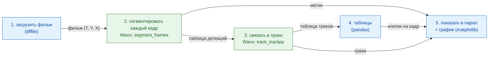

# Конвейер на Python и napari

!!! question "Что измеряет этот конвейер"
    **Число клеток (y) в зависимости от времени (x)** во временном ряду
    делящихся ядер и, как второй взгляд, число **родословных**: одна
    исходная клетка плюс все её дочерние. Каждый шаг ниже есть потому, что
    он нужен для этого результата (см. [Перед любым анализом](index.md)).

## Идея простыми словами

Анализ изображений — это ужин из нескольких блюд: каждый шаг (открыть,
сегментировать, отследить, посчитать, построить график) — одно блюдо. Ваш скрипт на Python —
официант: он приносит к столу ингредиенты (фильм), выписывает счёт (таблицу
подсчётов) и подаёт тарелки в napari. Для двух блюд нужна особая кухонная
утварь, поэтому они идут на две разные кухни: одна кухня **нарезает** каждый
кадр на ядра (сегментация, со scikit-image), следующая **следит** за каждым
ядром от кадра к кадру (трекинг, с trackpy). У каждой кухни своя утварь,
своё окружение pixi, и ни одна не знает о существовании другой.

Конвейер — это маленький **DAG** (*directed acyclic graph*, ориентированный
ациклический граф: блоки, соединённые стрелками, которые идут только
вперёд и никогда не возвращаются назад по кругу). Каждому блоку нужен
результат предыдущего:



Синие блоки выполняются в вашем собственном скрипте (*нативные* шаги);
зелёные блоки — шаги Wavu, каждый в своём окружении.

## Перед началом

1. **Получите репозиторий Wavu**: откройте его в VS Code, который сам его
   клонирует, или клонируйте его через `git clone`. Всё на этой странице
   запускается из этой папки, с помощью [pixi](../napari/install.md).

   [Открыть репозиторий Wavu в VS Code](vscode://vscode.git/clone?url=https%3A%2F%2Fgithub.com%2FOxford-Zeiss-Centre-of-Excellence%2FWavu.git){ .md-button .md-button--primary }

2. **Данные**: `examples/data/demo_timelapse.tif`, небольшой синтетический
   фильм: 30 кадров по 256 × 256 пикселей, 0,65 мкм на пиксель, 5 минут
   между кадрами. Около 25 ядер дрейфуют по полю; четыре делятся, одно
   уходит из поля зрения и одно входит, так что истинное число растёт с 25
   до 29. Раз фильм сделали мы сами, мы знаем правильный ответ и можем
   сверить с ним конвейер.

   { width="256" }

## Код

Это `examples/pipelines/dag_counting.py` из репозитория, та часть, которая
делает работу (в файле вокруг неё ещё небольшой интерфейс командной
строки):

```python
from pathlib import Path

import pandas as pd
import tifffile

from wavu.client import Worker

REPO = Path(__file__).resolve().parents[2]
MOVIE = REPO / "examples" / "data" / "demo_timelapse.tif"
SEGMENT = REPO / "examples" / "segment_frames"
TRACK = REPO / "examples" / "track_trackpy"
PIXEL_UM = 0.65        # микрометров на пиксель
FRAME_MIN = 5.0        # минут между кадрами


def analyse(movie_path: Path = MOVIE, log=print):
    # 1. Загрузка (нативно)
    movie = tifffile.imread(movie_path)                                   # (T, Y, X)
    log(f"loaded {movie_path.name}: {movie.shape}")

    # 2 + 3. Сегментация, затем трекинг: две кухни, два окружения
    with Worker.start(SEGMENT, on_log=log) as seg, Worker.start(TRACK, on_log=log) as trk:
        res = seg.run("script", {"sigma": 2.0, "threshold": "otsu", "min_area": 30},
                      {"image": movie}, meta={"image": {"pixel_um": PIXEL_UM}})
        labels = res.outputs["labels"].value                              # uint16 (T, Y, X)
        detections = res.outputs["detections"].value                      # frame, label, y, x, area, ...
        res = trk.run("script", {"search_range": 10.0, "memory": 2},
                      {"detections": detections})
        tracks = res.outputs["tracks"].value                              # ... плюс 'particle'

    # 4. Таблицы (нативно)
    counts = (detections.groupby("frame").size()
              .reindex(range(len(movie)), fill_value=0).rename("cells").reset_index())
    counts["minutes"] = counts["frame"] * FRAME_MIN
    per_track = tracks.groupby("particle")["frame"].agg(start="min", end="max", length="size")
    # Трек, который начинается после кадра 0, — это клетка, которой раньше не было:
    # дочерняя клетка после деления или клетка, вошедшая с края (или разрыв
    # трекинга). Мы их считаем, но не утверждаем, что есть что.
    new_tracks = per_track[per_track["start"] > 0]
    summary = {
        "frames": len(movie),
        "tracks": int(tracks["particle"].nunique()),
        "new_tracks": len(new_tracks),
        "median_track_length": float(per_track["length"].median()),
    }
    return movie, labels, tracks, counts, summary


def plot_counts(counts: pd.DataFrame):
    from matplotlib.figure import Figure

    fig = Figure(figsize=(5, 3), layout="constrained")
    ax = fig.add_subplot()
    ax.plot(counts["minutes"], counts["cells"], marker="o", markersize=3, color="#2e7d32")
    ax.set_xlabel("time (min)")
    ax.set_ylabel("cells")
    ax.set_title("Cells per frame")
    ax.grid(alpha=0.3)
    return fig


def show_in_napari(viewer, movie, labels, tracks, counts):
    """Step 5: the script decides names, colours and tail length."""
    from matplotlib.backends.backend_qtagg import FigureCanvasQTAgg

    scale = (1, PIXEL_UM, PIXEL_UM)                                        # t, y, x
    viewer.add_image(movie, name="nuclei", scale=scale, colormap="gray")
    viewer.add_labels(labels, name="segmentation", scale=scale, opacity=0.4)
    data = tracks[["particle", "frame", "y", "x"]].to_numpy(float)         # napari: [id, t, y, x]
    viewer.add_tracks(data, name="tracks", scale=scale, tail_length=10,
                      tail_width=2, colormap="turbo")
    canvas = FigureCanvasQTAgg(plot_counts(counts))
    canvas.setMinimumSize(320, 220)
    viewer.window.add_dock_widget(canvas, name="Cells per frame", area="right")
    return canvas


# Запустить и посмотреть
import napari

movie, labels, tracks, counts, summary = analyse()
print(summary)
viewer = napari.Viewer()
show_in_napari(viewer, movie, labels, tracks, counts)
napari.run()
```

Что делает каждая часть:

- **Оба воркера запускаются в одном `with`.** `Worker.start(folder)`
  запускает воркер этой папки в **его собственном** окружении. Второй
  воркер стартует, как только готов первый; оба останавливаются в конце
  блока.
- **Шаг 2** отправляет весь фильм и получает обратно три тарелки: `labels`
  (16-битный фильм меток, номера в каждом кадре начинаются снова с 1),
  `detections` (по строке на ядро на кадр: `frame`, `label`, `y`, `x`,
  `area`, `mean_intensity`) и `count_per_frame`.
- **Шаг 3** отправляет таблицу `detections`, а не изображение. `DataFrame`
  из pandas едет как временный CSV-файл и приходит в скрипт как таблица.
  trackpy добавляет столбец `particle`: номер трека.
- **Шаг 4** — обычный pandas в вашем скрипте: клетки на кадр, длины треков
  и треки, которые **начинаются после кадра 0**. Это новые клетки:
  дочерняя клетка после деления, клетка, вошедшая с края, или место, где
  трекер слишком надолго потерял ядро. Скрипт их считает и не делает вид,
  будто знает, что есть что.
- **Шаг 5**: ваш скрипт решает, как всё выглядит: имена слоёв, цветовую
  карту треков, длину их «хвостов» и размер пикселя (`scale`), чтобы
  линейка napari показывала микрометры.

## Что вы увидите в napari

- **nuclei**: фильм в оттенках серого, с ползунком времени внизу.
- **segmentation**: фильм меток поверх, каждое ядро своим цветом.
- **tracks**: линия за каждым ядром, показывающая, где оно было в
  последние десять кадров. napari ждёт треки в виде строк
  `[track_id, t, y, x]`, а это ровно `tracks[["particle", "frame", "y", "x"]]`.
- **Cells per frame** (клетки на кадр): график matplotlib с числом клеток в
  зависимости от времени в минутах, закреплённый справа в окне
  (`viewer.window.add_dock_widget`).

Потяните ползунок времени и посмотрите, как делится ядро: его трек
заканчивается, начинаются два новых, а кривая справа поднимается на
ступеньку.

## Почему это важно

- **Ваше окружение остаётся лёгким.** Скрипту, который управляет
  конвейером (здесь это окружение napari), нужны napari, pandas, matplotlib
  и `wavu`. Ему не нужен trackpy, и он не выполняет никакого кода
  сегментации.
- **У каждого шага своя кухонная утварь.** Сегментация и трекинг живут
  каждый в своей папке со своим `pixi.toml`. Обновите trackpy — и
  сегментация не может сломаться. Два шага, чьи пакеты конфликтуют, всё
  равно могут идти один за другим.
- **Замените шаг, остальное оставьте.** На реальных изображениях порога
  может не хватить. Замените `SEGMENT` на `examples/cellpose_nuclei` (и его
  параметры, например `{"diameter": 30}`), запускайте его кадр за кадром и
  стройте таблицу детекций из его меток с помощью `regionprops_table`.
  Трекинг, таблицы и вид в napari остаются как есть.

## Как запустить

В VS Code откройте терминал (**Terminal › New Terminal**) в папке Wavu и
выполните (в его окружении `napari` есть `wavu`, napari и matplotlib):

```sh
pixi run -e napari python examples/pipelines/dag_counting.py
```

Откроется napari с тремя слоями и графиком. Без экрана или чтобы получить
файлы:

```sh
pixi run -e napari python examples/pipelines/dag_counting.py --no-viewer
```

Эта команда записывает `counts.csv` (frame, cells, minutes) и `plot.png` в
`dag_counting_out/` и печатает одну строку сводки. Первый запуск
устанавливает окружения двух папок скриптов, это занимает несколько минут,
один раз.

## Результат

На демонстрационном фильме подсчёт верен в 27 из 30 кадров и на единицу
больше в остальных трёх (из-за ядер, которые уходят и входят на краю:
истина считает ядро, только когда его центр внутри изображения, а
сегментация — как только видна его часть). trackpy находит 32 трека, 7 из
которых начинаются после кадра 0: четыре дочерние клетки и новички, плюс
несколько разрывов.

{ width="720" }

Слева — фильм с хвостом каждого трека (trackpy). Справа — измерение,
**число клеток в зависимости от времени**. Серая пунктирная линия: истинное
число. Синие точки: измеренные клетки, одинаковые для всех методов, потому
что все они считают одну и ту же сегментацию. Оранжевая линия, для
сравнения: **родословные TrackMate** из [версии для Fiji](pipeline-fiji.md),
живые в каждом кадре; у trackpy есть треки, но нет родословных.
Разрыв между точками и оранжевой линией — это клетки, родившиеся при
делении: он растёт на единицу при каждом из четырёх делений. Линия
родословных проседает на 50 мин, когда ядро уходит, и возвращается на
85 мин, когда другое входит.

## Одним предложением

Ваш скрипт загружает, считает и показывает; два воркера Wavu, каждый в
своём окружении, сегментируют и отслеживают; результаты возвращаются как
массивы и таблицы, а ваш скрипт решает, как napari их подаёт.
