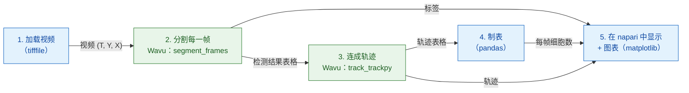

# Python 与 napari 中的分析流程

!!! question "这个分析流程测量什么"
    在一段细胞核会分裂的延时视频里，测量**细胞数（y）随时间（x）的变化**；
    再换个角度看，测量**谱系**的数目：一个起始细胞加上它所有的子细胞。下面
    的每个步骤之所以存在，都是因为这个输出需要它（请看[分析之前](index.md)）。

## 用白话说

一次图像分析就像一顿有好几道菜的晚餐：每个步骤（打开、分割、追踪、
计数、绘图）就是一道菜。你的 Python 脚本是服务员：它把食材
（视频）端上桌、开好账单（一张计数表），再把一盘盘菜在 napari 里端给你。
有两道菜需要特别的厨具，所以送到两个不同的厨房：一个厨房把每一帧**切**成
一个个细胞核（分割，用 scikit-image），下一个厨房**跟着**每个细胞核从一帧
走到下一帧（追踪，用 trackpy）。每个厨房都有自己的厨具，也就是它自己的
pixi 环境，而且两个厨房都不知道对方存在。

这个流程是一个小小的 **DAG**（*directed acyclic graph*，有向无环图：用
箭头连起来的方框，箭头只往前走，永远不会绕回去形成循环）。每个方框都需要
前一个方框的结果：



蓝色方框在你自己的脚本里运行（*原生*步骤）；绿色方框是 Wavu 步骤，各自在
自己的环境里运行。

## 开始之前

1. **获取 Wavu 仓库**：在 VS Code 中打开它，VS Code 会帮你克隆（clone）
   下来；或者用 `git clone` 克隆。本页的一切都在那个文件夹里、通过
   [pixi](../napari/install.md) 运行。

   [在 VS Code 中打开 Wavu 仓库](vscode://vscode.git/clone?url=https%3A%2F%2Fgithub.com%2FOxford-Zeiss-Centre-of-Excellence%2FWavu.git){ .md-button .md-button--primary }

2. **数据**：`examples/data/demo_timelapse.tif`，一段小小的合成视频：
   30 帧，每帧 256 × 256 像素，每像素 0.65 µm，帧与帧之间相隔 5 分钟。
   大约 25 个细胞核四处漂移；四个会分裂，一个离开视野，一个进入，所以真实
   数量从 25 变成 29。因为视频是我们自己做的，我们知道正确答案，可以拿来
   检查这个流程。

   { width="256" }

## 代码

这是仓库里的 `examples/pipelines/dag_counting.py` 负责实际工作的部分
（文件本身还在外面包了一层小小的命令行接口）：

```python
from pathlib import Path

import pandas as pd
import tifffile

from wavu.client import Worker

REPO = Path(__file__).resolve().parents[2]
MOVIE = REPO / "examples" / "data" / "demo_timelapse.tif"
SEGMENT = REPO / "examples" / "segment_frames"
TRACK = REPO / "examples" / "track_trackpy"
PIXEL_UM = 0.65        # 每像素的微米数
FRAME_MIN = 5.0        # 帧与帧之间的分钟数


def analyse(movie_path: Path = MOVIE, log=print):
    # 1. 加载（原生）
    movie = tifffile.imread(movie_path)                                   # (T, Y, X)
    log(f"loaded {movie_path.name}: {movie.shape}")

    # 2 + 3. 先分割，再追踪：两个厨房，两个环境
    with Worker.start(SEGMENT, on_log=log) as seg, Worker.start(TRACK, on_log=log) as trk:
        res = seg.run("script", {"sigma": 2.0, "threshold": "otsu", "min_area": 30},
                      {"image": movie}, meta={"image": {"pixel_um": PIXEL_UM}})
        labels = res.outputs["labels"].value                              # uint16 (T, Y, X)
        detections = res.outputs["detections"].value                      # frame, label, y, x, area, ...
        res = trk.run("script", {"search_range": 10.0, "memory": 2},
                      {"detections": detections})
        tracks = res.outputs["tracks"].value                              # ……再加上 'particle'

    # 4. 制表（原生）
    counts = (detections.groupby("frame").size()
              .reindex(range(len(movie)), fill_value=0).rename("cells").reset_index())
    counts["minutes"] = counts["frame"] * FRAME_MIN
    per_track = tracks.groupby("particle")["frame"].agg(start="min", end="max", length="size")
    # 在第 0 帧之后才开始的轨迹，代表一个之前不在的细胞：
    # 分裂后的子细胞，或从边缘漂进来的细胞（或追踪中断）。
    # 我们统计它们的数量，但不声称哪个是哪个。
    new_tracks = per_track[per_track["start"] > 0]
    summary = {
        "frames": len(movie),
        "tracks": int(tracks["particle"].nunique()),
        "new_tracks": len(new_tracks),
        "median_track_length": float(per_track["length"].median()),
    }
    return movie, labels, tracks, counts, summary


def plot_counts(counts: pd.DataFrame):
    from matplotlib.figure import Figure

    fig = Figure(figsize=(5, 3), layout="constrained")
    ax = fig.add_subplot()
    ax.plot(counts["minutes"], counts["cells"], marker="o", markersize=3, color="#2e7d32")
    ax.set_xlabel("time (min)")
    ax.set_ylabel("cells")
    ax.set_title("Cells per frame")
    ax.grid(alpha=0.3)
    return fig


def show_in_napari(viewer, movie, labels, tracks, counts):
    """Step 5: the script decides names, colours and tail length."""
    from matplotlib.backends.backend_qtagg import FigureCanvasQTAgg

    scale = (1, PIXEL_UM, PIXEL_UM)                                        # t, y, x
    viewer.add_image(movie, name="nuclei", scale=scale, colormap="gray")
    viewer.add_labels(labels, name="segmentation", scale=scale, opacity=0.4)
    data = tracks[["particle", "frame", "y", "x"]].to_numpy(float)         # napari: [id, t, y, x]
    viewer.add_tracks(data, name="tracks", scale=scale, tail_length=10,
                      tail_width=2, colormap="turbo")
    canvas = FigureCanvasQTAgg(plot_counts(counts))
    canvas.setMinimumSize(320, 220)
    viewer.window.add_dock_widget(canvas, name="Cells per frame", area="right")
    return canvas


# 运行并查看
import napari

movie, labels, tracks, counts, summary = analyse()
print(summary)
viewer = napari.Viewer()
show_in_napari(viewer, movie, labels, tracks, counts)
napari.run()
```

每个部分在做什么：

- **两个 worker 在同一个 `with` 里启动**。`Worker.start(folder)` 会在
  **该文件夹自己的**环境里启动它的 worker。第一个准备好之后，第二个马上
  启动；代码块结束时，两个都会停止。
- **步骤 2** 发送整段视频，拿回三盘菜：`labels`（16 位的标签视频，每一帧
  的编号都从 1 重新开始）、`detections`（每帧的每个细胞核一行：
  `frame`、`label`、`y`、`x`、`area`、`mean_intensity`）和
  `count_per_frame`。
- **步骤 3** 发送的是 `detections` 表格，而不是图像。pandas 的
  `DataFrame` 会以临时 CSV 文件的形式传过去，在脚本里以表格的形式到达。
  trackpy 会加上一列 `particle`：轨迹编号。
- **步骤 4** 是你脚本里的普通 pandas：每帧的细胞数、轨迹长度，以及
  **在第 0 帧之后才开始**的轨迹。那些是新的细胞：分裂后的子细胞、从边缘
  漂进来的细胞，或是追踪器跟丢某个细胞核太久的地方。脚本会统计它们的
  数量，但不假装知道哪个是哪个。
- **步骤 5**：由你的脚本决定外观：图层名称、轨迹的颜色映射（colormap）、
  尾巴有多长，以及像素大小（`scale`），让 napari 的标尺以微米为单位。

## 你在 napari 中会看到什么

- **nuclei**：灰度的视频，底部有时间滑块。
- **segmentation**：叠在上面的标签视频，每个细胞核各有自己的颜色。
- **tracks**：每个细胞核后面拖着一条线，显示它在最近十帧里的位置。
  napari 要的轨迹格式是一行行的 `[track_id, t, y, x]`，刚好就是
  `tracks[["particle", "frame", "y", "x"]]`。
- **Cells per frame**：一张 matplotlib 图表，画出数量随时间（分钟）的变化，
  停靠在窗口右侧（`viewer.window.add_dock_widget`）。

拖动时间滑块，看一个细胞核分裂：它的轨迹结束，两条新的轨迹开始，右边的
曲线往上跳一级。

## 为什么这很重要

- **你的环境保持轻巧**。驱动流程的脚本（这里用的是 napari 的环境）需要
  napari、pandas、matplotlib 和 `wavu`。它不需要 trackpy，也不运行任何
  分割代码。
- **每个步骤都有自己的厨具**。分割和追踪各自住在一个有自己 `pixi.toml`
  的文件夹里。升级 trackpy，分割也不会坏。两个软件包互相冲突的步骤，
  仍然可以一前一后接着做。
- **换掉一步，其余照旧**。在真实图像上，阈值可能不够用。把 `SEGMENT` 换成
  `examples/cellpose_nuclei`（以及它的参数，例如 `{"diameter": 30}`），
  逐帧运行，再用 `regionprops_table` 从它的标签建立检测结果表格。追踪、
  制表和 napari 的显示都保持不变。

## 如何运行

在 VS Code 中，在 Wavu 文件夹里打开终端（**Terminal › New Terminal**），
然后运行（它的 `napari` 环境里有 `wavu`、napari 和 matplotlib）：

```sh
pixi run -e napari python examples/pipelines/dag_counting.py
```

napari 会打开，带着三个图层和图表。没有屏幕时，或想改为得到文件：

```sh
pixi run -e napari python examples/pipelines/dag_counting.py --no-viewer
```

这会把 `counts.csv`（帧、细胞数、分钟）和 `plot.png` 写到
`dag_counting_out/`，并打印一行摘要。第一次运行会安装两个脚本文件夹的
环境，要花几分钟，只有一次。

## 结果

在示例视频上，30 帧中有 27 帧的数量正确，另外三帧多算了一个（就是在边缘
离开和进入的细胞核：真实值要等细胞核的中心在图像内才算，分割则是只要露出
一部分就算）。trackpy 找到 32 条轨迹，其中 7 条在第 0 帧之后才开始：四个
子细胞和新来的细胞核，再加上几次断开。

{ width="720" }

左边是视频，每条轨迹都拖着尾巴（trackpy）。右边是测量结果，**细胞数随
时间的变化**。灰色虚线：真实数量。蓝点：测得的细胞数，每种方法都一样，
因为它们数的都是同一份分割结果。橙线用来对照：[Fiji 版本](pipeline-fiji.md)
中每一帧存在的 **TrackMate 谱系**；trackpy 有轨迹，却没有谱系。蓝点和橙线
之间的差距，就是分裂产生的细胞：四次分裂，每次差距加一。谱系线在 50 分钟
时下降，因为有一个细胞核离开；到 85 分钟又回升，因为有一个进来。


## 一句话总结

你的脚本负责加载、计数和显示；两个 Wavu worker 各在自己的环境里负责分割和
追踪；结果以数组和表格的形式返回，再由你的脚本决定 napari 怎么把它们端上桌。
