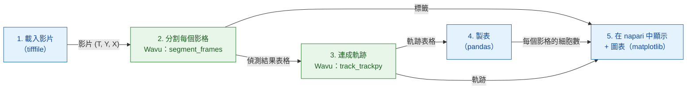

# Python 與 napari 中的分析流程

!!! question "這個分析流程量什麼"
    在一段細胞核會分裂的縮時影片裡，量**細胞數（y）對時間（x）**；再換個
    角度看，量**譜系**的數目：一個起始細胞加上它所有的子細胞。下面的每個
    步驟之所以存在，都是因為這個輸出需要它（請看[分析之前](index.md)）。

## 用白話說

一次影像分析就像一頓有好幾道菜的晚餐：每個步驟（開啟、分割、追蹤、
計數、繪圖）就是一道菜。你的 Python 腳本是服務生：它把食材
（影片）端上桌、開好帳單（一張計數表），再把一盤盤菜在 napari 裡端給你。
有兩道菜需要特別的廚具，所以送到兩個不同的廚房：一個廚房把每個影格**切**
成一個個細胞核（分割，用 scikit-image），下一個廚房**跟著**每個細胞核從一個
影格走到下一個影格（追蹤，用 trackpy）。每個廚房都有自己的廚具，也就是它
自己的 pixi 環境，而且兩個廚房都不知道對方存在。

這個流程是一個小小的 **DAG**（*directed acyclic graph*，有向無環圖：用
箭頭連起來的方框，箭頭只往前走，永遠不會繞回去形成迴圈）。每個方框都需要
前一個方框的結果：



藍色方框在你自己的腳本裡執行（*原生*步驟）；綠色方框是 Wavu 步驟，各自在
自己的環境裡執行。

## 開始之前

1. **取得 Wavu 儲存庫**：在 VS Code 中開啟它，VS Code 會幫你複製（clone）
   下來；或者用 `git clone` 複製。本頁的一切都在那個資料夾裡、透過
   [pixi](../napari/install.md) 執行。

   [在 VS Code 中開啟 Wavu 儲存庫](vscode://vscode.git/clone?url=https%3A%2F%2Fgithub.com%2FOxford-Zeiss-Centre-of-Excellence%2FWavu.git){ .md-button .md-button--primary }

2. **資料**：`examples/data/demo_timelapse.tif`，一段小小的合成影片：
   30 個影格，每格 256 × 256 像素，每像素 0.65 µm，影格之間相隔 5 分鐘。
   大約 25 個細胞核四處漂移；四個會分裂，一個離開視野，一個進入，所以真實
   數量從 25 變成 29。因為影片是我們自己做的，我們知道正確答案，可以拿來
   檢查這個流程。

   { width="256" }

## 程式碼

這是儲存庫裡的 `examples/pipelines/dag_counting.py` 負責實際工作的部分
（檔案本身還在外面包了一層小小的命令列介面）：

```python
from pathlib import Path

import pandas as pd
import tifffile

from wavu.client import Worker

REPO = Path(__file__).resolve().parents[2]
MOVIE = REPO / "examples" / "data" / "demo_timelapse.tif"
SEGMENT = REPO / "examples" / "segment_frames"
TRACK = REPO / "examples" / "track_trackpy"
PIXEL_UM = 0.65        # 每像素的微米數
FRAME_MIN = 5.0        # 影格之間的分鐘數


def analyse(movie_path: Path = MOVIE, log=print):
    # 1. 載入（原生）
    movie = tifffile.imread(movie_path)                                   # (T, Y, X)
    log(f"loaded {movie_path.name}: {movie.shape}")

    # 2 + 3. 先分割，再追蹤：兩個廚房，兩個環境
    with Worker.start(SEGMENT, on_log=log) as seg, Worker.start(TRACK, on_log=log) as trk:
        res = seg.run("script", {"sigma": 2.0, "threshold": "otsu", "min_area": 30},
                      {"image": movie}, meta={"image": {"pixel_um": PIXEL_UM}})
        labels = res.outputs["labels"].value                              # uint16 (T, Y, X)
        detections = res.outputs["detections"].value                      # frame, label, y, x, area, ...
        res = trk.run("script", {"search_range": 10.0, "memory": 2},
                      {"detections": detections})
        tracks = res.outputs["tracks"].value                              # ……再加上 'particle'

    # 4. 製表（原生）
    counts = (detections.groupby("frame").size()
              .reindex(range(len(movie)), fill_value=0).rename("cells").reset_index())
    counts["minutes"] = counts["frame"] * FRAME_MIN
    per_track = tracks.groupby("particle")["frame"].agg(start="min", end="max", length="size")
    # 在影格 0 之後才開始的軌跡，代表一個先前不在的細胞：
    # 分裂後的子細胞，或從邊緣漂進來的細胞（或追蹤中斷）。
    # 我們計算它們的數量，但不宣稱哪個是哪個。
    new_tracks = per_track[per_track["start"] > 0]
    summary = {
        "frames": len(movie),
        "tracks": int(tracks["particle"].nunique()),
        "new_tracks": len(new_tracks),
        "median_track_length": float(per_track["length"].median()),
    }
    return movie, labels, tracks, counts, summary


def plot_counts(counts: pd.DataFrame):
    from matplotlib.figure import Figure

    fig = Figure(figsize=(5, 3), layout="constrained")
    ax = fig.add_subplot()
    ax.plot(counts["minutes"], counts["cells"], marker="o", markersize=3, color="#2e7d32")
    ax.set_xlabel("time (min)")
    ax.set_ylabel("cells")
    ax.set_title("Cells per frame")
    ax.grid(alpha=0.3)
    return fig


def show_in_napari(viewer, movie, labels, tracks, counts):
    """Step 5: the script decides names, colours and tail length."""
    from matplotlib.backends.backend_qtagg import FigureCanvasQTAgg

    scale = (1, PIXEL_UM, PIXEL_UM)                                        # t, y, x
    viewer.add_image(movie, name="nuclei", scale=scale, colormap="gray")
    viewer.add_labels(labels, name="segmentation", scale=scale, opacity=0.4)
    data = tracks[["particle", "frame", "y", "x"]].to_numpy(float)         # napari: [id, t, y, x]
    viewer.add_tracks(data, name="tracks", scale=scale, tail_length=10,
                      tail_width=2, colormap="turbo")
    canvas = FigureCanvasQTAgg(plot_counts(counts))
    canvas.setMinimumSize(320, 220)
    viewer.window.add_dock_widget(canvas, name="Cells per frame", area="right")
    return canvas


# 執行並查看
import napari

movie, labels, tracks, counts, summary = analyse()
print(summary)
viewer = napari.Viewer()
show_in_napari(viewer, movie, labels, tracks, counts)
napari.run()
```

每個部分在做什麼：

- **兩個 worker 在同一個 `with` 裡啟動**。`Worker.start(folder)` 會在
  **該資料夾自己的**環境裡啟動它的 worker。第一個準備好之後，第二個馬上
  啟動；區塊結束時，兩個都會停止。
- **步驟 2** 送出整段影片，拿回三盤菜：`labels`（16 位元的標籤影片，每個
  影格的編號都從 1 重新開始）、`detections`（每個影格的每個細胞核一列：
  `frame`、`label`、`y`、`x`、`area`、`mean_intensity`）和
  `count_per_frame`。
- **步驟 3** 送出的是 `detections` 表格，而不是影像。pandas 的
  `DataFrame` 會以暫存 CSV 檔的形式傳過去，在腳本裡以表格的形式抵達。
  trackpy 會加上一欄 `particle`：軌跡編號。
- **步驟 4** 是你腳本裡的普通 pandas：每個影格的細胞數、軌跡長度，以及
  **在影格 0 之後才開始**的軌跡。那些是新的細胞：分裂後的子細胞、從邊緣
  漂進來的細胞，或是追蹤器跟丟某個細胞核太久的地方。腳本會計算它們的
  數量，但不假裝知道哪個是哪個。
- **步驟 5**：由你的腳本決定外觀：圖層名稱、軌跡的色彩對應表（colormap）、
  尾巴有多長，以及像素大小（`scale`），讓 napari 的尺規以微米為單位。

## 你在 napari 中會看到什麼

- **nuclei**：灰階的影片，底部有時間滑桿。
- **segmentation**：疊在上面的標籤影片，每個細胞核各有自己的顏色。
- **tracks**：每個細胞核後面拖著一條線，顯示它在最近十個影格裡的位置。
  napari 要的軌跡格式是一列列的 `[track_id, t, y, x]`，剛好就是
  `tracks[["particle", "frame", "y", "x"]]`。
- **Cells per frame**：一張 matplotlib 圖表，畫出數量對時間（分鐘），
  停靠在視窗右側（`viewer.window.add_dock_widget`）。

拖動時間滑桿，看一個細胞核分裂：它的軌跡結束，兩條新的軌跡開始，右邊的
曲線往上跳一格。

## 為什麼這很重要

- **你的環境保持輕巧**。驅動流程的腳本（這裡用的是 napari 的環境）需要
  napari、pandas、matplotlib 和 `wavu`。它不需要 trackpy，也不執行任何
  分割程式碼。
- **每個步驟都有自己的廚具**。分割和追蹤各自住在一個有自己 `pixi.toml`
  的資料夾裡。升級 trackpy，分割也不會壞。兩個套件互相衝突的
  步驟，仍然可以一前一後接著做。
- **換掉一步，其餘照舊**。在真實影像上，閾值可能不夠用。把 `SEGMENT` 換成
  `examples/cellpose_nuclei`（以及它的參數，例如 `{"diameter": 30}`），
  逐格執行，再用 `regionprops_table` 從它的標籤建立偵測結果表格。追蹤、
  製表和 napari 的顯示都維持原樣。

## 如何執行

在 VS Code 中，於 Wavu 資料夾開啟終端機（**Terminal › New Terminal**），
然後執行（它的 `napari` 環境裡有 `wavu`、napari 和 matplotlib）：

```sh
pixi run -e napari python examples/pipelines/dag_counting.py
```

napari 會開啟，帶著三個圖層和圖表。沒有螢幕時，或想改成拿到檔案：

```sh
pixi run -e napari python examples/pipelines/dag_counting.py --no-viewer
```

這會把 `counts.csv`（影格、細胞數、分鐘）和 `plot.png` 寫到
`dag_counting_out/`，並印出一行摘要。第一次執行會安裝兩個腳本資料夾的
環境，要花幾分鐘，只有一次。

## 結果

在示範影片上，30 個影格中有 27 個的數量正確，另外三個多算了一個（就是在
邊緣離開和進入的細胞核：真實值要等細胞核的中心在影像內才算，分割則是只要
露出一部分就算）。trackpy 找到 32 條軌跡，其中 7 條在影格 0 之後才開始：
四個子細胞和新來的細胞核，再加上幾次斷開。

{ width="720" }

左邊是影片，每條軌跡都拖著尾巴（trackpy）。右邊是量測結果，**細胞數對
時間**。灰色虛線：真實數量。藍點：量到的細胞數，每種方法都一樣，因為它們
數的都是同一份分割結果。橘線用來對照：[Fiji 版本](pipeline-fiji.md)中每個
影格存在的 **TrackMate 譜系**；trackpy 有軌跡，卻沒有譜系。藍點和橘線之間
的差距，就是分裂產生的細胞：四次分裂，每次差距加一。譜系線在 50 分鐘時
下降，因為有一個細胞核離開；到 85 分鐘又回升，因為有一個進來。


## 一句話總結

你的腳本負責載入、計數和顯示；兩個 Wavu worker 各在自己的環境裡負責分割和
追蹤；結果以陣列和表格的形式送回來，再由你的腳本決定 napari 怎麼把它們端上桌。
