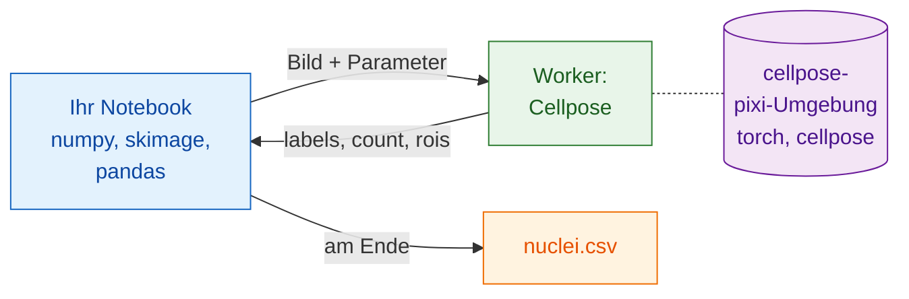

# In Python und napari

## Die Idee in einfachen Worten

Jetzt ist Ihr Notebook der Kellner. Es öffnet die Dateien, glättet sie,
misst die Zellkerne und schreibt die Tabelle mit den Paketen, die Sie schon
kennen: NumPy, scikit-image, pandas. Für die Segmentierung ruft es die Küche
über `wavu.client` auf, einen fertigen Python-Kellner.

Das Beste ist, was Ihr Notebook **nicht** braucht: kein PyTorch, kein
Cellpose. Die leben in der eigenen pixi-Umgebung des Ordners
`cellpose_nuclei` (seinen Küchengeräten). Ihr Notebook bleibt schlank, und
ein Update auf der einen Seite macht nie die andere kaputt.



## Bevor Sie beginnen

1. **pixi** ist installiert (von [pixi.sh](https://pixi.sh)); `wavu.client`
   nutzt es, um den Worker zu starten.
2. **Der Cellpose-Ordner**: Laden Sie das
   [Wavu-Repository als Zip](https://github.com/Oxford-Zeiss-Centre-of-Excellence/Wavu/archive/refs/heads/main.zip)
   herunter und verwenden Sie `examples/cellpose_nuclei` dort, wo es liegt
   (seine `pixi.toml` findet Wavu zwei Ordner weiter oben). Der erste
   `Worker.start` installiert seine Umgebung: **1–2 GB**, mehrere Minuten,
   nur einmal.
3. **`wavu.client` in der Umgebung Ihres Notebooks**. Installieren Sie es
   entweder mit pip:

    ```sh
    pip install "wavu @ git+https://github.com/Oxford-Zeiss-Centre-of-Excellence/Wavu.git"
    ```

    oder fügen Sie es in einem pixi-Projekt unter `[pypi-dependencies]` hinzu:

    ```toml
    wavu = { git = "https://github.com/Oxford-Zeiss-Centre-of-Excellence/Wavu.git" }
    ```

    Daneben brauchen Sie für dieses Beispiel nur `scikit-image` und `pandas`
    (`tifffile` und `numpy` kommen mit `wavu`).

## Die Pipeline

```python
from pathlib import Path

import numpy as np
import pandas as pd
import tifffile
from skimage.filters import gaussian
from skimage.measure import regionprops_table
from wavu.client import Worker

images = Path("D:/data/BBBC039")                         # ein Ordner mit Zellkern-TIFFs
cellpose = Path("D:/Wavu-main/examples/cellpose_nuclei")  # der Skriptordner

tables = []
with Worker.start(cellpose, on_log=print) as w:          # startet einmal, für jedes Bild
    for f in sorted(images.glob("*.tif")):
        img = tifffile.imread(f)                                          # nativ: öffnen
        smooth = gaussian(img, sigma=1, preserve_range=True).astype(np.float32)  # nativ: vorverarbeiten

        res = w.run("script", {"diameter": 30, "use_gpu": False},        # Wavu-Schritt: Cellpose
                    {"image": smooth})
        labels = res.outputs["labels"].value                              # ein NumPy-Labelbild
        print(f.name, res.outputs["count"].value, "nuclei")

        t = pd.DataFrame(regionprops_table(                               # nativ: messen
            labels, intensity_image=img,
            properties=("label", "area", "intensity_mean")))
        t.insert(0, "file", f.name)
        tables.append(t)
# hier ist der Worker gestoppt

nuclei = pd.concat(tables, ignore_index=True)
nuclei.to_csv(images / "nuclei.csv", index=False)                         # nativ: speichern
print(nuclei.groupby("file").size())                                      # Zellkerne pro Bild
```

Was jedes Wavu-Stück tut:

- `Worker.start(folder, on_log=print)` startet den Worker des Ordners in
  seiner eigenen Umgebung und gibt beim Warten den Fortschritt von pixi aus.
  Am Ende des `with`-Blocks beendet sich der Worker.
- `w.run(script, params, inputs)` schickt ein Bild und gibt jede Ausgabe
  bereits geladen zurück: `labels` als Array, `count` als Zahl und `rois`
  als RoiSet, dessen `.path` das ImageJ-Zip ist (praktisch, wenn eine
  Fiji-Nutzerin die Umrisse möchte). Lassen Sie einen Parameter weg, gilt
  sein Standardwert aus `PARAMS`.
- Wenn Sie die Pixelgröße kennen, geben Sie sie mit
  `meta={"image": {"pixel_um": 0.65}}` mit.
- Ein Fehler im Skript löst `WorkerError` aus, mit dem Python-Traceback in
  der Meldung. Fangen Sie ihn ab, wenn ein schlechtes Bild die Schleife nicht
  stoppen soll.
- `on_progress=` nimmt eine Funktion, die Werte von 0 bis 1 bekommt, und
  `cancel=` ein `threading.Event`: Setzen Sie es, um den laufenden Job zum
  Anhalten aufzufordern.

## Das Ergebnis in napari ansehen

In der Schleife, oder danach für ein Bild, bringen zwei Zeilen das Bild und
seine Zellkerne auf den Bildschirm:

```python
import napari

viewer = napari.Viewer()
viewer.add_image(img)
viewer.add_labels(labels)
```

Fügen Sie die ganze Pipeline in die eingebaute Konsole von napari ein, oder
speichern Sie sie als `my_pipeline.py` und führen Sie sie aus einem
Wavu-Klon aus, dessen `napari`-Umgebung `wavu`, napari und die obigen Pakete
bereits enthält:

```sh
pixi run -e napari python my_pipeline.py
```

## Mehrere Umgebungen hintereinander

Eine Pipeline kann mehr als eine Küche rufen. Angenommen, Sie haben einen
zweiten Skriptordner, der Rauschen entfernt (aus der
[Vorlage](../write/get-the-template.md) erstellt, gibt ein Bild namens
`denoised` zurück), mit Paketen, die sich mit denen von Cellpose beißen
würden. Starten Sie beide Worker in einem `with`; jeder läuft in seiner
eigenen Umgebung:

```python
with Worker.start("D:/scripts/denoise") as den, Worker.start(cellpose) as seg:
    for f in sorted(images.glob("*.tif")):
        img = tifffile.imread(f)
        clean = den.run("script", {}, {"image": img}).outputs["denoised"].value
        labels = seg.run("script", {"diameter": 30}, {"image": clean}).outputs["labels"].value
        ...
```

Ihr Notebook reicht nur Arrays von einem Schritt zum nächsten. Keine der
beiden Umgebungen weiß von der anderen, und keine ist in Ihrem Notebook
installiert.

Arbeiten Sie lieber in Fiji? Dieselbe Pipeline als Groovy und als
ImageJ-Makro: [In Fiji](fiji.md).

## In einem Satz

Öffnen, vorverarbeiten, messen und speichern Sie mit Ihren eigenen
Python-Paketen, und rufen Sie für den schweren Schritt `w.run(...)` auf einem
einmal mit `Worker.start(...)` gestarteten Worker auf, der in seiner eigenen
Umgebung läuft, sodass Ihr Notebook nie PyTorch installiert.
