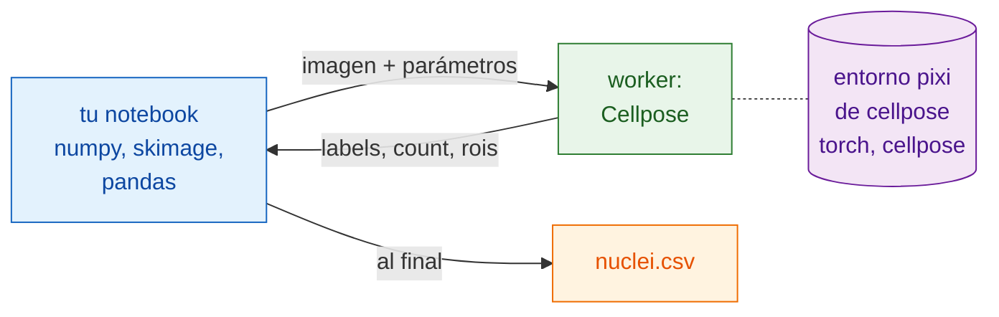

# En Python y napari

## La idea en palabras sencillas

Ahora el camarero es tu notebook. Abre los archivos, los suaviza, mide los
núcleos y escribe la tabla con los paquetes que ya conoces: NumPy,
scikit-image, pandas. Para la segmentación llama a la cocina a través de
`wavu.client`, un camarero de Python ya hecho.

Lo mejor es lo que tu notebook **no** necesita: ni PyTorch ni Cellpose. Esos
viven en el propio entorno pixi de la carpeta `cellpose_nuclei` (sus
utensilios de cocina). Tu notebook se mantiene ligero, y actualizar uno
nunca rompe el otro.



## Antes de empezar

1. **pixi** está instalado (desde [pixi.sh](https://pixi.sh)); `wavu.client`
   lo usa para arrancar el worker.
2. **La carpeta de Cellpose**: descarga el
   [repositorio de Wavu como zip](https://github.com/Oxford-Zeiss-Centre-of-Excellence/Wavu/archive/refs/heads/main.zip)
   y usa `examples/cellpose_nuclei` donde está (su `pixi.toml` encuentra
   Wavu dos carpetas más arriba). El primer `Worker.start` instala su
   entorno: **1–2 GB**, varios minutos, una sola vez.
3. **`wavu.client` en el entorno de tu notebook**. Instálalo con pip:

    ```sh
    pip install "wavu @ git+https://github.com/Oxford-Zeiss-Centre-of-Excellence/Wavu.git"
    ```

    o, en un proyecto pixi, añádelo bajo `[pypi-dependencies]`:

    ```toml
    wavu = { git = "https://github.com/Oxford-Zeiss-Centre-of-Excellence/Wavu.git" }
    ```

    Además, para este ejemplo solo necesitas `scikit-image` y `pandas`
    (`tifffile` y `numpy` vienen con `wavu`).

## El pipeline

```python
from pathlib import Path

import numpy as np
import pandas as pd
import tifffile
from skimage.filters import gaussian
from skimage.measure import regionprops_table
from wavu.client import Worker

images = Path("D:/data/BBBC039")                         # una carpeta de TIFF de núcleos
cellpose = Path("D:/Wavu-main/examples/cellpose_nuclei")  # la carpeta del script

tables = []
with Worker.start(cellpose, on_log=print) as w:          # arranca una vez, para todas las imágenes
    for f in sorted(images.glob("*.tif")):
        img = tifffile.imread(f)                                          # nativo: abrir
        smooth = gaussian(img, sigma=1, preserve_range=True).astype(np.float32)  # nativo: preprocesar

        res = w.run("script", {"diameter": 30, "use_gpu": False},        # paso de Wavu: Cellpose
                    {"image": smooth})
        labels = res.outputs["labels"].value                              # una imagen de etiquetas de NumPy
        print(f.name, res.outputs["count"].value, "nuclei")

        t = pd.DataFrame(regionprops_table(                               # nativo: medir
            labels, intensity_image=img,
            properties=("label", "area", "intensity_mean")))
        t.insert(0, "file", f.name)
        tables.append(t)
# aquí el worker ya se ha detenido

nuclei = pd.concat(tables, ignore_index=True)
nuclei.to_csv(images / "nuclei.csv", index=False)                         # nativo: guardar
print(nuclei.groupby("file").size())                                      # núcleos por imagen
```

Qué hace cada pieza de Wavu:

- `Worker.start(folder, on_log=print)` arranca el worker de la carpeta en su
  propio entorno y escribe el progreso de pixi mientras espera. Al final del
  bloque `with`, el worker termina.
- `w.run(script, params, inputs)` envía una imagen y devuelve todas las
  salidas ya cargadas: `labels` como array, `count` como número y `rois`
  como un RoiSet cuyo `.path` es el zip de ImageJ (útil si un usuario de
  Fiji quiere los contornos). Si omites un parámetro, se usa su valor por
  defecto de `PARAMS`.
- Si conoces el tamaño de píxel, pásalo con
  `meta={"image": {"pixel_um": 0.65}}`.
- Un fallo en el script lanza `WorkerError`, con la traza de Python en su
  mensaje. Captúralo si una imagen mala no debe detener el bucle.
- `on_progress=` recibe una función que obtiene valores de 0 a 1, y
  `cancel=` un `threading.Event`: actívalo para pedir que el trabajo en
  curso se detenga.

## Ver el resultado en napari

Dentro del bucle, o después para una imagen, dos líneas ponen en pantalla la
imagen y sus núcleos:

```python
import napari

viewer = napari.Viewer()
viewer.add_image(img)
viewer.add_labels(labels)
```

Pega el pipeline entero en la consola integrada de napari, o guárdalo como
`my_pipeline.py` y ejecútalo desde un clon de Wavu, cuyo entorno `napari` ya
tiene `wavu`, napari y los paquetes de arriba:

```sh
pixi run -e napari python my_pipeline.py
```

## Encadenar varios entornos

Un pipeline puede llamar a más de una cocina. Supón que tienes una segunda
carpeta de script que elimina ruido (creada a partir de la
[plantilla](../write/get-the-template.md), que devuelve una imagen llamada
`denoised`), con paquetes que chocarían con los de Cellpose. Arranca los dos
workers en un mismo `with`; cada uno se ejecuta en su propio entorno:

```python
with Worker.start("D:/scripts/denoise") as den, Worker.start(cellpose) as seg:
    for f in sorted(images.glob("*.tif")):
        img = tifffile.imread(f)
        clean = den.run("script", {}, {"image": img}).outputs["denoised"].value
        labels = seg.run("script", {"diameter": 30}, {"image": clean}).outputs["labels"].value
        ...
```

Tu notebook solo pasa arrays de un paso al siguiente. Ninguno de los dos
entornos sabe que el otro existe, y ninguno está instalado en tu notebook.

¿Trabajas en Fiji? El mismo pipeline en Groovy y como macro de ImageJ:
[En Fiji](fiji.md).

## En una frase

Abre, preprocesa, mide y guarda con tus propios paquetes de Python, y para
el paso pesado llama a `w.run(...)` sobre un worker arrancado una vez con
`Worker.start(...)`, que se ejecuta en su propio entorno, así que tu
notebook nunca instala PyTorch.
