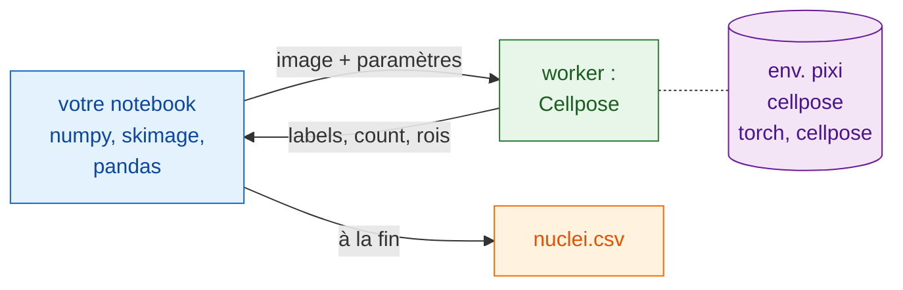

# En Python et napari

## L'idée en mots simples

Cette fois, le serveur, c'est votre notebook. Il ouvre les fichiers, les
lisse, mesure les noyaux et écrit le tableau avec les paquets que vous
connaissez déjà : NumPy, scikit-image, pandas. Pour la segmentation, il
appelle la cuisine via `wavu.client`, un serveur Python tout prêt.

Le meilleur, c'est ce dont votre notebook n'a **pas** besoin : ni PyTorch,
ni Cellpose. Ceux-ci vivent dans l'environnement pixi propre au dossier
`cellpose_nuclei` (sa batterie de cuisine). Votre notebook reste léger, et
mettre à jour l'un ne casse jamais l'autre.



## Avant de commencer

1. **pixi** est installé (depuis [pixi.sh](https://pixi.sh)) ; `wavu.client`
   s'en sert pour démarrer le worker.
2. **Le dossier Cellpose** : téléchargez le
   [dépôt Wavu en zip](https://github.com/Oxford-Zeiss-Centre-of-Excellence/Wavu/archive/refs/heads/main.zip)
   et utilisez `examples/cellpose_nuclei` là où il est (son `pixi.toml`
   trouve Wavu deux dossiers plus haut). Le premier `Worker.start` installe
   son environnement : **1–2 Go**, plusieurs minutes, une seule fois.
3. **`wavu.client` dans l'environnement de votre notebook**. Installez-le
   soit avec pip :

    ```sh
    pip install "wavu @ git+https://github.com/Oxford-Zeiss-Centre-of-Excellence/Wavu.git"
    ```

    soit, dans un projet pixi, ajoutez-le sous `[pypi-dependencies]` :

    ```toml
    wavu = { git = "https://github.com/Oxford-Zeiss-Centre-of-Excellence/Wavu.git" }
    ```

    À côté, il ne vous faut que `scikit-image` et `pandas` pour cet exemple
    (`tifffile` et `numpy` viennent avec `wavu`).

## Le pipeline

```python
from pathlib import Path

import numpy as np
import pandas as pd
import tifffile
from skimage.filters import gaussian
from skimage.measure import regionprops_table
from wavu.client import Worker

images = Path("D:/data/BBBC039")                         # un dossier de TIFF de noyaux
cellpose = Path("D:/Wavu-main/examples/cellpose_nuclei")  # le dossier du script

tables = []
with Worker.start(cellpose, on_log=print) as w:          # démarre une fois, pour toutes les images
    for f in sorted(images.glob("*.tif")):
        img = tifffile.imread(f)                                          # natif : ouvrir
        smooth = gaussian(img, sigma=1, preserve_range=True).astype(np.float32)  # natif : prétraiter

        res = w.run("script", {"diameter": 30, "use_gpu": False},        # étape Wavu : Cellpose
                    {"image": smooth})
        labels = res.outputs["labels"].value                              # une image d'étiquettes NumPy
        print(f.name, res.outputs["count"].value, "nuclei")

        t = pd.DataFrame(regionprops_table(                               # natif : mesurer
            labels, intensity_image=img,
            properties=("label", "area", "intensity_mean")))
        t.insert(0, "file", f.name)
        tables.append(t)
# ici, le worker s'est arrêté

nuclei = pd.concat(tables, ignore_index=True)
nuclei.to_csv(images / "nuclei.csv", index=False)                         # natif : enregistrer
print(nuclei.groupby("file").size())                                      # noyaux par image
```

Ce que fait chaque élément de Wavu :

- `Worker.start(folder, on_log=print)` démarre le worker du dossier dans son
  propre environnement et affiche la progression de pixi pendant l'attente.
  À la fin du bloc `with`, le worker s'arrête.
- `w.run(script, params, inputs)` envoie une image et renvoie toutes les
  sorties déjà chargées : `labels` sous forme de tableau, `count` sous forme
  de nombre, et `rois` sous forme de RoiSet dont `.path` est le zip ImageJ
  (pratique si un utilisateur de Fiji veut les contours). Omettez un
  paramètre et sa valeur par défaut dans `PARAMS` est utilisée.
- Si vous connaissez la taille de pixel, transmettez-la avec
  `meta={"image": {"pixel_um": 0.65}}`.
- Un échec dans le script lève `WorkerError`, avec la trace d'erreur Python
  dans son message. Interceptez-la si une mauvaise image ne doit pas arrêter
  la boucle.
- `on_progress=` prend une fonction qui reçoit des valeurs de 0 à 1, et
  `cancel=` un `threading.Event` : activez-le pour demander à la tâche en
  cours de s'arrêter.

## Voir le résultat dans napari

Dans la boucle, ou après coup pour une image, deux lignes affichent l'image
et ses noyaux :

```python
import napari

viewer = napari.Viewer()
viewer.add_image(img)
viewer.add_labels(labels)
```

Collez tout le pipeline dans la console intégrée de napari, ou
enregistrez-le sous `my_pipeline.py` et lancez-le depuis un clone de Wavu,
dont l'environnement `napari` contient déjà `wavu`, napari et les paquets
ci-dessus :

```sh
pixi run -e napari python my_pipeline.py
```

## Enchaîner plusieurs environnements

Un pipeline peut faire appel à plus d'une cuisine. Disons que vous avez un
second dossier de script qui retire le bruit (créé à partir du
[modèle](../write/get-the-template.md), et qui renvoie une image appelée
`denoised`), avec des paquets qui entreraient en conflit avec ceux de
Cellpose. Démarrez les deux workers dans un seul `with` ; chacun tourne dans
son propre environnement :

```python
with Worker.start("D:/scripts/denoise") as den, Worker.start(cellpose) as seg:
    for f in sorted(images.glob("*.tif")):
        img = tifffile.imread(f)
        clean = den.run("script", {}, {"image": img}).outputs["denoised"].value
        labels = seg.run("script", {"diameter": 30}, {"image": clean}).outputs["labels"].value
        ...
```

Votre notebook ne fait que passer des tableaux d'une étape à l'autre. Aucun
des deux environnements ne sait que l'autre existe, et aucun n'est installé
dans votre notebook.

Vous travaillez plutôt dans Fiji ? Le même pipeline en Groovy et en macro
ImageJ : [Dans Fiji](fiji.md).

## En une phrase

Ouvrez, prétraitez, mesurez et enregistrez avec vos propres paquets Python,
et appelez `w.run(...)` sur un worker démarré une fois avec
`Worker.start(...)` pour l'étape lourde, qui tourne dans son propre
environnement : votre notebook n'installe jamais PyTorch.
