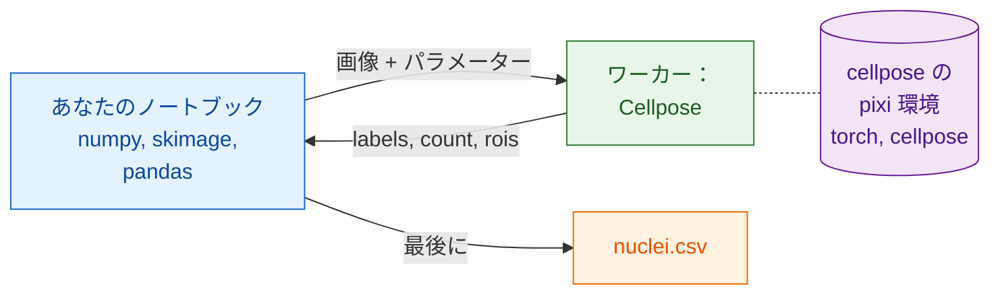

# Python と napari で

## やさしく言うと

今度はノートブックがウェイターです。ファイルを開き、なめらかにし、核を
測定し、表を書きます。使うのはおなじみのパッケージ、NumPy、scikit-image、
pandas です。セグメンテーションのためには、できあいの Python のウェイター
である `wavu.client` を通して厨房を呼びます。

いちばん良いのは、ノートブックに **必要ない** ものです。PyTorch も
Cellpose も要りません。それらは `cellpose_nuclei` フォルダー専用の pixi 環境
（その調理器具）にあります。ノートブックは軽いままで、片方を更新しても
もう片方が壊れることはありません。



## 始める前に

1. **pixi** がインストールされていること（[pixi.sh](https://pixi.sh) から）。
   `wavu.client` はワーカーを起動するのに pixi を使います。
2. **Cellpose のフォルダー**：
   [Wavu リポジトリを zip で](https://github.com/Oxford-Zeiss-Centre-of-Excellence/Wavu/archive/refs/heads/main.zip)
   ダウンロードし、`examples/cellpose_nuclei` をその場所のまま使います（その
   `pixi.toml` は 2 つ上のフォルダーにある Wavu を見つけます）。最初の
   `Worker.start` が環境をインストールします。**1～2 GB**、数分、一度だけです。
3. **ノートブックの環境に `wavu.client`**。pip でインストールするか、

    ```sh
    pip install "wavu @ git+https://github.com/Oxford-Zeiss-Centre-of-Excellence/Wavu.git"
    ```

    pixi のプロジェクトなら `[pypi-dependencies]` の下に追加します。

    ```toml
    wavu = { git = "https://github.com/Oxford-Zeiss-Centre-of-Excellence/Wavu.git" }
    ```

    この例では、ほかに `scikit-image` と `pandas` があれば十分です
    （`tifffile` と `numpy` は `wavu` と一緒に入ります）。

## パイプライン

```python
from pathlib import Path

import numpy as np
import pandas as pd
import tifffile
from skimage.filters import gaussian
from skimage.measure import regionprops_table
from wavu.client import Worker

images = Path("D:/data/BBBC039")                         # 核の TIFF のフォルダー
cellpose = Path("D:/Wavu-main/examples/cellpose_nuclei")  # スクリプトフォルダー

tables = []
with Worker.start(cellpose, on_log=print) as w:          # 一度だけ起動し、すべての画像に使う
    for f in sorted(images.glob("*.tif")):
        img = tifffile.imread(f)                                          # ネイティブ：開く
        smooth = gaussian(img, sigma=1, preserve_range=True).astype(np.float32)  # ネイティブ：前処理

        res = w.run("script", {"diameter": 30, "use_gpu": False},        # Wavu の手順：Cellpose
                    {"image": smooth})
        labels = res.outputs["labels"].value                              # NumPy のラベル画像
        print(f.name, res.outputs["count"].value, "nuclei")

        t = pd.DataFrame(regionprops_table(                               # ネイティブ：測定
            labels, intensity_image=img,
            properties=("label", "area", "intensity_mean")))
        t.insert(0, "file", f.name)
        tables.append(t)
# ここではワーカーは停止している

nuclei = pd.concat(tables, ignore_index=True)
nuclei.to_csv(images / "nuclei.csv", index=False)                         # ネイティブ：保存
print(nuclei.groupby("file").size())                                      # 画像ごとの核の数
```

Wavu の各部分がしていること：

- `Worker.start(folder, on_log=print)` は、フォルダーのワーカーを専用の環境で
  起動し、待っているあいだ pixi の進み具合を表示します。`with` ブロックが
  終わるとワーカーも終了します。
- `w.run(script, params, inputs)` は画像を 1 枚送り、すべての出力を読み込み
  済みで返します。`labels` は配列、`count` は数値、`rois` は RoiSet で、その
  `.path` が ImageJ の zip です（Fiji ユーザーが輪郭をほしがるときに便利）。
  パラメーターを省略すると、`PARAMS` の既定値が使われます。
- ピクセルサイズが分かっていれば、`meta={"image": {"pixel_um": 0.65}}` で
  一緒に渡します。
- スクリプトが失敗すると `WorkerError` が発生し、メッセージに Python の
  トレースバックが入ります。悪い画像 1 枚でループを止めたくなければ、
  これを捕まえます。
- `on_progress=` には 0 から 1 の値を受け取る関数を、`cancel=` には
  `threading.Event` を渡せます。イベントをセットすると、実行中のジョブに
  止まるよう頼みます。

## napari で結果を見る

ループの中で、または終わったあとに 1 枚の画像について、2 行で画像と核を
画面に出せます。

```python
import napari

viewer = napari.Viewer()
viewer.add_image(img)
viewer.add_labels(labels)
```

パイプライン全体を napari の組み込みコンソールに貼り付けるか、
`my_pipeline.py` として保存して Wavu の clone から実行します。その `napari`
環境には、`wavu`、napari、上のパッケージがすでに入っています。

```sh
pixi run -e napari python my_pipeline.py
```

## 複数の環境をつなぐ

パイプラインは複数の厨房を呼べます。たとえば、ノイズを取り除く 2 つ目の
スクリプトフォルダー（[テンプレート](../write/get-the-template.md) から作り、
`denoised` という画像を返すもの）があって、そのパッケージが Cellpose の
ものとぶつかるとします。1 つの `with` で両方のワーカーを起動します。
それぞれが専用の環境で動きます。

```python
with Worker.start("D:/scripts/denoise") as den, Worker.start(cellpose) as seg:
    for f in sorted(images.glob("*.tif")):
        img = tifffile.imread(f)
        clean = den.run("script", {}, {"image": img}).outputs["denoised"].value
        labels = seg.run("script", {"diameter": 30}, {"image": clean}).outputs["labels"].value
        ...
```

ノートブックは、ある手順から次の手順へ配列を渡すだけです。どちらの環境も
もう一方の存在を知らず、どちらもノートブックにはインストールされません。

Fiji を使いますか？ 同じパイプラインを Groovy と ImageJ マクロで：
[Fiji で](fiji.md)。

## ひとことで言うと

開く、前処理、測定、保存は自分の Python パッケージで行い、重い手順には
`Worker.start(...)` で一度だけ起動したワーカーの `w.run(...)` を呼びます。
重い手順は専用の環境で動くので、ノートブックに PyTorch をインストールする
ことはありません。
