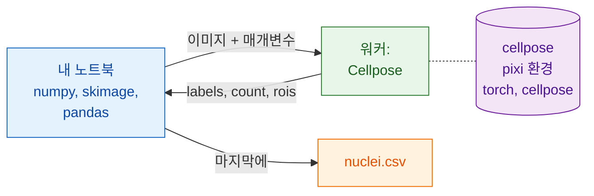

# Python과 napari에서

## 쉬운 말로 설명하면

이번에는 내 노트북이 웨이터예요. 이미 아는 패키지(NumPy, scikit-image,
pandas)로 파일을 열고, 부드럽게 하고, 핵을 측정하고, 표를 써요. 분할을
할 때는 미리 만들어 둔 Python 웨이터인 `wavu.client`로 주방을 불러요.

가장 좋은 점은 노트북에 **필요 없는** 것이에요. PyTorch도, Cellpose도 필요
없어요. 그것들은 `cellpose_nuclei` 폴더만의 pixi 환경(주방 도구)에 있어요.
노트북은 가볍게 유지되고, 한쪽을 업그레이드해도 다른 쪽이 망가지지 않아요.



## 시작하기 전에

1. **pixi**가 설치되어 있어야 해요([pixi.sh](https://pixi.sh)에서).
   `wavu.client`가 워커를 시작할 때 pixi를 써요.
2. **Cellpose 폴더**:
   [Wavu 저장소를 zip으로](https://github.com/Oxford-Zeiss-Centre-of-Excellence/Wavu/archive/refs/heads/main.zip)
   내려받고 `examples/cellpose_nuclei`를 그 자리에서 쓰세요(그 `pixi.toml`은
   두 단계 위 폴더에서 Wavu를 찾아요). 첫 `Worker.start`가 환경을 설치해요.
   **1–2 GB**, 몇 분, 한 번만이에요.
3. **노트북 환경에 `wavu.client`**. pip로 설치하거나:

    ```sh
    pip install "wavu @ git+https://github.com/Oxford-Zeiss-Centre-of-Excellence/Wavu.git"
    ```

    pixi 프로젝트라면 `[pypi-dependencies]` 아래에 추가하세요.

    ```toml
    wavu = { git = "https://github.com/Oxford-Zeiss-Centre-of-Excellence/Wavu.git" }
    ```

    이 예에서는 그 밖에 `scikit-image`와 `pandas`만 있으면 돼요
    (`tifffile`과 `numpy`는 `wavu`와 함께 따라와요).

## 파이프라인

```python
from pathlib import Path

import numpy as np
import pandas as pd
import tifffile
from skimage.filters import gaussian
from skimage.measure import regionprops_table
from wavu.client import Worker

images = Path("D:/data/BBBC039")                         # 핵 TIFF 폴더
cellpose = Path("D:/Wavu-main/examples/cellpose_nuclei")  # 스크립트 폴더

tables = []
with Worker.start(cellpose, on_log=print) as w:          # 한 번 시작해서 모든 이미지에
    for f in sorted(images.glob("*.tif")):
        img = tifffile.imread(f)                                          # 기본: 열기
        smooth = gaussian(img, sigma=1, preserve_range=True).astype(np.float32)  # 기본: 전처리

        res = w.run("script", {"diameter": 30, "use_gpu": False},        # Wavu 단계: Cellpose
                    {"image": smooth})
        labels = res.outputs["labels"].value                              # NumPy 라벨 이미지
        print(f.name, res.outputs["count"].value, "nuclei")

        t = pd.DataFrame(regionprops_table(                               # 기본: 측정
            labels, intensity_image=img,
            properties=("label", "area", "intensity_mean")))
        t.insert(0, "file", f.name)
        tables.append(t)
# 여기서 워커는 멈춰 있어요

nuclei = pd.concat(tables, ignore_index=True)
nuclei.to_csv(images / "nuclei.csv", index=False)                         # 기본: 저장
print(nuclei.groupby("file").size())                                      # 이미지당 핵 수
```

Wavu 부분이 하는 일:

- `Worker.start(folder, on_log=print)`는 폴더의 워커를 자기 환경에서 시작하고,
  기다리는 동안 pixi의 진행 상황을 출력해요. `with` 블록이 끝나면 워커도
  끝나요.
- `w.run(script, params, inputs)`는 이미지 하나를 보내고, 모든 출력을 이미
  불러온 상태로 돌려줘요. `labels`는 배열로, `count`는 숫자로, `rois`는
  `.path`가 ImageJ zip인 RoiSet으로 와요(Fiji 사용자가 윤곽선을 원할 때
  편리해요). 매개변수를 빠뜨리면 `PARAMS` 기본값을 써요.
- 픽셀 크기를 안다면 `meta={"image": {"pixel_um": 0.65}}`로 함께 넘기세요.
- 스크립트가 실패하면 `WorkerError`가 나고, 메시지에 Python traceback이
  들어 있어요. 나쁜 이미지 하나 때문에 반복이 멈추면 안 된다면 잡아서
  처리하세요.
- `on_progress=`는 0에서 1까지의 값을 받는 함수를, `cancel=`은
  `threading.Event`를 받아요. 이벤트를 set하면 실행 중인 작업에 멈추라고
  요청해요.

## napari에서 결과 보기

반복 안에서, 또는 나중에 이미지 하나에 대해, 두 줄이면 이미지와 핵을 화면에
띄울 수 있어요.

```python
import napari

viewer = napari.Viewer()
viewer.add_image(img)
viewer.add_labels(labels)
```

파이프라인 전체를 napari 내장 콘솔에 붙여 넣거나, `my_pipeline.py`로 저장해서
Wavu 클론에서 실행하세요. 그 `napari` 환경에는 `wavu`, napari, 위 패키지들이
이미 들어 있어요.

```sh
pixi run -e napari python my_pipeline.py
```

## 여러 환경 잇기

파이프라인은 주방을 둘 이상 부를 수 있어요. 잡음을 없애는 두 번째 스크립트
폴더가 있다고 해 봐요([템플릿](../write/get-the-template.md)으로 만들었고
`denoised`라는 이미지를 돌려줘요). 그 패키지는 Cellpose의 패키지와
충돌해요. 두 워커를 `with` 하나에서 시작하세요. 각자 자기 환경에서 돌아요.

```python
with Worker.start("D:/scripts/denoise") as den, Worker.start(cellpose) as seg:
    for f in sorted(images.glob("*.tif")):
        img = tifffile.imread(f)
        clean = den.run("script", {}, {"image": img}).outputs["denoised"].value
        labels = seg.run("script", {"diameter": 30}, {"image": clean}).outputs["labels"].value
        ...
```

노트북은 한 단계에서 다음 단계로 배열만 넘겨요. 두 환경은 서로가 있는 줄도
모르고, 어느 쪽도 노트북에 설치되지 않아요.

Fiji에서 작업하나요? 같은 파이프라인을 Groovy와 ImageJ 매크로로:
[Fiji에서](fiji.md).

## 한 문장으로

열기, 전처리, 측정, 저장은 내 Python 패키지로 하고, 무거운 단계는
`Worker.start(...)`로 한 번 시작한 워커에 `w.run(...)`을 부르세요. 그 단계는
자기 환경에서 돌기 때문에 노트북에 PyTorch를 설치할 일이 없어요.
