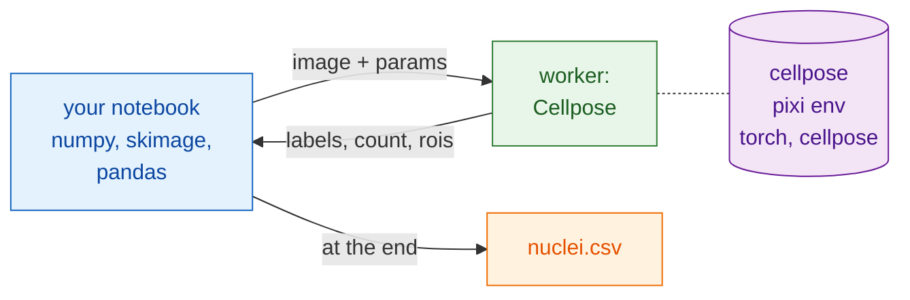

# In Python and napari

## The idea in plain words

Now the waiter is your notebook. It opens the files, smooths them, measures
the nuclei and writes the table with the packages you already know: NumPy,
scikit-image, pandas. For the segmentation it calls the kitchen through
`wavu.client`, a ready-made Python waiter.

The best part is what your notebook does **not** need: no PyTorch, no
Cellpose. Those live in the `cellpose_nuclei` folder's own pixi environment
(its kitchenware). Your notebook stays light, and upgrading one never breaks the
other.



## Before you start

1. **pixi** is installed (from [pixi.sh](https://pixi.sh)); `wavu.client`
   uses it to start the worker.
2. **The Cellpose folder**: download the
   [Wavu repository as a zip](https://github.com/Oxford-Zeiss-Centre-of-Excellence/Wavu/archive/refs/heads/main.zip)
   and use `examples/cellpose_nuclei` where it is (its `pixi.toml` finds
   Wavu two folders up). The first `Worker.start` installs its environment:
   **1–2 GB**, several minutes, once.
3. **`wavu.client` in your notebook's environment**. Either install it with
   pip:

    ```sh
    pip install "wavu @ git+https://github.com/Oxford-Zeiss-Centre-of-Excellence/Wavu.git"
    ```

    or, in a pixi project, add it under `[pypi-dependencies]`:

    ```toml
    wavu = { git = "https://github.com/Oxford-Zeiss-Centre-of-Excellence/Wavu.git" }
    ```

    Next to it you need only `scikit-image` and `pandas` for this example
    (`tifffile` and `numpy` come with `wavu`).

## The pipeline

```python
from pathlib import Path

import numpy as np
import pandas as pd
import tifffile
from skimage.filters import gaussian
from skimage.measure import regionprops_table
from wavu.client import Worker

images = Path("D:/data/BBBC039")                         # a folder of nuclei TIFFs
cellpose = Path("D:/Wavu-main/examples/cellpose_nuclei")  # the script folder

tables = []
with Worker.start(cellpose, on_log=print) as w:          # starts once, for every image
    for f in sorted(images.glob("*.tif")):
        img = tifffile.imread(f)                                          # native: open
        smooth = gaussian(img, sigma=1, preserve_range=True).astype(np.float32)  # native: preprocess

        res = w.run("script", {"diameter": 30, "use_gpu": False},        # Wavu step: Cellpose
                    {"image": smooth})
        labels = res.outputs["labels"].value                              # a NumPy label image
        print(f.name, res.outputs["count"].value, "nuclei")

        t = pd.DataFrame(regionprops_table(                               # native: measure
            labels, intensity_image=img,
            properties=("label", "area", "intensity_mean")))
        t.insert(0, "file", f.name)
        tables.append(t)
# the worker has stopped here

nuclei = pd.concat(tables, ignore_index=True)
nuclei.to_csv(images / "nuclei.csv", index=False)                         # native: save
print(nuclei.groupby("file").size())                                      # nuclei per image
```

What each Wavu piece does:

- `Worker.start(folder, on_log=print)` starts the folder's worker in its own
  environment and prints pixi's progress while it waits. At the end of the
  `with` block the worker exits.
- `w.run(script, params, inputs)` sends one image and returns every output
  already loaded: `labels` as an array, `count` as a number, and `rois` as a
  RoiSet whose `.path` is the ImageJ zip (handy if a Fiji user wants the
  outlines). Leave out a parameter and its `PARAMS` default is used.
- If you know the pixel size, pass it along with
  `meta={"image": {"pixel_um": 0.65}}`.
- A failure in the script raises `WorkerError`, with the Python traceback in
  its message. Catch it if one bad image should not stop the loop.
- `on_progress=` takes a function that gets values from 0 to 1, and
  `cancel=` a `threading.Event`: set it to ask the running job to stop.

## See the result in napari

Inside the loop, or afterwards for one image, two lines put the image and
its nuclei on screen:

```python
import napari

viewer = napari.Viewer()
viewer.add_image(img)
viewer.add_labels(labels)
```

Paste the whole pipeline into napari's built-in console, or
save it as `my_pipeline.py` and run it from a Wavu clone, whose `napari`
environment already has `wavu`, napari and the packages above:

```sh
pixi run -e napari python my_pipeline.py
```

## Chain several environments

A pipeline can call more than one kitchen. Say you have a second script
folder that removes noise (made from the
[template](../write/get-the-template.md), returning an image called
`denoised`), with packages that would clash with Cellpose's. Start both
workers in one `with`; each runs in its own environment:

```python
with Worker.start("D:/scripts/denoise") as den, Worker.start(cellpose) as seg:
    for f in sorted(images.glob("*.tif")):
        img = tifffile.imread(f)
        clean = den.run("script", {}, {"image": img}).outputs["denoised"].value
        labels = seg.run("script", {"diameter": 30}, {"image": clean}).outputs["labels"].value
        ...
```

Your notebook only passes arrays from one step to the next. Neither
environment knows the other exists, and neither is installed in your
notebook.

Working in Fiji instead? The same pipeline as Groovy and as an ImageJ
macro: [In Fiji](fiji.md).

## In one sentence

Open, preprocess, measure and save with your own Python packages, and call
`w.run(...)` on a worker started once with `Worker.start(...)` for the
heavy step, which runs in its own environment, so your notebook never
installs PyTorch.
