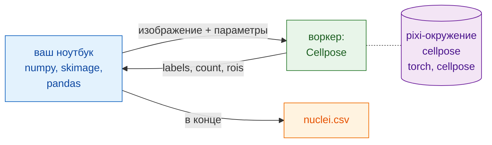

# В Python и napari

## Идея простыми словами

Теперь официант — ваш ноутбук (notebook). Он открывает файлы, сглаживает
их, измеряет ядра и записывает таблицу с помощью пакетов, которые вы уже
знаете: NumPy, scikit-image, pandas. Для сегментации он обращается на кухню
через `wavu.client` — готового официанта на Python.

Лучшее — то, что вашему ноутбуку **не** нужно: ни PyTorch, ни Cellpose. Они
живут в собственном pixi-окружении папки `cellpose_nuclei` (её кухонной
утвари). Ваш ноутбук остаётся лёгким, и обновление одного никогда не
ломает другое.



## Перед началом

1. **pixi** установлен (с [pixi.sh](https://pixi.sh)); `wavu.client`
   использует его, чтобы запустить воркер.
2. **Папка Cellpose**: скачайте
   [репозиторий Wavu в виде zip](https://github.com/Oxford-Zeiss-Centre-of-Excellence/Wavu/archive/refs/heads/main.zip)
   и используйте `examples/cellpose_nuclei` там, где она лежит (её
   `pixi.toml` находит Wavu двумя папками выше). Первый `Worker.start`
   устанавливает её окружение: **1–2 ГБ**, несколько минут, один раз.
3. **`wavu.client` в окружении вашего ноутбука**. Либо установите его через
   pip:

    ```sh
    pip install "wavu @ git+https://github.com/Oxford-Zeiss-Centre-of-Excellence/Wavu.git"
    ```

    либо, в проекте pixi, добавьте его в `[pypi-dependencies]`:

    ```toml
    wavu = { git = "https://github.com/Oxford-Zeiss-Centre-of-Excellence/Wavu.git" }
    ```

    Кроме него для этого примера нужны только `scikit-image` и `pandas`
    (`tifffile` и `numpy` приходят вместе с `wavu`).

## Конвейер

```python
from pathlib import Path

import numpy as np
import pandas as pd
import tifffile
from skimage.filters import gaussian
from skimage.measure import regionprops_table
from wavu.client import Worker

images = Path("D:/data/BBBC039")                         # папка с TIFF ядер
cellpose = Path("D:/Wavu-main/examples/cellpose_nuclei")  # папка скрипта

tables = []
with Worker.start(cellpose, on_log=print) as w:          # запускается один раз, для всех изображений
    for f in sorted(images.glob("*.tif")):
        img = tifffile.imread(f)                                          # своими силами: открыть
        smooth = gaussian(img, sigma=1, preserve_range=True).astype(np.float32)  # своими силами: предобработка

        res = w.run("script", {"diameter": 30, "use_gpu": False},        # шаг Wavu: Cellpose
                    {"image": smooth})
        labels = res.outputs["labels"].value                              # изображение меток NumPy
        print(f.name, res.outputs["count"].value, "nuclei")

        t = pd.DataFrame(regionprops_table(                               # своими силами: измерить
            labels, intensity_image=img,
            properties=("label", "area", "intensity_mean")))
        t.insert(0, "file", f.name)
        tables.append(t)
# здесь воркер уже остановлен

nuclei = pd.concat(tables, ignore_index=True)
nuclei.to_csv(images / "nuclei.csv", index=False)                         # своими силами: сохранить
print(nuclei.groupby("file").size())                                      # ядер на изображение
```

Что делает каждая часть Wavu:

- `Worker.start(folder, on_log=print)` запускает воркер папки в её
  собственном окружении и, пока вы ждёте, печатает прогресс pixi. В конце
  блока `with` воркер завершается.
- `w.run(script, params, inputs)` отправляет одно изображение и возвращает
  все результаты уже загруженными: `labels` — как массив, `count` — как
  число, а `rois` — как RoiSet, чей `.path` — это zip ImageJ (удобно, если
  контуры нужны пользователю Fiji). Если не указать параметр, используется
  его значение по умолчанию из `PARAMS`.
- Если вы знаете размер пикселя, передайте его через
  `meta={"image": {"pixel_um": 0.65}}`.
- Сбой в скрипте выбрасывает `WorkerError` с трассировкой Python в
  сообщении. Перехватите его, если одно плохое изображение не должно
  останавливать цикл.
- `on_progress=` принимает функцию, получающую значения от 0 до 1, а
  `cancel=` — `threading.Event`: установите его, чтобы попросить текущее
  задание остановиться.

## Результат в napari

Внутри цикла или потом для одного изображения две строки выводят
изображение и его ядра на экран:

```python
import napari

viewer = napari.Viewer()
viewer.add_image(img)
viewer.add_labels(labels)
```

Вставьте весь конвейер во встроенную консоль napari или сохраните его как
`my_pipeline.py` и запустите из клона Wavu, в окружении `napari` которого
уже есть `wavu`, napari и перечисленные выше пакеты:

```sh
pixi run -e napari python my_pipeline.py
```

## Цепочка из нескольких окружений

Конвейер может обращаться к нескольким кухням. Допустим, у вас есть вторая
папка скрипта, которая убирает шум (сделана из
[шаблона](../write/get-the-template.md) и возвращает изображение
`denoised`), с пакетами, которые конфликтовали бы с пакетами Cellpose.
Запустите оба воркера в одном `with`; каждый работает в своём окружении:

```python
with Worker.start("D:/scripts/denoise") as den, Worker.start(cellpose) as seg:
    for f in sorted(images.glob("*.tif")):
        img = tifffile.imread(f)
        clean = den.run("script", {}, {"image": img}).outputs["denoised"].value
        labels = seg.run("script", {"diameter": 30}, {"image": clean}).outputs["labels"].value
        ...
```

Ваш ноутбук лишь передаёт массивы от одного шага к другому. Ни одно
окружение не знает о существовании другого, и ни одно не установлено в
ваш ноутбук.

Работаете в Fiji? Тот же конвейер на Groovy и в виде макроса ImageJ:
[В Fiji](fiji.md).

## Одним предложением

Открывайте, предобрабатывайте, измеряйте и сохраняйте своими пакетами
Python, а для тяжёлого шага вызывайте `w.run(...)` у воркера, запущенного
один раз через `Worker.start(...)`: он работает в своём окружении, так что
вашему ноутбуку никогда не нужно устанавливать PyTorch.
