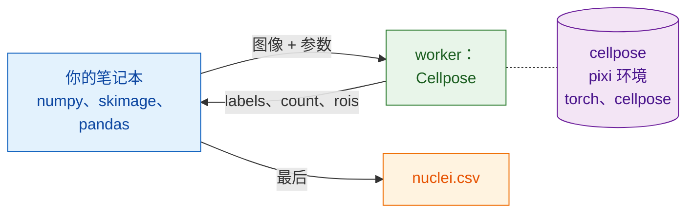

# 在 Python 和 napari 中

## 用大白话说

这次服务员换成了你的笔记本。它打开文件、做平滑、测量细胞核，并用你已经
熟悉的包写出表格：NumPy、scikit-image、pandas。需要分割时，它通过
`wavu.client` 呼叫厨房；`wavu.client` 就是一位现成的 Python 服务员。

最妙的是你的笔记本**不**需要的东西：不用 PyTorch，也不用 Cellpose。它们待在
`cellpose_nuclei` 文件夹自己的 pixi 环境（它的厨具）里。你的笔记本保持轻量，
升级其中一边也绝不会弄坏另一边。



## 开始之前

1. 已安装 **pixi**（从 [pixi.sh](https://pixi.sh) 获取）；`wavu.client`
   用它来启动 worker。
2. **Cellpose 文件夹**：下载
   [Wavu 仓库的 zip 包](https://github.com/Oxford-Zeiss-Centre-of-Excellence/Wavu/archive/refs/heads/main.zip)，
   并原地使用 `examples/cellpose_nuclei`（它的 `pixi.toml` 会往上两级文件夹
   找到 Wavu）。第一次 `Worker.start` 会安装它的环境：**1–2 GB**，需要几分钟，
   只有一次。
3. **笔记本的环境里要有 `wavu.client`**。可以用 pip 安装：

    ```sh
    pip install "wavu @ git+https://github.com/Oxford-Zeiss-Centre-of-Excellence/Wavu.git"
    ```

    或者在 pixi 项目中，把它加到 `[pypi-dependencies]` 下面：

    ```toml
    wavu = { git = "https://github.com/Oxford-Zeiss-Centre-of-Excellence/Wavu.git" }
    ```

    这个示例另外只需要 `scikit-image` 和 `pandas`（`tifffile` 和 `numpy`
    会随 `wavu` 一起安装）。

## 流程

```python
from pathlib import Path

import numpy as np
import pandas as pd
import tifffile
from skimage.filters import gaussian
from skimage.measure import regionprops_table
from wavu.client import Worker

images = Path("D:/data/BBBC039")                         # 一个细胞核 TIFF 文件夹
cellpose = Path("D:/Wavu-main/examples/cellpose_nuclei")  # 脚本文件夹

tables = []
with Worker.start(cellpose, on_log=print) as w:          # 只启动一次，服务每张图像
    for f in sorted(images.glob("*.tif")):
        img = tifffile.imread(f)                                          # 原生：打开
        smooth = gaussian(img, sigma=1, preserve_range=True).astype(np.float32)  # 原生：预处理

        res = w.run("script", {"diameter": 30, "use_gpu": False},        # Wavu 步骤：Cellpose
                    {"image": smooth})
        labels = res.outputs["labels"].value                              # NumPy 标签图像
        print(f.name, res.outputs["count"].value, "nuclei")

        t = pd.DataFrame(regionprops_table(                               # 原生：测量
            labels, intensity_image=img,
            properties=("label", "area", "intensity_mean")))
        t.insert(0, "file", f.name)
        tables.append(t)
# 到这里 worker 已经停止

nuclei = pd.concat(tables, ignore_index=True)
nuclei.to_csv(images / "nuclei.csv", index=False)                         # 原生：保存
print(nuclei.groupby("file").size())                                      # 每张图像的细胞核数
```

每个 Wavu 部分的作用：

- `Worker.start(folder, on_log=print)` 在文件夹自己的环境中启动 worker，
  等待时会打印 pixi 的进度。`with` 块结束时，worker 就会退出。
- `w.run(script, params, inputs)` 发送一张图像，返回已经加载好的所有输出：
  `labels` 是数组，`count` 是数字，`rois` 是 RoiSet，它的 `.path` 就是
  ImageJ 的 zip 文件（如果有 Fiji 用户想要轮廓，就很方便）。没给的参数会使用
  `PARAMS` 里的默认值。
- 如果你知道像素大小，可以用 `meta={"image": {"pixel_um": 0.65}}` 一起传过去。
- 脚本中的错误会抛出 `WorkerError`，消息里附有 Python 的 traceback（错误
  回溯）。如果不想让一张坏图像中断整个循环，就捕获它。
- `on_progress=` 接收一个函数，它会拿到 0 到 1 之间的数值；`cancel=` 接收一个
  `threading.Event`：设置它，就是请正在运行的任务停下来。

## 在 napari 中看结果

在循环里，或者事后针对某一张图像，两行代码就能把图像和它的细胞核显示在
屏幕上：

```python
import napari

viewer = napari.Viewer()
viewer.add_image(img)
viewer.add_labels(labels)
```

把整个流程粘贴到 napari 内置的控制台（console），或者保存为
`my_pipeline.py`，在 Wavu 的克隆中运行；它的 `napari` 环境已经包含 `wavu`、
napari 和上面的包：

```sh
pixi run -e napari python my_pipeline.py
```

## 串联多个环境

一个流程可以呼叫不止一个厨房。假设你有第二个用来去噪的脚本文件夹
（由[模板](../write/get-the-template.md)创建，返回一张名为 `denoised` 的
图像），它的包会和 Cellpose 的包冲突。在同一个 `with` 里启动两个 worker；
各自在自己的环境中运行：

```python
with Worker.start("D:/scripts/denoise") as den, Worker.start(cellpose) as seg:
    for f in sorted(images.glob("*.tif")):
        img = tifffile.imread(f)
        clean = den.run("script", {}, {"image": img}).outputs["denoised"].value
        labels = seg.run("script", {"diameter": 30}, {"image": clean}).outputs["labels"].value
        ...
```

你的笔记本只负责把数组从一个步骤传到下一个步骤。两个环境都不知道对方的
存在，也都没有安装在你的笔记本里。

改用 Fiji？同一个流程的 Groovy 和 ImageJ 宏版本：[在 Fiji 中](fiji.md)。

## 一句话总结

用你自己的 Python 包打开、预处理、测量和保存，繁重的步骤则对一个用
`Worker.start(...)` 只启动一次的 worker 调用 `w.run(...)`；它在自己的环境中
运行，所以你的笔记本永远不必安装 PyTorch。
