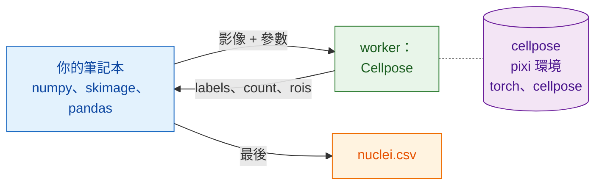

# 在 Python 和 napari 中

## 用白話說

這次服務生換成你的筆記本。它開啟檔案、做平滑處理、測量細胞核，並用你已經
熟悉的套件寫出表格：NumPy、scikit-image、pandas。需要分割時，它透過
`wavu.client` 呼叫廚房；`wavu.client` 就是一位現成的 Python 服務生。

最棒的是你的筆記本**不**需要的東西：不用 PyTorch，也不用 Cellpose。它們住在
`cellpose_nuclei` 資料夾自己的 pixi 環境（它的廚具）裡。你的筆記本保持輕巧，
升級其中一邊也永遠不會弄壞另一邊。



## 開始之前

1. 已安裝 **pixi**（從 [pixi.sh](https://pixi.sh) 取得）；`wavu.client`
   用它來啟動 worker。
2. **Cellpose 資料夾**：下載
   [Wavu 儲存庫的 zip 檔](https://github.com/Oxford-Zeiss-Centre-of-Excellence/Wavu/archive/refs/heads/main.zip)，
   並就地使用 `examples/cellpose_nuclei`（它的 `pixi.toml` 會往上兩層資料夾
   找到 Wavu）。第一次 `Worker.start` 會安裝它的環境：**1–2 GB**，需要幾分鐘，
   只有一次。
3. **筆記本的環境裡要有 `wavu.client`**。可以用 pip 安裝：

    ```sh
    pip install "wavu @ git+https://github.com/Oxford-Zeiss-Centre-of-Excellence/Wavu.git"
    ```

    或者在 pixi 專案中，把它加到 `[pypi-dependencies]` 底下：

    ```toml
    wavu = { git = "https://github.com/Oxford-Zeiss-Centre-of-Excellence/Wavu.git" }
    ```

    這個範例另外只需要 `scikit-image` 和 `pandas`（`tifffile` 和 `numpy`
    會隨 `wavu` 一起安裝）。

## 流程

```python
from pathlib import Path

import numpy as np
import pandas as pd
import tifffile
from skimage.filters import gaussian
from skimage.measure import regionprops_table
from wavu.client import Worker

images = Path("D:/data/BBBC039")                         # 一個細胞核 TIFF 資料夾
cellpose = Path("D:/Wavu-main/examples/cellpose_nuclei")  # 腳本資料夾

tables = []
with Worker.start(cellpose, on_log=print) as w:          # 只啟動一次，服務每張影像
    for f in sorted(images.glob("*.tif")):
        img = tifffile.imread(f)                                          # 原生：開啟
        smooth = gaussian(img, sigma=1, preserve_range=True).astype(np.float32)  # 原生：前處理

        res = w.run("script", {"diameter": 30, "use_gpu": False},        # Wavu 步驟：Cellpose
                    {"image": smooth})
        labels = res.outputs["labels"].value                              # NumPy 標籤影像
        print(f.name, res.outputs["count"].value, "nuclei")

        t = pd.DataFrame(regionprops_table(                               # 原生：測量
            labels, intensity_image=img,
            properties=("label", "area", "intensity_mean")))
        t.insert(0, "file", f.name)
        tables.append(t)
# 到這裡 worker 已經停止

nuclei = pd.concat(tables, ignore_index=True)
nuclei.to_csv(images / "nuclei.csv", index=False)                         # 原生：存檔
print(nuclei.groupby("file").size())                                      # 每張影像的細胞核數
```

每個 Wavu 部分的作用：

- `Worker.start(folder, on_log=print)` 在資料夾自己的環境中啟動 worker，
  等待時會印出 pixi 的進度。`with` 區塊結束時，worker 就會結束。
- `w.run(script, params, inputs)` 送出一張影像，回傳已經載入好的所有輸出：
  `labels` 是陣列，`count` 是數字，`rois` 是 RoiSet，它的 `.path` 就是
  ImageJ 的 zip 檔（如果有 Fiji 使用者想要輪廓，就很方便）。沒給的參數會使用
  `PARAMS` 裡的預設值。
- 如果你知道像素大小，可以用 `meta={"image": {"pixel_um": 0.65}}` 一起傳過去。
- 腳本中的錯誤會拋出 `WorkerError`，訊息裡附有 Python 的 traceback（錯誤
  追蹤）。如果不想讓一張壞影像中斷整個迴圈，就捕捉它。
- `on_progress=` 接收一個函式，它會拿到 0 到 1 之間的數值；`cancel=` 接收一個
  `threading.Event`：設定它，就是請正在執行的工作停下來。

## 在 napari 中看結果

在迴圈裡，或事後針對某一張影像，兩行程式碼就能把影像和它的細胞核顯示在
畫面上：

```python
import napari

viewer = napari.Viewer()
viewer.add_image(img)
viewer.add_labels(labels)
```

把整個流程貼到 napari 內建的主控台（console），或存成 `my_pipeline.py`，
在 Wavu 的 clone 中執行；它的 `napari` 環境已經包含 `wavu`、napari 和上面的
套件：

```sh
pixi run -e napari python my_pipeline.py
```

## 串接多個環境

一個流程可以呼叫不只一個廚房。假設你有第二個用來去除雜訊的腳本資料夾
（由[範本](../write/get-the-template.md)建立，回傳一張名為 `denoised` 的
影像），它的套件會和 Cellpose 的套件衝突。在同一個 `with` 裡啟動兩個
worker；各自在自己的環境中執行：

```python
with Worker.start("D:/scripts/denoise") as den, Worker.start(cellpose) as seg:
    for f in sorted(images.glob("*.tif")):
        img = tifffile.imread(f)
        clean = den.run("script", {}, {"image": img}).outputs["denoised"].value
        labels = seg.run("script", {"diameter": 30}, {"image": clean}).outputs["labels"].value
        ...
```

你的筆記本只負責把陣列從一個步驟傳到下一個步驟。兩個環境都不知道對方的
存在，也都沒有安裝在你的筆記本裡。

改用 Fiji？同一個流程的 Groovy 和 ImageJ 巨集版本：[在 Fiji 中](fiji.md)。

## 一句話總結

用你自己的 Python 套件開啟、前處理、測量和存檔，吃重的步驟則對一個用
`Worker.start(...)` 只啟動一次的 worker 呼叫 `w.run(...)`；它在自己的環境中
執行，所以你的筆記本永遠不必安裝 PyTorch。
