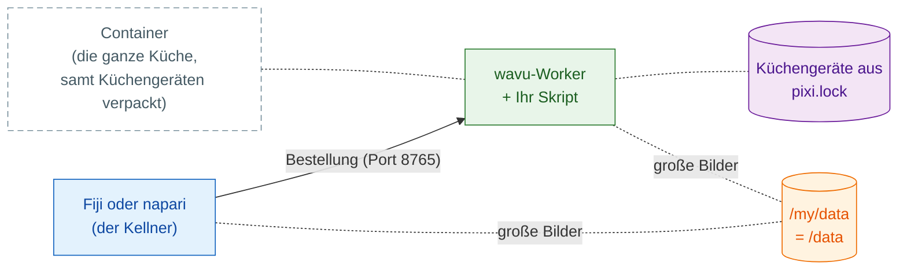

# Als Container teilen

## Die Idee in einfachen Worten

Bisher bringt der Kellner jedes Gastes (Fiji oder napari) die Bestellung in
eine Küche auf dem eigenen Rechner des Gastes, wo pixi die Küchengeräte jedes
Rezepts einrichtet. Ein **Container** ist **die ganze Küche, samt
Küchengeräten verpackt**, bereit, überall aufgebaut zu werden: auf Ihrem
Rechner, einem Laborserver oder einem Cluster. Ihr Betrachter nimmt weiterhin
die Bestellung auf und trägt die Zutaten (Ihre Bilder); er geht einfach dorthin,
wo diese Küche gerade steht.



Das ist **optional**: Fiji und napari starten den Worker normalerweise
selbst. Ein Container hilft, wenn:

- ein PC **abgeschottet** ist und Sie dort weder pixi noch Pakete
  installieren dürfen;
- die Arbeit auf einem **Laborserver oder einem HPC-Cluster** laufen soll,
  während Sie auf Ihrem eigenen Rechner im Betrachter klicken;
- Sie jedes Mal **genau dieselbe Küche** wollen, für ein Paper oder ein
  langlebiges Projekt: Das Image ist eingefroren, bis hinunter zum
  Betriebssystem.

Sie brauchen ein Container-Werkzeug auf dem Rechner, der das Image baut
oder ausführt. Das Image ist ein gewöhnliches Linux-Image (OCI), daher
funktioniert jedes dieser Werkzeuge; die Befehle unten lauten `docker`, und
die anderen verstehen dieselben Wörter `build`/`run`:

=== "Windows"

    Linux-Images laufen unter Windows über **WSL 2**, das in Windows
    eingebaute Linux:

    - Führen Sie einmal `wsl --install` aus (danach neu starten) und nutzen
      Sie darin [Podman](https://podman.io) oder Docker Engine; oder
    - installieren Sie [Podman Desktop](https://podman-desktop.io) oder
      [Rancher Desktop](https://rancherdesktop.io), die WSL 2 für Sie
      einrichten.

    In WSL ist Ihr Ordner `D:\data` unter `/mnt/d/data` zu finden.

=== "macOS"

    - **Apples [`container`](https://github.com/apple/container)** (kostenlos
      und Open Source, von Apple; Apple Silicon, macOS 26 empfohlen): führt
      jeden Container in einer eigenen winzigen virtuellen Maschine aus.
      `container build -t my-tool .` und `container run …`; die Optionen für
      Port und Ordner zeigt `container run --help`.
    - [OrbStack](https://orbstack.dev), [Colima](https://github.com/abiosoft/colima)
      oder [Podman Desktop](https://podman-desktop.io): schlanke Alternativen
      zu Docker Desktop, die dieselben `docker`-Befehle verstehen.

=== "Linux"

    [Podman](https://podman.io) (ohne Daemon, ohne Root) oder Docker Engine:
    `podman build -t my-tool .`, `podman run …`.

Auf einem Cluster nehmen Sie Apptainer (siehe [unten](#on-an-hpc-cluster)).

## Schritt 1: bauen

Jeder Ordner, der aus der [Vorlage](get-the-template.md) erstellt wurde, hat
ein `Dockerfile` und eine `.dockerignore`. Das Image installiert genau das,
was in `pixi.lock` steht, also führen Sie zuerst `pixi install` aus und
committen `pixi.lock`. Im Skriptordner:

```sh
docker build -t my-tool .
```

!!! note "Nur in Ordnern aus der Vorlage"
    Das `Dockerfile` holt `wavu` von GitHub, so wie es die `pixi.toml` der
    Vorlage tut. Im Wavu-Repository selbst nehmen Sie stattdessen das
    `Dockerfile` im Wurzelverzeichnis von Wavu, mit
    `--build-arg SCRIPT_DIR=examples/cellpose_nuclei` (zum Beispiel).

## Schritt 2: ausführen

```sh
docker run --rm -p 127.0.0.1:8765:8765 -e WAVU_TOKEN=pick-one -v /my/data:/data my-tool
```

- `-p 127.0.0.1:8765:8765` öffnet die Küchentür auf Port 8765, **nur für
  diesen Rechner**.
- `-e WAVU_TOKEN=pick-one` setzt das Passwort (wählen Sie Ihr eigenes).
- `-v /my/data:/data` teilt Ihren Datenordner: Auf Ihrem Rechner ist es
  `/my/data` (unter Windows zum Beispiel `D:/data`); im Container ist es
  `/data`.

Der Worker schreibt seine Handshake-Datei (Adresse, Port und Token) nach
`/my/data/.wavu/worker.json` und Auftragsdateien unter `/my/data/.wavu-tmp`.
Große Bilder reisen durch diesen geteilten Ordner, deshalb muss der
Betrachter seine zwei Namen kennen.

## Schritt 3: verbinden

=== "Fiji"

    Wählen Sie **Plugins › Wavu › Connect to Running Worker** (mit
    laufendem Worker verbinden) und füllen Sie aus:

    - **Handshake file** (Handshake-Datei): `/my/data/.wavu/worker.json`
    - **Host data folder** (Datenordner auf dem Host): `/my/data`
    - **Same folder inside the container** (derselbe Ordner im Container):
      `/data`

    Dann **Plugins › Wavu › Run Python Script** und den Worker aus der
    Liste wählen.

=== "napari"

    Öffnen Sie **Plugins › Run Python Script (Wavu)** und haken Sie
    **Remote / container** (entfernt / Container) an. Füllen Sie aus:

    - **Handshake file**: `/my/data/.wavu/worker.json`
    - **Host folder** (Ordner auf dem Host): `/my/data`
    - **Container folder** (Ordner im Container): `/data`

    Lassen Sie **Host** leer und drücken Sie **Connect to running worker**.

## Ein anderer Rechner

Um die Küche auf einem Laborserver aufzubauen, starten Sie den Container dort
mit `-p 8765:8765` (jede Netzwerkadresse, nicht nur `127.0.0.1`). Kopieren
Sie seine `.wavu/worker.json` auf Ihren Rechner. Tragen Sie in napari die
Adresse des Servers unter **Host** ein (Fiji und napari haben beide dieses
Feld). Für große Bilder müssen beide Rechner den Datenordner (ein
Netzlaufwerk) unter den Namen sehen, die Sie angeben.

!!! warning "Das Token ist das einzige Schloss"
    Wer den Port erreicht und das Token kennt, kann Ihre Skripte ausführen,
    mit Zugriff auf den geteilten Ordner. Halten Sie das Token geheim.
    Bevorzugen Sie `127.0.0.1` plus einen SSH-Tunnel
    (`ssh -L 8765:localhost:8765 you@server`), damit der Port nie zum
    Netzwerk hin offen ist; dann bleibt **Host** leer.

## Veröffentlichen

Wavu veröffentlicht keine Images Ihrer Skripte; Sie veröffentlichen Ihre
eigenen, zum Beispiel in der GitHub Container Registry (ghcr.io):

```sh
docker login ghcr.io          # Benutzername + ein GitHub-Token mit write:packages
docker tag my-tool ghcr.io/<you>/my-tool:1.0.0
docker push ghcr.io/<you>/my-tool:1.0.0
```

Pakete sind zunächst privat: Machen Sie es unter **GitHub › Packages ›
my-tool › Package settings** öffentlich. Andere führen dann in Schritt 2
`ghcr.io/<you>/my-tool:1.0.0` statt `my-tool` aus. Die Fiji-ZIP-Datei aus
`wavu package` lässt das `Dockerfile` weg, sodass beides in einem Ordner
leben kann.

??? example "Für Fortgeschrittene: bei jedem Tag mit GitHub Actions bauen und pushen"
    Speichern Sie dies als `.github/workflows/container.yml`; das Pushen
    eines Tags wie `v1.0.0` veröffentlicht `ghcr.io/<you>/<repo>:v1.0.0`.

    ```yaml
    name: container
    on:
      push:
        tags: ["v*"]
    permissions:
      contents: read
      packages: write
    jobs:
      image:
        runs-on: ubuntu-latest
        steps:
          - uses: actions/checkout@v4
          - uses: docker/login-action@v3
            with:
              registry: ghcr.io
              username: ${{ github.actor }}
              password: ${{ github.token }}
          - uses: docker/build-push-action@v6
            with:
              context: .
              push: true
              tags: ghcr.io/${{ github.repository }}:${{ github.ref_name }}
    ```

    GitHub braucht den Image-Namen in Kleinbuchstaben: Enthält Ihr
    Benutzer- oder Repository-Name Großbuchstaben, schreiben Sie den Tag von
    Hand aus.

## Auf einem HPC-Cluster { #on-an-hpc-cluster }

Cluster bieten meist Apptainer (früher Singularity) statt Docker an. Es
führt dasselbe Image aus:

```sh
apptainer pull docker://ghcr.io/<you>/my-tool:1.0.0
apptainer run --bind /my/data:/data --env WAVU_TOKEN=pick-one my-tool_1.0.0.sif
```

`--bind` teilt Ordner, wie `-v` bei Docker. Binden Sie Ihren Datenordner an
`/data`: Der Startbefehl des Images erwartet ihn dort. Apptainer hat kein
`-p`, also lauscht der Worker direkt auf Port 8765 des Rechenknotens;
erreichen Sie ihn über einen SSH-Tunnel, wie oben.

## In einem Satz

`docker build`, dann `docker run` mit einem Port, einem Token und Ihrem
Datenordner, und aus Fiji oder napari mit der Handshake-Datei und den zwei
Namen des Ordners verbinden: die ganze Küche, samt Küchengeräten verpackt
und aufgebaut, wo immer Sie sie brauchen.

[Weiter: mit dem eigenen Labor teilen :material-arrow-right:](../fiji/with-your-lab.md){ .md-button }
