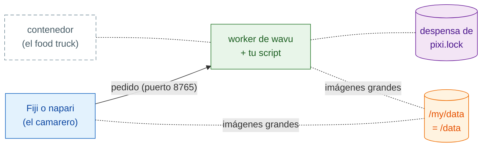

# Compartir como contenedor

## La idea en palabras sencillas

Hasta ahora, el camarero de cada cliente (Fiji o napari) cocina en una cocina
del propio ordenador del cliente, con una despensa que pixi llena allí. Un
**contenedor** es un **food truck**: la cocina entera, con la despensa ya
llena, metida en un solo vehículo que puedes aparcar donde quieras. Tu visor
sigue tomando el pedido; simplemente se acerca hasta el camión.



Esto es **opcional**: normalmente Fiji y napari arrancan el worker ellos
mismos. Un contenedor ayuda cuando:

- un PC está **bloqueado** y no puedes instalar pixi ni paquetes en él;
- el trabajo debe ejecutarse en un **servidor del laboratorio o en un clúster
  HPC**, mientras tú haces clic en el visor de tu propio ordenador;
- quieres **exactamente la misma cocina** cada vez, para un artículo o un
  proyecto largo: la imagen queda congelada, hasta el sistema operativo.

Necesitas una herramienta de contenedores en el ordenador que construye
o ejecuta la imagen. La imagen es una imagen Linux (OCI) normal, así que
cualquiera de estas sirve; los comandos de abajo dicen `docker`, y las
demás usan las mismas palabras `build`/`run`:

=== "macOS"

    - **[`container`](https://github.com/apple/container) de Apple** (gratis
      y de código abierto, de Apple; Apple silicon, se recomienda macOS 26):
      ejecuta cada contenedor en su propia máquina virtual diminuta.
      `container build -t my-tool .` y `container run …`; mira
      `container run --help` para sus opciones de puerto y carpeta.
    - [OrbStack](https://orbstack.dev), [Colima](https://github.com/abiosoft/colima)
      o [Podman Desktop](https://podman-desktop.io): alternativas ligeras a
      Docker Desktop que aceptan los mismos comandos `docker`.

=== "Windows"

    Las imágenes Linux funcionan en Windows a través de **WSL 2**, el Linux
    integrado en Windows:

    - Ejecuta `wsl --install` una vez (y reinicia), y usa
      [Podman](https://podman.io) o Docker Engine dentro; o
    - instala [Podman Desktop](https://podman-desktop.io) o
      [Rancher Desktop](https://rancherdesktop.io), que configuran WSL 2 por
      ti.

    Dentro de WSL, tu carpeta `D:\data` es `/mnt/d/data`.

=== "Linux"

    [Podman](https://podman.io) (sin daemon, sin root) o Docker Engine:
    `podman build -t my-tool .`, `podman run …`.

En un clúster, usa Apptainer (mira [más abajo](#on-an-hpc-cluster)).

## Paso 1: construir

Cada carpeta creada a partir de la [plantilla](get-the-template.md) tiene un
`Dockerfile` y un `.dockerignore`. La imagen instala exactamente lo que dice
`pixi.lock`, así que ejecuta antes `pixi install` y haz commit de
`pixi.lock`. En la carpeta del script:

```sh
docker build -t my-tool .
```

!!! note "Solo en carpetas creadas a partir de la plantilla"
    El `Dockerfile` descarga `wavu` de GitHub, igual que el `pixi.toml` de
    la plantilla. Dentro del propio repositorio de Wavu, usa en su lugar el
    `Dockerfile` raíz de Wavu con
    `--build-arg SCRIPT_DIR=examples/cellpose_nuclei` (por ejemplo).

## Paso 2: ejecutar

```sh
docker run --rm -p 127.0.0.1:8765:8765 -e WAVU_TOKEN=pick-one -v /my/data:/data my-tool
```

- `-p 127.0.0.1:8765:8765` abre la puerta de la cocina en el puerto 8765,
  **solo para este ordenador**.
- `-e WAVU_TOKEN=pick-one` fija la contraseña (elige la tuya).
- `-v /my/data:/data` comparte tu carpeta de datos: en tu ordenador es
  `/my/data` (en Windows, por ejemplo, `D:/data`); dentro del contenedor es
  `/data`.

El worker escribe su archivo de saludo (dirección, puerto y token) en
`/my/data/.wavu/worker.json`, y los archivos de los trabajos bajo
`/my/data/.wavu-tmp`. Las imágenes grandes viajan por esa carpeta compartida;
por eso el visor tiene que conocer sus dos nombres.

## Paso 3: conectar

=== "Fiji"

    Elige **Plugins › Wavu › Connect to Running Worker** (conectar a un
    worker en marcha) y rellena:

    - **Handshake file** (archivo de saludo): `/my/data/.wavu/worker.json`
    - **Host data folder** (carpeta de datos del anfitrión): `/my/data`
    - **Same folder inside the container** (la misma carpeta dentro del
      contenedor): `/data`

    Después, **Plugins › Wavu › Run Python Script** y elige el worker en la
    lista.

=== "napari"

    Abre **Plugins › Run Python Script (Wavu)** y marca
    **Remote / container** (remoto / contenedor). Rellena:

    - **Handshake file**: `/my/data/.wavu/worker.json`
    - **Host folder** (carpeta del anfitrión): `/my/data`
    - **Container folder** (carpeta del contenedor): `/data`

    Deja **Host** vacío y pulsa **Connect to running worker**.

## Otra máquina

Para ejecutar el camión en un servidor del laboratorio, arráncalo allí con
`-p 8765:8765` (todas las direcciones de red, no solo `127.0.0.1`). Copia su
`.wavu/worker.json` a tu ordenador. En napari, pon la dirección del servidor
en **Host** (Fiji y napari tienen los dos este campo). Para imágenes grandes,
los dos ordenadores tienen que ver la carpeta de datos (una unidad de red)
con los nombres que indiques.

!!! warning "El token es la única cerradura"
    Cualquiera que pueda llegar al puerto y conozca el token puede ejecutar
    tus scripts, con acceso a la carpeta compartida. Mantén el token en
    secreto. Mejor usa `127.0.0.1` más un túnel SSH
    (`ssh -L 8765:localhost:8765 you@server`), para que el puerto nunca quede
    abierto a la red; entonces **Host** se queda vacío.

## Publicarlo

Wavu no publica imágenes de tus scripts; publicas las tuyas, por ejemplo en
GitHub Container Registry (ghcr.io):

```sh
docker login ghcr.io          # nombre de usuario + un token de GitHub con write:packages
docker tag my-tool ghcr.io/<you>/my-tool:1.0.0
docker push ghcr.io/<you>/my-tool:1.0.0
```

Los paquetes empiezan siendo privados: hazlo público en
**GitHub › Packages › my-tool › Package settings**. Así, otras personas
ejecutan `ghcr.io/<you>/my-tool:1.0.0` en el paso 2 en lugar de `my-tool`. El
zip para Fiji que crea `wavu package` deja fuera el `Dockerfile`, así que los
dos pueden convivir en una misma carpeta.

??? example "Avanzado: construir y publicar con cada etiqueta usando GitHub Actions"
    Guárdalo como `.github/workflows/container.yml`; al subir una etiqueta
    como `v1.0.0` se publica `ghcr.io/<you>/<repo>:v1.0.0`.

    ```yaml
    name: container
    on:
      push:
        tags: ["v*"]
    permissions:
      contents: read
      packages: write
    jobs:
      image:
        runs-on: ubuntu-latest
        steps:
          - uses: actions/checkout@v4
          - uses: docker/login-action@v3
            with:
              registry: ghcr.io
              username: ${{ github.actor }}
              password: ${{ github.token }}
          - uses: docker/build-push-action@v6
            with:
              context: .
              push: true
              tags: ghcr.io/${{ github.repository }}:${{ github.ref_name }}
    ```

    GitHub necesita el nombre de la imagen en minúsculas: si tu usuario o tu
    repositorio tiene mayúsculas, escribe la etiqueta a mano.

## En un clúster HPC { #on-an-hpc-cluster }

Los clústeres suelen ofrecer Apptainer (antes Singularity) en lugar de
Docker. Ejecuta la misma imagen:

```sh
apptainer pull docker://ghcr.io/<you>/my-tool:1.0.0
apptainer run --bind /my/data:/data --env WAVU_TOKEN=pick-one my-tool_1.0.0.sif
```

`--bind` comparte carpetas, como `-v` en Docker. Enlaza tu carpeta de datos a
`/data`: el comando de arranque de la imagen la espera ahí. Apptainer no tiene
`-p`, así que el worker escucha en el puerto 8765 del propio nodo de cómputo;
llega a él mediante un túnel SSH, como arriba.

## En una frase

`docker build`, después `docker run` con un puerto, un token y tu carpeta de
datos, y conéctate desde Fiji o napari con el archivo de saludo y los dos
nombres de la carpeta: la cocina entera, aparcada donde la necesites.

[Siguiente: compartir con tu laboratorio :material-arrow-right:](../fiji/with-your-lab.md){ .md-button }
