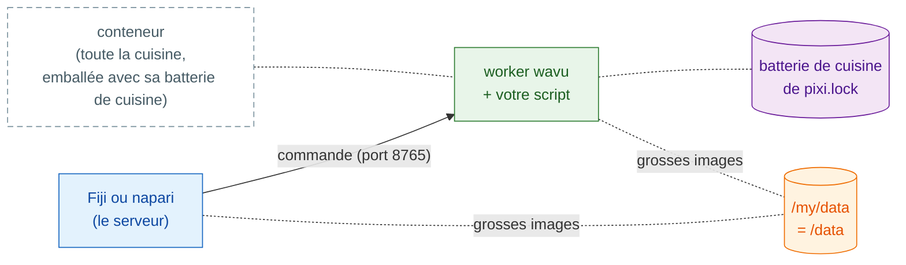

# Partager sous forme de conteneur

## L'idée en mots simples

Jusqu'ici, le serveur de chaque client (Fiji ou napari) porte la commande à
une cuisine sur l'ordinateur du client lui-même, où pixi installe la
batterie de cuisine de chaque recette. Un **conteneur**, c'est **toute la
cuisine, emballée avec sa batterie de cuisine**, prête à être installée
n'importe où : sur votre ordinateur, un serveur du labo ou un cluster. Votre
visualiseur prend toujours la commande et apporte les ingrédients (vos
images) ; il va simplement jusqu'à l'endroit où se trouve cette cuisine.



C'est **optionnel** : normalement, Fiji et napari démarrent le worker
eux-mêmes. Un conteneur aide quand :

- un PC est **verrouillé** et vous n'avez pas le droit d'y installer pixi
  ni des paquets ;
- le travail doit tourner sur un **serveur du labo ou un cluster de calcul
  (HPC)**, pendant que vous cliquez dans le visualiseur sur votre propre
  ordinateur ;
- vous voulez **exactement la même cuisine** à chaque fois, pour un article
  ou un projet de longue durée : l'image est figée, jusqu'au système
  d'exploitation.

Il vous faut un outil de conteneurs sur l'ordinateur qui construit ou
lance l'image. L'image est une image Linux (OCI) ordinaire, donc chacun de
ces outils convient ; les commandes ci-dessous disent `docker`, et les
autres acceptent les mêmes mots `build`/`run` :

=== "Windows"

    Les images Linux tournent sous Windows grâce à **WSL 2**, le Linux
    intégré à Windows :

    - lancez `wsl --install` une fois (puis redémarrez), et utilisez
      [Podman](https://podman.io) ou Docker Engine à l'intérieur ; ou
    - installez [Podman Desktop](https://podman-desktop.io) ou
      [Rancher Desktop](https://rancherdesktop.io), qui configurent WSL 2
      pour vous.

    Dans WSL, votre dossier `D:\data` est `/mnt/d/data`.

=== "macOS"

    - **[`container`](https://github.com/apple/container) d'Apple** (gratuit et
      open source, par Apple ; Apple silicon, macOS 26 recommandé) : lance
      chaque conteneur dans sa propre petite machine virtuelle.
      `container build -t my-tool .` et `container run …` ; consultez
      `container run --help` pour ses options de port et de dossier.
    - [OrbStack](https://orbstack.dev), [Colima](https://github.com/abiosoft/colima)
      ou [Podman Desktop](https://podman-desktop.io) : des alternatives légères
      à Docker Desktop qui acceptent les mêmes commandes `docker`.

=== "Linux"

    [Podman](https://podman.io) (sans démon, sans root) ou Docker Engine :
    `podman build -t my-tool .`, `podman run …`.

Sur un cluster, utilisez Apptainer (voir [plus bas](#on-an-hpc-cluster)).

## Étape 1 : construire

Chaque dossier créé à partir du [modèle](get-the-template.md) contient un
`Dockerfile` et un `.dockerignore`. L'image installe exactement ce qui est
dans `pixi.lock` : lancez donc d'abord `pixi install` et committez
`pixi.lock`. Dans le dossier de script :

```sh
docker build -t my-tool .
```

!!! note "Seulement dans les dossiers créés à partir du modèle"
    Le `Dockerfile` récupère `wavu` sur GitHub, comme le fait le
    `pixi.toml` du modèle. Dans le dépôt Wavu lui-même, utilisez plutôt le
    `Dockerfile` à la racine de Wavu avec
    `--build-arg SCRIPT_DIR=examples/cellpose_nuclei` (par exemple).

## Étape 2 : lancer

```sh
docker run --rm -p 127.0.0.1:8765:8765 -e WAVU_TOKEN=pick-one -v /my/data:/data my-tool
```

- `-p 127.0.0.1:8765:8765` ouvre la porte de la cuisine sur le port 8765,
  **pour cet ordinateur seulement**.
- `-e WAVU_TOKEN=pick-one` définit le mot de passe (choisissez le vôtre).
- `-v /my/data:/data` partage votre dossier de données : sur votre
  ordinateur, c'est `/my/data` (sous Windows, par exemple `D:/data`) ; dans
  le conteneur, c'est `/data`.

Le worker écrit son fichier de poignée de main (adresse, port et jeton)
dans `/my/data/.wavu/worker.json`, et les fichiers des tâches sous
`/my/data/.wavu-tmp`. Les grosses images passent par ce dossier partagé :
c'est pourquoi le visualiseur doit connaître ses deux noms.

## Étape 3 : se connecter

=== "Fiji"

    Choisissez **Plugins › Wavu › Connect to Running Worker** et
    remplissez :

    - **Handshake file** (fichier de poignée de main) :
      `/my/data/.wavu/worker.json`
    - **Host data folder** (dossier de données sur l'hôte) : `/my/data`
    - **Same folder inside the container** (le même dossier dans le
      conteneur) : `/data`

    Puis **Plugins › Wavu › Run Python Script** et choisissez le worker
    dans la liste.

=== "napari"

    Ouvrez **Plugins › Run Python Script (Wavu)** et cochez
    **Remote / container** (distant / conteneur). Remplissez :

    - **Handshake file** : `/my/data/.wavu/worker.json`
    - **Host folder** (dossier de l'hôte) : `/my/data`
    - **Container folder** (dossier du conteneur) : `/data`

    Laissez **Host** (hôte) vide et appuyez sur
    **Connect to running worker**.

## Une autre machine

Pour installer la cuisine sur un serveur du labo, démarrez-la là-bas
avec `-p 8765:8765` (toutes les adresses réseau, pas seulement
`127.0.0.1`). Copiez son `.wavu/worker.json` sur votre ordinateur. Dans
napari, mettez l'adresse du serveur dans **Host** (Fiji et napari ont tous
deux ce champ). Pour les grosses images, les deux ordinateurs doivent voir
le dossier de données (un lecteur réseau) sous les noms que vous indiquez.

!!! warning "Le jeton est le seul verrou"
    Quiconque peut joindre le port et connaît le jeton peut lancer vos
    scripts, avec accès au dossier partagé. Gardez le jeton secret.
    Préférez `127.0.0.1` plus un tunnel SSH
    (`ssh -L 8765:localhost:8765 you@server`), pour que le port ne soit
    jamais ouvert sur le réseau ; **Host** reste alors vide.

## Le publier

Wavu ne publie pas d'images de vos scripts ; vous publiez les vôtres, par
exemple sur le GitHub Container Registry (ghcr.io) :

```sh
docker login ghcr.io          # nom d'utilisateur + un jeton GitHub avec write:packages
docker tag my-tool ghcr.io/<you>/my-tool:1.0.0
docker push ghcr.io/<you>/my-tool:1.0.0
```

Les paquets sont privés au départ : rendez-le public sous
**GitHub › Packages › my-tool › Package settings**. Les autres lancent
alors `ghcr.io/<you>/my-tool:1.0.0` à l'étape 2 au lieu de `my-tool`. Le zip
Fiji produit par `wavu package` laisse le `Dockerfile` de côté : les deux
peuvent donc vivre dans le même dossier.

??? example "Avancé : construire et publier à chaque tag avec GitHub Actions"
    Enregistrez sous `.github/workflows/container.yml` ; pousser un tag
    comme `v1.0.0` publie `ghcr.io/<you>/<repo>:v1.0.0`.

    ```yaml
    name: container
    on:
      push:
        tags: ["v*"]
    permissions:
      contents: read
      packages: write
    jobs:
      image:
        runs-on: ubuntu-latest
        steps:
          - uses: actions/checkout@v4
          - uses: docker/login-action@v3
            with:
              registry: ghcr.io
              username: ${{ github.actor }}
              password: ${{ github.token }}
          - uses: docker/build-push-action@v6
            with:
              context: .
              push: true
              tags: ghcr.io/${{ github.repository }}:${{ github.ref_name }}
    ```

    GitHub exige le nom de l'image en minuscules : si votre nom
    d'utilisateur ou de dépôt contient des majuscules, écrivez le tag à la
    main.

## Sur un cluster de calcul (HPC) { #on-an-hpc-cluster }

Les clusters proposent en général Apptainer (anciennement Singularity) au
lieu de Docker. Il lance la même image :

```sh
apptainer pull docker://ghcr.io/<you>/my-tool:1.0.0
apptainer run --bind /my/data:/data --env WAVU_TOKEN=pick-one my-tool_1.0.0.sif
```

`--bind` partage des dossiers, comme le `-v` de Docker. Liez votre dossier
de données à `/data` : la commande de démarrage de l'image l'attend là.
Apptainer n'a pas de `-p` : le worker écoute donc sur le port 8765 du nœud
de calcul lui-même ; joignez-le par un tunnel SSH, comme ci-dessus.

## En une phrase

`docker build`, puis `docker run` avec un port, un jeton et votre dossier de
données, et connectez-vous depuis Fiji ou napari avec le fichier de poignée
de main et les deux noms du dossier : toute la cuisine, emballée avec sa
batterie de cuisine et installée là où vous en avez besoin.

[Suite : partager avec votre labo :material-arrow-right:](../fiji/with-your-lab.md){ .md-button }
