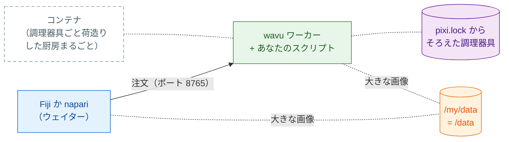

# コンテナとして共有する

## やさしく言うと

ここまでは、お客さんのウェイター（Fiji または napari）が、お客さん自身の
コンピューターにある厨房へ注文を運んでいました。そこでは pixi がレシピごとの
調理器具をそろえます。**コンテナ** は **調理器具ごとまるごと荷造りした厨房**
で、自分のコンピューター、研究室のサーバー、クラスターなど、どこにでも
設置できます。注文を受けて食材（あなたの画像）を運ぶのは今までどおり
ビューアーで、ただその厨房のある場所まで歩いていくだけです。



これは **任意** です。ふだんは Fiji や napari が自分でワーカーを起動します。
コンテナが役立つのは次のようなときです。

- PC が **ロックされていて**、pixi やパッケージをインストールできない
- 処理を **研究室のサーバーや HPC クラスター** で動かし、操作は自分の
  コンピューターのビューアーで行いたい
- 論文や長く続くプロジェクトのために、毎回 **まったく同じ厨房** を使い
  たい。イメージはオペレーティングシステムまで含めて固定されます。

イメージをビルドまたは実行するコンピューターには、コンテナツールが必要
です。イメージはふつうの Linux（OCI）イメージなので、次のどれでも動きます。
以下のコマンドは `docker` と書いていますが、ほかのツールも同じ
`build`/`run` という言葉を使います。

=== "Windows"

    Windows では、Windows に組み込まれた Linux である **WSL 2** を通して
    Linux イメージを動かします。

    - `wsl --install` を一度実行し（そのあと再起動）、その中で
      [Podman](https://podman.io) か Docker Engine を使う。または
    - [Podman Desktop](https://podman-desktop.io) か
      [Rancher Desktop](https://rancherdesktop.io) をインストールする。
      WSL 2 の設定はこれらがやってくれます。

    WSL の中では、`D:\data` フォルダーは `/mnt/d/data` になります。

=== "macOS"

    - **Apple の [`container`](https://github.com/apple/container)**（Apple
      製の無料オープンソース。Apple シリコン、macOS 26 推奨）：コンテナを
      1 つずつ専用の小さな仮想マシンで動かします。
      `container build -t my-tool .` と `container run …` を使います。ポートや
      フォルダーのオプションは `container run --help` で確認してください。
    - [OrbStack](https://orbstack.dev)、[Colima](https://github.com/abiosoft/colima)、
      [Podman Desktop](https://podman-desktop.io)：同じ `docker` コマンドが
      使える、Docker Desktop の軽い代替です。

=== "Linux"

    [Podman](https://podman.io)（デーモン不要、root 不要）または Docker
    Engine：`podman build -t my-tool .`、`podman run …`。

クラスターでは Apptainer を使います（[下記](#on-an-hpc-cluster)を参照）。

## ステップ 1：ビルドする

[テンプレート](get-the-template.md) から作ったフォルダーには、どれも
`Dockerfile` と `.dockerignore` があります。イメージは `pixi.lock` にある
とおりのものをインストールするので、先に `pixi install` を実行して
`pixi.lock` をコミットしておきます。スクリプトフォルダーで次を実行します。

```sh
docker build -t my-tool .
```

!!! note "テンプレートから作ったフォルダーだけ"
    `Dockerfile` は、テンプレートの `pixi.toml` と同じく `wavu` を GitHub
    から取ってきます。Wavu リポジトリそのものの中では、代わりに Wavu の
    ルートにある `Dockerfile` を `--build-arg SCRIPT_DIR=examples/cellpose_nuclei`
    （例）付きで使ってください。

## ステップ 2：実行する

```sh
docker run --rm -p 127.0.0.1:8765:8765 -e WAVU_TOKEN=pick-one -v /my/data:/data my-tool
```

- `-p 127.0.0.1:8765:8765` は、ポート 8765 で厨房のドアを開けます。
  **このコンピューターからだけ** 入れます。
- `-e WAVU_TOKEN=pick-one` はパスワードを設定します（自分で決めてください）。
- `-v /my/data:/data` はデータフォルダーを共有します。あなたのコンピューター
  では `/my/data`（Windows ならたとえば `D:/data`）、コンテナの中では
  `/data` です。

ワーカーはハンドシェイクファイル（アドレス、ポート、トークン）を
`/my/data/.wavu/worker.json` に、ジョブのファイルを `/my/data/.wavu-tmp` の
下に書きます。大きな画像はこの共有フォルダーを通って運ばれます。だから
ビューアーはフォルダーの 2 つの名前を知っている必要があります。

## ステップ 3：接続する

=== "Fiji"

    **Plugins › Wavu › Connect to Running Worker**（実行中のワーカーに接続）
    を選び、次のように入力します。

    - **Handshake file**（ハンドシェイクファイル）：`/my/data/.wavu/worker.json`
    - **Host data folder**（ホスト側のデータフォルダー）：`/my/data`
    - **Same folder inside the container**（コンテナ内の同じフォルダー）：`/data`

    それから **Plugins › Wavu › Run Python Script** を開き、リストから
    ワーカーを選びます。

=== "napari"

    **Plugins › Run Python Script (Wavu)** を開き、
    **Remote / container**（リモート / コンテナ）にチェックを入れます。
    次のように入力します。

    - **Handshake file**：`/my/data/.wavu/worker.json`
    - **Host folder**（ホスト側のフォルダー）：`/my/data`
    - **Container folder**（コンテナ側のフォルダー）：`/data`

    **Host**（ホスト）は空のままにして、**Connect to running worker** を
    押します。

## 別のマシン

厨房を研究室のサーバーに設置するには、そこで `-p 8765:8765`
（`127.0.0.1` だけでなく、すべてのネットワークアドレス）を付けて起動します。
サーバーの `.wavu/worker.json` を自分のコンピューターにコピーします。napari
では、サーバーのアドレスを **Host** に入れます（この欄は Fiji にも napari
にもあります）。大きな画像を扱うには、両方のコンピューターから、指定した
名前でデータフォルダー（ネットワークドライブ）が見える必要があります。

!!! warning "鍵はトークンだけ"
    ポートに届き、トークンを知っている人なら誰でも、共有フォルダーへの
    アクセス付きであなたのスクリプトを実行できます。トークンは秘密にして
    ください。おすすめは `127.0.0.1` と SSH トンネル
    （`ssh -L 8765:localhost:8765 you@server`）の組み合わせです。こうすれば
    ポートがネットワークに開かれることはありません。その場合 **Host** は
    空のままです。

## 公開する

Wavu はあなたのスクリプトのイメージを公開しません。自分で公開します。
たとえば GitHub Container Registry（ghcr.io）なら次のようにします。

```sh
docker login ghcr.io          # ユーザー名 + write:packages 付きの GitHub トークン
docker tag my-tool ghcr.io/<you>/my-tool:1.0.0
docker push ghcr.io/<you>/my-tool:1.0.0
```

パッケージは最初は非公開です。**GitHub › Packages › my-tool ›
Package settings** で公開にします。ほかの人はステップ 2 で `my-tool` の
代わりに `ghcr.io/<you>/my-tool:1.0.0` を実行します。`wavu package` で
作る Fiji 用の zip には `Dockerfile` が入らないので、両方を 1 つの
フォルダーに置いておけます。

??? example "上級：GitHub Actions でタグごとにビルドしてプッシュする"
    `.github/workflows/container.yml` として保存します。`v1.0.0` のような
    タグをプッシュすると、`ghcr.io/<you>/<repo>:v1.0.0` が公開されます。

    ```yaml
    name: container
    on:
      push:
        tags: ["v*"]
    permissions:
      contents: read
      packages: write
    jobs:
      image:
        runs-on: ubuntu-latest
        steps:
          - uses: actions/checkout@v4
          - uses: docker/login-action@v3
            with:
              registry: ghcr.io
              username: ${{ github.actor }}
              password: ${{ github.token }}
          - uses: docker/build-push-action@v6
            with:
              context: .
              push: true
              tags: ghcr.io/${{ github.repository }}:${{ github.ref_name }}
    ```

    GitHub ではイメージ名を小文字にする必要があります。ユーザー名や
    リポジトリ名に大文字が含まれる場合は、タグを手で書いてください。

## HPC クラスターで { #on-an-hpc-cluster }

クラスターでは、Docker の代わりに Apptainer（旧 Singularity）が用意されて
いることがほとんどです。同じイメージを実行できます。

```sh
apptainer pull docker://ghcr.io/<you>/my-tool:1.0.0
apptainer run --bind /my/data:/data --env WAVU_TOKEN=pick-one my-tool_1.0.0.sif
```

`--bind` は Docker の `-v` と同じくフォルダーを共有します。データフォルダー
は `/data` にバインドしてください。イメージの起動コマンドがそこにあると
想定しているからです。Apptainer には `-p` がないので、ワーカーは計算ノード
自身のポート 8765 で待ち受けます。上と同じく SSH トンネルでつなぎます。

## ひとことで言うと

`docker build` してから、ポート、トークン、データフォルダーを付けて
`docker run` し、Fiji か napari からハンドシェイクファイルとフォルダーの
2 つの名前で接続します。調理器具ごと荷造りした厨房まるごとを、必要な場所に
設置できます。

[次へ：研究室で共有する :material-arrow-right:](../fiji/with-your-lab.md){ .md-button }
