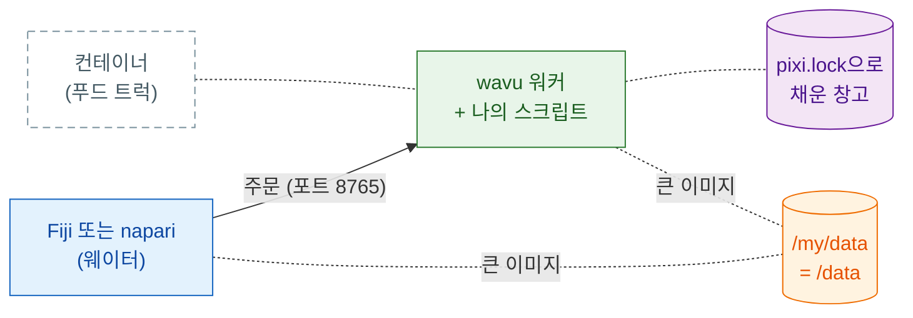

# 컨테이너로 공유하기

## 쉬운 말로 설명하면

지금까지는 손님마다 웨이터(Fiji나 napari)가 손님 컴퓨터에 있는 주방에서
요리했고, 식료품 창고도 pixi가 거기서 채웠어요. **컨테이너**는 **푸드
트럭**이에요. 식료품 창고까지 다 채운 주방 전체를 차 한 대에 실어서, 어디든
세울 수 있어요. 주문은 여전히 뷰어가 받고, 트럭까지 걸어갈 뿐이에요.



이건 **선택 사항**이에요. 보통은 Fiji와 napari가 워커를 직접 시작해요.
컨테이너는 이럴 때 도움이 돼요.

- PC가 **잠겨 있어서** pixi나 패키지를 설치할 수 없을 때
- 작업은 **연구실 서버나 HPC 클러스터**에서 돌리고, 클릭은 내 컴퓨터의
  뷰어에서 하고 싶을 때
- 논문이나 오래가는 프로젝트를 위해 매번 **완전히 같은 주방**을 원할 때.
  이미지는 운영 체제까지 통째로 고정돼요.

이미지를 빌드하거나 실행하는 컴퓨터에 컨테이너 도구가 있어야 해요.
이미지는 평범한 Linux(OCI) 이미지라서 아래 중 무엇이든 쓸 수 있어요.
아래 명령은 `docker`라고 쓰지만, 다른 도구도 같은 `build`/`run` 단어를
써요.

=== "macOS"

    - **Apple의 [`container`](https://github.com/apple/container)**(Apple이
      만든 무료 오픈 소스, Apple 실리콘, macOS 26 권장): 컨테이너마다 작은
      전용 가상 머신에서 실행해요. `container build -t my-tool .`과
      `container run …`을 쓰고, 포트와 폴더 옵션은 `container run --help`에서
      확인하세요.
    - [OrbStack](https://orbstack.dev), [Colima](https://github.com/abiosoft/colima),
      [Podman Desktop](https://podman-desktop.io): 같은 `docker` 명령을 받는
      Docker Desktop의 가벼운 대안이에요.

=== "Windows"

    Windows에서는 Windows에 내장된 Linux인 **WSL 2**를 통해 Linux 이미지를
    실행해요.

    - `wsl --install`을 한 번 실행하고(그다음 재시작), 그 안에서
      [Podman](https://podman.io)이나 Docker Engine을 쓰거나,
    - [Podman Desktop](https://podman-desktop.io)이나
      [Rancher Desktop](https://rancherdesktop.io)을 설치하세요. WSL 2
      설정을 대신 해 줘요.

    WSL 안에서는 `D:\data` 폴더가 `/mnt/d/data`예요.

=== "Linux"

    [Podman](https://podman.io)(데몬 없음, root 불필요) 또는 Docker Engine:
    `podman build -t my-tool .`, `podman run …`.

클러스터에서는 Apptainer를 쓰세요([아래](#on-an-hpc-cluster) 참고).

## 1단계: 빌드하기

[템플릿](get-the-template.md)으로 만든 폴더에는 모두 `Dockerfile`과
`.dockerignore`가 있어요. 이미지는 `pixi.lock`에 있는 그대로 설치하니까, 먼저
`pixi install`을 실행하고 `pixi.lock`을 커밋하세요. 스크립트 폴더에서:

```sh
docker build -t my-tool .
```

!!! note "템플릿으로 만든 폴더에서만"
    `Dockerfile`은 템플릿의 `pixi.toml`처럼 `wavu`를 GitHub에서 가져와요.
    Wavu 저장소 안에서는 대신 Wavu 루트의 `Dockerfile`을
    `--build-arg SCRIPT_DIR=examples/cellpose_nuclei`(예시)와 함께 쓰세요.

## 2단계: 실행하기

```sh
docker run --rm -p 127.0.0.1:8765:8765 -e WAVU_TOKEN=pick-one -v /my/data:/data my-tool
```

- `-p 127.0.0.1:8765:8765`는 주방 문을 포트 8765에 열어요. **이 컴퓨터에서만**
  들어올 수 있어요.
- `-e WAVU_TOKEN=pick-one`은 비밀번호를 정해요(직접 고르세요).
- `-v /my/data:/data`는 데이터 폴더를 공유해요. 내 컴퓨터에서는
  `/my/data`(Windows라면 예를 들어 `D:/data`)이고, 컨테이너 안에서는
  `/data`예요.

워커는 핸드셰이크 파일(주소, 포트, 토큰)을 `/my/data/.wavu/worker.json`에,
작업 파일을 `/my/data/.wavu-tmp` 아래에 써요. 큰 이미지는 이 공유 폴더를 통해
오가요. 그래서 뷰어가 이 폴더의 두 이름을 알아야 해요.

## 3단계: 연결하기

=== "Fiji"

    **Plugins › Wavu › Connect to Running Worker**(실행 중인 워커에 연결)를
    고르고 다음을 채우세요.

    - **Handshake file**(핸드셰이크 파일): `/my/data/.wavu/worker.json`
    - **Host data folder**(호스트 데이터 폴더): `/my/data`
    - **Same folder inside the container**(컨테이너 안의 같은 폴더): `/data`

    그다음 **Plugins › Wavu › Run Python Script**에서 목록의 워커를 고르세요.

=== "napari"

    **Plugins › Run Python Script (Wavu)**를 열고
    **Remote / container**(원격 / 컨테이너)를 체크하세요. 다음을 채우세요.

    - **Handshake file**: `/my/data/.wavu/worker.json`
    - **Host folder**(호스트 폴더): `/my/data`
    - **Container folder**(컨테이너 폴더): `/data`

    **Host**(호스트)는 비워 두고 **Connect to running worker**를 누르세요.

## 다른 컴퓨터에서

트럭을 연구실 서버에서 돌리려면, 거기서 `-p 8765:8765`(`127.0.0.1`만이
아니라 모든 네트워크 주소)로 시작하세요. 그 서버의 `.wavu/worker.json`을 내
컴퓨터로 복사하세요. napari에서는 서버 주소를 **Host**에 넣으세요(Fiji와
napari 모두 이 입력란이 있어요). 큰 이미지를 쓰려면 두 컴퓨터가 데이터
폴더(네트워크 드라이브)를 여러분이 준 이름으로 볼 수 있어야 해요.

!!! warning "토큰이 유일한 자물쇠예요"
    포트에 닿을 수 있고 토큰을 아는 사람은 누구나 여러분의 스크립트를
    실행할 수 있고, 공유 폴더에도 접근할 수 있어요. 토큰은 비밀로 하세요.
    `127.0.0.1`과 SSH 터널
    (`ssh -L 8765:localhost:8765 you@server`)을 쓰는 편이 좋아요. 그러면
    포트가 네트워크에 절대 열리지 않고, **Host**는 비워 둬요.

## 공개하기

Wavu는 여러분 스크립트의 이미지를 공개하지 않아요. 직접 공개하세요. 예를
들어 GitHub Container Registry(ghcr.io)에:

```sh
docker login ghcr.io          # 사용자 이름 + write:packages 권한이 있는 GitHub 토큰
docker tag my-tool ghcr.io/<you>/my-tool:1.0.0
docker push ghcr.io/<you>/my-tool:1.0.0
```

패키지는 처음에 비공개예요. **GitHub › Packages › my-tool › Package
settings**에서 공개로 바꾸세요. 그러면 다른 사람은 2단계에서 `my-tool` 대신
`ghcr.io/<you>/my-tool:1.0.0`을 실행해요. `wavu package`로 만든 Fiji zip에는
`Dockerfile`이 빠지니까, 둘이 한 폴더에 함께 있어도 돼요.

??? example "고급: GitHub Actions로 태그마다 빌드하고 푸시하기"
    `.github/workflows/container.yml`로 저장하세요. `v1.0.0` 같은 태그를
    푸시하면 `ghcr.io/<you>/<repo>:v1.0.0`이 공개돼요.

    ```yaml
    name: container
    on:
      push:
        tags: ["v*"]
    permissions:
      contents: read
      packages: write
    jobs:
      image:
        runs-on: ubuntu-latest
        steps:
          - uses: actions/checkout@v4
          - uses: docker/login-action@v3
            with:
              registry: ghcr.io
              username: ${{ github.actor }}
              password: ${{ github.token }}
          - uses: docker/build-push-action@v6
            with:
              context: .
              push: true
              tags: ghcr.io/${{ github.repository }}:${{ github.ref_name }}
    ```

    GitHub는 이미지 이름이 소문자여야 해요. 사용자나 저장소 이름에 대문자가
    있으면 태그를 직접 적으세요.

## HPC 클러스터에서 { #on-an-hpc-cluster }

클러스터는 보통 Docker 대신 Apptainer(예전 이름 Singularity)를 제공해요.
같은 이미지를 실행할 수 있어요.

```sh
apptainer pull docker://ghcr.io/<you>/my-tool:1.0.0
apptainer run --bind /my/data:/data --env WAVU_TOKEN=pick-one my-tool_1.0.0.sif
```

`--bind`는 Docker의 `-v`처럼 폴더를 공유해요. 데이터 폴더를 `/data`에
연결하세요. 이미지의 시작 명령이 거기 있을 거라고 기대해요. Apptainer에는
`-p`가 없어서, 워커는 계산 노드 자체의 포트 8765에서 기다려요. 위처럼 SSH
터널로 접속하세요.

## 한 문장으로

`docker build`, 그다음 포트와 토큰과 데이터 폴더를 붙여 `docker run`을 하고,
Fiji나 napari에서 핸드셰이크 파일과 폴더의 두 이름으로 연결하면 돼요. 주방
전체를 필요한 곳 어디든 세워 둘 수 있어요.

[다음: 연구실과 공유하기 :material-arrow-right:](../fiji/with-your-lab.md){ .md-button }
