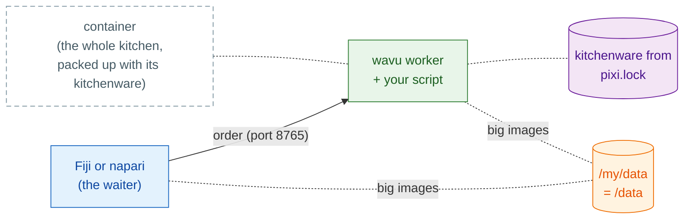

# Share as a container

## The idea in plain words

So far, every customer's waiter (Fiji or napari) brings the order to a
kitchen on the customer's own computer, where pixi sets up each recipe's
kitchenware. A **container** is **the whole kitchen, packed up with its
kitchenware**, ready to be set up anywhere: on your computer, a lab server
or a cluster. Your viewer still takes the order and carries the ingredients
(your images); it simply walks over to wherever that kitchen stands.



This is **optional**: Fiji and napari normally start the worker themselves.
A container helps when:

- a PC is **locked down** and you may not install pixi or packages there;
- the work should run on a **lab server or an HPC cluster**,
  while you click in the viewer on your own computer;
- you want **exactly the same kitchen** every time, for a paper or a
  long-running project: the image is frozen, down to the operating system.

You need a container tool on the computer that builds or runs the image.
The image is an ordinary Linux (OCI) image, so any of these work; the
commands below say `docker`, and the others take the same `build`/`run`
words:

=== "Windows"

    Linux images run on Windows through **WSL 2**, Windows' built-in Linux:

    - Run `wsl --install` once (then restart), and use
      [Podman](https://podman.io) or Docker Engine inside it; or
    - install [Podman Desktop](https://podman-desktop.io) or
      [Rancher Desktop](https://rancherdesktop.io), which set WSL 2 up for you.

    Inside WSL, your `D:\data` folder is `/mnt/d/data`.

=== "macOS"

    - **Apple's [`container`](https://github.com/apple/container)** (free and
      open source, from Apple; Apple silicon, macOS 26 recommended): runs each
      container in its own tiny virtual machine. `container build -t my-tool .`
      and `container run …`; check `container run --help` for its port and
      folder options.
    - [OrbStack](https://orbstack.dev), [Colima](https://github.com/abiosoft/colima)
      or [Podman Desktop](https://podman-desktop.io): light alternatives to
      Docker Desktop that accept the same `docker` commands.

=== "Linux"

    [Podman](https://podman.io) (no daemon, no root) or Docker Engine:
    `podman build -t my-tool .`, `podman run …`.

On a cluster, use Apptainer (see [below](#on-an-hpc-cluster)).

## Step 1: build

Every folder made from the [template](get-the-template.md) has a
`Dockerfile` and a `.dockerignore`. The image installs exactly what is in
`pixi.lock`, so run `pixi install` first and commit `pixi.lock`. In the
script folder:

```sh
docker build -t my-tool .
```

!!! note "Only in folders made from the template"
    The `Dockerfile` fetches `wavu` from GitHub, as the template's
    `pixi.toml` does. Inside the Wavu repository itself, use Wavu's root
    `Dockerfile` with `--build-arg SCRIPT_DIR=examples/cellpose_nuclei`
    (for example) instead.

## Step 2: run

```sh
docker run --rm -p 127.0.0.1:8765:8765 -e WAVU_TOKEN=pick-one -v /my/data:/data my-tool
```

- `-p 127.0.0.1:8765:8765` opens the kitchen door on port 8765, **for this
  computer only**.
- `-e WAVU_TOKEN=pick-one` sets the password (pick your own).
- `-v /my/data:/data` shares your data folder: on your computer it is
  `/my/data` (on Windows, for example, `D:/data`); inside the container it
  is `/data`.

The worker writes its handshake file (address, port and token) to
`/my/data/.wavu/worker.json`, and job files under `/my/data/.wavu-tmp`.
Big images travel through that shared folder, which is why the viewer must
know its two names.

## Step 3: connect

=== "Fiji"

    Choose **Plugins › Wavu › Connect to Running Worker** and fill in:

    - **Handshake file**: `/my/data/.wavu/worker.json`
    - **Host data folder**: `/my/data`
    - **Same folder inside the container**: `/data`

    Then **Plugins › Wavu › Run Python Script** and pick the worker from
    the list.

=== "napari"

    Open **Plugins › Run Python Script (Wavu)** and tick
    **Remote / container**. Fill in:

    - **Handshake file**: `/my/data/.wavu/worker.json`
    - **Host folder**: `/my/data`
    - **Container folder**: `/data`

    Leave **Host** empty and press **Connect to running worker**.

## Another machine

To set the kitchen up on a lab server, start it there with `-p 8765:8765`
(every network address, not only `127.0.0.1`). Copy its
`.wavu/worker.json` to your computer. In napari, put the server's address
in **Host** (Fiji and napari both have this field). For big
images, both computers must see the data folder (a network drive) under the
names you give.

!!! warning "The token is the only lock"
    Anyone who can reach the port and knows the token can run your scripts,
    with access to the shared folder. Keep the token secret. Prefer
    `127.0.0.1` plus an SSH tunnel
    (`ssh -L 8765:localhost:8765 you@server`), so the port is never open to
    the network; then **Host** stays empty.

## Release it

Wavu does not publish images of your scripts; you publish your own, for
example on the GitHub Container Registry (ghcr.io):

```sh
docker login ghcr.io          # user name + a GitHub token with write:packages
docker tag my-tool ghcr.io/<you>/my-tool:1.0.0
docker push ghcr.io/<you>/my-tool:1.0.0
```

Packages start private: make it public under **GitHub › Packages ›
my-tool › Package settings**. Others then run
`ghcr.io/<you>/my-tool:1.0.0` in Step 2 instead of `my-tool`. The Fiji zip
from `wavu package` leaves the `Dockerfile` out, so both can live in one
folder.

??? example "Advanced: build and push on every tag with GitHub Actions"
    Save as `.github/workflows/container.yml`; pushing a tag such as `v1.0.0`
    publishes `ghcr.io/<you>/<repo>:v1.0.0`.

    ```yaml
    name: container
    on:
      push:
        tags: ["v*"]
    permissions:
      contents: read
      packages: write
    jobs:
      image:
        runs-on: ubuntu-latest
        steps:
          - uses: actions/checkout@v4
          - uses: docker/login-action@v3
            with:
              registry: ghcr.io
              username: ${{ github.actor }}
              password: ${{ github.token }}
          - uses: docker/build-push-action@v6
            with:
              context: .
              push: true
              tags: ghcr.io/${{ github.repository }}:${{ github.ref_name }}
    ```

    GitHub needs the image name in lower case: if your user or repository
    name has capitals, write the tag out by hand.

## On an HPC cluster

Clusters usually offer Apptainer (formerly Singularity) instead of Docker.
It runs the same image:

```sh
apptainer pull docker://ghcr.io/<you>/my-tool:1.0.0
apptainer run --bind /my/data:/data --env WAVU_TOKEN=pick-one my-tool_1.0.0.sif
```

`--bind` shares folders, like Docker's `-v`. Bind your data folder to
`/data`: the image's start command expects it there. Apptainer has no `-p`,
so the worker listens on port 8765 of the compute node itself; reach it
through an SSH tunnel, as above.

## In one sentence

`docker build`, then `docker run` with a port, a token and your data folder,
and connect from Fiji or napari with the handshake file and the folder's
two names: the whole kitchen, packed up with its kitchenware and set up
wherever you need it.

[Next: share with your lab :material-arrow-right:](../fiji/with-your-lab.md){ .md-button }
