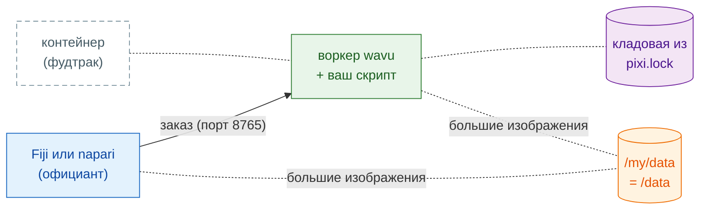

# Поделиться в виде контейнера

## Идея простыми словами

До сих пор официант каждого посетителя (Fiji или napari) готовил на кухне
на собственном компьютере посетителя, с кладовой, которую там наполняет
pixi. **Контейнер** — это **фудтрак**: вся кухня с уже наполненной
кладовой, упакованная в одну машину, которую можно поставить где угодно.
Ваш просмотрщик по-прежнему принимает заказ; он просто идёт к фудтраку.



Это **необязательно**: обычно Fiji и napari сами запускают воркер.
Контейнер помогает, когда:

- компьютер **закрыт администратором**, и устанавливать туда pixi или
  пакеты нельзя;
- работа должна идти на **сервере лаборатории или HPC-кластере**, а
  щёлкаете вы в просмотрщике на своём компьютере;
- вам нужна **ровно та же кухня** каждый раз, для статьи или долгого
  проекта: образ заморожен, вплоть до операционной системы.

На компьютере, где собирается или запускается образ, нужен инструмент
для контейнеров. Образ — обычный Linux-образ (OCI), поэтому подойдёт любой
из этих инструментов; в командах ниже написано `docker`, а остальные
понимают те же слова `build`/`run`:

=== "macOS"

    - **[`container`](https://github.com/apple/container) от Apple**
      (бесплатный, с открытым кодом, от Apple; Apple silicon, рекомендуется
      macOS 26): запускает каждый контейнер в собственной крошечной
      виртуальной машине. `container build -t my-tool .` и
      `container run …`; параметры порта и папок смотрите в
      `container run --help`.
    - [OrbStack](https://orbstack.dev), [Colima](https://github.com/abiosoft/colima)
      или [Podman Desktop](https://podman-desktop.io): лёгкие альтернативы
      Docker Desktop, которые понимают те же команды `docker`.

=== "Windows"

    Linux-образы работают в Windows через **WSL 2** — встроенный в Windows
    Linux:

    - один раз выполните `wsl --install` (затем перезагрузитесь) и
      используйте внутри [Podman](https://podman.io) или Docker Engine; или
    - установите [Podman Desktop](https://podman-desktop.io) или
      [Rancher Desktop](https://rancherdesktop.io) — они сами настроят
      WSL 2.

    Внутри WSL ваша папка `D:\data` — это `/mnt/d/data`.

=== "Linux"

    [Podman](https://podman.io) (без демона, без root) или Docker Engine:
    `podman build -t my-tool .`, `podman run …`.

На кластере используйте Apptainer (см. [ниже](#on-an-hpc-cluster)).

## Шаг 1: сборка

В каждой папке, созданной из [шаблона](get-the-template.md), есть
`Dockerfile` и `.dockerignore`. Образ устанавливает ровно то, что записано в
`pixi.lock`, поэтому сначала выполните `pixi install` и закоммитьте
`pixi.lock`. В папке скрипта:

```sh
docker build -t my-tool .
```

!!! note "Только в папках, созданных из шаблона"
    `Dockerfile` загружает `wavu` с GitHub, как и `pixi.toml` шаблона.
    Внутри самого репозитория Wavu вместо этого используйте корневой
    `Dockerfile` Wavu с `--build-arg SCRIPT_DIR=examples/cellpose_nuclei`
    (например).

## Шаг 2: запуск

```sh
docker run --rm -p 127.0.0.1:8765:8765 -e WAVU_TOKEN=pick-one -v /my/data:/data my-tool
```

- `-p 127.0.0.1:8765:8765` открывает дверь кухни на порту 8765, **только
  для этого компьютера**.
- `-e WAVU_TOKEN=pick-one` задаёт пароль (придумайте свой).
- `-v /my/data:/data` открывает доступ к вашей папке с данными: на вашем
  компьютере это `/my/data` (в Windows, например, `D:/data`), внутри
  контейнера — `/data`.

Воркер записывает файл рукопожатия (адрес, порт и токен) в
`/my/data/.wavu/worker.json`, а файлы заданий — в `/my/data/.wavu-tmp`.
Большие изображения передаются через эту общую папку, поэтому просмотрщик
должен знать оба её имени.

## Шаг 3: подключение

=== "Fiji"

    Выберите **Plugins › Wavu › Connect to Running Worker** (подключиться к
    работающему воркеру) и заполните:

    - **Handshake file** (файл рукопожатия): `/my/data/.wavu/worker.json`
    - **Host data folder** (папка с данными на хосте): `/my/data`
    - **Same folder inside the container** (та же папка внутри
      контейнера): `/data`

    Затем откройте **Plugins › Wavu › Run Python Script** и выберите
    воркер в списке.

=== "napari"

    Откройте **Plugins › Run Python Script (Wavu)** и отметьте
    **Remote / container** (удалённый / контейнер). Заполните:

    - **Handshake file**: `/my/data/.wavu/worker.json`
    - **Host folder** (папка на хосте): `/my/data`
    - **Container folder** (папка в контейнере): `/data`

    Оставьте **Host** (хост) пустым и нажмите
    **Connect to running worker**.

## Другая машина

Чтобы фудтрак работал на сервере лаборатории, запустите его там с
`-p 8765:8765` (на всех сетевых адресах, а не только на `127.0.0.1`).
Скопируйте его `.wavu/worker.json` на свой компьютер. В napari укажите адрес
сервера в поле **Host** (это поле есть и в Fiji, и в napari). Для больших
изображений оба компьютера должны видеть папку с данными (сетевой диск)
под теми именами, которые вы указали.

!!! warning "Токен — единственный замок"
    Любой, кто может достучаться до порта и знает токен, может запускать
    ваши скрипты с доступом к общей папке. Держите токен в секрете. Лучше
    используйте `127.0.0.1` плюс SSH-туннель
    (`ssh -L 8765:localhost:8765 you@server`), чтобы порт никогда не был
    открыт в сеть; тогда **Host** остаётся пустым.

## Выпуск

Wavu не публикует образы ваших скриптов; вы публикуете их сами, например в
GitHub Container Registry (ghcr.io):

```sh
docker login ghcr.io          # имя пользователя + токен GitHub с правом write:packages
docker tag my-tool ghcr.io/<you>/my-tool:1.0.0
docker push ghcr.io/<you>/my-tool:1.0.0
```

Пакеты сначала приватные: сделайте пакет публичным в
**GitHub › Packages › my-tool › Package settings**. Тогда другие на шаге 2
запускают `ghcr.io/<you>/my-tool:1.0.0` вместо `my-tool`. Zip-файл для Fiji
из `wavu package` не включает `Dockerfile`, так что оба могут жить в одной
папке.

??? example "Для продвинутых: сборка и публикация на каждый тег через GitHub Actions"
    Сохраните как `.github/workflows/container.yml`; push тега, например
    `v1.0.0`, публикует `ghcr.io/<you>/<repo>:v1.0.0`.

    ```yaml
    name: container
    on:
      push:
        tags: ["v*"]
    permissions:
      contents: read
      packages: write
    jobs:
      image:
        runs-on: ubuntu-latest
        steps:
          - uses: actions/checkout@v4
          - uses: docker/login-action@v3
            with:
              registry: ghcr.io
              username: ${{ github.actor }}
              password: ${{ github.token }}
          - uses: docker/build-push-action@v6
            with:
              context: .
              push: true
              tags: ghcr.io/${{ github.repository }}:${{ github.ref_name }}
    ```

    GitHub требует имя образа в нижнем регистре: если в имени пользователя
    или репозитория есть заглавные буквы, впишите тег вручную.

## На HPC-кластере { #on-an-hpc-cluster }

На кластерах обычно вместо Docker есть Apptainer (ранее Singularity). Он
запускает тот же образ:

```sh
apptainer pull docker://ghcr.io/<you>/my-tool:1.0.0
apptainer run --bind /my/data:/data --env WAVU_TOKEN=pick-one my-tool_1.0.0.sif
```

`--bind` открывает доступ к папкам, как `-v` в Docker. Привяжите папку с
данными к `/data`: команда запуска образа ожидает её именно там. У
Apptainer нет `-p`, поэтому воркер слушает порт 8765 самого
вычислительного узла; добирайтесь до него через SSH-туннель, как выше.

## Одним предложением

`docker build`, затем `docker run` с портом, токеном и вашей папкой с
данными, и подключение из Fiji или napari с файлом рукопожатия и двумя
именами папки: вся кухня, припаркованная там, где она вам нужна.

[Далее: поделиться с лабораторией :material-arrow-right:](../fiji/with-your-lab.md){ .md-button }
