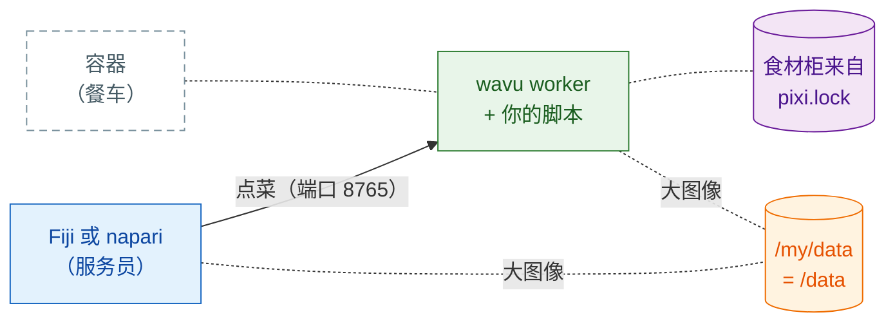

# 以容器形式分享

## 用大白话说

到目前为止，每位客人的服务员（Fiji 或 napari）都是在客人自己电脑上的厨房里
做菜，食材柜也是 pixi 在那里备好的。**容器**（container）就像一辆**餐车**：
整个厨房连同备好料的食材柜，全部装进一辆车，你想停在哪里都行。Fiji/napari
照样负责点菜，只是改成走到餐车那边去。



这是**可选的**：通常 Fiji 和 napari 会自己启动 worker。在下面这些情况下，
容器能帮上忙：

- 某台电脑**被锁定**，你不能在上面安装 pixi 或包；
- 计算应该在**实验室服务器或 HPC 集群**上运行，而你在自己的电脑上用
  Fiji/napari 点击操作；
- 为了论文或长期项目，你希望**每次都是完全相同的厨房**：镜像是冻结的，
  连操作系统都一样。

构建或运行镜像的那台电脑上需要有容器工具。镜像是普通的 Linux（OCI）镜像，
所以下面任何一个都能用；以下命令写的是 `docker`，其他工具也用同样的
`build`/`run` 字眼：

=== "macOS"

    - **Apple 的 [`container`](https://github.com/apple/container)**（Apple
      出品，免费开源；Apple 芯片，建议 macOS 26）：把每个容器放在自己的小型
      虚拟机里运行。`container build -t my-tool .` 和 `container run …`；
      端口和文件夹选项请看 `container run --help`。
    - [OrbStack](https://orbstack.dev)、[Colima](https://github.com/abiosoft/colima)
      或 [Podman Desktop](https://podman-desktop.io)：Docker Desktop 的轻量
      替代品，接受同样的 `docker` 命令。

=== "Windows"

    Linux 镜像在 Windows 上通过 **WSL 2**（Windows 内置的 Linux）运行：

    - 运行一次 `wsl --install`（然后重启），再在里面使用
      [Podman](https://podman.io) 或 Docker Engine；或者
    - 安装 [Podman Desktop](https://podman-desktop.io) 或
      [Rancher Desktop](https://rancherdesktop.io)，它们会帮你配置好 WSL 2。

    在 WSL 里，你的 `D:\data` 文件夹是 `/mnt/d/data`。

=== "Linux"

    [Podman](https://podman.io)（不需要守护进程，不需要 root）或 Docker
    Engine：`podman build -t my-tool .`、`podman run …`。

在集群上请使用 Apptainer（见[下文](#on-an-hpc-cluster)）。

## 第 1 步：构建

每个用[模板](get-the-template.md)创建的文件夹，都有一个 `Dockerfile` 和
一个 `.dockerignore`。镜像会严格按照 `pixi.lock` 的内容安装，所以请先运行
`pixi install`，并提交（commit）`pixi.lock`。在脚本文件夹里：

```sh
docker build -t my-tool .
```

!!! note "仅适用于用模板创建的文件夹"
    这个 `Dockerfile` 会从 GitHub 获取 `wavu`，和模板的 `pixi.toml` 一样。
    如果是在 Wavu 仓库本身里面，请改用 Wavu 根目录的 `Dockerfile`，加上
    `--build-arg SCRIPT_DIR=examples/cellpose_nuclei`（举例）。

## 第 2 步：运行

```sh
docker run --rm -p 127.0.0.1:8765:8765 -e WAVU_TOKEN=pick-one -v /my/data:/data my-tool
```

- `-p 127.0.0.1:8765:8765` 在端口 8765 打开厨房的门，**只对这台电脑开放**。
- `-e WAVU_TOKEN=pick-one` 设置密码（请自己取一个）。
- `-v /my/data:/data` 共享你的数据文件夹：在你的电脑上它是 `/my/data`
  （例如在 Windows 上是 `D:/data`）；在容器里它是 `/data`。

worker 会把握手文件（地址、端口和 token）写到
`/my/data/.wavu/worker.json`，任务文件则放在 `/my/data/.wavu-tmp` 下。
大图像通过这个共享文件夹传递，所以 Fiji/napari 必须知道它的两个名字。

## 第 3 步：连接

=== "Fiji"

    选择 **Plugins › Wavu › Connect to Running Worker**（连接正在运行的
    worker），然后填写：

    - **Handshake file**（握手文件）：`/my/data/.wavu/worker.json`
    - **Host data folder**（主机数据文件夹）：`/my/data`
    - **Same folder inside the container**（容器内的同一个文件夹）：`/data`

    接着选择 **Plugins › Wavu › Run Python Script**，从列表里选中这个 worker。

=== "napari"

    打开 **Plugins › Run Python Script (Wavu)**，勾选
    **Remote / container**（远程／容器）。填写：

    - **Handshake file**：`/my/data/.wavu/worker.json`
    - **Host folder**（主机文件夹）：`/my/data`
    - **Container folder**（容器文件夹）：`/data`

    **Host**（主机）留空，然后点击 **Connect to running worker**。

## 另一台机器

要让餐车停在实验室服务器上，就在那台服务器上用 `-p 8765:8765` 启动它
（对所有网络地址开放，而不只是 `127.0.0.1`）。把它的 `.wavu/worker.json`
复制到你的电脑上。在 napari 里，把服务器的地址填进 **Host**（Fiji 和 napari
都有这个字段）。对于大图像，两台电脑都必须能用你填写的名字访问数据文件夹
（例如网络驱动器）。

!!! warning "token 是唯一的锁"
    任何能访问这个端口、又知道 token 的人，都能运行你的脚本，也能访问共享
    文件夹。请对 token 保密。更好的做法是用 `127.0.0.1` 加上 SSH 隧道
    （`ssh -L 8765:localhost:8765 you@server`），这样端口永远不会对网络开放；
    此时 **Host** 保持留空。

## 发布

Wavu 不会替你的脚本发布镜像；你需要自己发布，例如发布到 GitHub Container
Registry（ghcr.io）：

```sh
docker login ghcr.io          # 用户名 + 带 write:packages 权限的 GitHub token
docker tag my-tool ghcr.io/<you>/my-tool:1.0.0
docker push ghcr.io/<you>/my-tool:1.0.0
```

包一开始是私有的：请在 **GitHub › Packages › my-tool › Package settings**
里把它设为公开。之后别人在第 2 步里用 `ghcr.io/<you>/my-tool:1.0.0` 代替
`my-tool` 即可。`wavu package` 生成的 Fiji zip 不包含 `Dockerfile`，所以两者
可以放在同一个文件夹里。

??? example "进阶：用 GitHub Actions 在每个 tag 上构建并推送"
    保存为 `.github/workflows/container.yml`；推送像 `v1.0.0` 这样的 tag，就会
    发布 `ghcr.io/<you>/<repo>:v1.0.0`。

    ```yaml
    name: container
    on:
      push:
        tags: ["v*"]
    permissions:
      contents: read
      packages: write
    jobs:
      image:
        runs-on: ubuntu-latest
        steps:
          - uses: actions/checkout@v4
          - uses: docker/login-action@v3
            with:
              registry: ghcr.io
              username: ${{ github.actor }}
              password: ${{ github.token }}
          - uses: docker/build-push-action@v6
            with:
              context: .
              push: true
              tags: ghcr.io/${{ github.repository }}:${{ github.ref_name }}
    ```

    GitHub 要求镜像名称全部小写：如果你的用户名或仓库名里有大写字母，
    请手动写出 tag。

## 在 HPC 集群上 { #on-an-hpc-cluster }

集群通常提供的是 Apptainer（旧名 Singularity），而不是 Docker。它能运行
同一个镜像：

```sh
apptainer pull docker://ghcr.io/<you>/my-tool:1.0.0
apptainer run --bind /my/data:/data --env WAVU_TOKEN=pick-one my-tool_1.0.0.sif
```

`--bind` 用来共享文件夹，就像 Docker 的 `-v`。请把你的数据文件夹绑定到
`/data`：镜像的启动命令默认它在那里。Apptainer 没有 `-p`，所以 worker 直接
在计算节点本身的端口 8765 上监听；请像上面那样通过 SSH 隧道连过去。

## 一句话总结

先 `docker build`，再带上端口、token 和你的数据文件夹 `docker run`，然后
从 Fiji 或 napari 用握手文件和文件夹的两个名字连接上去：整个厨房，停在你需要的
任何地方。

[下一步：分享给实验室 :material-arrow-right:](../fiji/with-your-lab.md){ .md-button }
