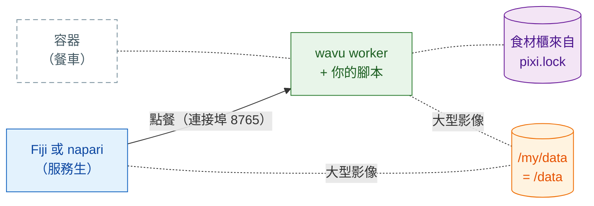

# 以容器分享

## 用白話說

到目前為止，每位客人的服務生（Fiji 或 napari）都是在客人自己電腦上的廚房裡
做菜，食材櫃也是由 pixi 在那裡備好的。**容器**（container）就像一輛
**餐車**：整個廚房連同備好料的食材櫃，全部裝進一輛車，你想停在哪裡都行。
Fiji/napari 一樣負責點餐，只是改成走到餐車那邊去。



這是**可選的**：平常 Fiji 和 napari 會自己啟動 worker。容器在這些情況下派得上
用場：

- 某台電腦**被鎖住了**，你不能在上面安裝 pixi 或套件；
- 運算應該在**實驗室伺服器或 HPC 叢集**上跑，而你在自己的電腦上用
  Fiji/napari 點選操作；
- 為了論文或長期專案，你希望**每次都是完全相同的廚房**：映像檔是凍結的，
  連作業系統都一樣。

建置或執行映像檔的那台電腦上需要有容器工具。映像檔是一般的 Linux（OCI）
映像檔，所以下面任何一個都能用；以下指令寫的是 `docker`，其他工具也用同樣的
`build`/`run` 字眼：

=== "macOS"

    - **Apple 的 [`container`](https://github.com/apple/container)**（Apple
      出品，免費開源；Apple 晶片，建議 macOS 26）：把每個容器放在自己的小型
      虛擬機器裡執行。`container build -t my-tool .` 和 `container run …`；
      連接埠和資料夾選項請看 `container run --help`。
    - [OrbStack](https://orbstack.dev)、[Colima](https://github.com/abiosoft/colima)
      或 [Podman Desktop](https://podman-desktop.io)：Docker Desktop 的輕量
      替代品，接受同樣的 `docker` 指令。

=== "Windows"

    Linux 映像檔在 Windows 上透過 **WSL 2**（Windows 內建的 Linux）執行：

    - 執行一次 `wsl --install`（然後重新開機），再在裡面使用
      [Podman](https://podman.io) 或 Docker Engine；或者
    - 安裝 [Podman Desktop](https://podman-desktop.io) 或
      [Rancher Desktop](https://rancherdesktop.io)，它們會幫你設定好 WSL 2。

    在 WSL 裡，你的 `D:\data` 資料夾是 `/mnt/d/data`。

=== "Linux"

    [Podman](https://podman.io)（不需要常駐程式，不需要 root）或 Docker
    Engine：`podman build -t my-tool .`、`podman run …`。

在叢集上請使用 Apptainer（見[下文](#on-an-hpc-cluster)）。

## 步驟 1：建置

每個用[範本](get-the-template.md)做出來的資料夾，都有一個 `Dockerfile` 和
一個 `.dockerignore`。映像檔會完全照 `pixi.lock` 的內容安裝，所以請先執行
`pixi install`，並把 `pixi.lock` 提交（commit）。在腳本資料夾裡：

```sh
docker build -t my-tool .
```

!!! note "只適用於用範本做出來的資料夾"
    這個 `Dockerfile` 會從 GitHub 取得 `wavu`，和範本的 `pixi.toml` 一樣。
    如果是在 Wavu 儲存庫本身裡面，請改用 Wavu 根目錄的 `Dockerfile`，加上
    `--build-arg SCRIPT_DIR=examples/cellpose_nuclei`（舉例）。

## 步驟 2：執行

```sh
docker run --rm -p 127.0.0.1:8765:8765 -e WAVU_TOKEN=pick-one -v /my/data:/data my-tool
```

- `-p 127.0.0.1:8765:8765` 在連接埠 8765 打開廚房的門，**只對這台電腦開放**。
- `-e WAVU_TOKEN=pick-one` 設定密碼（請自己取一個）。
- `-v /my/data:/data` 共用你的資料資料夾：在你的電腦上它是 `/my/data`
  （例如在 Windows 上是 `D:/data`）；在容器裡它是 `/data`。

worker 會把交握檔案（位址、連接埠和 token）寫到
`/my/data/.wavu/worker.json`，工作檔案則放在 `/my/data/.wavu-tmp` 底下。
大型影像透過這個共用資料夾傳遞，所以 Fiji/napari 必須知道它的兩個名字。

## 步驟 3：連接

=== "Fiji"

    選擇 **Plugins › Wavu › Connect to Running Worker**（連接執行中的 worker），
    然後填入：

    - **Handshake file**（交握檔案）：`/my/data/.wavu/worker.json`
    - **Host data folder**（主機上的資料夾）：`/my/data`
    - **Same folder inside the container**（容器裡的同一個資料夾）：`/data`

    接著選 **Plugins › Wavu › Run Python Script**，從清單裡挑這個 worker。

=== "napari"

    開啟 **Plugins › Run Python Script (Wavu)**，勾選
    **Remote / container**（遠端／容器）。填入：

    - **Handshake file**：`/my/data/.wavu/worker.json`
    - **Host folder**（主機資料夾）：`/my/data`
    - **Container folder**（容器資料夾）：`/data`

    **Host**（主機）留空，然後按 **Connect to running worker**。

## 另一台機器

要讓餐車停在實驗室伺服器上，就在那台伺服器上用 `-p 8765:8765` 啟動它
（開放所有網路位址，而不只是 `127.0.0.1`）。把它的 `.wavu/worker.json` 複製到
你的電腦上。在 napari 裡，把伺服器的位址填進 **Host**（Fiji 和 napari 都有這個
欄位）。如果是大型影像，兩台電腦都必須用你填的名字看得到資料資料夾（例如
網路磁碟）。

!!! warning "token 是唯一的鎖"
    任何連得到這個連接埠、又知道 token 的人，都能執行你的腳本，也能存取
    共用資料夾。請把 token 保密。比較好的做法是用 `127.0.0.1` 加上 SSH 通道
    （`ssh -L 8765:localhost:8765 you@server`），讓連接埠永遠不對網路開放；
    這樣 **Host** 就維持留空。

## 發布

Wavu 不會替你的腳本發布映像檔；你要自己發布，例如發布到 GitHub Container
Registry（ghcr.io）：

```sh
docker login ghcr.io          # 使用者名稱 + 具有 write:packages 權限的 GitHub token
docker tag my-tool ghcr.io/<you>/my-tool:1.0.0
docker push ghcr.io/<you>/my-tool:1.0.0
```

套件一開始是私人的：請到 **GitHub › Packages › my-tool › Package settings**
把它設成公開。之後其他人在步驟 2 裡就用 `ghcr.io/<you>/my-tool:1.0.0` 取代
`my-tool`。`wavu package` 產生的 Fiji zip 不會包含 `Dockerfile`，所以兩者可以
放在同一個資料夾裡。

??? example "進階：用 GitHub Actions 在每個 tag 建置並推送"
    存成 `.github/workflows/container.yml`；推送像 `v1.0.0` 這樣的 tag，就會
    發布 `ghcr.io/<you>/<repo>:v1.0.0`。

    ```yaml
    name: container
    on:
      push:
        tags: ["v*"]
    permissions:
      contents: read
      packages: write
    jobs:
      image:
        runs-on: ubuntu-latest
        steps:
          - uses: actions/checkout@v4
          - uses: docker/login-action@v3
            with:
              registry: ghcr.io
              username: ${{ github.actor }}
              password: ${{ github.token }}
          - uses: docker/build-push-action@v6
            with:
              context: .
              push: true
              tags: ghcr.io/${{ github.repository }}:${{ github.ref_name }}
    ```

    GitHub 要求映像檔名稱全部小寫：如果你的使用者名稱或儲存庫名稱有大寫字母，
    請手動寫出 tag。

## 在 HPC 叢集上 { #on-an-hpc-cluster }

叢集通常提供的是 Apptainer（舊名 Singularity），而不是 Docker。它能執行
同一個映像檔：

```sh
apptainer pull docker://ghcr.io/<you>/my-tool:1.0.0
apptainer run --bind /my/data:/data --env WAVU_TOKEN=pick-one my-tool_1.0.0.sif
```

`--bind` 用來共用資料夾，就像 Docker 的 `-v`。請把你的資料資料夾綁定到
`/data`：映像檔的啟動指令預期它在那裡。Apptainer 沒有 `-p`，所以 worker 直接
在運算節點本身的連接埠 8765 上監聽；請像上面一樣透過 SSH 通道連過去。

## 一句話總結

先 `docker build`，再帶著連接埠、token 和你的資料資料夾 `docker run`，然後
從 Fiji 或 napari 用交握檔案和資料夾的兩個名字連上去：整個廚房，停在你需要的
任何地方。

[下一步：分享給實驗室 :material-arrow-right:](../fiji/with-your-lab.md){ .md-button }
