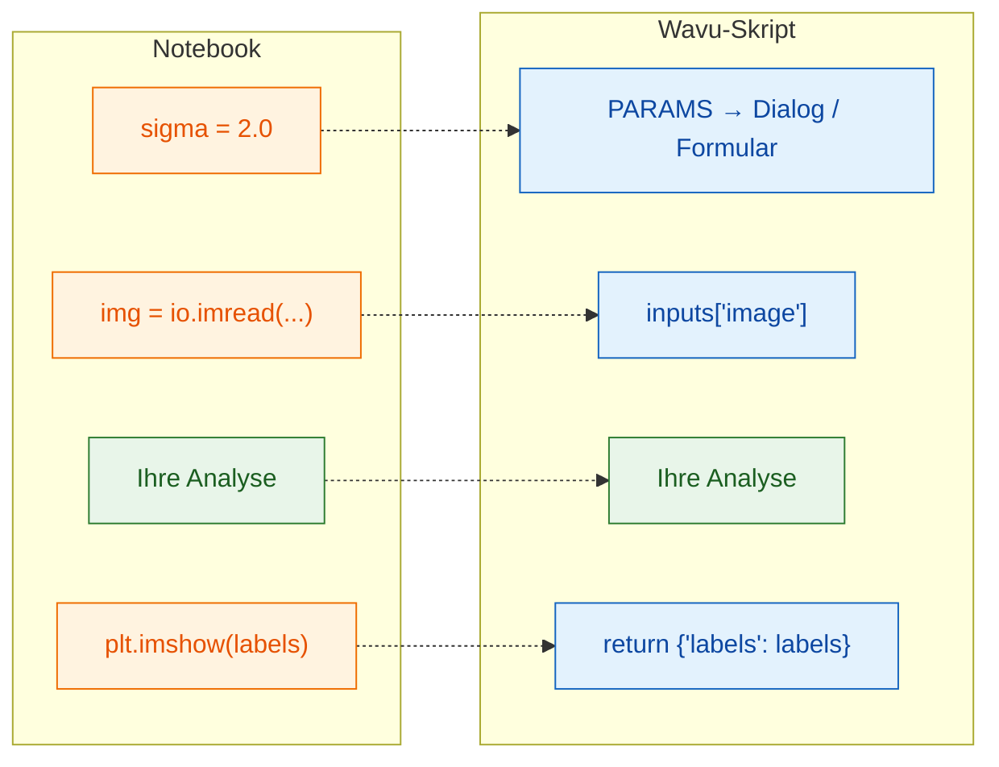

# Vom Notebook zu Wavu

## Die Idee in einfachen Worten

Eine Notebook-Zelle und ein Wavu-Skript erledigen dieselbe Arbeit; nur die
**Türen hinein und hinaus** ändern sich. Im Notebook tippen *Sie* die
Einstellungen, laden die Datei und sehen sich den Plot an. Bei Wavu füllt
der Viewer (**Fiji** oder **napari**) die Einstellungen aus einem Dialog oder
Formular aus, reicht das bereits geöffnete Bild weiter und zeigt an, was Sie
zurückgeben. Ihre Analyse in der Mitte bleibt gleich, und das Skript auch,
egal welcher Viewer es ausführt.



## Die Übersetzungstabelle

| In Ihrem Notebook | In `script.py` | Was Sie in Fiji oder napari sehen |
|---|---|---|
| `sigma = 2.0` | `"sigma": {"type": "float", "default": 2.0, "label": "Sigma (pixels)"}` in `PARAMS`, dann `params["sigma"]` | ein Zahlenfeld **Sigma (pixels)** im Dialog von Fiji oder im Formular des napari-Panels |
| `img = io.imread("cells.tif")` | `"image": {"type": "image"}` in `PARAMS`, dann `inputs["image"]` | eine Auswahlliste: die geöffneten Bilder (Fiji) oder die Image- und Labels-Layer (napari); die Eingabe ist das, was Sie wählen |
| `print("found", n)` | `ctx.log(f"found {n}")` (`print` geht auch) | eine Zeile im **Log**-Fenster von Fiji oder im Log des napari-Panels |
| `plt.imshow(labels)` | `return {"labels": labels}` | ein neues Bildfenster namens *…-labels* (Fiji) oder ein Labels-Layer (napari) |
| `df` (eine Tabelle) | `return {"cells": df}` | eine Results-Tabelle (Fiji) oder ein Tabellen-Panel (napari) |

## Ein durchgespieltes Beispiel

Hier ist eine typische Notebook-Zelle, die Zellkerne per Schwellenwert
findet und zählt:

```python
from skimage import io, filters, measure

sigma = 2.0
img = io.imread("nuclei.tif")
smooth = filters.gaussian(img, sigma)
mask = smooth > filters.threshold_otsu(smooth)
labels = measure.label(mask)
print("found", labels.max(), "nuclei")
plt.imshow(labels)
```

Und dasselbe als Wavu-Skript. Ersetzen Sie den Inhalt von `script.py` durch:

```python
"""Count nuclei -- Otsu threshold after a Gaussian blur."""

PARAMS = {
    "image": {"type": "image", "label": "Nuclei image"},
    "sigma": {"type": "float", "default": 2.0, "label": "Sigma (pixels)"},
}


def run(ctx, inputs, params):
    from skimage import filters, measure

    img = inputs["image"]                     # das im Dialog/Formular gewählte Bild
    smooth = filters.gaussian(img, params["sigma"])
    mask = smooth > filters.threshold_otsu(smooth)
    labels = measure.label(mask)
    ctx.log(f"found {labels.max()} nuclei")   # erscheint im Log
    return {"labels": labels}                 # neues Bildfenster / Labels-Layer
```

Das Skript braucht scikit-image, also fügen Sie zuerst
`scikit-image = "*"` zu `pixi.toml` hinzu
([wie](get-the-template.md#adding-a-package)). Speichern Sie beide Dateien,
stoppen Sie den Worker ([wie](get-the-template.md#the-everyday-loop)) und
führen Sie es auf einem 2-D-Bild aus: *Blobs* in Fiji oder *Coins* in napari
(**File › Open Sample › napari builtins › Coins**).

## Die drei Regeln

1. **`PARAMS` ganz oben** ist der Dialog (Fiji) oder das Formular (napari).
   Jeder Eintrag wird zu einem Feld.
2. **`def run(ctx, inputs, params):`** ist der Ort, an dem gearbeitet wird.
   Bilder kommen in `inputs` an, die übrigen Einstellungen in `params`, und
   `ctx` ist Ihr direkter Draht zum Viewer (Log, Fortschrittsbalken,
   Abbrechen).
3. **Geben Sie ein Dictionary zurück.** Jeder Schlüssel wird zum Namen eines
   Ergebnisses (Fiji setzt den Bildnamen davor, wie bei *blobs-labels*;
   napari benennt den Layer nach dem Schlüssel), und jeder Wert wird auf die passende Art angezeigt.

!!! tip "Zwei Gewohnheiten, die Zeit sparen"
    - **Importieren Sie schwere Pakete innerhalb von `run`**, wie oben. Dann
      kann der Dialog oder das Formular sofort erscheinen, ohne auf große
      Importe zu warten.
    - **Lösen Sie bei Bedienfehlern einen verständlichen Fehler aus**, zum
      Beispiel `raise ValueError("Please pick a single-channel image")`.
      Fiji zeigt die Meldung in einem Fehlerfenster; napari schreibt
      `Error: …` ins Log des Panels und zeigt eine Benachrichtigung.

Die erste Zeile des Docstrings (der Text in dreifachen Anführungszeichen ganz
oben) erscheint oben im Dialog von Fiji und im napari-Panel; machen Sie also
eine kurze Beschreibung daraus.

## In einem Satz

Lassen Sie Ihre Analyse, wie sie ist; nehmen Sie einfach die Einstellungen
aus `params` und das Bild aus `inputs`, schreiben Sie Meldungen mit
`ctx.log` und geben Sie mit `return` zurück, was Sie sehen möchten.

[Weiter: PARAMS = Ihr Dialog :material-arrow-right:](params.md){ .md-button }
