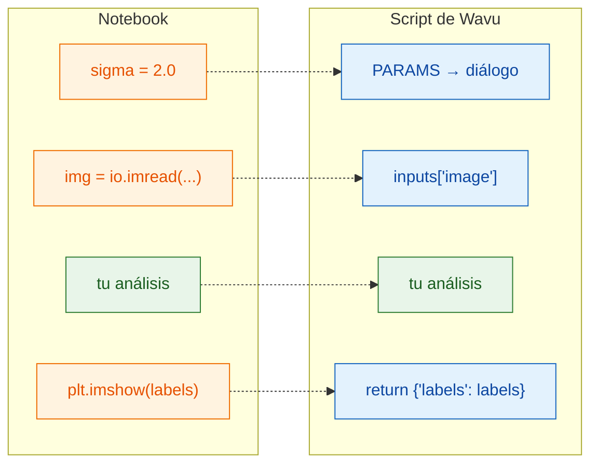

# Del notebook a Wavu

## La idea en palabras sencillas

Una celda de notebook y un script de Wavu hacen el mismo trabajo; solo
cambian las **puertas de entrada y salida**. En un notebook *tú* escribes los
ajustes, cargas el archivo y miras el gráfico. En Wavu, **Fiji** rellena los
ajustes desde un diálogo, te pasa la imagen que ya está abierta y muestra lo
que devuelvas. Tu análisis, en el medio, sigue igual.



## La tabla de traducción

| En tu notebook | En `script.py` | Lo que ves en Fiji |
|---|---|---|
| `sigma = 2.0` | `"sigma": {"type": "float", "default": 2.0, "label": "Sigma (pixels)"}` en `PARAMS`, y luego `params["sigma"]` | un campo numérico **Sigma (pixels)** |
| `img = io.imread("cells.tif")` | `"image": {"type": "image"}` en `PARAMS`, y luego `inputs["image"]` | un desplegable con las imágenes abiertas |
| `print("found", n)` | `ctx.log(f"found {n}")` (`print` también funciona) | una línea en la ventana **Log** |
| `plt.imshow(labels)` | `return {"labels": labels}` | una ventana de imagen nueva llamada *…-labels* |
| `df` (una tabla) | `return {"cells": df}` | una tabla Results |

## Un ejemplo completo

Esta es una celda típica de notebook que umbraliza núcleos y los cuenta:

```python
from skimage import io, filters, measure

sigma = 2.0
img = io.imread("nuclei.tif")
smooth = filters.gaussian(img, sigma)
mask = smooth > filters.threshold_otsu(smooth)
labels = measure.label(mask)
print("found", labels.max(), "nuclei")
plt.imshow(labels)
```

Y lo mismo como script de Wavu. Sustituye el contenido de `script.py` por:

```python
"""Count nuclei -- Otsu threshold after a Gaussian blur."""

PARAMS = {
    "image": {"type": "image", "label": "Nuclei image"},
    "sigma": {"type": "float", "default": 2.0, "label": "Sigma (pixels)"},
}


def run(ctx, inputs, params):
    from skimage import filters, measure

    img = inputs["image"]                     # la imagen elegida en el diálogo
    smooth = filters.gaussian(img, params["sigma"])
    mask = smooth > filters.threshold_otsu(smooth)
    labels = measure.label(mask)
    ctx.log(f"found {labels.max()} nuclei")   # aparece en el Log de Fiji
    return {"labels": labels}                 # se abre como imagen nueva
```

Usa scikit-image, así que primero añade `scikit-image = "*"` a `pixi.toml`
([cómo](get-the-template.md#adding-a-package)). Guarda los dos archivos,
**Stop Worker**, y ejecútalo sobre *Blobs*.

## Las tres reglas

1. **`PARAMS` al principio** es el diálogo. Cada entrada se convierte en un
   campo.
2. **`def run(ctx, inputs, params):`** es donde se hace el trabajo. Las
   imágenes llegan en `inputs`, los demás ajustes en `params`, y `ctx` es tu
   línea de vuelta a Fiji (Log, barra de progreso, cancelar).
3. **Devuelve un diccionario.** Cada clave se convierte en el nombre de un
   resultado (Fiji antepone el nombre de la imagen, como en *blobs-labels*),
   y cada valor se muestra de la forma adecuada.

!!! tip "Dos costumbres que ahorran tiempo"
    - **Importa los paquetes pesados dentro de `run`**, como arriba. Así Fiji
      puede mostrar el diálogo enseguida, sin esperar a imports grandes.
    - **Lanza un error con un mensaje claro** ante errores del usuario, por
      ejemplo `raise ValueError("Please pick a single-channel image")`. Fiji
      muestra el mensaje en una ventana de error.

La primera línea del docstring (el texto entre comillas triples al principio
del todo) aparece en la parte superior del diálogo, así que haz que sea una
descripción corta.

## En una frase

Deja tu análisis como está; solo toma los ajustes de `params`, la imagen de
`inputs`, escribe mensajes con `ctx.log` y devuelve con `return` lo que
quieras ver.

[Siguiente: PARAMS = tu diálogo :material-arrow-right:](params.md){ .md-button }
