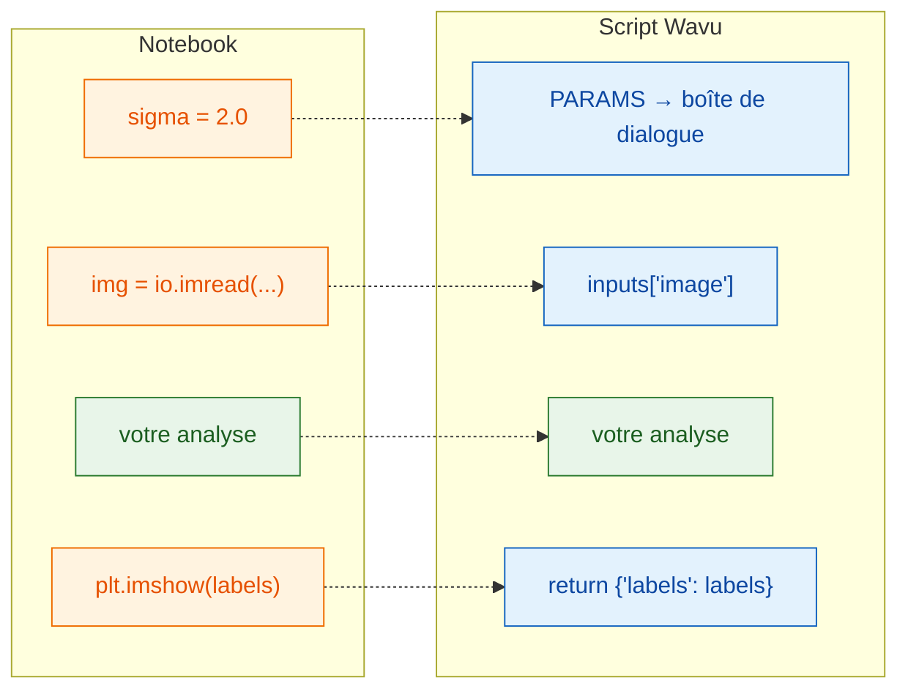

# Du notebook à Wavu

## L'idée en mots simples

Une cellule de notebook et un script Wavu font le même travail ; seules les
**portes d'entrée et de sortie** changent. Dans un notebook, c'est *vous*
qui tapez les réglages, chargez le fichier et regardez le graphique. Dans
Wavu, c'est **Fiji** qui remplit les réglages depuis une boîte de dialogue,
transmet l'image déjà ouverte et affiche ce que vous renvoyez. Votre analyse,
au milieu, reste la même.



## La table de traduction

| Dans votre notebook | Dans `script.py` | Ce que vous voyez dans Fiji |
|---|---|---|
| `sigma = 2.0` | `"sigma": {"type": "float", "default": 2.0, "label": "Sigma (pixels)"}` dans `PARAMS`, puis `params["sigma"]` | un champ numérique **Sigma (pixels)** |
| `img = io.imread("cells.tif")` | `"image": {"type": "image"}` dans `PARAMS`, puis `inputs["image"]` | une liste déroulante des images ouvertes |
| `print("found", n)` | `ctx.log(f"found {n}")` (`print` marche aussi) | une ligne dans la fenêtre **Log** |
| `plt.imshow(labels)` | `return {"labels": labels}` | une nouvelle fenêtre d'image nommée *…-labels* |
| `df` (un tableau) | `return {"cells": df}` | un tableau de résultats (Results) |

## Un exemple complet

Voici une cellule de notebook typique qui seuille des noyaux et les compte :

```python
from skimage import io, filters, measure

sigma = 2.0
img = io.imread("nuclei.tif")
smooth = filters.gaussian(img, sigma)
mask = smooth > filters.threshold_otsu(smooth)
labels = measure.label(mask)
print("found", labels.max(), "nuclei")
plt.imshow(labels)
```

Et la même chose en script Wavu. Remplacez le contenu de `script.py` par :

```python
"""Count nuclei -- Otsu threshold after a Gaussian blur."""

PARAMS = {
    "image": {"type": "image", "label": "Nuclei image"},
    "sigma": {"type": "float", "default": 2.0, "label": "Sigma (pixels)"},
}


def run(ctx, inputs, params):
    from skimage import filters, measure

    img = inputs["image"]                     # l'image choisie dans la boîte de dialogue
    smooth = filters.gaussian(img, params["sigma"])
    mask = smooth > filters.threshold_otsu(smooth)
    labels = measure.label(mask)
    ctx.log(f"found {labels.max()} nuclei")   # apparaît dans le Log de Fiji
    return {"labels": labels}                 # s'ouvre comme nouvelle image
```

Ce script utilise scikit-image : ajoutez d'abord `scikit-image = "*"` à
`pixi.toml` ([comment](get-the-template.md#adding-a-package)). Enregistrez
les deux fichiers, faites **Stop Worker**, et lancez-le sur *Blobs*.

## Les trois règles

1. **`PARAMS` en haut**, c'est la boîte de dialogue. Chaque entrée devient
   un champ.
2. **`def run(ctx, inputs, params):`**, c'est là que le travail se fait.
   Les images arrivent dans `inputs`, les autres réglages dans `params`, et
   `ctx` est votre ligne directe vers Fiji (Log, barre de progression,
   annulation).
3. **Renvoyez un dictionnaire.** Chaque clé devient le nom d'un résultat
   (Fiji ajoute le nom de l'image devant, comme dans *blobs-labels*), et
   chaque valeur est affichée de la bonne façon.

!!! tip "Deux habitudes qui font gagner du temps"
    - **Importez les gros paquets à l'intérieur de `run`**, comme ci-dessus.
      Fiji peut alors afficher la boîte de dialogue tout de suite, sans
      attendre de longs imports.
    - **Levez une erreur en langage clair** pour les erreurs de
      l'utilisateur, par exemple
      `raise ValueError("Please pick a single-channel image")`. Fiji affiche
      le message dans une fenêtre d'erreur.

La première ligne de la docstring (le texte entre triples guillemets tout en
haut) apparaît en haut de la boîte de dialogue : faites-en une courte
description.

## En une phrase

Gardez votre analyse telle quelle ; prenez simplement les réglages dans
`params`, l'image dans `inputs`, écrivez vos messages avec `ctx.log`, et
renvoyez avec `return` ce que vous voulez voir.

[Suite : PARAMS = votre boîte de dialogue :material-arrow-right:](params.md){ .md-button }
