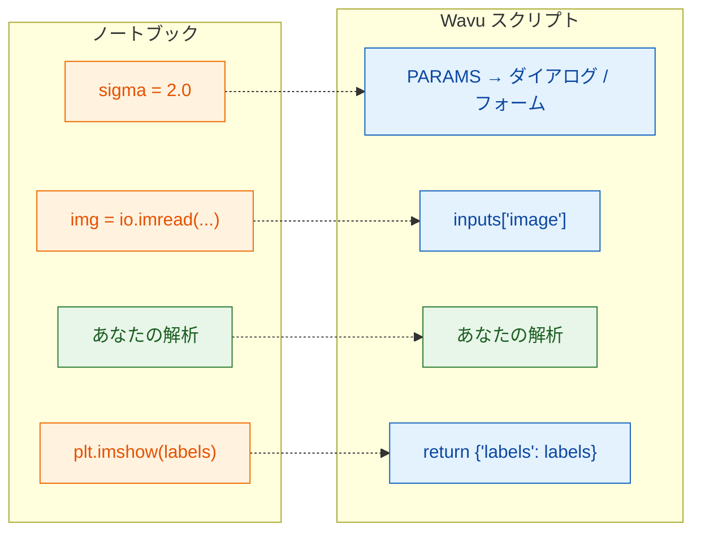

# ノートブックから Wavu へ

## やさしく言うと

ノートブックのセルと Wavu スクリプトは同じ仕事をします。変わるのは
**入口と出口** だけです。ノートブックでは、*あなた* が設定を打ち込み、
ファイルを読み込み、プロットを見ます。Wavu では、ビューアー（**Fiji** または
**napari**）がダイアログやフォームから設定を受け取り、すでに開いている画像を
渡し、あなたが返したものを表示します。真ん中の解析はそのままで、どちらの
ビューアーで実行してもスクリプトも同じです。



## 対応表

| ノートブックでは | `script.py` では | Fiji や napari で見えるもの |
|---|---|---|
| `sigma = 2.0` | `PARAMS` に `"sigma": {"type": "float", "default": 2.0, "label": "Sigma (pixels)"}`、使うときは `params["sigma"]` | Fiji のダイアログ、または napari パネルのフォームにある数値欄 **Sigma (pixels)** |
| `img = io.imread("cells.tif")` | `PARAMS` に `"image": {"type": "image"}`、使うときは `inputs["image"]` | ドロップダウン：開いている画像（Fiji）、または Image と Labels のレイヤー（napari）。選んだものが入力になります |
| `print("found", n)` | `ctx.log(f"found {n}")`（`print` も使えます） | Fiji の **Log** ウィンドウ、または napari パネルのログの 1 行 |
| `plt.imshow(labels)` | `return {"labels": labels}` | *…-labels* という新しい画像ウィンドウ（Fiji）、または Labels レイヤー（napari） |
| `df`（表） | `return {"cells": df}` | Results 表（Fiji）、または表のパネル（napari） |

## 例で見てみる

核をしきい値処理して数える、よくあるノートブックのセルです。

```python
from skimage import io, filters, measure

sigma = 2.0
img = io.imread("nuclei.tif")
smooth = filters.gaussian(img, sigma)
mask = smooth > filters.threshold_otsu(smooth)
labels = measure.label(mask)
print("found", labels.max(), "nuclei")
plt.imshow(labels)
```

同じことを Wavu スクリプトで書きます。`script.py` の中身を次に置き換えます。

```python
"""Count nuclei -- Otsu threshold after a Gaussian blur."""

PARAMS = {
    "image": {"type": "image", "label": "Nuclei image"},
    "sigma": {"type": "float", "default": 2.0, "label": "Sigma (pixels)"},
}


def run(ctx, inputs, params):
    from skimage import filters, measure

    img = inputs["image"]                     # ダイアログ/フォームで選んだ画像
    smooth = filters.gaussian(img, params["sigma"])
    mask = smooth > filters.threshold_otsu(smooth)
    labels = measure.label(mask)
    ctx.log(f"found {labels.max()} nuclei")   # ログに出る
    return {"labels": labels}                 # 新しい画像ウィンドウ / Labels レイヤー
```

これは scikit-image を使うので、先に `pixi.toml` に `scikit-image = "*"`
を足しておきます（[やり方](get-the-template.md#adding-a-package)）。両方の
ファイルを保存し、ワーカーを止めて（[やり方](get-the-template.md#the-everyday-loop)）、
2 次元の画像で実行してみましょう。Fiji なら *Blobs*、napari なら *Coins*
（**File › Open Sample › napari builtins › Coins**）です。

## 3 つのルール

1. **先頭の `PARAMS`** がダイアログ（Fiji）またはフォーム（napari）です。
   各項目が 1 つの入力欄になります。
2. **`def run(ctx, inputs, params):`** で処理をします。画像は `inputs` に、
   その他の設定は `params` に届きます。`ctx` はビューアーへの連絡線
   （ログ、プログレスバー、キャンセル）です。
3. **辞書を返します。** 各キーが結果の名前になり（Fiji は *blobs-labels* の
   ように画像の名前を前に付け、napari はキーをレイヤー名にします）、
   各値はふさわしい形で表示されます。

!!! tip "時間を節約する 2 つの習慣"
    - 上の例のように、**重いパッケージは `run` の中でインポート** します。
      そうすると、大きなインポートを待たずにすぐダイアログやフォームが
      出ます。
    - ユーザーのミスには **分かりやすい言葉でエラーを出します**。たとえば
      `raise ValueError("Please pick a single-channel image")`。Fiji は
      そのメッセージをエラーウィンドウに表示します。napari はパネルのログに
      `Error: …` と書き、通知を出します。

docstring（一番上の三重引用符で囲まれた文章）の 1 行目は Fiji のダイアログと
napari パネルの上部に表示されるので、短い説明にしておきましょう。

## ひとことで言うと

解析はそのままに、設定は `params` から、画像は `inputs` から受け取り、
メッセージは `ctx.log` で書き、見たいものを `return` するだけです。

[次へ：PARAMS = あなたのダイアログ :material-arrow-right:](params.md){ .md-button }
