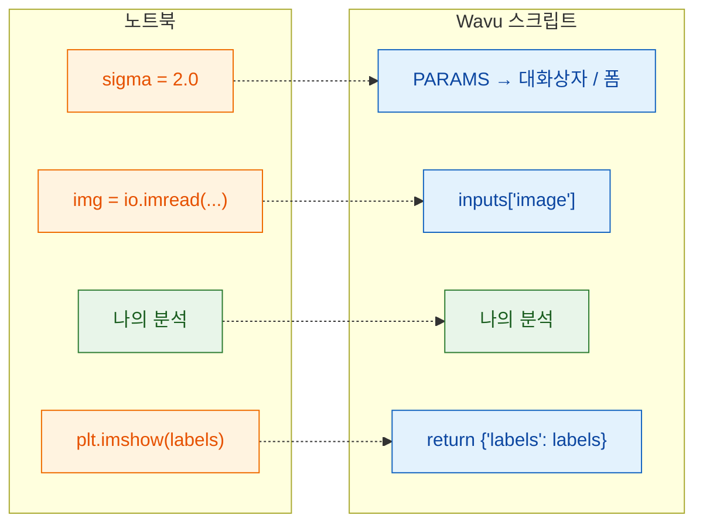

# 노트북에서 Wavu로

## 쉬운 말로 설명하면

노트북 셀과 Wavu 스크립트는 같은 일을 해요. 바뀌는 건 **들어오고 나가는
문**뿐이에요. 노트북에서는 *여러분이* 설정을 입력하고, 파일을 불러오고,
그래프를 봐요. Wavu에서는 뷰어(**Fiji** 또는 **napari**)가 대화상자나
폼으로 설정을 채우고, 이미 열려 있는 이미지를 넘겨주고, 돌려준 것을 보여
줘요. 가운데의 분석은 그대로이고, 어느 뷰어에서 실행하든 스크립트도
그대로예요.



## 바꿔 쓰기 표

| 노트북에서 | `script.py`에서 | Fiji나 napari에서 보이는 것 |
|---|---|---|
| `sigma = 2.0` | `PARAMS`에 `"sigma": {"type": "float", "default": 2.0, "label": "Sigma (pixels)"}`, 그리고 `params["sigma"]` | Fiji 대화상자나 napari 패널 폼의 숫자 입력란 **Sigma (pixels)** |
| `img = io.imread("cells.tif")` | `PARAMS`에 `"image": {"type": "image"}`, 그리고 `inputs["image"]` | 드롭다운: 열린 이미지들(Fiji) 또는 Image와 Labels 레이어들(napari). 고른 것이 입력이 돼요 |
| `print("found", n)` | `ctx.log(f"found {n}")` (`print`도 돼요) | Fiji의 **Log** 창이나 napari 패널 로그의 한 줄 |
| `plt.imshow(labels)` | `return {"labels": labels}` | *…-labels*라는 새 이미지 창(Fiji) 또는 Labels 레이어(napari) |
| `df` (표) | `return {"cells": df}` | Results 표(Fiji) 또는 표 패널(napari) |

## 실제 예

핵을 임계값으로 나누고 세는 흔한 노트북 셀이에요.

```python
from skimage import io, filters, measure

sigma = 2.0
img = io.imread("nuclei.tif")
smooth = filters.gaussian(img, sigma)
mask = smooth > filters.threshold_otsu(smooth)
labels = measure.label(mask)
print("found", labels.max(), "nuclei")
plt.imshow(labels)
```

같은 일을 하는 Wavu 스크립트예요. `script.py`의 내용을 이걸로 바꾸세요.

```python
"""Count nuclei -- Otsu threshold after a Gaussian blur."""

PARAMS = {
    "image": {"type": "image", "label": "Nuclei image"},
    "sigma": {"type": "float", "default": 2.0, "label": "Sigma (pixels)"},
}


def run(ctx, inputs, params):
    from skimage import filters, measure

    img = inputs["image"]                     # 대화상자/폼에서 고른 이미지
    smooth = filters.gaussian(img, params["sigma"])
    mask = smooth > filters.threshold_otsu(smooth)
    labels = measure.label(mask)
    ctx.log(f"found {labels.max()} nuclei")   # 로그에 나와요
    return {"labels": labels}                 # 새 이미지 창 / Labels 레이어
```

scikit-image를 쓰니까 먼저 `pixi.toml`에 `scikit-image = "*"`를 추가하세요
([방법](get-the-template.md#adding-a-package)). 두 파일을 저장하고,
워커를 멈춘 다음([방법](get-the-template.md#the-everyday-loop)), 2-D
이미지에서 실행해 보세요. Fiji에서는 *Blobs*, napari에서는 *Coins*
(**File › Open Sample › napari builtins › Coins**)예요.

## 세 가지 규칙

1. **맨 위의 `PARAMS`**가 대화상자(Fiji) 또는 폼(napari)이에요. 항목
   하나가 입력란 하나가 돼요.
2. **`def run(ctx, inputs, params):`**에서 일이 일어나요. 이미지는
   `inputs`로, 나머지 설정은 `params`로 들어오고, `ctx`는 뷰어와 이어진
   연락선이에요(로그, 진행 표시줄, 취소).
3. **딕셔너리를 돌려주세요.** 키 하나하나가 결과의 이름이 되고
   (Fiji는 *blobs-labels*처럼 이미지 이름을 앞에 붙이고, napari는 키
   이름으로 레이어 이름을 지어요), 값은 알맞은 방식으로 표시돼요.

!!! tip "시간을 아껴 주는 두 가지 습관"
    - 위처럼 **무거운 패키지는 `run` 안에서 import하세요.** 그러면 큰
      import를 기다리지 않고 대화상자나 폼이 바로 나타날 수 있어요.
    - 사용자의 실수에는 **알기 쉬운 오류를 내세요.** 예를 들어
      `raise ValueError("Please pick a single-channel image")`. Fiji는 그
      메시지를 오류 창에 보여 주고, napari는 패널 로그에 `Error: …`를 쓰고
      알림을 띄워요.

docstring(맨 위의 따옴표 세 개 안에 있는 글)의 첫 줄은 Fiji 대화상자와
napari 패널의 맨 위에 나오니, 짧은 설명으로 써 주세요.

## 한 문장으로

분석은 그대로 두고, 설정은 `params`에서, 이미지는 `inputs`에서 가져오고,
메시지는 `ctx.log`로 쓰고, 보고 싶은 것을 `return`하면 돼요.

[다음: PARAMS = 나의 대화상자 :material-arrow-right:](params.md){ .md-button }
