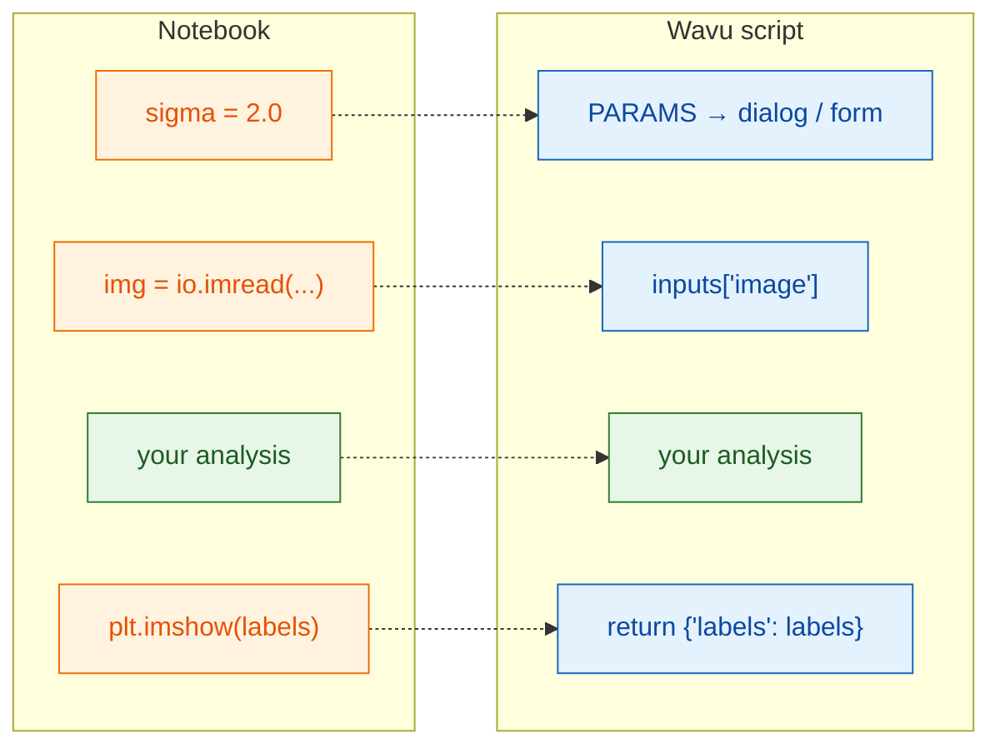

# From notebook to Wavu

## The idea in plain words

A notebook cell and a Wavu script do the same work; only the **doors in and
out** change. In a notebook *you* type the settings, load the file and look
at the plot. In Wavu, the viewer (**Fiji** or **napari**) fills in the
settings from a dialog or form, hands over the image that is already open,
and shows whatever you return. Your analysis in the middle stays the same,
and so does the script, whichever viewer runs it.



## The translation table

| In your notebook | In `script.py` | What you see in Fiji or napari |
|---|---|---|
| `sigma = 2.0` | `"sigma": {"type": "float", "default": 2.0, "label": "Sigma (pixels)"}` in `PARAMS`, then `params["sigma"]` | a number field **Sigma (pixels)** in Fiji's dialog or the napari panel's form |
| `img = io.imread("cells.tif")` | `"image": {"type": "image"}` in `PARAMS`, then `inputs["image"]` | a drop-down: the open images (Fiji) or the Image and Labels layers (napari); the input is the one you choose |
| `print("found", n)` | `ctx.log(f"found {n}")` (`print` also works) | a line in Fiji's **Log** window or the napari panel's log |
| `plt.imshow(labels)` | `return {"labels": labels}` | a new image window called *…-labels* (Fiji) or a Labels layer (napari) |
| `df` (a table) | `return {"cells": df}` | a Results table (Fiji) or a table panel (napari) |

## A worked example

Here is a typical notebook cell that thresholds nuclei and counts them:

```python
from skimage import io, filters, measure

sigma = 2.0
img = io.imread("nuclei.tif")
smooth = filters.gaussian(img, sigma)
mask = smooth > filters.threshold_otsu(smooth)
labels = measure.label(mask)
print("found", labels.max(), "nuclei")
plt.imshow(labels)
```

And the same thing as a Wavu script. Replace the contents of `script.py` with:

```python
"""Count nuclei -- Otsu threshold after a Gaussian blur."""

PARAMS = {
    "image": {"type": "image", "label": "Nuclei image"},
    "sigma": {"type": "float", "default": 2.0, "label": "Sigma (pixels)"},
}


def run(ctx, inputs, params):
    from skimage import filters, measure

    img = inputs["image"]                     # the image chosen in the dialog/form
    smooth = filters.gaussian(img, params["sigma"])
    mask = smooth > filters.threshold_otsu(smooth)
    labels = measure.label(mask)
    ctx.log(f"found {labels.max()} nuclei")   # appears in the log
    return {"labels": labels}                 # new image window / Labels layer
```

This uses scikit-image, so add `scikit-image = "*"` to `pixi.toml` first
([how](get-the-template.md#adding-a-package)). Save both files,
stop the worker ([how](get-the-template.md#the-everyday-loop)), and run it
on a 2-D image: *Blobs* in Fiji, or *Coins* in napari
(**File › Open Sample › napari builtins › Coins**).

## The three rules

1. **`PARAMS` at the top** is the dialog (Fiji) or form (napari). Every
   entry becomes one field.
2. **`def run(ctx, inputs, params):`** is where the work happens. Images
   arrive in `inputs`, the other settings in `params`, and `ctx` is your
   line back to the viewer (log, progress bar, cancel).
3. **Return a dictionary.** Each key becomes the name of a result
   (Fiji adds the image's name in front, as in *blobs-labels*; napari names
   the layer after the key), each value is shown in the right way.

!!! tip "Two habits that save time"
    - **Import heavy packages inside `run`**, as above. The dialog or form
      can then appear at once, without waiting for big imports.
    - **Raise a plain-English error** for user mistakes, for example
      `raise ValueError("Please pick a single-channel image")`. Fiji shows
      the message in an error window; napari writes `Error: …` in the
      panel's log and shows a notification.

The first line of the docstring (the text in triple quotes at the very top)
appears at the top of Fiji's dialog and of the napari panel, so make it a
short description.

## In one sentence

Keep your analysis as it is; just take settings from `params`, the image from
`inputs`, write messages with `ctx.log`, and `return` what you want to see.

[Next: PARAMS = your dialog :material-arrow-right:](params.md){ .md-button }
