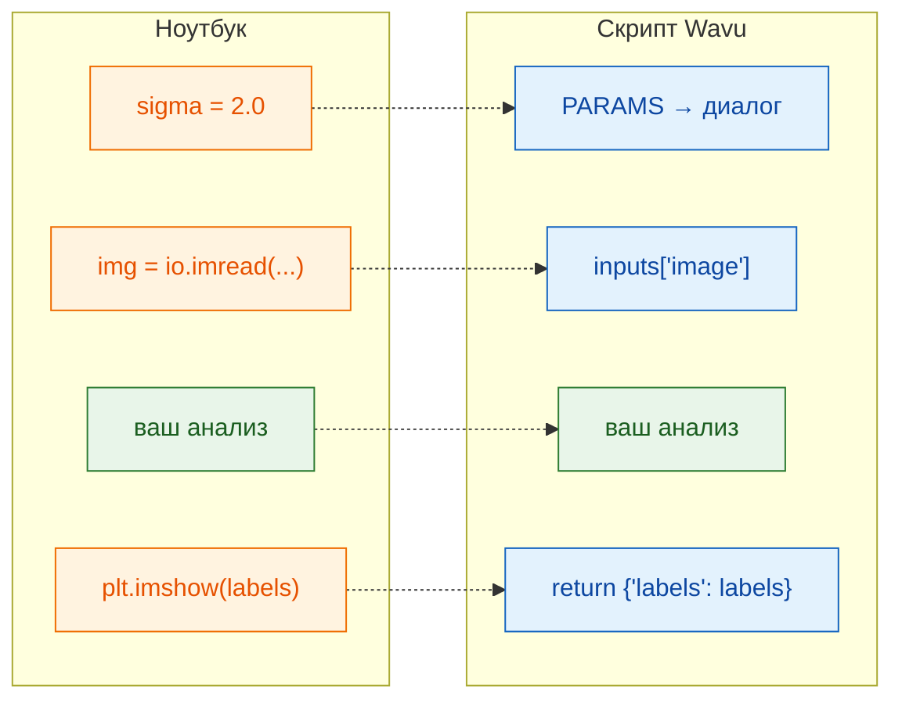

# От ноутбука к Wavu

## Идея простыми словами

Ячейка ноутбука и скрипт Wavu делают одну и ту же работу; меняются только
**двери входа и выхода**. В ноутбуке *вы* вводите настройки, загружаете файл
и смотрите на график. В Wavu **Fiji** берёт настройки из диалога, передаёт
уже открытое изображение и показывает всё, что вы вернёте. Сам анализ
посередине остаётся прежним.



## Таблица перевода

| В ноутбуке | В `script.py` | Что вы видите в Fiji |
|---|---|---|
| `sigma = 2.0` | `"sigma": {"type": "float", "default": 2.0, "label": "Sigma (pixels)"}` в `PARAMS`, затем `params["sigma"]` | числовое поле **Sigma (pixels)** |
| `img = io.imread("cells.tif")` | `"image": {"type": "image"}` в `PARAMS`, затем `inputs["image"]` | выпадающий список открытых изображений |
| `print("found", n)` | `ctx.log(f"found {n}")` (`print` тоже работает) | строка в окне **Log** |
| `plt.imshow(labels)` | `return {"labels": labels}` | новое окно изображения *…-labels* |
| `df` (таблица) | `return {"cells": df}` | таблица Results |

## Разберём пример

Вот типичная ячейка ноутбука, которая пороговой обработкой выделяет ядра и
считает их:

```python
from skimage import io, filters, measure

sigma = 2.0
img = io.imread("nuclei.tif")
smooth = filters.gaussian(img, sigma)
mask = smooth > filters.threshold_otsu(smooth)
labels = measure.label(mask)
print("found", labels.max(), "nuclei")
plt.imshow(labels)
```

А вот то же самое как скрипт Wavu. Замените содержимое `script.py` на:

```python
"""Count nuclei -- Otsu threshold after a Gaussian blur."""

PARAMS = {
    "image": {"type": "image", "label": "Nuclei image"},
    "sigma": {"type": "float", "default": 2.0, "label": "Sigma (pixels)"},
}


def run(ctx, inputs, params):
    from skimage import filters, measure

    img = inputs["image"]                     # изображение, выбранное в диалоге
    smooth = filters.gaussian(img, params["sigma"])
    mask = smooth > filters.threshold_otsu(smooth)
    labels = measure.label(mask)
    ctx.log(f"found {labels.max()} nuclei")   # появляется в Log Fiji
    return {"labels": labels}                 # открывается как новое изображение
```

Здесь используется scikit-image, поэтому сначала добавьте
`scikit-image = "*"` в `pixi.toml` ([как](get-the-template.md#adding-a-package)).
Сохраните оба файла, нажмите **Stop Worker** и запустите на *Blobs*.

## Три правила

1. **`PARAMS` в начале** — это диалог. Каждая запись становится одним полем.
2. **`def run(ctx, inputs, params):`** — здесь делается работа. Изображения
   приходят в `inputs`, остальные настройки — в `params`, а `ctx` — ваша
   связь с Fiji (Log, индикатор прогресса, отмена).
3. **Верните словарь.** Каждый ключ становится именем результата (Fiji
   добавляет спереди имя изображения, как в *blobs-labels*), каждое значение
   показывается подходящим способом.

!!! tip "Две привычки, которые экономят время"
    - **Импортируйте тяжёлые пакеты внутри `run`**, как выше. Тогда Fiji
      сразу покажет диалог, не дожидаясь больших импортов.
    - **Выбрасывайте понятную ошибку** при ошибках пользователя, например
      `raise ValueError("Please pick a single-channel image")`. Fiji покажет
      сообщение в окне ошибки.

Первая строка docstring (текст в тройных кавычках в самом начале файла)
показывается вверху диалога, так что сделайте её кратким описанием.

## Одним предложением

Оставьте анализ как есть; просто берите настройки из `params`, изображение
из `inputs`, пишите сообщения через `ctx.log` и возвращайте через `return`
то, что хотите увидеть.

[Далее: PARAMS = ваш диалог :material-arrow-right:](params.md){ .md-button }
