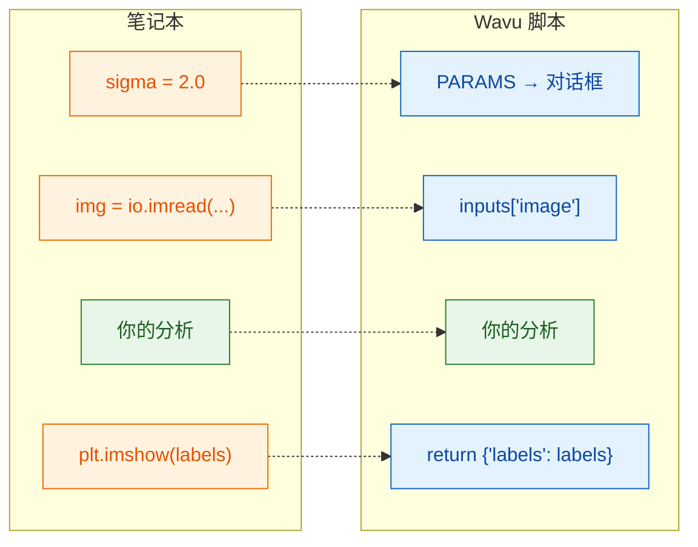

# 从笔记本到 Wavu

## 用大白话说

笔记本里的一个单元格和一个 Wavu 脚本干的是同一件事，只是**进出的门**变了。
在笔记本里，是*你*自己输入参数、读取文件、看图。在 Wavu 里，**Fiji**
通过对话框填好参数，把已经打开的图像交给你，再把你返回的东西显示出来。
中间的分析部分一点都不用改。



## 对照表

| 在笔记本里 | 在 `script.py` 里 | 在 Fiji 里看到的 |
|---|---|---|
| `sigma = 2.0` | 在 `PARAMS` 里写 `"sigma": {"type": "float", "default": 2.0, "label": "Sigma (pixels)"}`，再用 `params["sigma"]` | 一个数字输入框 **Sigma (pixels)** |
| `img = io.imread("cells.tif")` | 在 `PARAMS` 里写 `"image": {"type": "image"}`，再用 `inputs["image"]` | 列出已打开图像的下拉菜单 |
| `print("found", n)` | `ctx.log(f"found {n}")`（`print` 也行） | **Log** 窗口里的一行 |
| `plt.imshow(labels)` | `return {"labels": labels}` | 一个名为 *…-labels* 的新图像窗口 |
| `df`（一张表） | `return {"cells": df}` | 一张 Results 表 |

## 一个完整的例子

下面是一个典型的笔记本单元格：对细胞核做阈值分割并计数：

```python
from skimage import io, filters, measure

sigma = 2.0
img = io.imread("nuclei.tif")
smooth = filters.gaussian(img, sigma)
mask = smooth > filters.threshold_otsu(smooth)
labels = measure.label(mask)
print("found", labels.max(), "nuclei")
plt.imshow(labels)
```

同样的事写成 Wavu 脚本。把 `script.py` 的内容替换成：

```python
"""Count nuclei -- Otsu threshold after a Gaussian blur."""

PARAMS = {
    "image": {"type": "image", "label": "Nuclei image"},
    "sigma": {"type": "float", "default": 2.0, "label": "Sigma (pixels)"},
}


def run(ctx, inputs, params):
    from skimage import filters, measure

    img = inputs["image"]                     # 对话框里选中的图像
    smooth = filters.gaussian(img, params["sigma"])
    mask = smooth > filters.threshold_otsu(smooth)
    labels = measure.label(mask)
    ctx.log(f"found {labels.max()} nuclei")   # 显示在 Fiji 的 Log 里
    return {"labels": labels}                 # 作为新图像打开
```

这里用到了 scikit-image，所以先在 `pixi.toml` 里加上 `scikit-image = "*"`
（[怎么加](get-the-template.md#adding-a-package)）。两个文件都保存，点
**Stop Worker**，然后在 *Blobs* 上运行。

## 三条规则

1. **顶部的 `PARAMS`** 就是对话框。每一项变成一个输入框。
2. **`def run(ctx, inputs, params):`** 是干活的地方。图像在 `inputs` 里，
   其他参数在 `params` 里，`ctx` 是你和 Fiji 之间的联络线（Log、进度条、取消）。
3. **返回一个字典。** 每个键是一个结果的名字（Fiji 会在前面加上图像名，
   比如 *blobs-labels*），每个值会以合适的方式显示。

!!! tip "两个省时间的习惯"
    - **在 `run` 里面再 import 大的包**，就像上面那样。这样 Fiji 能马上弹出对话框，
      不用等大包加载。
    - **用户操作出错时，抛出一句说人话的错误**，比如
      `raise ValueError("Please pick a single-channel image")`。Fiji 会在错误窗口里显示这句话。

docstring（最顶上三引号里的文字）的第一行会显示在对话框顶部，
所以写一句简短的说明就好。

## 一句话总结

分析照旧；只要从 `params` 取参数、从 `inputs` 取图像、用 `ctx.log`
写消息，再 `return` 你想看到的东西。

[下一步：PARAMS = 你的对话框 :material-arrow-right:](params.md){ .md-button }
