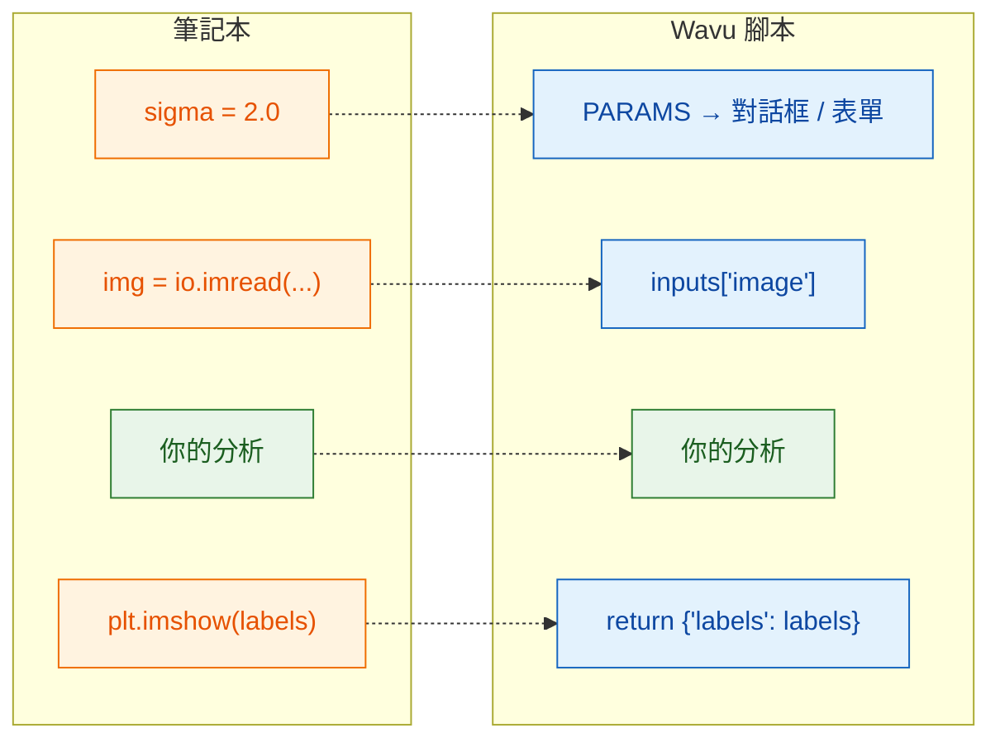

# 從筆記本到 Wavu

## 用白話說

筆記本裡的一個儲存格和一個 Wavu 腳本做的是同樣的工作，只有**進出的門**換了。
在筆記本裡，是*你*自己輸入設定、載入檔案、看圖表。在 Wavu 裡，則是 **Fiji** 或
**napari** 用對話框或表單填好設定、把已經開著的影像交給你，再把你回傳的東西顯示出來。
中間的分析完全不用改；不管由 Fiji 還是 napari 來執行，腳本也都一樣。



## 對照表

| 在筆記本裡 | 在 `script.py` 裡 | 在 Fiji 或 napari 裡看到的 |
|---|---|---|
| `sigma = 2.0` | 在 `PARAMS` 裡寫 `"sigma": {"type": "float", "default": 2.0, "label": "Sigma (pixels)"}`，再用 `params["sigma"]` | Fiji 對話框或 napari 面板表單裡的一個數字欄位 **Sigma (pixels)** |
| `img = io.imread("cells.tif")` | 在 `PARAMS` 裡寫 `"image": {"type": "image"}`，再用 `inputs["image"]` | 一個下拉選單：已開啟的影像（Fiji）或 Image 和 Labels 圖層（napari）；你選的那個就是輸入 |
| `print("found", n)` | `ctx.log(f"found {n}")`（`print` 也可以） | Fiji **Log** 視窗或 napari 面板 log 裡的一行 |
| `plt.imshow(labels)` | `return {"labels": labels}` | 一個名為 *…-labels* 的新影像視窗（Fiji）或一個 Labels 圖層（napari） |
| `df`（一個表格） | `return {"cells": df}` | 一個 Results 表格（Fiji）或一個表格面板（napari） |

## 實際範例

這是一個典型的筆記本儲存格，對細胞核做閾值分割並計數：

```python
from skimage import io, filters, measure

sigma = 2.0
img = io.imread("nuclei.tif")
smooth = filters.gaussian(img, sigma)
mask = smooth > filters.threshold_otsu(smooth)
labels = measure.label(mask)
print("found", labels.max(), "nuclei")
plt.imshow(labels)
```

同樣的事寫成 Wavu 腳本。把 `script.py` 的內容換成：

```python
"""Count nuclei -- Otsu threshold after a Gaussian blur."""

PARAMS = {
    "image": {"type": "image", "label": "Nuclei image"},
    "sigma": {"type": "float", "default": 2.0, "label": "Sigma (pixels)"},
}


def run(ctx, inputs, params):
    from skimage import filters, measure

    img = inputs["image"]                     # 對話框/表單裡選的影像
    smooth = filters.gaussian(img, params["sigma"])
    mask = smooth > filters.threshold_otsu(smooth)
    labels = measure.label(mask)
    ctx.log(f"found {labels.max()} nuclei")   # 出現在 log 裡
    return {"labels": labels}                 # 新影像視窗 / Labels 圖層
```

這裡用到 scikit-image，所以先在 `pixi.toml` 加上 `scikit-image = "*"`
（[做法](get-the-template.md#adding-a-package)）。兩個檔案都儲存，停止 worker
（[做法](get-the-template.md#the-everyday-loop)），然後在一張 2-D 影像上執行：
Fiji 用 *Blobs*，napari 用 *Coins*
（**File › Open Sample › napari builtins › Coins**）。

## 三條規則

1. **最上方的 `PARAMS`** 就是對話框（Fiji）或表單（napari）。每一項變成一個欄位。
2. **`def run(ctx, inputs, params):`** 是真正做事的地方。影像放在 `inputs`，
   其他設定放在 `params`，`ctx` 則是你通往 Fiji 或 napari 的熱線（log、進度條、取消）。
3. **回傳一個字典。** 每個鍵成為一個結果的名稱（Fiji 會在前面加上影像名稱，
   例如 *blobs-labels*；napari 則直接用鍵當圖層名稱），每個值會用合適的方式顯示。

!!! tip "兩個省時間的習慣"
    - **在 `run` 裡面才 import 大型套件**，如上例。這樣對話框或表單能立刻出現，
      不必等大型套件載入。
    - **遇到使用者操作錯誤時，丟出一句白話的錯誤**，例如
      `raise ValueError("Please pick a single-channel image")`。Fiji 會在錯誤視窗裡顯示這段訊息；
      napari 會在面板的 log 裡寫出 `Error: …`，並跳出通知。

docstring（最上方三引號裡的文字）的第一行會顯示在 Fiji 對話框和 napari 面板的頂端，
所以寫一句簡短的說明就好。

## 一句話總結

分析保持原樣；只要從 `params` 取設定、從 `inputs` 取影像、用 `ctx.log`
寫訊息，再 `return` 你想看到的東西。

[下一步：PARAMS = 你的對話框 :material-arrow-right:](params.md){ .md-button }
