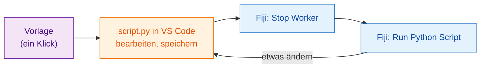

# Die Vorlage holen

[Vorlage in VS Code öffnen](vscode://vscode.git/clone?url=https%3A%2F%2Fgithub.com%2FOxford-Zeiss-Centre-of-Excellence%2FWavu-Script-Template.git){ .md-button .md-button--primary }
[ZIP herunterladen](https://github.com/Oxford-Zeiss-Centre-of-Excellence/Wavu-Script-Template/archive/refs/heads/main.zip){ .md-button }
[Diese Vorlage auf GitHub verwenden](https://github.com/Oxford-Zeiss-Centre-of-Excellence/Wavu-Script-Template/generate){ .md-button }

## Die Idee in einfachen Worten

Niemand schreibt eine Rezeptkarte auf einem leeren Blatt. Die **Vorlage**
ist ein fertiges, funktionierendes Rezept (der Weichzeichner aus
[Ihrem ersten Durchlauf](../start/first-run.md)), das Sie kopieren und dann
ändern. Sie bearbeiten eine einzige Datei, `script.py`, in
[VS Code](https://code.visualstudio.com), einem kostenlosen Code-Editor, und
probieren sie sofort in Fiji aus.



## Was nach dem Klick passiert

1. Ihr Browser fragt, ob er **Visual Studio Code öffnen** darf. Erlauben Sie
   es.
2. VS Code fragt, **wo** der neue Ordner **gespeichert** werden soll. Wählen
   Sie einen Ort wie *Dokumente*.
3. Der Ordner öffnet sich in VS Code, mit `script.py` in der Dateiliste
   links. Wenn VS Code die Python-Erweiterungen vorschlägt, klicken Sie auf
   **Install**.

Dafür müssen **VS Code** und **Git** installiert sein. Wenn nichts
passiert, nehmen Sie **ZIP herunterladen**, entpacken die Datei und wählen
in VS Code **File › Open Folder…** (Ordner öffnen).

*Diese Vorlage auf GitHub verwenden* legt stattdessen Ihre eigene
Online-Kopie an; das ist später praktisch, wenn Sie
[mit der ganzen Welt teilen](../share/with-the-world.md) möchten.

## Was im Ordner liegt

| Datei | Was sie ist |
|---|---|
| `script.py` | **Ihr Rezept.** `PARAMS` (der Dialog) und `run` (die Arbeit). |
| `pixi.toml` | Die Einkaufsliste für die Vorratskammer dieses Skripts. |
| `test_script.py` | Prüfungen, die ohne Fiji laufen. **Hier beginnen** ([zuerst testen](test-without-fiji.md)). |
| `.vscode/` | Macht das [Debuggen in VS Code](../help/debug-in-vscode.md) zu einem Klick. |
| `README.md`, `.github/` | Notizen und automatische Veröffentlichungen ([für Fortgeschrittene](../share/with-the-world.md)). |

## Der Alltags-Kreislauf

1. **Schreiben Sie zuerst die Prüfung** in `test_script.py`: Was soll bei
   einem kleinen ausgedachten Bild herauskommen? Führen Sie `pixi run test`
   aus und sehen Sie zu, wie sie fehlschlägt. ([Zuerst testen](test-without-fiji.md)
   zeigt, wie. Sie können das überspringen, aber es ist dringend empfohlen,
   vor allem wenn ein KI-Assistent den Code schreibt.)
2. **Bearbeiten** Sie `script.py` in VS Code und **speichern** Sie
   (++ctrl+s++, oder ++cmd+s++ auf dem Mac), bis `pixi run test` besteht.
3. Wählen Sie in Fiji **Plugins › Wavu › Stop Worker**.
4. Wählen Sie **Plugins › Wavu › Run Python Script** und dann Ihren Ordner.

!!! warning "Warum Stop Worker?"
    Die Küche liest das Rezept, wenn sie öffnet. Ist sie vom letzten
    Durchlauf noch geöffnet, kocht sie weiter nach dem *alten* Rezept.
    **Stop Worker** schließt sie, damit der nächste Durchlauf Ihre
    gespeicherten Änderungen liest. Das dauert nur eine Sekunde; die
    Vorratskammer bleibt gefüllt.

## Ein Paket hinzufügen { #adding-a-package }

Sie brauchen scikit-image? Öffnen Sie `pixi.toml` und fügen Sie unter
`[dependencies]` eine Zeile hinzu:

```toml
[dependencies]
python = ">=3.10,<3.14"
numpy = ">=1.24"
scipy = ">=1.10"
scikit-image = "*"     # <- neue Zeile: "*" heißt: beliebige Version
```

Speichern, **Stop Worker**, und noch einmal ausführen. Wavu bemerkt die neue
Zeile, und pixi holt das Paket (das Log zeigt es an). Pakete, die es nur auf
PyPI gibt (der Welt von `pip`), gehören stattdessen unter
`[pypi-dependencies]`.

!!! info "Woher kommen die Pakete? conda-forge und PyPI"
    Stellen Sie sich zwei Läden vor. **conda-forge** ist der Laden, in dem pixi zuerst einkauft: ein kostenloser, von der Community betriebener Laden mit fertig gebauten Paketen, auch solchen mit kompilierten Teilen wie numpy, scikit-image oder PyTorch, und sogar Werkzeugen, die gar nicht in Python geschrieben sind. Alles unter `[dependencies]` kommt von dort. **PyPI** ist der Laden von `pip`; einige Pakete gibt es nur dort, und die gehören unter `[pypi-dependencies]`.

    Faustregel: Suchen Sie zuerst auf [conda-forge](https://prefix.dev/channels/conda-forge); fehlt das Paket dort, nehmen Sie PyPI. Die Namen können sich unterscheiden: PyTorch heißt auf conda-forge `pytorch`, auf PyPI aber `torch`.

??? note "Lieber im Terminal?"
    Diese Befehle tun dasselbe wie die Buttons, nur im Terminal:

    ```sh
    git clone https://github.com/Oxford-Zeiss-Centre-of-Excellence/Wavu-Script-Template.git my-analysis
    cd my-analysis
    pixi add scikit-image
    ```

    `pixi add` bearbeitet `pixi.toml` für Sie. Damit `pixi` im Terminal
    funktioniert, installieren Sie es von [pixi.sh](https://pixi.sh); die
    Kopie, die Fiji heruntergeladen hat, liegt nicht im Suchpfad (PATH) des
    Terminals.

## In einem Satz

Ein Klick bringt Ihnen einen funktionierenden Skriptordner; bearbeiten Sie
`script.py` in VS Code und probieren Sie jede Änderung in Fiji mit
**Stop Worker** und **Run Python Script** aus.

[Weiter: zuerst testen :material-arrow-right:](test-without-fiji.md){ .md-button }
