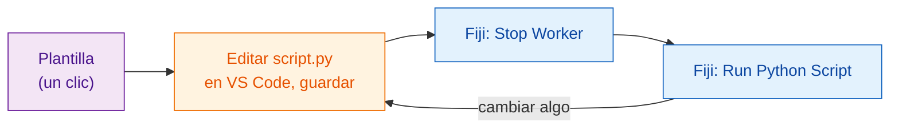

# Consigue la plantilla

[Abrir la plantilla en VS Code](vscode://vscode.git/clone?url=https%3A%2F%2Fgithub.com%2FOxford-Zeiss-Centre-of-Excellence%2FWavu-Script-Template.git){ .md-button .md-button--primary }
[Descargar ZIP](https://github.com/Oxford-Zeiss-Centre-of-Excellence/Wavu-Script-Template/archive/refs/heads/main.zip){ .md-button }
[Usar esta plantilla en GitHub](https://github.com/Oxford-Zeiss-Centre-of-Excellence/Wavu-Script-Template/generate){ .md-button }

## La idea en palabras sencillas

Nadie escribe una receta partiendo de una hoja en blanco. La **plantilla** es
una receta terminada que funciona (el desenfoque de
[tu primera ejecución](../start/first-run.md)) y que copias y luego cambias.
Editas un solo archivo, `script.py`, en [VS Code](https://code.visualstudio.com),
un editor de código gratuito, y lo pruebas enseguida desde Fiji.



## Qué pasa después del clic

1. Tu navegador pregunta si quieres **abrir Visual Studio Code**. Permítelo.
2. VS Code pregunta **dónde guardar** la carpeta nueva. Elige un sitio como
   *Documentos*.
3. La carpeta se abre en VS Code, con `script.py` en la lista de archivos de
   la izquierda. Si VS Code sugiere las extensiones de Python, haz clic en
   **Install**.

Para esto necesitas **VS Code** y **Git** instalados. Si no pasa nada, usa
**Descargar ZIP**, descomprímelo y en VS Code elige **File › Open Folder…**.

*Usar esta plantilla en GitHub* crea en cambio tu propia copia en línea; eso
viene bien más adelante, cuando quieras
[compartir con el mundo](../share/with-the-world.md).

## Qué hay en la carpeta

| Archivo | Qué es |
|---|---|
| `script.py` | **Tu receta.** `PARAMS` (el diálogo) y `run` (el trabajo). |
| `pixi.toml` | La lista de la compra de la despensa de este script. |
| `test_script.py` | Comprobaciones que se ejecutan sin Fiji. **Empieza aquí** ([primero el test](test-without-fiji.md)). |
| `.vscode/` | Hace que [depurar en VS Code](../help/debug-in-vscode.md) sea un clic. |
| `README.md`, `.github/` | Notas y publicaciones automáticas ([avanzado](../share/with-the-world.md)). |

## El ciclo de cada día

1. **Escribe primero la comprobación** en `test_script.py`: ¿qué debería salir
   para una pequeña imagen inventada? Ejecuta `pixi run test` y mira cómo falla.
   ([Primero el test](test-without-fiji.md) explica cómo. Puedes saltártelo,
   pero es muy recomendable, sobre todo cuando un asistente de IA escribe el código.)
2. **Edita** `script.py` en VS Code y **guarda** (++ctrl+s++, o ++cmd+s++ en
   un Mac) hasta que `pixi run test` pase.
3. En Fiji, elige **Plugins › Wavu › Stop Worker**.
4. Elige **Plugins › Wavu › Run Python Script** y escoge tu carpeta.

!!! warning "¿Por qué Stop Worker?"
    La cocina lee la receta al abrir. Si sigue abierta desde la última
    ejecución, sigue cocinando la receta *antigua*. **Stop Worker** la cierra,
    para que la siguiente ejecución lea tus cambios guardados. Solo tarda un
    segundo; la despensa sigue llena.

## Añadir un paquete { #adding-a-package }

¿Necesitas scikit-image? Abre `pixi.toml` y añade una línea bajo
`[dependencies]`:

```toml
[dependencies]
python = ">=3.10,<3.14"
numpy = ">=1.24"
scipy = ">=1.10"
scikit-image = "*"     # <- línea nueva: "*" significa cualquier versión
```

Guarda, **Stop Worker**, y vuelve a ejecutar. Wavu nota la línea nueva y pixi
trae el paquete (el Log lo muestra). Los paquetes que solo existen en PyPI
(el mundo de `pip`) van en `[pypi-dependencies]`.

!!! info "¿De dónde salen los paquetes? conda-forge y PyPI"
    Piensa en dos tiendas. **conda-forge** es la tienda donde pixi compra primero: una tienda gratuita, mantenida por la comunidad, de paquetes ya preparados, incluidos los que llevan partes compiladas como numpy, scikit-image o PyTorch, e incluso herramientas que no son de Python. Todo lo que va en `[dependencies]` sale de ahí. **PyPI** es la tienda de `pip`; algunos paquetes solo están allí, y esos van en `[pypi-dependencies]`.

    Regla práctica: busca primero en [conda-forge](https://prefix.dev/channels/conda-forge); si el paquete no está, usa PyPI. Los nombres pueden cambiar de una tienda a otra: PyTorch se llama `pytorch` en conda-forge, pero `torch` en PyPI.

??? note "¿Prefieres la terminal?"
    Esto hace lo mismo que los botones, en una terminal:

    ```sh
    git clone https://github.com/Oxford-Zeiss-Centre-of-Excellence/Wavu-Script-Template.git my-analysis
    cd my-analysis
    pixi add scikit-image
    ```

    `pixi add` edita `pixi.toml` por ti. Para tener `pixi` en una terminal,
    instálalo desde [pixi.sh](https://pixi.sh); la copia que descargó Fiji no
    está en la ruta (PATH) de la terminal.

## En una frase

Un clic te da una carpeta de script que funciona; edita `script.py` en VS Code
y luego usa **Stop Worker** y **Run Python Script** en Fiji para probar cada
cambio.

[Siguiente: primero el test :material-arrow-right:](test-without-fiji.md){ .md-button }
