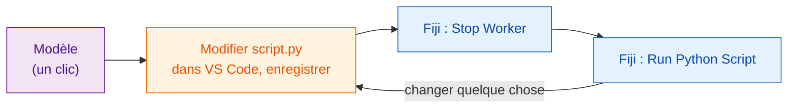
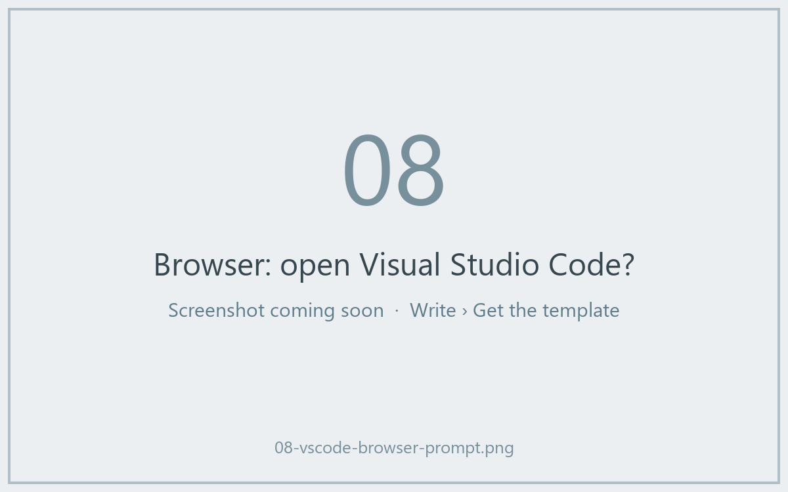
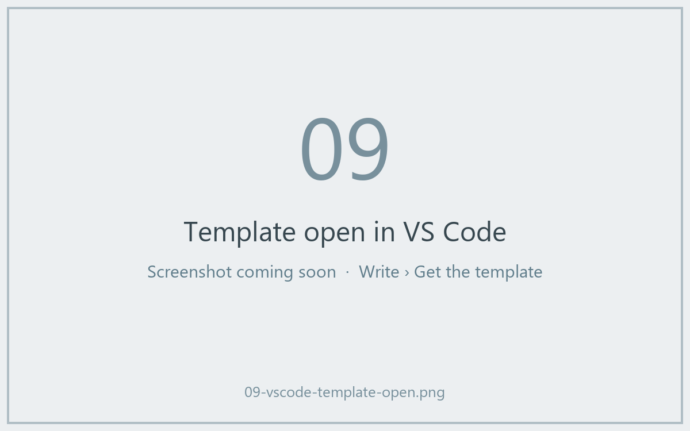

# Récupérer le modèle

[Ouvrir le modèle dans VS Code](vscode://vscode.git/clone?url=https%3A%2F%2Fgithub.com%2FOxford-Zeiss-Centre-of-Excellence%2FWavu-Script-Template.git){ .md-button .md-button--primary }
[Télécharger le ZIP](https://github.com/Oxford-Zeiss-Centre-of-Excellence/Wavu-Script-Template/archive/refs/heads/main.zip){ .md-button }
[Utiliser ce modèle sur GitHub](https://github.com/Oxford-Zeiss-Centre-of-Excellence/Wavu-Script-Template/generate){ .md-button }

## L'idée en mots simples

Personne n'écrit une fiche recette à partir d'une page blanche. Le
**modèle** est une recette finie qui fonctionne (le flou de
[votre première exécution](../start/first-run.md)) que vous copiez puis
modifiez. Vous éditez un seul fichier, `script.py`, dans
[VS Code](https://code.visualstudio.com), un éditeur de code gratuit, et vous
l'essayez tout de suite depuis Fiji.



## Ce qui se passe après le clic

1. Votre navigateur demande s'il faut **ouvrir Visual Studio Code**.
   Acceptez.
2. VS Code demande **où enregistrer** le nouveau dossier. Choisissez un
   endroit comme *Documents*.
3. Le dossier s'ouvre dans VS Code, avec `script.py` dans la liste des
   fichiers à gauche. Si VS Code propose les extensions Python, cliquez sur
   **Install**.

Il faut que **VS Code** et **Git** soient installés. Si rien ne se passe,
utilisez **Télécharger le ZIP**, décompressez-le, et dans VS Code choisissez
**File › Open Folder…** (ouvrir un dossier).





*Utiliser ce modèle sur GitHub* crée plutôt votre propre copie en ligne ;
c'est pratique plus tard, quand vous voudrez
[partager avec le monde](../share/with-the-world.md).

## Ce que contient le dossier

| Fichier | Ce que c'est |
|---|---|
| `script.py` | **Votre recette.** `PARAMS` (la boîte de dialogue) et `run` (le travail). |
| `pixi.toml` | La liste de courses pour le garde-manger de ce script. |
| `test_script.py` | Des vérifications qui tournent sans Fiji. **Commencez ici** ([d'abord le test](test-without-fiji.md)). |
| `.vscode/` | Permet de [déboguer dans VS Code](../help/debug-in-vscode.md) en un clic. |
| `README.md`, `.github/` | Des notes, et les publications automatiques ([avancé](../share/with-the-world.md)). |

## La boucle de tous les jours

1. **Écrivez d'abord la vérification** dans `test_script.py` : que doit-on
   obtenir pour une petite image inventée ? Lancez `pixi run test` et
   regardez-la échouer. ([D'abord le test](test-without-fiji.md) montre
   comment. Vous pouvez sauter cette étape, mais elle est vivement
   recommandée, surtout quand un assistant IA écrit le code.)
2. **Modifiez** `script.py` dans VS Code et **enregistrez** (++ctrl+s++, ou
   ++cmd+s++ sur Mac) jusqu'à ce que `pixi run test` réussisse.
3. Dans Fiji, choisissez **Plugins › Wavu › Stop Worker**.
4. Choisissez **Plugins › Wavu › Run Python Script** et sélectionnez votre
   dossier.

!!! warning "Pourquoi Stop Worker ?"
    La cuisine lit la recette à l'ouverture. Si elle est encore ouverte
    depuis la dernière exécution, elle continue de cuisiner l'*ancienne*
    recette. **Stop Worker** la ferme, pour que l'exécution suivante lise vos
    modifications enregistrées. Cela ne prend qu'une seconde ; le
    garde-manger reste plein.

## Ajouter un paquet { #adding-a-package }

Besoin de scikit-image ? Ouvrez `pixi.toml` et ajoutez une ligne sous
`[dependencies]` :

```toml
[dependencies]
python = ">=3.10,<3.14"
numpy = ">=1.24"
scipy = ">=1.10"
scikit-image = "*"     # <- nouvelle ligne : "*" veut dire n'importe quelle version
```

Enregistrez, faites **Stop Worker**, et relancez. Wavu remarque la nouvelle
ligne et pixi récupère le paquet (le Log l'affiche). Les paquets qui
n'existent que sur PyPI (le monde de `pip`) vont plutôt sous
`[pypi-dependencies]`.

!!! info "D'où viennent les paquets ? conda-forge et PyPI"
    Imaginez deux magasins. **conda-forge** est celui où pixi va d'abord : un magasin gratuit, tenu par la communauté, de paquets prêts à l'emploi, y compris ceux qui contiennent du code compilé comme numpy, scikit-image ou PyTorch, et même des outils qui ne sont pas en Python. Tout ce qui est sous `[dependencies]` vient de là. **PyPI** est le magasin de `pip` ; quelques paquets ne se trouvent que là, et ils vont sous `[pypi-dependencies]`.

    En pratique : cherchez d'abord sur [conda-forge](https://prefix.dev/channels/conda-forge) ; si le paquet n'y est pas, utilisez PyPI. Les noms peuvent différer entre les deux magasins : PyTorch s'appelle `pytorch` sur conda-forge mais `torch` sur PyPI.

??? note "Vous préférez le terminal ?"
    Ces commandes font la même chose que les boutons, dans un terminal :

    ```sh
    git clone https://github.com/Oxford-Zeiss-Centre-of-Excellence/Wavu-Script-Template.git my-analysis
    cd my-analysis
    pixi add scikit-image
    ```

    `pixi add` modifie `pixi.toml` pour vous. Pour avoir `pixi` dans un
    terminal, installez-le depuis [pixi.sh](https://pixi.sh) ; la copie
    téléchargée par Fiji n'est pas dans le chemin (PATH) du terminal.

## En une phrase

Un clic pour obtenir un dossier de script qui fonctionne, modifiez
`script.py` dans VS Code, puis **Stop Worker** et **Run Python Script** dans
Fiji pour essayer chaque changement.

[Suite : d'abord le test :material-arrow-right:](test-without-fiji.md){ .md-button }
