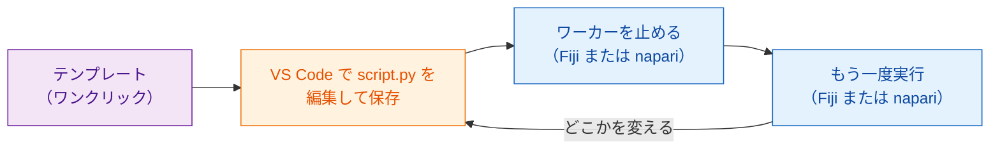

# テンプレートを手に入れる

[VS Code でテンプレートを開く](vscode://vscode.git/clone?url=https%3A%2F%2Fgithub.com%2FOxford-Zeiss-Centre-of-Excellence%2FWavu-Script-Template.git){ .md-button .md-button--primary }
[ZIP をダウンロード](https://github.com/Oxford-Zeiss-Centre-of-Excellence/Wavu-Script-Template/archive/refs/heads/main.zip){ .md-button }
[GitHub でこのテンプレートを使う](https://github.com/Oxford-Zeiss-Centre-of-Excellence/Wavu-Script-Template/generate){ .md-button }

## やさしく言うと

白紙からレシピカードを書く人はいません。**テンプレート** は、完成して
ちゃんと動くレシピ（[Fiji](../fiji/first-run.md) または
[napari](../napari/first-run.md) での最初の実行のぼかし）で、
これをコピーしてから書き換えます。編集するのは `script.py` という 1 つの
ファイルだけです。無料のコードエディター
[VS Code](https://code.visualstudio.com) で編集し、すぐに Fiji や napari
から試せます。テンプレートはどちらのビューアーでも同じです。レシピは 1 つ、
ウェイターは 2 人です。



## クリックした後に起きること

1. ブラウザーが **Visual Studio Code を開くか** を聞いてきます。許可します。
2. VS Code が新しいフォルダーを **どこに保存するか** を聞いてきます。
   *ドキュメント* などを選びます。
3. フォルダーが VS Code で開き、左のファイル一覧に `script.py` が
   見えます。VS Code が Python 拡張機能を勧めてきたら、**Install** を
   クリックします。

これには **VS Code** と **Git** のインストールが必要です。何も起きない
場合は **ZIP をダウンロード** を使って解凍し、VS Code で
**File › Open Folder…**（フォルダーを開く）を選んでください。

*GitHub でこのテンプレートを使う* は、代わりにあなた専用のオンラインの
コピーを作ります。あとで [世界と共有](../fiji/with-the-world.md) したく
なったときに便利です。

## フォルダーの中身

| ファイル | 何か |
|---|---|
| `script.py` | **あなたのレシピ。** `PARAMS`（ダイアログまたはフォーム）と `run`（処理）。 |
| `pixi.toml` | このスクリプトの調理器具のリスト。必要なパッケージです。 |
| `test_script.py` | ビューアーなしで動くチェック。**ここから始めます**（[まずテストから](test-without-fiji.md)）。 |
| `.vscode/` | [VS Code でのデバッグ](../help/debug-in-vscode.md) をワンクリックにします。 |
| `README.md`, `.github/` | メモと、自動リリース（[上級](../fiji/with-the-world.md)）。 |

## いつもの流れ { #the-everyday-loop }

1. `test_script.py` に **まずチェックを書きます**。小さな作り物の画像から
   何が出てくるべきでしょう？ `pixi run test` を実行し、失敗するのを確かめます。
   （やり方は [まずテストから](test-without-fiji.md) にあります。飛ばしても
   構いませんが、特に AI アシスタントがコードを書くときは強くおすすめします。）
2. VS Code で `script.py` を **編集** して **保存** します
   （++ctrl+s++、Mac なら ++cmd+s++）。`pixi run test` が通るまで続けます。
3. **ワーカーを止めて、もう一度実行します。**

    === "Fiji"

        **Plugins › Wavu › Stop Worker** を選び、次に
        **Plugins › Wavu › Run Python Script** を選んでフォルダーを選びます。

    === "napari"

        Wavu パネル（**Plugins › Run Python Script (Wavu)**）で
        **Stop worker** を押し、次に **Start worker** を押してスクリプトを選び、
        **Run** を押します。

!!! warning "なぜワーカーを止めるの？"
    厨房は開店するときにレシピを読みます。前回の実行から開いたままだと、
    *古い* レシピで料理を続けてしまいます。ワーカーを止めて厨房を閉めれば、
    次の実行で保存した変更が読み込まれます。かかるのは 1 秒ほどで、
    調理器具はそろったままです。

## パッケージを追加する { #adding-a-package }

scikit-image が必要ですか？ `pixi.toml` を開き、`[dependencies]` の下に
1 行足します。

```toml
[dependencies]
python = ">=3.10,<3.14"
numpy = ">=1.24"
scipy = ">=1.10"
scikit-image = "*"     # <- 新しい行："*" はどのバージョンでもよいという意味
```

保存してワーカーを止め、もう一度実行します。Wavu が新しい行に気づき、
pixi がパッケージを取ってきます（Fiji の Log または napari パネルのログに
表示されます）。PyPI（`pip` の世界）
にしかないパッケージは、代わりに `[pypi-dependencies]` の下に書きます。

!!! info "パッケージはどこから来るの？ conda-forge と PyPI"
    お店が 2 つあると考えてください。**conda-forge** は pixi が最初に買いに行くお店です。コミュニティが運営する無料のお店で、numpy、scikit-image、PyTorch のようにコンパイル済みの部分を含むパッケージや、Python 以外のツールまで、すぐ使える形でそろっています。`[dependencies]` に書いたものはすべてここから来ます。**PyPI** は `pip` のお店です。ここにしかないパッケージもあり、それは `[pypi-dependencies]` に書きます。

    目安：まず [conda-forge](https://prefix.dev/channels/conda-forge) で探し、なければ PyPI を使います。お店によって名前が違うこともあります。PyTorch は conda-forge では `pytorch`、PyPI では `torch` です。

??? note "ターミナルのほうが好きですか？"
    次のコマンドは、ボタンと同じことをターミナルで行います。

    ```sh
    git clone https://github.com/Oxford-Zeiss-Centre-of-Excellence/Wavu-Script-Template.git my-analysis
    cd my-analysis
    pixi add scikit-image
    ```

    `pixi add` は `pixi.toml` を代わりに書き換えてくれます。napari を
    使っている人は、ターミナルですでに `pixi` を使えます。Fiji を使っている
    人は [pixi.sh](https://pixi.sh) からインストールしてください。Fiji が
    ダウンロードしたものは、ターミナルからは見えません。

## ひとことで言うと

ワンクリックで動くスクリプトフォルダーを手に入れ、VS Code で `script.py`
を編集し、変更を試すたびに Fiji か napari でワーカーを止めてもう一度
実行します。

[次へ：まずテストから :material-arrow-right:](test-without-fiji.md){ .md-button }
