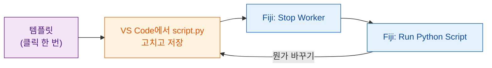

# 템플릿 받기

[VS Code에서 템플릿 열기](vscode://vscode.git/clone?url=https%3A%2F%2Fgithub.com%2FOxford-Zeiss-Centre-of-Excellence%2FWavu-Script-Template.git){ .md-button .md-button--primary }
[ZIP 내려받기](https://github.com/Oxford-Zeiss-Centre-of-Excellence/Wavu-Script-Template/archive/refs/heads/main.zip){ .md-button }
[GitHub에서 이 템플릿 사용하기](https://github.com/Oxford-Zeiss-Centre-of-Excellence/Wavu-Script-Template/generate){ .md-button }

## 쉬운 말로 설명하면

레시피 카드를 빈 종이에서 시작하는 사람은 없어요. **템플릿**은 완성되어
잘 작동하는 레시피([첫 실행](../fiji/first-run.md)의 블러)이고, 이걸
복사해서 고쳐 쓰면 돼요. 무료 코드 편집기인
[VS Code](https://code.visualstudio.com)에서 `script.py` 파일 하나만 고치고,
바로 Fiji에서 시험해 볼 수 있어요.



## 클릭한 뒤에 일어나는 일

1. 브라우저가 **Visual Studio Code를 열지** 물어요. 허용하세요.
2. VS Code가 새 폴더를 **어디에 저장할지** 물어요. *문서* 같은 곳을 고르세요.
3. 폴더가 VS Code에서 열리고, 왼쪽 파일 목록에 `script.py`가 보여요.
   VS Code가 Python 확장을 추천하면 **Install**을 누르세요.

이 과정에는 **VS Code**와 **Git**이 설치되어 있어야 해요. 아무 일도
일어나지 않으면 **ZIP 내려받기**로 받아 압축을 풀고, VS Code에서
**File › Open Folder…**를 고르세요.

*GitHub에서 이 템플릿 사용하기*는 대신 나만의 온라인 사본을 만들어요.
나중에 [전 세계와 공유](../fiji/with-the-world.md)하고 싶을 때 편리해요.

## 폴더 안에 있는 것

| 파일 | 무엇인가요 |
|---|---|
| `script.py` | **나의 레시피.** `PARAMS`(대화상자)와 `run`(실제 작업). |
| `pixi.toml` | 이 스크립트의 창고를 위한 장보기 목록. |
| `test_script.py` | Fiji 없이 돌아가는 검사. **여기서 시작하세요**([테스트 먼저](test-without-fiji.md)). |
| `.vscode/` | [VS Code 디버깅](../help/debug-in-vscode.md)을 클릭 한 번으로 해 줘요. |
| `README.md`, `.github/` | 메모와 자동 릴리스([고급](../fiji/with-the-world.md)). |

## 매일 하는 반복

1. `test_script.py`에 **검사를 먼저 써요**. 작은 지어낸 이미지에서 무엇이
   나와야 하나요? `pixi run test`를 실행해서 실패하는 걸 확인해요.
   ([테스트 먼저](test-without-fiji.md)에서 방법을 보여 줘요. 건너뛰어도
   되지만, 특히 AI 어시스턴트가 코드를 쓸 때는 강력히 추천해요.)
2. VS Code에서 `script.py`를 **고치고 저장**해요(++ctrl+s++, Mac은
   ++cmd+s++). `pixi run test`가 통과할 때까지요.
3. Fiji에서 **Plugins › Wavu › Stop Worker**를 골라요.
4. **Plugins › Wavu › Run Python Script**를 고르고 폴더를 선택해요.

!!! warning "왜 Stop Worker를 하나요?"
    주방은 문을 열 때 레시피를 읽어요. 지난 실행 때부터 계속 열려 있으면
    *옛날* 레시피로 계속 요리해요. **Stop Worker**로 주방을 닫으면 다음
    실행 때 저장한 변경 사항을 읽어요. 1초면 되고, 창고는 그대로 채워져
    있어요.

## 패키지 추가하기 { #adding-a-package }

scikit-image가 필요한가요? `pixi.toml`을 열고 `[dependencies]` 아래에 한 줄을
추가하세요.

```toml
[dependencies]
python = ">=3.10,<3.14"
numpy = ">=1.24"
scipy = ">=1.10"
scikit-image = "*"     # <- 새 줄: "*"는 아무 버전이나 된다는 뜻
```

저장하고, **Stop Worker**를 하고, 다시 실행하세요. Wavu가 새 줄을 알아채고
pixi가 패키지를 가져와요(Log에 나와요). PyPI(`pip`의 세계)에만 있는
패키지는 대신 `[pypi-dependencies]` 아래에 넣으세요.

!!! info "패키지는 어디서 오나요? conda-forge와 PyPI"
    가게가 두 곳 있다고 생각해 보세요. **conda-forge**는 pixi가 먼저 들르는 가게예요. 커뮤니티가 운영하는 무료 가게로, numpy, scikit-image, PyTorch처럼 컴파일된 부분이 있는 패키지와 Python이 아닌 도구까지 바로 쓸 수 있게 갖춰 두었어요. `[dependencies]`에 적은 것은 모두 여기서 와요. **PyPI**는 `pip`의 가게예요. 그곳에만 있는 패키지도 있는데, 그런 것은 `[pypi-dependencies]`에 적어요.

    요령: 먼저 [conda-forge](https://prefix.dev/channels/conda-forge)에서 찾아보고, 없으면 PyPI를 쓰세요. 가게마다 이름이 다를 수 있어요. PyTorch는 conda-forge에서는 `pytorch`, PyPI에서는 `torch`예요.

??? note "터미널이 더 편한가요?"
    버튼과 같은 일을 터미널에서 하려면 이렇게 하세요.

    ```sh
    git clone https://github.com/Oxford-Zeiss-Centre-of-Excellence/Wavu-Script-Template.git my-analysis
    cd my-analysis
    pixi add scikit-image
    ```

    `pixi add`가 `pixi.toml`을 대신 고쳐 줘요. 터미널에서 `pixi`를 쓰려면
    [pixi.sh](https://pixi.sh)에서 설치하세요. Fiji가 내려받은 pixi는
    터미널의 경로에 없어요.

## 한 문장으로

클릭 한 번으로 잘 작동하는 스크립트 폴더를 받고, VS Code에서 `script.py`를
고친 다음, Fiji에서 **Stop Worker**와 **Run Python Script**로 변경 사항을
하나씩 시험하세요.

[다음: 테스트 먼저 :material-arrow-right:](test-without-fiji.md){ .md-button }
