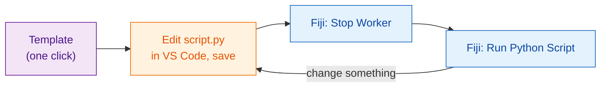
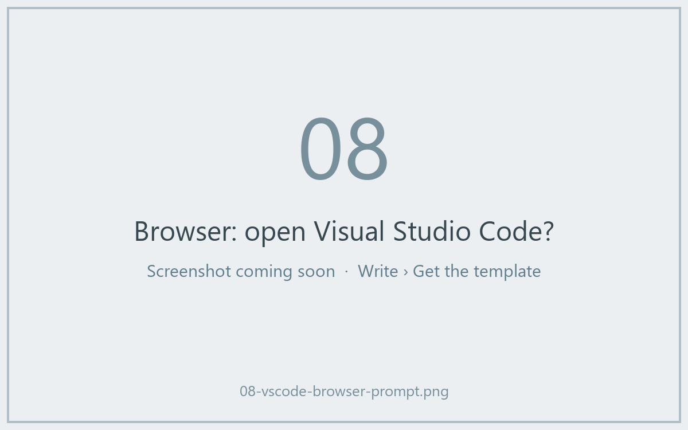
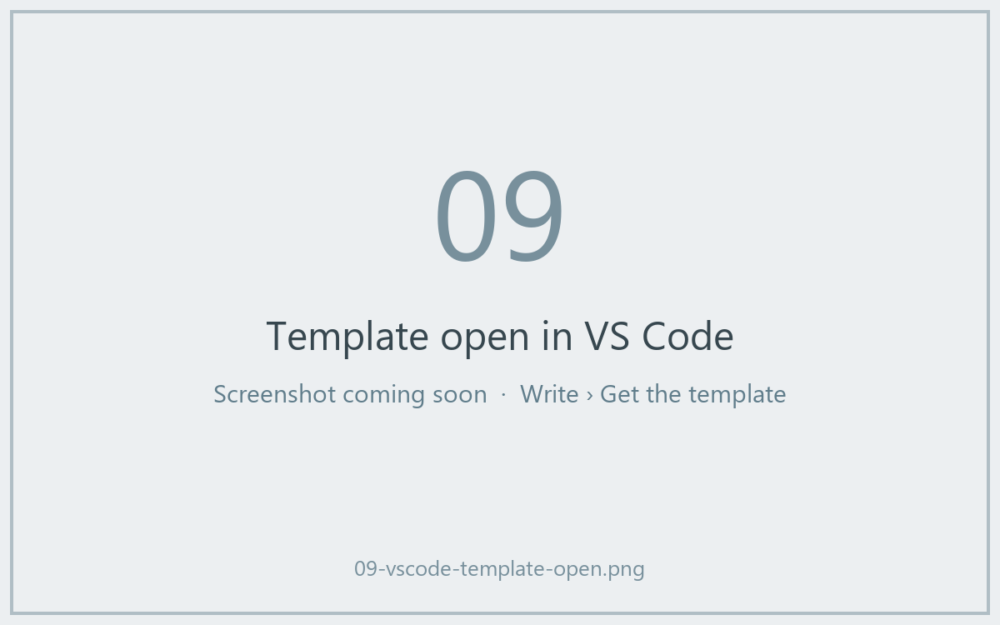

# Get the template

[Open the template in VS Code](vscode://vscode.git/clone?url=https%3A%2F%2Fgithub.com%2FOxford-Zeiss-Centre-of-Excellence%2FWavu-Script-Template.git){ .md-button .md-button--primary }
[Download ZIP](https://github.com/Oxford-Zeiss-Centre-of-Excellence/Wavu-Script-Template/archive/refs/heads/main.zip){ .md-button }
[Use this template on GitHub](https://github.com/Oxford-Zeiss-Centre-of-Excellence/Wavu-Script-Template/generate){ .md-button }

## The idea in plain words

Nobody writes a recipe card from a blank page. The **template** is a
finished, working recipe (the blur from [your first run](../start/first-run.md))
that you copy and then change. You edit one file, `script.py`, in
[VS Code](https://code.visualstudio.com), a free code editor, and try it
straight away from Fiji.



## What happens after the click

1. Your browser asks whether to **open Visual Studio Code**. Allow it.
2. VS Code asks **where to save** the new folder. Pick a place such as
   *Documents*.
3. The folder opens in VS Code, with `script.py` in the file list on the
   left. If VS Code suggests the Python extensions, click **Install**.

This needs **VS Code** and **Git** installed. If nothing happens, use
**Download ZIP**, unzip it, and in VS Code choose **File › Open Folder…**.





*Use this template on GitHub* makes your own online copy instead; that is
handy later, when you want to [share with the world](../share/with-the-world.md).

## What is in the folder

| File | What it is |
|---|---|
| `script.py` | **Your recipe.** `PARAMS` (the dialog) and `run` (the work). |
| `pixi.toml` | The shopping list for this script's pantry. |
| `test_script.py` | Checks that run without Fiji ([optional](test-without-fiji.md)). |
| `.vscode/` | Makes [debugging in VS Code](../help/debug-in-vscode.md) one click. |
| `README.md`, `.github/` | Notes, and automatic releases ([advanced](../share/with-the-world.md)). |

## The everyday loop

1. **Edit** `script.py` in VS Code and **save** (++ctrl+s++, or ++cmd+s++ on a Mac).
2. In Fiji, choose **Plugins › Wavu › Stop Worker**.
3. Choose **Plugins › Wavu › Run Python Script** and pick your folder.

!!! warning "Why Stop Worker?"
    The kitchen reads the recipe when it opens. If it is still open from the
    last run, it keeps cooking the *old* recipe. **Stop Worker** closes it, so
    the next run reads your saved changes. This only takes a second; the
    pantry stays stocked.

## Adding a package

Need scikit-image? Open `pixi.toml` and add one line under
`[dependencies]`:

```toml
[dependencies]
python = ">=3.10,<3.14"
numpy = ">=1.24"
scipy = ">=1.10"
scikit-image = "*"     # <- new line: "*" means any version
```

Save, **Stop Worker**, and run again. Wavu notices the new line and pixi
fetches the package (the Log shows it). Packages that only exist on PyPI
(the `pip` world) go under `[pypi-dependencies]` instead.

??? note "Prefer the terminal?"
    These do the same as the buttons, in a terminal:

    ```sh
    git clone https://github.com/Oxford-Zeiss-Centre-of-Excellence/Wavu-Script-Template.git my-analysis
    cd my-analysis
    pixi add scikit-image
    ```

    `pixi add` edits `pixi.toml` for you. For `pixi` in a terminal, install it
    from [pixi.sh](https://pixi.sh); the copy that Fiji downloaded is not on
    the terminal's path.

## In one sentence

Click once to get a working script folder, edit `script.py` in VS Code, then
**Stop Worker** and **Run Python Script** in Fiji to try each change.

[Next: from notebook to Wavu :material-arrow-right:](from-notebook.md){ .md-button }
