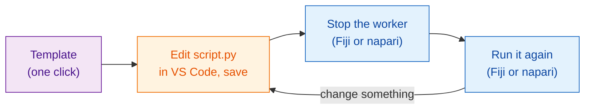

# Get the template

[Open the template in VS Code](vscode://vscode.git/clone?url=https%3A%2F%2Fgithub.com%2FOxford-Zeiss-Centre-of-Excellence%2FWavu-Script-Template.git){ .md-button .md-button--primary }
[Download ZIP](https://github.com/Oxford-Zeiss-Centre-of-Excellence/Wavu-Script-Template/archive/refs/heads/main.zip){ .md-button }
[Use this template on GitHub](https://github.com/Oxford-Zeiss-Centre-of-Excellence/Wavu-Script-Template/generate){ .md-button }

## The idea in plain words

Nobody writes a recipe card from a blank page. The **template** is a
finished, working recipe (the blur from your first run in
[Fiji](../fiji/first-run.md) or [napari](../napari/first-run.md)) that you
copy and then change. You edit one file, `script.py`, in
[VS Code](https://code.visualstudio.com), a free code editor, and try it
straight away from Fiji or napari. It is the same template for both
viewers: one recipe, two waiters.



## What happens after the click

1. Your browser asks whether to **open Visual Studio Code**. Allow it.
2. VS Code asks **where to save** the new folder. Pick a place such as
   *Documents*.
3. The folder opens in VS Code, with `script.py` in the file list on the
   left. If VS Code suggests the Python extensions, click **Install**.

This needs **VS Code** and **Git** installed. If nothing happens, use
**Download ZIP**, unzip it, and in VS Code choose **File › Open Folder…**.

*Use this template on GitHub* makes your own online copy instead; that is
handy later, when you want to [share with the world](../fiji/with-the-world.md).

## What is in the folder

| File | What it is |
|---|---|
| `script.py` | **Your recipe.** `PARAMS` (the dialog or form) and `run` (the work). |
| `pixi.toml` | The kitchenware list for this script: the packages it needs. |
| `test_script.py` | Checks that run without any viewer. **Start here** ([test first](test-without-fiji.md)). |
| `.vscode/` | Makes [debugging in VS Code](../help/debug-in-vscode.md) one click. |
| `README.md`, `.github/` | Notes, and automatic releases ([advanced](../fiji/with-the-world.md)). |

## The everyday loop

1. **Write the check first** in `test_script.py`: what should come out for a
   small made-up image? Run `pixi run test` and watch it fail.
   ([Test first](test-without-fiji.md) shows how. You can skip this, but it
   is strongly recommended, above all when an AI assistant writes the code.)
2. **Edit** `script.py` in VS Code and **save** (++ctrl+s++, or ++cmd+s++ on
   a Mac) until `pixi run test` passes.
3. **Stop the worker and run again:**

    === "Fiji"

        Choose **Plugins › Wavu › Stop Worker**, then
        **Plugins › Wavu › Run Python Script** and pick your folder.

    === "napari"

        In the Wavu panel (**Plugins › Run Python Script (Wavu)**), press
        **Stop worker**, then **Start worker**, pick the script, and press
        **Run**.

!!! warning "Why stop the worker?"
    The kitchen reads the recipe when it opens. If it is still open from the
    last run, it keeps cooking the *old* recipe. Stopping the worker closes
    it, so the next run reads your saved changes. This only takes a second;
    the kitchenware stays set up.

## Adding a package

Need scikit-image? Open `pixi.toml` and add one line under
`[dependencies]`:

```toml
[dependencies]
python = ">=3.10,<3.14"
numpy = ">=1.24"
scipy = ">=1.10"
scikit-image = "*"     # <- new line: "*" means any version
```

Save, stop the worker, and run again. Wavu notices the new line and pixi
fetches the package (Fiji's Log or the napari panel's log shows it). Packages that only exist on PyPI
(the `pip` world) go under `[pypi-dependencies]` instead.

!!! info "Where do packages come from? conda-forge and PyPI"
    Think of two shops. **conda-forge** is the shop pixi visits first: a free, community-run store of ready-built packages, including ones with compiled parts such as numpy, scikit-image or PyTorch, and even tools that are not Python at all. Everything under `[dependencies]` comes from there. **PyPI** is the shop `pip` uses; a few packages are only sold there, and those go under `[pypi-dependencies]`.

    Rule of thumb: search [conda-forge](https://prefix.dev/channels/conda-forge) first; if the package is not there, use PyPI. Names can differ between the two shops: PyTorch is `pytorch` on conda-forge but `torch` on PyPI.

??? note "Prefer the terminal?"
    These do the same as the buttons, in a terminal:

    ```sh
    git clone https://github.com/Oxford-Zeiss-Centre-of-Excellence/Wavu-Script-Template.git my-analysis
    cd my-analysis
    pixi add scikit-image
    ```

    `pixi add` edits `pixi.toml` for you. napari users already have `pixi`
    in the terminal. Fiji users install it from [pixi.sh](https://pixi.sh);
    the copy that Fiji downloaded is not on the terminal's path.

## In one sentence

Click once to get a working script folder, edit `script.py` in VS Code, then
stop the worker and run again, in Fiji or napari, to try each change.

[Next: test first :material-arrow-right:](test-without-fiji.md){ .md-button }
