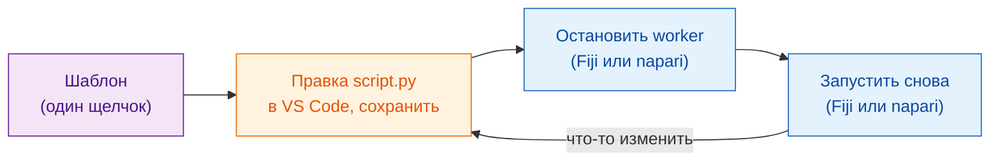

# Получите шаблон

[Открыть шаблон в VS Code](vscode://vscode.git/clone?url=https%3A%2F%2Fgithub.com%2FOxford-Zeiss-Centre-of-Excellence%2FWavu-Script-Template.git){ .md-button .md-button--primary }
[Скачать ZIP](https://github.com/Oxford-Zeiss-Centre-of-Excellence/Wavu-Script-Template/archive/refs/heads/main.zip){ .md-button }
[Использовать шаблон на GitHub](https://github.com/Oxford-Zeiss-Centre-of-Excellence/Wavu-Script-Template/generate){ .md-button }

## Идея простыми словами

Никто не пишет карточку рецепта с чистого листа. **Шаблон** — это готовый,
работающий рецепт (размытие из первого запуска в
[Fiji](../fiji/first-run.md) или [napari](../napari/first-run.md)), который
вы копируете и меняете. Вы правите один файл, `script.py`, в
[VS Code](https://code.visualstudio.com) — бесплатном редакторе кода — и сразу
проверяете его из Fiji или napari. Шаблон один и тот же для обоих
просмотрщиков: один рецепт, два официанта.



## Что происходит после щелчка

1. Браузер спросит, **открыть ли Visual Studio Code**. Разрешите.
2. VS Code спросит, **куда сохранить** новую папку. Выберите место, например
   *Документы*.
3. Папка откроется в VS Code, и слева в списке файлов будет `script.py`.
   Если VS Code предложит расширения для Python, нажмите **Install**.

Для этого нужны установленные **VS Code** и **Git**. Если ничего не
происходит, нажмите **Скачать ZIP**, распакуйте архив и в VS Code выберите
**File › Open Folder…**.

*Использовать шаблон на GitHub* вместо этого создаёт вашу собственную копию
в интернете; это пригодится позже, когда вы захотите
[поделиться со всем миром](../fiji/with-the-world.md).

## Что лежит в папке

| Файл | Что это |
|---|---|
| `script.py` | **Ваш рецепт.** `PARAMS` (диалог или форма) и `run` (работа). |
| `pixi.toml` | Список кухонной утвари этого скрипта: пакеты, которые ему нужны. |
| `test_script.py` | Проверки, которые работают без всякого просмотрщика. **Начните отсюда** ([сначала тест](test-without-fiji.md)). |
| `.vscode/` | Делает [отладку в VS Code](../help/debug-in-vscode.md) делом одного щелчка. |
| `README.md`, `.github/` | Заметки и автоматические релизы ([для продвинутых](../fiji/with-the-world.md)). |

## Повседневный цикл { #the-everyday-loop }

1. **Сначала пишете проверку** в `test_script.py`: что должно получиться для
   маленького придуманного изображения? Запускаете `pixi run test` и видите,
   что она не проходит. ([Сначала тест](test-without-fiji.md) показывает как.
   Этот шаг можно пропустить, но он настоятельно рекомендуется, особенно
   когда код пишет ИИ-ассистент.)
2. **Правите** `script.py` в VS Code и **сохраняете** (++ctrl+s++, или ++cmd+s++
   на Mac), пока `pixi run test` не пройдёт.
3. **Останавливаете worker и запускаете снова:**

    === "Fiji"

        Выберите **Plugins › Wavu › Stop Worker**, затем
        **Plugins › Wavu › Run Python Script** и укажите свою папку.

    === "napari"

        В панели Wavu (**Plugins › Run Python Script (Wavu)**) нажмите
        **Stop worker**, затем **Start worker**, выберите скрипт и нажмите
        **Run**.

!!! warning "Зачем останавливать worker?"
    Кухня читает рецепт, когда открывается. Если она ещё открыта с прошлого
    запуска, она продолжает готовить по *старому* рецепту. Остановка worker
    закрывает её, и следующий запуск прочитает сохранённые изменения. Это
    занимает секунду; кухонная утварь остаётся готовой.

## Добавляем пакет { #adding-a-package }

Нужен scikit-image? Откройте `pixi.toml` и добавьте одну строку в раздел
`[dependencies]`:

```toml
[dependencies]
python = ">=3.10,<3.14"
numpy = ">=1.24"
scipy = ">=1.10"
scikit-image = "*"     # <- новая строка: "*" значит любая версия
```

Сохраните, остановите worker и запустите снова. Wavu заметит новую строку, и
pixi скачает пакет (это видно в Log Fiji или в журнале панели napari).
Пакеты, которые есть только на PyPI (мир `pip`), указываются в
`[pypi-dependencies]`.

!!! info "Откуда берутся пакеты? conda-forge и PyPI"
    Представьте два магазина. **conda-forge** — магазин, куда pixi идёт в первую очередь: бесплатный склад готовых пакетов, который поддерживает сообщество. Там есть и пакеты с компилируемыми частями, как numpy, scikit-image или PyTorch, и даже инструменты не на Python. Всё, что в `[dependencies]`, берётся оттуда. **PyPI** — магазин `pip`; некоторые пакеты есть только там, и их пишут в `[pypi-dependencies]`.

    Простое правило: сначала ищите на [conda-forge](https://prefix.dev/channels/conda-forge); если пакета там нет, берите PyPI. Названия в двух магазинах могут отличаться: PyTorch на conda-forge называется `pytorch`, а на PyPI — `torch`.

??? note "Предпочитаете терминал?"
    Эти команды делают то же, что и кнопки, но в терминале:

    ```sh
    git clone https://github.com/Oxford-Zeiss-Centre-of-Excellence/Wavu-Script-Template.git my-analysis
    cd my-analysis
    pixi add scikit-image
    ```

    `pixi add` сам правит `pixi.toml`. У пользователей napari `pixi` в
    терминале уже есть. Пользователи Fiji устанавливают его с
    [pixi.sh](https://pixi.sh); копия, которую скачал Fiji, терминалу не видна.

## Одним предложением

Один щелчок — и у вас рабочая папка скрипта; правьте `script.py` в VS Code,
а затем остановите worker и запустите снова, в Fiji или napari, чтобы
проверить каждое изменение.

[Далее: сначала тест :material-arrow-right:](test-without-fiji.md){ .md-button }
